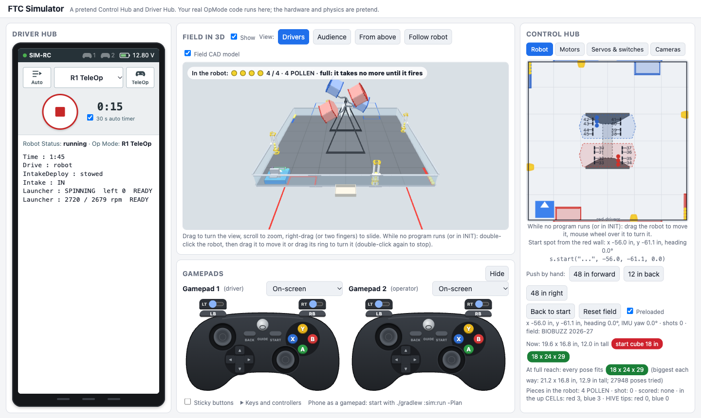

# ftc-helper-lib

> **Work in progress.** This library is new and still changing, and some parts are not yet tested on a
> real robot. Please try it and [tell us what works and what does not](https://github.com/crossbotics/ftc-helper-lib/issues) (a GitHub issue). Every
> report helps.

Shortcuts for programming an FTC robot in Java, made by Indianola Robotics (FTC team 8938).
A **library** is code someone else wrote that your program can use, so you do not write it again.

It takes the jobs every robot needs and makes each one a line or two of clear code: motors and
servos, buttons, mecanum and standard (tank) drive, lifts and arms that cannot hurt themselves,
intakes with jam back-out, a full shooter kit (flywheel, hood, turret, feeder), AprilTag aiming with a
webcam or Limelight 3A, autonomous modes written as a list of steps, live tuning, practice and
competition profiles, a hardware check, and a **simulator** that runs your real code on a laptop with
the field in 3D (see below). It started from our 2025-26 (DECODE) robot code, and is
built to be extended every season.

```java
PositionMotor lift = PositionMotor.create(hardwareMap, "lift")
        .limits(0, 2600).pid(0.004, 0, 0.0002, 0.05)
        .position("DOWN", 0).position("HIGH", 2400);
SpinMotor intake = SpinMotor.create(hardwareMap, "intake").powers(1.0, -0.7);

ControllerBindings controls = new ControllerBindings()
        .bindPress(Pad.G2, Btn.Y, () -> lift.goTo("HIGH"))
        .bindToggle(Pad.G2, Btn.A, intake::in, intake::stop);

// An autonomous is a list of steps:
routine.step("Lift up", lift.startStep("HIGH"))
       .move("To the goal", 24, 0, 0.6)
       .turn("Face it", 45, 0.5)            // mirrored for RED (unless the field is turned, like BIOBUZZ)
       .step("Score", claw.goToStep("OPEN"))
       .thenPark()
       .move("Park", 20, 90, 0.8);
```

New to Java? Do not worry if this looks strange. The [lessons](docs/tutorials/README.md) explain each
line, one at a time.

## Try your robot without a robot: the simulator



Your **real OpMode code** runs on a laptop against a pretend Control Hub and Driver Hub, in a browser.
No robot, no field, no phone needed:

- **The real field in 3D** (BIOBUZZ 2026-27, from the official field CAD), with physics: the robot
  drives, bumps into field parts and pushes game pieces; intakes take them in, launchers shoot them,
  FLOWERs and HIVEs score and tip.
- **Your robot's real size and parts**, made from your `Robot.java` (or your CAD): it checks the start
  cube and the 18 x 24 x 29 in limits in every pose.
- **Drive it** with the keyboard, a real gamepad (USB or Bluetooth) or a phone as a gamepad.
- **See inside**: motors, servos, switches and cameras (with the AprilTags they see), telemetry on the
  Driver Hub, the button map on GUIDE.
- **Place the robot** by dragging it on the map or in 3D; the spot is shown as an autonomous start spot.
- **Scripted tests** (scenario files) that press buttons and check results, to catch mistakes before a
  meeting.

```bash
./gradlew :sim:run
```

Then open http://localhost:8780. Everything else: [the simulator guide](docs/guides/simulator.md) and
the [four BIOBUZZ starter bots](docs/guides/starter-bots.md) to try.

## How it is made: experience plus AI

We believe AI can be an amazing tool, and this library is built to show it. It combines what we have
learned in nearly 30 years of hands-on coding with the power of agentic coding and testing:

- **People set the direction.** An experienced mentor decides what the library must do and how it should
  feel to a student, checks every design, and tries it on real robots with the team.
- **AI agents write and test.** Most of the code, the docs and the tests are written by Claude (Anthropic)
  in Claude Code, working in small, checked steps.
- **Cross-model checking.** Before each release, other models review the work: OpenAI's Codex and a second
  Claude model look for the mistakes the first one missed. Their findings are fixed and listed in the
  [changelog](CHANGELOG.md).
- **Checks on every change:** unit tests, simulator test scripts, a docs check (every public class is
  on a docs page, every link works) and a check that nothing stops the robot's loop.

What this means for you: the code is checked, but it is new, and people and AI both make mistakes. Test it
on your robot, read the code you rely on, and [tell us](https://github.com/crossbotics/ftc-helper-lib/issues) when something is wrong or unclear. For
students: use AI the same way, as a strong helper whose work you check and understand, not as a
replacement for learning.

## Start here

**New to the library?** Read in this order:

1. [Start from zero](docs/start-from-zero.md) (never used Android Studio, or new to Java): install
   Android Studio, get the robot project, put a first program on the robot, and change one line of
   Java safely. Skip it if your robot project already builds and installs.
2. [From Blocks to Java](docs/blocks-to-java.md) (used Scratch or Blocks before): where each block you
   know went, and why you never write the loop.
3. [Quick start](docs/quick-start.md): add the library, get five files, and drive.
4. [Lesson 1: the robot in five files](docs/tutorials/22-robot-in-five-files.md): what each file is for.
5. Lessons 2 to 7 of the [main track](docs/tutorials/README.md#start-here-the-main-track): drive,
   buttons, mechanisms, actions, autonomous, a shooter.

Everything else, by what you want to do:

| I want to... | Read |
| --- | --- |
| **Install Android Studio and get the robot project** (no Java needed) | [Start from zero](docs/start-from-zero.md) |
| Know Scratch or Blocks: see where each block went in Java | [From Blocks to Java](docs/blocks-to-java.md) |
| **Get a robot driving in 30 minutes** (files to copy, the lines to change) | [Quick start](docs/quick-start.md) |
| Add the library to our robot project | [Add it to a project](docs/01-add-to-project.md) |
| **A whole robot program, fast: the robot in five files** (made from your configuration) | [Lesson 1](docs/tutorials/22-robot-in-five-files.md), [robot module](docs/modules/robot.md) |
| **Learn it step by step** (a 7-lesson main track, plus 21 "under the hood" tutorials) | [Tutorials](docs/tutorials/README.md) |
| **Every way a button can work: tap, hold, double-tap, tap then hold, pairs, buzzes** | [The button menu](docs/guides/buttons.md) |
| See how it all fits together | [Architecture](docs/guides/architecture.md) |
| **Write autonomous modes with the builder (every feature, with a tested example)** | [The autonomous builder](docs/guides/autonomous-builder.md) |
| Make autonomous modes the older way (EasyAuto) | [Easy autonomous modes](docs/guides/easy-autos.md) |
| The older six-file starter kit (EasyTeleOp, EasyAuto) | [Starter kit](docs/starter-kit.md) |
| Look up any class or method (searchable) | [Reference](docs/reference.md) |
| Drive + slow mode + intake, ready to copy | [Example: drive and intake](docs/guides/example-drive-intake.md) |
| Keep the loop fast: what blocks and what never does | [Non-blocking code](docs/guides/non-blocking.md) |
| Exactly what runs every loop: order, hub reads and writes, files, statics | [What runs every loop](docs/guides/every-loop.md) |
| Use just the parts you want in your own LinearOpMode (no framework) | [Use only what you need](docs/guides/use-only-what-you-need.md) |
| Practice vs competition behavior | [Profiles](docs/guides/profiles.md) |
| Change numbers while the robot runs | [Tuning](docs/guides/tuning.md) |
| Test the robot (checklists) | [Testing procedures](docs/guides/testing.md) |
| **Try OpModes without a robot (pretend Control Hub + Driver Hub, field in 3D)** | [Simulator](docs/guides/simulator.md) |
| Motors and servos the simulator knows (and how to add your own) | [Parts catalog](docs/guides/parts-catalog.md) |
| Your real robot in the simulator, with an AI agent's help | [Robot-file skill](docs/guides/robot-file-skill.md) |
| Four real BIOBUZZ starter bots to try in the simulator | [Starter bots](docs/guides/starter-bots.md) |
| From your robot's CAD to the simulator (parts, which motor drives what, shot tables) | [CAD tools](tools/cad/README.md), [Launcher program](tools/launcher/README.md) |
| Get ready for a new season | [New season](docs/guides/new-season.md) |
| Add something new to the library | [Extending](docs/guides/extending.md), [Contributing](docs/contributing.md) |
| Get the newest version, or an older one | [Keep it up to date](docs/02-keep-up-to-date.md) |
| Know which way is "positive" | [Signs and units](docs/conventions.md) |
| Fix a problem | [Troubleshooting](docs/troubleshooting.md) |
| Find last season's class | [Coming from last season's code](docs/from-last-season.md) |

## What is inside

Every class and every function is explained in the module pages. A **package** is a folder of Java
classes; its name is how your code finds them (in an `import` line). A **module** here is one part of
the library, with its own docs page. (In the lessons, a module is also a ready-made robot part, like
`Intake` or `Lift`, that you add in `Robot.java`. Neither is a Gradle module.)

| Module | Package | What it does | Docs |
| --- | --- | --- | --- |
| Hardware | `com.crossbotics.ftchelper.hardware` | Set up motors, servos and the IMU in one line. Clear errors for wrong names. Faster loops with bulk reads. | [hardware.md](docs/modules/hardware.md) |
| Gamepad | `com.crossbotics.ftchelper.gamepad` | Press, hold, release, toggle and trigger actions. Stick shaping. Slow-mode trigger. Rumble feedback. | [gamepad.md](docs/modules/gamepad.md) |
| Drive | `com.crossbotics.ftchelper.drive` | Mecanum (robot- and field-centric) and standard/tank drive, standard driver controls, "forward" carried over from autonomous, reverse mode, autonomous moves and turns for both. | [drive.md](docs/modules/drive.md) |
| Mechanism | `com.crossbotics.ftchelper.mechanism` | Lifts/arms to named positions, intakes with jam back-out, servos with positions or degrees, continuous servos. | [mechanism.md](docs/modules/mechanism.md) |
| Launcher | `com.crossbotics.ftchelper.launcher` | Flywheel in RPM, shot table, feeders, turret with safe limits, and a Launcher that only feeds when ready. | [launcher.md](docs/modules/launcher.md) |
| Vision | `com.crossbotics.ftchelper.vision` | AprilTags with a webcam (SDK 12 clusters too) or a Limelight 3A, one interface, safe aiming. | [vision.md](docs/modules/vision.md) |
| Robot | `com.crossbotics.ftchelper.robot` | The robot in five files: Robot.java (what is on it), Tunables.java (its numbers), Controls.java (the buttons and the TeleOp), Actions.java (moves that use several parts) and autos. Ready-made modules: intake, lift, arm, claw, wrist, turret, launcher, indexer, camera. | [robot.md](docs/modules/robot.md) |
| TeleOp | `com.crossbotics.ftchelper.teleop` | EasyTeleOp: a whole TeleOp where you add only your mechanisms and buttons; driving, timer, tuning menu and safety come with it. | [teleop.md](docs/modules/teleop.md) |
| Auto | `com.crossbotics.ftchelper.auto` | Autonomous as a list of named steps; EasyAuto does menu, timer, mirroring, park time, report. | [auto.md](docs/modules/auto.md) |
| Match | `com.crossbotics.ftchelper.match` | Alliance and mirroring, match timer with buzz cues, INIT menu, auto-to-TeleOp memory. | [match.md](docs/modules/match.md) |
| Control | `com.crossbotics.ftchelper.control` | PID controller and slew-rate limiter (ramp). | [control.md](docs/modules/control.md) |
| Telemetry | `com.crossbotics.ftchelper.telemetry` | Driver and debug levels, warnings on top, rate limit; one-line helpers. | [telemetry.md](docs/modules/telemetry.md) |
| Tuning | `com.crossbotics.ftchelper.tuning` | Change numbers live from the gamepad; saved on the hub. | [tuning.md](docs/modules/tuning.md) |
| Safety | `com.crossbotics.ftchelper.safety` | Soft limits, limit switches, homing, slow zones, jam detection. | [safety.md](docs/modules/safety.md) |
| Core | `com.crossbotics.ftchelper.core` | The Subsystem pattern, practice/competition profiles, settings file, RobotConfig (the robot described once). | [core.md](docs/modules/core.md) |
| Testing | `com.crossbotics.ftchelper.testing` | A ready-made Hardware Check OpMode. | [testing.md](docs/modules/testing.md) |
| Finders | `com.crossbotics.ftchelper.finders` | Ready-made OpModes that measure servo ends, lift limits, flywheel gains, wheel size, camera offset and the shot table, and show the code to copy. | [finders.md](docs/modules/finders.md) |
| Util | `com.crossbotics.ftchelper.util` | Math and angle helpers, loop timer, Auto-to-TeleOp pose handoff. | [util.md](docs/modules/util.md) |

Example OpModes you can copy (including the [starter kit](docs/starter-kit.md)) are in [`examples/`](examples/src/main/java/com/crossbotics/ftchelper/examples), and every tutorial's complete program is in [`examples/.../tutorials/`](examples/src/main/java/com/crossbotics/ftchelper/examples/tutorials).

## Works with

- FTC SDK **12.0** (the 2026-27 BIOBUZZ release; built and tested). Older SDKs are not tested, and the
  vision classes need 12.0. See [A new FTC SDK version](docs/02-keep-up-to-date.md#a-new-ftc-sdk-version).
- Android Studio Narwhal 3 Feature Drop or newer (needed by SDK 12.0). OnBot Java and Blocks cannot use a
  library like this.
- Java 8 language level, like the SDK.

## Build and test the library by itself

You only need this if you change the library. From this folder:

```bash
./gradlew :library:testDebugUnitTest :examples:assembleDebug :examples:testDebugUnitTest :sim:testDebugUnitTest
python3 tools/check_docs.py
python3 tools/check_blocking.py
python3 tools/parts_page.py --check
```

You need JDK 17 or newer and the Android SDK (Android Studio installs both). Details: [Contributing](docs/contributing.md).

## Rules check (2026-27 BIOBUZZ manual, TU01)

- **R304:** custom software can be reused year to year, and robot software made before Kickoff
  is allowed. So using this library is fine.
- **R105 B:** the robot must stay inside its size limits **without software**. The soft limits in
  `SafeMotor` help, but every moving part also needs a physical hard stop. Inspectors check the
  maximum mechanical extension.

Read the newest manual and Team Updates each season, and update this section.
