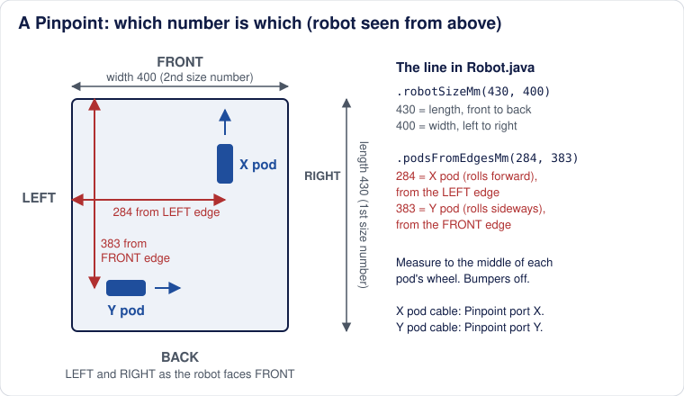

# Add odometry

A sensor that knows where the robot is on the field, so autonomous can drive to field points.

**You need:**

- A robot that drives, with its five files ([The five files](../five-files/README.md)). The drive is
  calibrated (`Tunables.Drive.calibrated = true`, [Drive Tuner](../tuning/08-drive-tuner.md)).
- For `driveTo`: a mecanum drive. A tank robot can still use odometry for `robot.pose()`.
- On the robot, one of these three:
  - **a goBILDA Pinpoint and two pods** (recommended). The Pinpoint goes on an I2C port. In the robot
    configuration it is a "goBILDA® Pinpoint Odometry Computer". Call it `pinpoint`.
  - **a SparkFun OTOS** on an I2C port, 10 to 12 mm above the tiles. In the robot configuration it is a
    "SparkFun OTOS". Call it `otos`.
  - **dead wheels:** three pods (or two and the Control Hub's IMU), each in a motor port's encoder
    connector.

Which one to buy, and how to mount and wire it: [lesson 7, sections 2 and 3](../tutorials/start/07-odometry.md#2-which-one-to-buy).

## 1. What it is

**Odometry** tells the robot its **pose** every loop: where it is (x, y) and which way it faces (heading).

- **Pods** are small free-turning wheels with encoders. Springs press them onto the tiles. One rolls
  forward and back (the **X pod**), one rolls sideways (the **Y pod**).
- **Field numbers are inches, seen from your own drivers' wall**, whatever your alliance. x = inches right of
  the center line. y = inches away from your wall (negative = your half). Heading 0 = facing away from you,
  and a turn to the left is +. See the [field map](../tutorials/start/07-odometry.md#1-why-odometry).
- **It must know where its pods sit.** When the robot turns in place, a pod away from the turn point rolls
  too. The library takes that roll away.
- **It must be checked before it drives.** `driveTo` steps do nothing on the robot until
  `Tunables.Odometry.checked = true`. **Why:** a pod that counts the wrong way would send the robot the
  wrong way at speed.

With odometry, `driveTo` goes to a field point and ends on it, even after a bump or a wheel slip. TeleOp
starts where autonomous ended.

## 2. Add it to the five files

### Robot.java: one line

**Where:** `Robot.java`, in `define()`, right after the `drive(...)` line. Add
`import com.crossbotics.ftchelper.robot.Odometry;` at the top (Alt+Enter on the red name).

Use the line for your kind. Measure with a tape from the robot's **edges**, with the bumpers off. The
library works out the robot's center from the size. The Odometry Tuner then measures the exact numbers.

**A Pinpoint:**

<!-- recipe: odometry-pinpoint -->
```java title="Robot.java"
// After drive(...). The robot's length and width, then where each pod's wheel is, mm:
// the forward pod from the LEFT edge, the sideways pod from the FRONT edge.
odometry(Odometry.pinpoint("pinpoint").robotSizeMm(430, 400).podsFromEdgesMm(284, 383));
```



| Number | What it is | Measure |
| --- | --- | --- |
| `robotSizeMm(430, …)` | the robot's length | front edge to back edge |
| `robotSizeMm(…, 400)` | the robot's width | left edge to right edge |
| `podsFromEdgesMm(284, …)` | the **X pod**: the pod that rolls when the robot drives **forward** | LEFT edge to the middle of its wheel |
| `podsFromEdgesMm(…, 383)` | the **Y pod**: the pod that rolls when the robot drives **sideways** | FRONT edge to the middle of its wheel |

- Plug the X pod (forward) into the Pinpoint's X port, and the Y pod (sideways) into its Y port.
- goBILDA swingarm pods need `.podsSwingarm()` at the end of the line. The default is 4-bar pods.

**An OTOS:**

<!-- recipe: odometry-otos -->
```java title="Robot.java"
// The robot's length and width, then the OTOS's middle from the FRONT and LEFT edges (mm), and its turn.
odometry(Odometry.otos("otos").robotSizeMm(430, 400).mountFromEdgesMm(126, 200, 0));
```

| Number | What it is | Measure |
| --- | --- | --- |
| `robotSizeMm(430, 400)` | length, then width | as for the Pinpoint |
| `mountFromEdgesMm(126, …, …)` | where the OTOS is, front to back | FRONT edge to the middle of the OTOS |
| `mountFromEdgesMm(…, 200, …)` | where the OTOS is, side to side | LEFT edge to the middle of the OTOS |
| `mountFromEdgesMm(…, …, 0)` | the way its arrow points | degrees, see below |

**Careful:** the OTOS line gives FRONT first, then LEFT. The Pinpoint line is the other way around.

The last number is the way the OTOS's arrow points, in degrees (0 = forward, a turn to the left is +).
The tuner cannot measure where an OTOS sits, so these tape numbers stay.

**Dead wheels:**

<!-- recipe: odometry-dead-wheels -->
```java title="Robot.java"
// The configuration names of the motor ports the pods plug into: left, right, sideways pod.
// trackWidthIn: left pod to right pod. perpForwardIn: the sideways pod, 6 in BEHIND the center.
odometry(Odometry.threeWheels("par_left", "par_right", "perp")
        .trackWidthIn(13.2).perpForwardIn(-6));
```

| Number or name | What it is | Measure |
| --- | --- | --- |
| `"par_left"` | the LEFT pod that rolls when the robot drives forward | its motor port's configuration name |
| `"par_right"` | the RIGHT pod that rolls when the robot drives forward | its motor port's configuration name |
| `"perp"` | the pod that rolls when the robot drives sideways | its motor port's configuration name |
| `trackWidthIn(13.2)` | the distance between the two forward pods | the left pod's wheel to the right pod's wheel, inches |
| `perpForwardIn(-6)` | how far the sideways pod is ahead of the robot's middle: **+** = ahead, **−** = behind | do not measure it from the middle (see below) |

**A first `perpForwardIn` from the edges:** (half the robot's length) − (the sideways pod's wheel from the
FRONT edge), in inches. Example: a robot 17 in long with the pod 14.5 in from the front: 8.5 − 14.5 = −6.
The Odometry Tuner then measures the exact number.
- Two pods and the IMU: `Odometry.twoWheels(parallel, perp)` with `.parallelLeftIn(...)` and
  `.perpForwardIn(...)` ([Odometry](../reference/parts/odometry.md#in-robotjava)).

**Dead wheels and the OTOS need the IMU in the drive line** (`.imu(...)` in `drive(...)`). The tuner's
Spin test uses it. The Pinpoint has its own.

### Tunables.java: the check and the reset spot

**Where:** `Tunables.java`, a new section. Its name is always `Odometry`.

<!-- recipe: tunables-reset-spot -->
```java title="Tunables.java"
public static class Odometry {                                  // a fixed name: always Odometry
    public static boolean checked = false;                      // true after the Odometry Tuner's Loop test
    // "Set pose here" (TeleOp: hold gamepad 1 START 1 s on this spot), written for BLUE.
    public static double resetX = -56;                          // inches right of center, - = left
    public static double resetY = -61;                          // inches from center, - = our half
    public static double resetHeading = 0;                      // degrees, 0 = facing the field
    // RED: false = the same numbers from the red wall; true (or left out) = mirrored left-right.
    public static boolean mirrorForRed = false;                 // BIOBUZZ: false
}
```

- `checked`: you set it to `true` by hand, after the tuner's Loop test passes (step 3).
- `resetX`, `resetY`, `resetHeading`: the **reset spot**. When autonomous did not run, TeleOp does not know
  where the robot is. Put the robot on this spot, let go of the sticks, and hold gamepad 1 **START** for
  1 s. Here the spot is your left corner tile, facing the field.
- `mirrorForRed = false` is for BIOBUZZ: its field is turned half a turn, so RED uses the same numbers from
  its own wall.

### Controls.java: show the pose

**Where:** `Controls.java`, inside `buttons(...)`. The reset spot on START works with no line. To check
the odometry, show the pose on the Driver Station:

<!-- recipe: show-pose -->
```java title="Controls.java"
show("Where", () -> String.format(Locale.US, "x %.0f, y %.0f in, heading %.0f",
        robot.pose().x, robot.pose().y, robot.pose().headingDeg));
```

For a second reset spot, or a reset from an action:
[How do I set the pose when autonomous did not run?](../cookbook.md#how-do-i-set-the-pose-when-autonomous-did-not-run).

#### A button that drives to a spot in TeleOp

With odometry, a button can drive the robot to a field spot by itself, for example to park at the end.
**Any drive stick stops it at once**, and the driver has the robot again. It needs a mecanum drive and a
field map, so that it goes around the field parts.

**Where:** `Robot.java`, in `define()`, after the `odometry(...)` line: the field map.

<!-- recipe: field-map -->
```java title="Robot.java"
// After odometry(...). The margin: half the robot's corner to corner size, plus some for drift.
// Each box: two opposite corners, like driveTo's numbers. These are BIOBUZZ's two HIVE frames.
fieldMap(FieldMap.margin(13)
        .keepOut("HIVE frame, near", -19.5, -24.8, 19.5, -15.4)
        .keepOut("HIVE frame, far", -19.5, 15.4, 19.5, 24.8));
```

**Where:** `Controls.java`, inside `buttons(...)`: the button, and a time when it starts by itself.

<!-- recipe: route-button -->
```java title="Controls.java"
// route(...) makes the job. It starts when the button or the time says so.
Runnable park = route("Park", -56, -36, 0, 0.8);
g1.dpadLeft.tap(park).says("drive to the park spot (a drive stick stops it)");
atSecondsLeft(10, park);
```

- `route("Park", -56, -36, 0, 0.8)`: the spot's x, y and heading (field numbers, as in `driveTo`), then the
  top power.
- `atSecondsLeft(10, park)`: it starts with 10 s left. When a driver pushes a stick at that time, it waits
  until the sticks are let go (at most 5 s).
- It drives only after the Drive Tuner and the Odometry Tuner (`calibrated` and `checked` are `true`).

More: [Keep-out boxes and routes](../modules/odometry.md#keep-out-boxes-and-routes).

### Actions.java and autos: drive to field points

**Where:** a file in `autos/`, inside `steps(...)`. It needs a mecanum drive.

<!-- recipe: drive-to -->
```java title="autos/YourAuto.java"
// The start spot (x, y, heading) must be where the robot really stands: the pose starts there.
s.start("Against our wall, in the left corner tile, facing the field", -56, -61, 0)
 .driveTo("To the goal", -30, -30, 45, 0.6)
 .parkWithSeconds(4)
 // The last number: "close enough", in inches (default 1).
 .driveTo("Park", -56, -36, 0, 0.7, 2.0);
```

- `driveTo(label, x, y, heading, power)`: a place on the field, not a distance.
- The numbers in `start(...)` must be where the robot really stands. The pose starts there.

An action can also use the pose. **Where:** `Actions.java`, one method per action.

<!-- recipe: pose-in-action -->
```java title="Actions.java"
/** Runs the intake while the robot is on our half of the field (y below 0). */
public static Action intakeOnOurHalf(Robot r) {
    return Action.named("Intake on our half")
            .then(r.intake::in)
            .waitUntil("past the center line", () -> r.pose().y > 0, 10.0)
            .then(r.intake::stop);
}
```

To drive around field elements (`routeTo`), see
[keep-out boxes and routes](../modules/odometry.md#keep-out-boxes-and-routes).

## 3. Find its numbers

The **Odometry Tuner** is in the **Tune and check** OpMode ([how](../tuning/09-odometry-tuner.md)). You need
a 48 in strip of tape on the floor, with a mark at its start.

1. **Forward 48 in:** it says which way the X pod counts. For "counted BACKWARD", add
   `.reversed("x")` to the odometry line (dead wheels: that pod's port name).
2. **Left 24 in:** it says which way the Y pod counts. For "counted RIGHT", add `.reversed("y")`.
3. **Spin 3+ turns:** it measures where the pods sit, and shows the line to change, for example
   `.offsetsMm(-84.2, -167.5)`. The 1st number is the X pod: mm LEFT of the robot's middle (− = right). The
   2nd is the Y pod: mm AHEAD of the middle (− = behind). With a Pinpoint, write `.offsetsMm(...)` in place of
   `.robotSizeMm(...).podsFromEdgesMm(...)`. Dead wheels get `.trackWidthIn(..).perpForwardIn(..)`.
4. Send the code again.
5. **Loop and back:** drive away at least 24 in and come back onto the mark. Within 1 in and 2 degrees,
   the screen says `Tunables.Odometry: checked = true`. Write it in `Tunables.java`.

An OTOS gets `Tunables.Odometry: linearScalar = ...` from the Forward test.

## 4. Check it, then tune it

**Check it:**

1. Run your TeleOp. Push the robot by hand and watch the `Where` line.
2. Forward must make y go up. Left must make x go down. A turn to the left must make the heading go up.
3. In an autonomous with a `driveTo`, set `Tunables.Drive.maxPower` low (0.4) for the first runs. Put the
   robot exactly on the start spot, and keep a hand on STOP.
4. In INIT, check for `Odometry: Pinpoint ready` (or your kind). Run it. The robot must end within about
   1 in of the point.
5. Run it again, and push the robot gently sideways while it drives. It must come back on course.
6. Set `maxPower` back to `DEFAULT`.

**Tune it** with the [Move Tuner](../tuning/10-move-tuner.md). It makes moves stop where they should and
turns end on their heading. `driveTo` and routes use the same numbers (`moveMinPower`, `slowDownIn`,
`turnMinPower`). With an odometry line, the Move Tuner measures with the odometry, so it sees a skid.
Run its tests in order: Creep, Stops, Turns, Drift, then Move and turn on a mecanum. Put the
`Tunables.Drive:` lines it shows in `Tunables.Drive`.

To try a turn number without a new build, use [Live tuning](../tuning/16-live-tuning.md). The drive's turn
numbers change at the next INIT. Then write the number in `Tunables.Drive`.

## Fix a problem

| Problem | Why, and the fix |
| --- | --- |
| `skipped: Tunables.Odometry.checked is false` in the report | Run the tuner's Loop test, then `checked = true` |
| INIT stops: no `GoBildaPinpointDriver` named `"pinpoint"` | The configuration name and type must match `Robot.java` |
| `Pinpoint: X pod not found: check its cable` | A pod cable is out of the Pinpoint |
| `Pinpoint: calibrating (keep the robot still)` stays | The robot moved in INIT. Keep it still, and INIT again |
| The pose goes the wrong way | A pod is reversed. Forward and Left tests, then `.reversed("x")` or `("y")` |
| x and y look swapped | The X and Y pods are in each other's ports |
| The pose drifts when the robot only turns | The offsets. Run the Spin test |
| INIT stops: `driveTo(...) needs a mecanum drive` | `driveTo` drives sideways. A tank robot uses `turnTo` and `move` |
| It drives to the mirror spot on RED | BIOBUZZ: `mirrorForRed = false` |
| It circles the point or stops just short | Run the [Move Tuner](../tuning/10-move-tuner.md) |
| The report says `NO_ODOMETRY` | The odometry stopped during a `driveTo`. Check the pod and I2C cables |

More: [lesson 7, If something goes wrong](../tutorials/start/07-odometry.md#if-something-goes-wrong).

## Done when

- Pushed by hand, the `Where` line goes the right way.
- The Loop test passed, and `Tunables.Odometry.checked = true`.
- A `driveTo` ends within about 1 in of its point.

---

**Next:** [Make parts work together](10-parts-together.md). For curved paths in autos: [Add Pedro paths](../building-autos/05-pedro-paths.md).

**Look it up:** [Odometry](../reference/parts/odometry.md): every setting, number and command.
