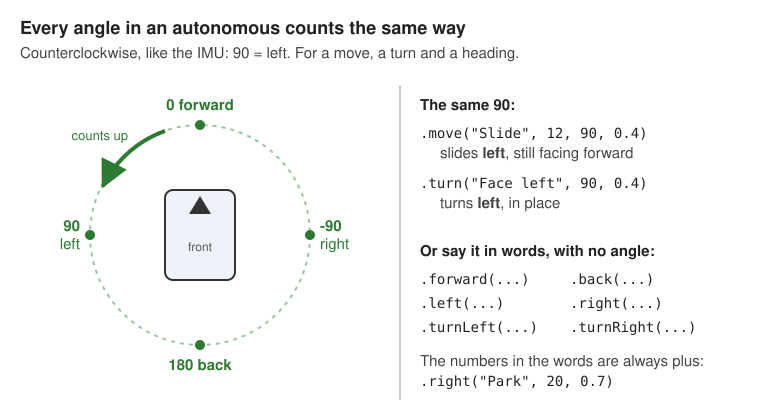
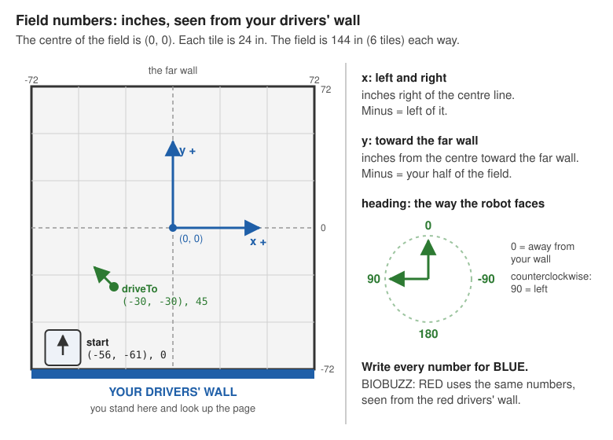

# What an auto can do

Every step you can put in an auto, in groups.

An auto is a **list of steps, read top to bottom**. Each step is one line that starts with a dot. The last
step ends with `;`. Pick the steps your robot needs from the groups below.

## Two kinds of steps

- **A step that waits.** The list waits until the step is done. Then the next step starts.
  A drive waits until the robot is there.
- **A step that does not wait.** It starts something, and the next step starts at once.
  The part keeps working during the next steps. A lift rises while the robot drives.

The **Waits?** column in each table says which kind a step is.

**Every part keeps working during every step.** A wait does not freeze the robot. A lift keeps its height,
and a flywheel keeps its speed.

## The words in every step

Most steps have the same parts, for example this step:

```java
.forward("To the goal", 24, 0.5)
```

| Part | Here | What it is |
| --- | --- | --- |
| The step | `forward` | what the robot does |
| The name | `"To the goal"` | the step's name in the report at the end. Write what the step is for. |
| A number | `24` | how far, in inches. Angles are in degrees, times in seconds. |
| The power | `0.5` | the most power the step may use, 0 to 1 |

**About the power:** a drive slows down near its end, so it does not overshoot. A very small number still
moves the robot: a drive always gets the least power that moves it (`moveMinPower` in `Tunables.Drive`).

**Every angle counts counterclockwise:** 0 = forward, 90 = left, 180 = back, -90 = right. Drives, turns and
headings all count this way. The words (`left`, `turnRight`) need no angle.



**In each group below,** the code comes first. The comment at the end of a line names the numbers in
order. Then a table says what each step does.

**The auto builder** ([page 6](06-auto-builder-steps.md)) makes every step on this page, except the ones
marked "not in the builder".

## Where the robot starts

`start` is the first step. It tells the drive team where to put the robot. It does not move the robot.

```java
s.start("Against our wall, facing the field", 0)    // note, heading
s.start("Our wall, left corner tile", -56, -61, 0)  // note, x, y, heading
```

| Step | What it does |
| --- | --- |
| `start(note, heading)` | The note shows on the Driver Hub in INIT. The heading is the way the robot faces: 0 = away from your drivers. |
| `start(note, x, y, heading)` | The same, plus the spot on the field in inches. The simulator puts the robot there. Odometry starts there. |

### Field numbers

The spot is in **inches on the field**, seen from your drivers' wall, written for BLUE:

- **x**: inches right of the field's center line (minus = left).
- **y**: inches from the center toward the far wall (minus = your half).
- **heading**: the way the robot faces. 0 = away from your wall. Counterclockwise: 90 = left.



`driveTo` and Pedro paths use the same numbers ([below](#drive-to-a-point-on-the-field)).

**Find the numbers:** in the simulator, drag the robot on the field map before ▶. The numbers are under the
map. Or let the auto builder write them ([page 6](06-auto-builder-steps.md#4-the-start-spot-and-the-note)).

## Drive

```java
.forward("To the goal", 24, 0.5)           // name, inches, power
.back("Off the wall", 6, 0.4)              // name, inches, power
.left("Slide over", 12, 0.5)               // name, inches, power
.right("Park", 20, 0.7)                    // name, inches, power
.move("Slide", 12, 45, 0.5)                // name, inches, angle, power
.moveWithTurn("Swing in", 24, 0, 90, 0.5)  // name, inches, angle, heading, power
```

| Step | What it does | Waits? |
| --- | --- | --- |
| `forward`, `back` | Drives forward or backward. | yes |
| `left`, `right` | Slides to the side, still facing the same way. **Mecanum only.** | yes |
| `move` | Drives at an angle. 90 = left. A tank drive can only use 0 and 180. | yes |
| `moveWithTurn` | Drives and turns at the same time. **Mecanum only.** Both angles count from the way the robot faced at the start. | yes |

Write the inches as plus numbers. The word says which way.

**A drive does not fix the heading on the way.** It counts wheel turns only. This is true with odometry
too: only `driveTo` and `follow` use the odometry ([below](#drive-to-a-point-on-the-field)). After a bump
or a long drive, add a `turnTo` to square up.

A drive that cannot finish (stuck on a wall) ends by itself. The report then says `STALLED` or `TIMED_OUT`.

## Turn

```java
.turnLeft("Face the goal", 45, 0.4)   // name, degrees, power
.turnRight("Face the wall", 90, 0.4)  // name, degrees, power
.turn("Face the goal", 45, 0.4)       // name, degrees (90 = left), power
.turnTo("Square up", 0, 0.4)          // name, heading, power
.rememberHeading("Before the shot")   // name
.turnBack("Back as before", 0.4)      // name, power
```

| Step | What it does | Waits? |
| --- | --- | --- |
| `turnLeft`, `turnRight` | Turns in place, this many degrees. | yes |
| `turn` | Turns by an angle. 90 = left, -90 = right. | yes |
| `turnTo` | Turns to a heading. 0 = the way the robot faced at the start. | yes |
| `rememberHeading` | Saves the heading now. | no |
| `turnBack` | Turns back to the saved heading. | yes |

## Wait

```java
.waitSeconds("Let it settle", 0.5)                        // name, seconds
.waitUntil("Lift at the top", robot.lift::isAtTarget, 2)  // name, check, seconds
```

| Step | What it does | Waits? |
| --- | --- | --- |
| `waitSeconds` | Waits this many seconds. | yes |
| `waitUntil` | Waits until the check is true, at most this many seconds. **Not in the builder.** | yes |

`robot.lift::isAtTarget` is a **method reference**: it names the method, and the step calls it later. The
step calls it again and again until it gives true. If the time runs out, the report says `timed out`, and the list goes on.

**Checks you can wait for.** Use the part's name from your `Robot.java` in place of `lift`, `launcher`
and so on:

| Check | True when |
| --- | --- |
| `robot.lift::isAtTarget` | a lift or an arm is at its position. Any part with positions has it. |
| `robot.claw::isClosed` | the claw is closed |
| `robot.launcher::isReady` | the flywheel is at speed, and every other launcher check passes |
| `() -> !robot.launcher.isShooting()` | the launcher has fired everything (`!` = "not") |
| `robot.pieces::isFull` | the robot holds as many pieces as it can |
| `robot.pieces::isEmpty` | the robot holds no pieces |
| `() -> robot.aim().isAimed()` | the robot or the turret is aimed at the goal |

Write a check with a `!` or with `()` in it as a small piece of code (a **lambda**): `() -> ...`.

## Parts and actions

```java
.run("Intake in", robot.intake::in)   // name, command
.action(Actions.scoreHigh(robot), 5)  // action, seconds
.alongside(Actions.fireAll(robot))    // action
```

| Step | What it does | Waits? |
| --- | --- | --- |
| `run` | Starts a part's command. | no |
| `action` | Runs an action, and waits until it is done (at most this many seconds). | yes |
| `alongside` | Starts an action. It runs during the next steps. | no |

- **A command** is one thing a part does: `robot.intake::in`, `robot.claw::close`. A command that needs a
  word or a number is a lambda: `() -> robot.lift.goTo("high")`.
- **An action** is several steps that use parts together. A TeleOp button runs the same action.
- When an action runs out of time, it stops safely, and the report says why.

**Actions you can use:**

| Action | Where it comes from | What it does |
| --- | --- | --- |
| `robot.launcher.fireAllAction()` | the library | fires every piece the robot holds |
| `robot.launcher.fireAction(2)` | the library | fires 2 pieces |
| `robot.launcher.fireAllAction(2250)` | the library | fires every piece, at this flywheel speed (RPM) |
| `robot.launcher.readyAction(3)` | the library | spins up, and is done at speed (at most 3 s) |
| `robot.launcher.ejectAction()` | the library | shoots one piece out slowly, for example a piece of the wrong color |
| `Actions.scoreHigh(robot)`, `Actions.grab(robot)`, ... | your `Actions.java` | what you wrote ([Actions.java](../five-files/04-actions-java.md)) |

You choose the names of the actions in your `Actions.java`. The example robots have
`fireAll`, `scoreHigh`, `grab`, `grabAndLift`, `stow` and more. Copy one and change it.

## Aim and shoot

For a robot with a launcher (a flywheel shooter) or a camera.

```java
.readyToLaunch("Ready", 3)                      // name, seconds
.action(robot.launcher.fireAllAction(), 8)      // action, seconds
.action(robot.launcher.fireAllAction(2250), 8)  // action at 2250 RPM, seconds
.aimAtGoal("Aim", 3)                            // name, seconds
.aimAtGoal("Aim", 4, 45)                        // name, seconds, degrees to look each way
.waitForGoal("See the goal", 5)                 // name, seconds
```

| Step | What it does | Waits? |
| --- | --- | --- |
| `readyToLaunch` | Spins the launcher up and waits until it is at speed. | yes |
| `fireAllAction()` in an `action` | Fires every piece the robot holds. `fireAction(2)` fires 2. | yes |
| `fireAllAction(rpm)` in an `action` | The same, at this flywheel speed. For a robot with no camera that shoots from more than one spot. | yes |
| `aimAtGoal` | Turns the robot to the goal with the camera. With a turret that follows the goal, it waits until the turret is aimed. When no goal is in view, the robot does not turn, and the report says `not seen`. | yes |
| `aimAtGoal` with degrees | The same. When the goal is not in view, it turns slowly up to this many degrees each way to find it. | yes |
| `waitForGoal` | Waits until the camera sees the goal and the goal is still. It does not turn. After this many seconds, it goes on anyway. With no seconds, it waits until the park time. | yes |

To spin up while the robot drives, start it and go on: `.run("Spin up", robot.launcher::spinUp)`.

The auto builder lists the ones your robot can do under **What this robot can do**
([page 6](06-auto-builder-steps.md#1-robot-and-alliance)).

## Drive to a point on the field

For a robot with **odometry** (sensors that track where the robot is on the field).
Page 4 explains them: [Drive to points on the field](04-drive-to-points.md).
The numbers are [field numbers](#field-numbers), like the start spot.

```java
.driveTo("To the goal", -30, -30, 45, 0.6)  // name, x, y, heading, power
.routeTo("Park", -56, -36, 0, 0.8)          // name, x, y, heading, power
.follow("To the goal", TO_GOAL)             // name, Pedro path
```

| Step | What it does | Waits? |
| --- | --- | --- |
| `driveTo` | Drives to a point on the field, and keeps correcting on the way. **Mecanum only.** | yes |
| `routeTo` | The same, but around the field parts you list. **Not in the builder.** | yes |
| `follow` | Follows a curved path with Pedro Pathing. **Mecanum only.** | yes |

## Your own step, and parking

```java
.step("Clear the intake", ctx -> { ... })  // name, your code
.parkWithSeconds(3)                        // seconds
```

| Step | What it does | Waits? |
| --- | --- | --- |
| `step` | Your own code, for what no other step can say. **Not in the builder.** | your code |
| `parkWithSeconds` | Not a move. The steps after it always get the last seconds of the 30. | - |

`step`: [Advanced autos](08-advanced-autos.md#write-your-own-step). `parkWithSeconds`: [page 2](02-put-steps-together.md#keep-time-to-park).

## Try it

Add a turn and a wait to your `FirstAuto.java`. Each new step goes before the `;`:

```java
        s.start("Against our wall, facing the field", 0)
         .forward("Leave the start", 12, 0.4)
         .turnLeft("Face the goal", 45, 0.4)
         .waitSeconds("Let it settle", 0.5)
         .turnTo("Square up", 0, 0.4);
```

Run it in the simulator: pick **Simulator** in the run list next to Android Studio's **Run** button, and
click **Run**. Pick your auto, INIT, ▶.

## Done when

The robot drives, turns left, waits, and turns back. The report at the end says `done` for every step.

## Problems

| Problem | Why, and the fix |
| --- | --- |
| It turns the wrong way | Angles count counterclockwise: 90 = left. Or use the words `turnLeft` and `turnRight`. |
| `Turn first, then move` | A tank drive cannot drive at an angle. Turn, then drive `forward`. |
| `needs a mecanum drive` | `left`, `right`, `moveWithTurn` and `driveTo` slide sideways. A tank drive cannot. |
| `';' expected` | A step line is missing its dot, or the `;` is not after the last step. |
| A step says `timed out` | A wait or an action ran out of time. The list went on. Give it more seconds, or check the part. |

**What each word in the report means** (`done`, `STALLED`, ...): [Match day](09-match-day.md#after-the-match-read-the-report).

---

**Next:** [Put steps together](02-put-steps-together.md).

**Look it up:** [every step](../reference/steps.md#auto). **Go deeper:**
[the cookbook's autonomous recipes](../cookbook.md#autonomous).
