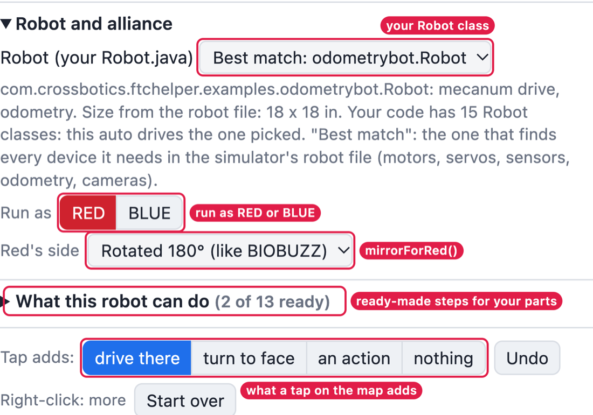
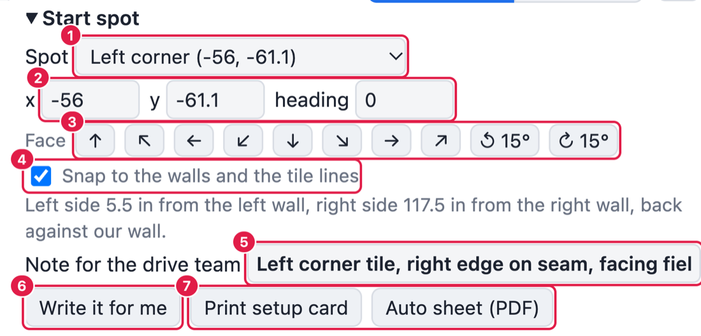
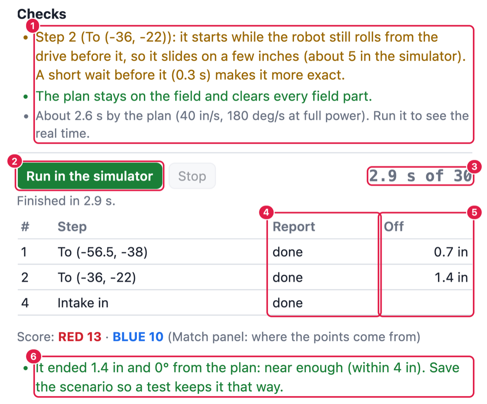
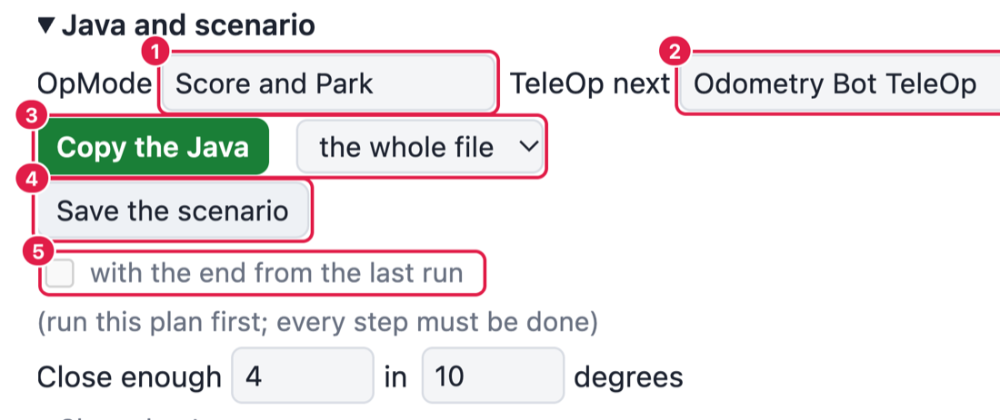

# The auto builder: steps

Build an auto on a picture of the field, run it with your own code, and
copy the Java into your project.

You can come here first, if you like to see the field before you read code. Step 1 uses the red-and-blue
table on [page 2](02-put-steps-together.md#red-and-blue).

The **auto builder** is part of the simulator. You tap the field to add drives, and pick the other steps
from a list. **Run** drives the plan with **your real code**: your `Robot.java`, your parts and your
`Actions.java`. Then you copy the Java.

**Why use it:** you see the route on the field before the robot drives it. The builder checks it against
the field walls, the field parts and the start rules. It also writes the start note for the drive team.

**With no robot code yet:** the [web auto builder](https://crossbotics.com/ftc-helper/path-builder/) is the same
builder in a web page, with no install. It writes the same Java. It cannot run your code.

## Open it

Start the simulator with your own code. In Android Studio, pick **Simulator** in the run list next to the
**Run** button, and click **Run**. Or:

**Where:** Android Studio's **Terminal** tab, in the **`ftc-helper-lib` folder** (type `cd ftc-helper-lib` first). ([Which folder](../setup/09-the-terminal.md#which-folder))

```bash
./gradlew :sim:run
```

Open http://localhost:8780. Press **Auto builder** over the 3D view. It takes the Control Hub panel's place.
Close it with the **x** to get the hub back.

The top of the builder, with a plan on the map. A number on a dark badge is a place the robot drives to. A
letter on an orange diamond is a step that does something:


## 0. Start from an auto you have (optional)

At the top, **Load an existing auto** lists your autos. Pick one and press **Load**. The builder reads
its steps.

- An older auto can name its numbers (`Tunables.Auto.parkInches`, or a name for a number at the top of the
  file). The builder works them out from your code, and lists what it could not read.
- The builder does not change your file. You copy the Java back when you are done ([step 8](#8-copy-the-java)).

## 1. Robot and alliance

- **The robot:** the builder finds your `Robot.java`. Its drive (tank or mecanum), size and parts come from
  your code. When you have more than one Robot class, pick yours in the list.
- **What this robot can do:** a list of the library's ready-made steps for your parts. For example
  **Fire all** and **Ready to launch** with a launcher, **Aim at the goal** with a camera. Each one is
  ready, or says what to add.
- **Run as:** RED or BLUE.
- **Red's side:** **Rotated 180°** (BIOBUZZ) or **Mirrored**. The builder writes `mirrorForRed()` for you
  ([red and blue](02-put-steps-together.md#red-and-blue)).



## 2. Add the steps

Pick **Simple steps** (any drive). Then:

| To add | Do this |
| --- | --- |
| A drive to a spot | Tap the field there. A spot ahead drives forward. A spot behind backs up. |
| A turn to face a spot | Set **Tap adds** to **turn to face**, then tap the spot. |
| Any other step | Press its button: drive, strafe (mecanum), turn, turn to, wait, start something, an action, aim at the goal, ready to launch, wait for the goal, park from here. |
| A step between two | Point between the two steps in the list, and press the **+** there. Press **Done** when you are finished. |

**Change a route on the map:**

- **Drag a point** (the blue dot at the end of a drive). The drive and the turn before it change, and the
  other points stay where they were.
- **Put a point between two:** move the pointer over a drive's line. Click the white dot with the plus to
  split the drive in two.
- **Turn a turn:** drag the yellow knob in front of the robot.
- **Right-click** a point, a line or the field (or press and hold on a touch screen) for a short menu.

**On the map:** a number on a dark badge is a place the robot drives to. An orange diamond with a letter
is a step that does something (an action, start something). The same letter is beside the step in the list.


**A command or an action** opens a list of the ones your code has. Pick one, for example
`Actions.scoreHigh(robot)`, or the library's `robot.launcher.fireAllAction()`.

**A fire action** has a **flywheel** box. Leave it empty for the usual speed. Type a number (RPM) for this
shot's own speed. **Why:** a robot with no camera can shoot from two spots at two speeds.

**Mecanum: turn while driving.** Tick it on a drive to make one step that drives and turns at the same time
(`moveWithTurn`).

**A tank drive cannot slide sideways,** so the builder never makes a strafe for it.

## 3. Edit in 3D (optional)

Tick **Edit in the 3D view**. The same points are balls in the 3D view: drag them, or tap the field to add a
step.

## 4. The start spot and the note

- **Pick a ready-made spot,** or drag the green dot. The robot must touch a field wall. With **Snap** ticked,
  it lines up with the tile seams, so the drive team can copy it by eye.
- **Turn the start** with the yellow knob or the **Face** arrows.
- **The numbers** under the map are [field numbers](01-what-an-auto-can-do.md#field-numbers): x, y and heading.
- **The note** is what the Driver Hub shows in INIT as `Place robot : ...`. **Write it for me** writes it
  from the spot, for example "Our wall, tile 3 from left, centered, facing field". About 50 characters fit
  one line.



1. A ready-made spot.
2. The field numbers: x, y and heading.
3. Which way the robot faces at the start: the arrows, and 15° turns.
4. **Snap:** the robot lines up with the walls and the tile seams.
5. The note for the drive team.
6. **Write it for me:** writes the note from the spot.
7. The pages to print: the setup card and the auto sheet.

The auto sheet (for your partner teams) and the setup card (for your drive team): [Match day](07-match-day.md#show-your-partners-what-your-robot-does).

## 5. Read the checks

Before a run, the builder checks:

- the field walls and field parts along the route,
- the start rules (touching the wall, on your half, inside the 18 in box),
- more than 30 seconds of steps, and the park time,
- names left empty.

The builder guesses the time from simple speed numbers. The run gives the real time.

**A failed check is a warning.** **Run** still works, so you can watch what goes wrong. Fix each warning
before you copy the Java.

## 6. Run it

Press **Run**. The simulator puts the field's pieces back, puts the robot on the start spot, and runs the
plan as a real auto: the INIT menu, the 30 s timer, the park time and the report.

- A **purple robot** drives the plan. Your robot drives beside it. You see where they part.
- The **green line** is the path your robot drove.

To run it again, press **Run** again.

## 7. Read the result




1. **The checks,** before the run. Green: fine. Yellow: advice. Red: a problem to fix.
2. **Run in the simulator.**
3. The run's time, of the 30 seconds.
4. **Report:** each step's word from the report.
5. **Off:** how far from the plan the step ended.
6. The result, and what to do next.

A table shows each step's word from the report (`done`, `STALLED`, `timed out`, ...) and how far off the
plan it ended. **A step can say `done` and still push a field part.** Watch the run. The saved scenario's
`expect bumped none` line checks it ([step 8](#8-copy-the-java)). Under the table, **what to change** lists
changes to try. Some changes have an **Apply** button, for example a short wait after a drive, so the robot
stops rolling before it turns. Press **Run** again to check.

## 8. Copy the Java



1. **OpMode:** the auto's name on the Driver Hub.
2. **TeleOp next:** the TeleOp the Driver Hub picks after the auto.
3. **Copy the Java:** the whole file, or only the steps.
4. **Save the scenario:** a test file for this auto.
5. **With the end from the last run:** the test also checks where the robot ended.

- **Copy the Java:** the whole file. Make a new file in your `autos` folder. Its name is the name after
  `public class` in the copied Java. Paste the Java in.
- **After Load:** the copy is **only the steps**. Paste them over everything inside `steps(...)` in your file.
  Your file keeps its comments and its other methods.
  **First read the list of what Load did not carry over.** The copy leaves out menus (`menuChoice`, `onlyIf`),
  your own steps and `waitUntil`. When you paste over them, they are gone: a park that ran for one choice
  then runs every time. Put them back in your file by hand.
- **Save the scenario:** a test file that checks the note, the start spot, that each step is `done`, and
  where the robot ends. Tick **with the end from the last run** to check the end your robot reached in
  the run. ([Scenario files](../guides/simulator.md#scenario-files-test-without-a-browser).)

Then stop the simulator (the red Stop button, or **Ctrl+C** in the Terminal) and start it again. Your new
auto is in the Driver Hub list, like any auto.

The builder keeps your plan in this browser.

## What it cannot do

- Menus: `menuChoice`, `menuYesNo`, `onlyIf` ([Advanced autos](06-advanced-autos.md#add-choices-to-the-init-menu)).
- A number that differs for RED, `alliance().pick` ([Advanced autos](06-advanced-autos.md#a-different-number-for-red)).
- `waitUntil` and your own steps, `step(...)` ([Advanced autos](06-advanced-autos.md#wait-until-a-part-is-ready)).
- Pieces in `Routes.java` ([Advanced autos](06-advanced-autos.md#routes)). **Load** cannot read an
  auto made from them.
- `routeTo` ([page 5](05-auto-builder-odometry-and-pedro.md#go-around-field-parts-routeto)).
- A command that is not a part's method or an action, like two calls in one. Write it as a method in
  `Robot.java` or `Actions.java`, and pick that method.

**Why learn the file too:** you change autos at events, often in a hurry, and the builder does not do
everything.

## Done when

- You built an auto in the builder, and **Run** shows `done` for every step.
- You copied it into your `autos` folder, built the project, and it runs from the Driver Hub list in the
  simulator.

## Problems

| Problem | Why, and the fix |
| --- | --- |
| It found the wrong Robot class | Pick yours in the robot list (step 1). |
| **Run** is off | Your robot cannot do this mode (for example a Pedro path with no `follower(...)` line), or the Pedro path is empty. Read the message above **Run**. |
| `Robot.java has no part called ...` | The command names a part your robot does not have. Pick one from the list. |
| The real robot ends far from the plan | Tune the drive first ([Drive Tuner](../five-files/05-autos.md#tune-the-drive-first)). The builder's purple robot drives perfectly. Your robot does not. |
| A new auto is not on the Driver Hub | The simulator reads your code when it starts. Stop it (the red Stop button, or **Ctrl+C** in the Terminal) and start it again. |

---

**Next:** [The auto builder: odometry and Pedro](05-auto-builder-odometry-and-pedro.md).

**Look it up:** [the auto builder, every detail](../guides/simulator.md#the-auto-builder).
