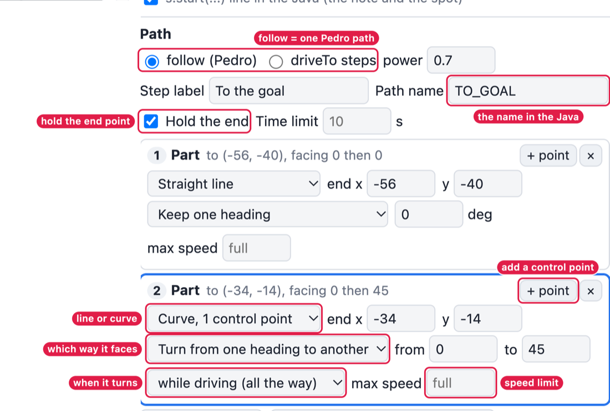
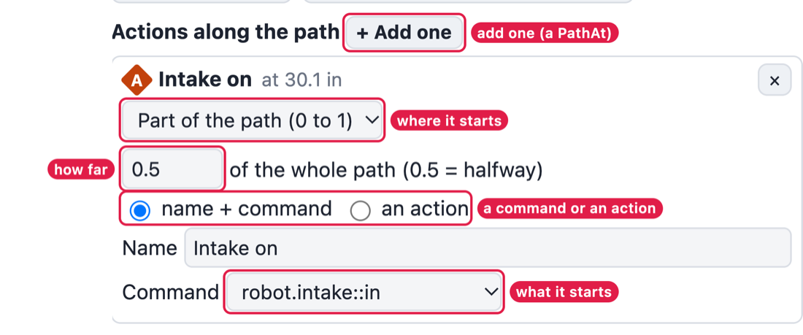

# The auto builder: odometry and Pedro

**Building autos, page 5 of 7.** Drive to points on the field, go around field parts, and follow curved
paths.

**Before this:** [The auto builder: steps](04-auto-builder-steps.md). Your robot has odometry: the
`odometry(...)` line in `Robot.java`, and the Odometry Tuner passed. Lesson 7 adds both
([Odometry](../tutorials/start/07-odometry.md)).

**Odometry** is a sensor set (a Pinpoint, an OTOS, or dead wheels) that tracks where the robot is on the
field, all the time. With it, a step can say **where to go** on the field, not only how far to drive.

## Drives and points: the difference

| | `forward`, `turn`, ... (pages 1 to 4) | `driveTo` (this page) |
| --- | --- | --- |
| You say | "24 in forward from here" | "go to x -30, y -30, facing 45" |
| On the way | it does not correct | it checks where the robot is, and corrects all the time |
| After a bump or wheel slip | every later step is off | the robot still ends at the point |
| You change one step | the steps after it move too | the other points stay where they are |
| Needs | any drive | odometry, and a **mecanum** drive |

## Field numbers

Every point uses the same **field numbers** as the start spot: x, y and heading, in inches and degrees,
seen from your drivers' wall, written for BLUE. The picture and the words: [page 1, field
numbers](01-what-an-auto-can-do.md#field-numbers).

**Give the spot** in every auto that uses `driveTo`: `start(note, x, y, heading)`. The odometry starts
there. Without a spot, the odometry starts at (0, 0), and every point is wrong.

**Find the numbers:** in the simulator, drag the robot on the field map before ▶. The numbers are under the
map. Or use the auto builder (below): it writes them for you.

## Drive to a point: driveTo

The odometry robot's auto, a compiled file in the library:
[`odometrybot/autos/ToTheGoal.java`](../../examples/src/main/java/com/crossbotics/ftchelper/examples/odometrybot/autos/ToTheGoal.java).

```java
        s.start("Against our wall, in the left corner tile, facing the field", -56, -61, 0)
         .run("Intake on", robot.intake::in)
         .driveTo("To the goal", -30, -30, 45, 0.6)    // x, y, heading, power
         .run("Intake off", robot.intake::stop)
         .parkWithSeconds(4)
         .driveTo("Park", -56, -36, 0, 0.7);
```

- `driveTo(name, x, y, heading, power)`: drives and turns at the same time, to the point and the heading.
  The step is done when the robot is within 1 inch and 2 degrees.
- `driveTo(name, x, y, heading, power, inches)`: your own "close enough", in inches. Use a larger number for a
  point the robot only drives through.

**If a driveTo does not finish** (stuck, or out of time), the next steps still run, from where the robot is.
Read the report after each practice run.

**Its heading is the field's.** `turnTo`'s 0 is the way the robot faced at the start. `driveTo`'s 0 is
"away from your wall". They are the same only when the robot starts facing the field. With odometry, give
headings in `driveTo`.

**Red and blue** work like the start spot ([page 2](02-put-steps-together.md#red-and-blue)):

- `mirrorForRed()` true: RED flips x and the heading. `(-30, -30, 45)` becomes `(30, -30, -45)`.
- `mirrorForRed()` false (BIOBUZZ): RED uses the same numbers, seen from the red wall.

## Go around field parts: routeTo

A `driveTo` is one straight line. When the park time comes, the running step stops, wherever the robot is.
A straight line home from there can go through a field part.

So list the field parts in `Robot.java`, after the `odometry(...)` line:

```java
fieldMap(FieldMap.margin(13)   // needs: import com.crossbotics.ftchelper.drive.FieldMap;
        .keepOut("HIVE frame, near", -19.5, -24.8, 19.5, -15.4)
        .keepOut("HIVE frame, far", -19.5, 15.4, 19.5, 24.8));
```

- `keepOut(name, x1, y1, x2, y2)`: a box, from two opposite corners, in field numbers.
- `margin(13)`: the robot's center stays this far from every box, in inches.

Then write `routeTo` where you wrote `driveTo`. It finds its way around the boxes when the step starts:

```java
         .parkWithSeconds(6)
         .routeTo("Park", -56, -36, 0, 0.8);
```

The whole file: [`odometrybot/autos/ParkAround.java`](../../examples/src/main/java/com/crossbotics/ftchelper/examples/odometrybot/autos/ParkAround.java).
The auto builder does not make `routeTo` steps yet: write them in the file.

## Follow a curved path: Pedro

**Pedro Pathing** is a separate library that drives curved paths, fast and smooth. It needs odometry, a
mecanum drive, Pedro in your project, and a `follower(...)` line in `Robot.java`
([lesson 8](../tutorials/start/08-paths-with-pedro.md)).

The Pedro robot's auto:
[`pedrobot/autos/CurveToTheGoal.java`](../../examples/src/main/java/com/crossbotics/ftchelper/examples/pedrobot/autos/CurveToTheGoal.java).

Give the path a name once, at the top of the class (above `steps(...)`). `static final` means "a name
that never changes". Copy the `import` lines from `CurveToTheGoal.java` too (`PedroPath`, `PathAt`).

```java
    // Two parts with no stop between them, then hold the end point.
    static final PedroPath TO_GOAL = PedroPath.line(-56, -61, -48, -50).keepHeading(0)
            .then(PedroPath.curve(-48, -50, -44, -36, -30, -30)).turnTo(0, 45)
            .holdEnd();
```

```java
         .follow("To the goal", TO_GOAL, PathAt.fraction(0.5, "Intake on", robot.intake::in))
```

- `PedroPath.line(x1, y1, x2, y2)`: a straight part. `PedroPath.curve(x1, y1, cx, cy, x2, y2)`: a curve.
  The middle point pulls the curve toward it. The robot does not drive through it.
- `.keepHeading(0)`, `.turnTo(0, 45)`: which way the robot faces on that part.
- `.then(...)`: the next part, with no stop between.
- `.maxSpeed(0.5)`: at most half the robot's top speed on that part (the builder's speed limit).
- `.holdEnd()`: keep holding the end point while the next steps run (at most 5 s). The next drive step ends it.

**Start things along the path.** A `PathAt` starts a command or an action at a place on the path, while the
robot keeps driving:

| `PathAt` | Starts it |
| --- | --- |
| `PathAt.fraction(0.5, name, command)` | halfway along the whole path |
| `PathAt.inchesLeft(12, name, command)` | 12 in before the end |
| `PathAt.inchesDone(12, name, command)` | 12 in after the start |
| `PathAt.part(2, name, command)` | where part 2 starts |
| `PathAt.near(x, y, inches, name, command)` | when the robot comes this close to a point |

An action works too: `PathAt.inchesLeft(12, Actions.scoreHigh(robot))`. `driveTo` takes `PathAt` too.

## In the auto builder

Open the auto builder ([page 4](04-auto-builder-steps.md#open-it)). Pick the mode:

- **Simple steps:** the drives, turns and actions of page 4.
- **Pedro path:** a mecanum robot with odometry. Tap to add lines or curves. Drag the ends and the curve
  points. Pick each part's heading and speed limit. Tick **Hold the end**. Add things to start along the
  path (`PathAt`). The Java has a `follow` with a `PedroPath`, or one `driveTo` per part.

The builder says when your robot cannot do a mode, and **Run** stays off:

- **follow** needs the `follower(...)` line in `Robot.java`.
- **driveTo steps** need only odometry.

The map in **Pedro path** mode, close up. The path has two parts: a straight line, then a curve:


- **Drag the ends** to move a part. **Drag the control point** to bend the curve. The robot does not drive
  through it: it pulls the curve toward it.
- **Drag the heading knob** to change which way the robot faces.

The settings for the path and each part:



**Actions along the path** are the `PathAt` lines: they start something while the robot drives.



**A Pedro plan is one path.** Add the steps before and after it in your file.

## Done when

- Your auto has a start spot (`start(note, x, y, heading)`).
- It drives to a field point with `driveTo` (or follows a path), in the simulator, as BLUE and as RED.
- The report says `done` for every point.

## Problems

| Problem | Why, and the fix |
| --- | --- |
| `needs odometry: add an odometry(...) line` | `Robot.java` has no odometry line ([lesson 7](../tutorials/start/07-odometry.md)). |
| The report says `skipped: Tunables.Odometry.checked is false` | On a real robot, `driveTo` and `follow` wait for the Odometry Tuner. Run its loop test, then set `checked = true`. The simulator runs them anyway. |
| `needs a mecanum drive` | `driveTo` and Pedro slide sideways. On a tank drive, use `turnTo`, then `forward`. |
| Every point is off by the same amount | The start spot in `start(...)` is not where the robot starts on the field, or it is missing. |
| `NO_ODOMETRY` in the report | The odometry stopped answering on the way. Check its cable. |
| `STALLED` near a field part | The straight line goes through it. Use `routeTo` with a `fieldMap`. |
| RED goes to the wrong side | `mirrorForRed()` is wrong for this field. |

**What each word in the report means** (`done`, `STALLED`, ...): [Match day](07-match-day.md#after-the-match-read-the-report).

---

**Next:** [Advanced autos](06-advanced-autos.md): beyond the auto builder.

**Look it up:** [driveTo](../modules/odometry.md#driveto), [keep-out boxes and routes](../modules/odometry.md#keep-out-boxes-and-routes),
[Pedro paths](../modules/pedro.md#pedropath-paths-in-our-field-numbers).
**Go deeper:** [the odometry module](../modules/odometry.md), [the pedro module](../modules/pedro.md).
