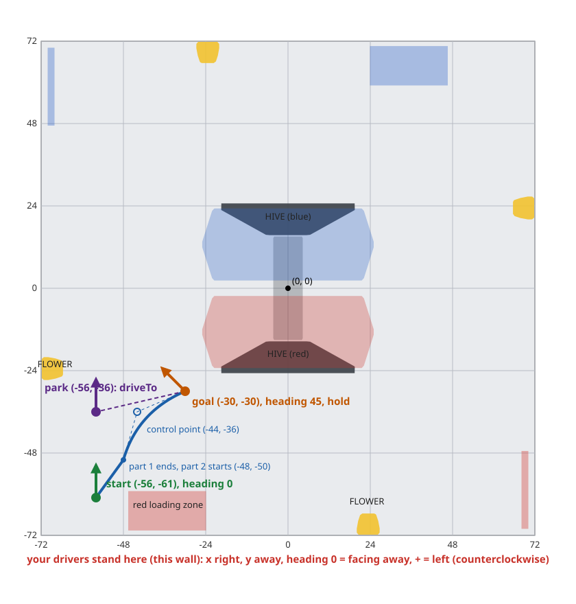

# Add Pedro paths

Smooth curved paths in autonomous, driven by the Pedro Pathing library.

**You need:**

- A robot with a **mecanum** drive and **checked odometry** ([Add odometry](../add-to-robot/09-odometry.md):
  `Tunables.Odometry.checked = true`).
- A charged battery, clear floor, and a laptop that can join the robot's WiFi (for Pedro's tuner).

## 1. What it is

A **path follower** drives the robot along a line or a curve, and corrects it all the way. **Pedro Pathing**
is a separate library. The library's `pedro` add-on connects it to your robot.

- **When you need it:** `driveTo` drives a straight line to a point and ends on it. That is enough for many
  autos. Pedro is for curves, for paths with no stop between parts, and for facing a point while the robot
  drives.
- **Paths use the same field numbers as `driveTo`** ([Drive to points](04-drive-to-points.md#field-numbers)): inches, seen from your own drivers' wall.
- **Pedro uses your `drive(...)` and `odometry(...)` lines.** You describe the robot only once.
- **Pedro must measure your robot** with its own tuner: its top speed, how far it slides when it brakes,
  and how hard to correct (step 3). Until then, do not trust a path on the real robot.
- Pedro paths run in **autonomous** steps.

| | `driveTo` ([Drive to points](04-drive-to-points.md)) | Pedro (this page) |
| --- | --- | --- |
| How you say where | a point and a heading | a road: lines and curves |
| Around a field part | a point in between (it stops there) | a curve (no stop) |
| Speed | good | faster, with smooth braking |
| Extra setup | none | an add-on, and Pedro's own tuning |

**Our advice:** start with `driveTo`. Change to Pedro when you want curves, or when a stop at every point
costs you time. One auto can use both.

**Words you will meet:**

| Word | What it means |
| --- | --- |
| **path** | the road the robot follows, from a start point to an end point |
| **line** | a straight part between two points |
| **curve** | a smooth bent part. Pedro uses **Bezier** curves (say "bez-ee-ay") |
| **control point** | a point that **pulls** a curve toward it. The robot does **not** drive through it |
| **part** | one line or curve. A path can have several parts, with no stop between them |
| **follower** | the code that drives the robot along the path (Pedro's `Follower`) |
| **Foresight** | Pedro's way of driving. It looks ahead to know when to brake |
| **hold** | after the path, keep the robot on the end point, and push back when it is bumped |

**How far a curve bends:** with one control point, the middle of the curve is halfway between the middle
of the straight line (start to end) and the control point.

## 2. Add it to the five files

### Your project: add the Pedro add-on once

**Where:** `settings.gradle`, in the project folder (not in TeamCode), under the two `ftc-helper-lib` lines.

```groovy
include ':ftc-helper-lib-pedro'
project(':ftc-helper-lib-pedro').projectDir = new File(rootDir, 'ftc-helper-lib/pedro')
```

**Where:** `TeamCode/build.gradle`, in `dependencies { ... }`, under the `ftc-helper-lib` line.

```groovy
implementation project(':ftc-helper-lib-pedro')
```

Then click **Sync Now**. Wait until it ends with no red errors. Gradle downloads Pedro itself.

### Robot.java: one line, and Pedro's numbers file

**Where:** `Robot.java`, in `define()`, **after** the `odometry(...)` line.

<!-- recipe: pedro-follower -->
```java title="Robot.java"
odometry(Odometry.pinpoint("pinpoint").offsetsMm(-84, -168));   // Pedro needs odometry
// Pedro drives the paths with the drive and odometry lines above. PedroConstants holds the
// numbers from Pedro's Foresight tuner (docs/modules/pedro.md#tuning-pedro).
follower(Pedro.follower(PedroConstants.foresight));
```

- Only the `follower(...)` line is new. Keep your own `odometry(...)` line.
- When `Pedro` is red, click it and press Alt+Enter (Option+Enter on a Mac) to add the import.
- Copy [`PedroConstants.java`](../../examples/src/main/java/com/crossbotics/ftchelper/examples/pedrobot/PedroConstants.java)
  into TeamCode, next to `Robot.java`. Make its first line (`package ...`) the same as the first line of
  your `Robot.java`. Its numbers are from the simulated example robot. Pedro's tuner replaces them (step 3).

### Tunables.java: nothing new

Pedro's numbers are in `PedroConstants.java`, not in `Tunables.java`. Paths use `Tunables.Drive.maxPower`
and `Tunables.Odometry.checked`, which you already have.

### Controls.java: nothing new

Paths run in autonomous. You need no button.

### Actions.java and autos: make paths, then follow them

**Make each path once**, in your autonomous class, above `steps(...)`.

**Where:** your autonomous class in `autos/`, above `steps(...)`.

<!-- recipe: pedro-line-curve -->
```java title="autos/YourAuto.java"
// Make each path once. A line: from (x1, y1) to (x2, y2). A curve: start, a control point
// that pulls the curve toward it (the robot does not drive through it), end.
static final PedroPath OUT = PedroPath.line(-56, -61, -56, -36).keepHeading(0);
static final PedroPath TO_GOAL = PedroPath.curve(-56, -36, -44, -36, -30, -30).turnTo(0, 45);
```

- `keepHeading(0)`: the robot keeps facing 0 the whole way.
- `turnTo(0, 45)`: it turns from 0 to 45 along the path.

**Face one point the whole way**, for example the goal, so the camera or launcher stays on it:

<!-- recipe: pedro-face-point -->
```java title="autos/YourAuto.java"
// Keep facing one field point the whole way (here x -60, y 60: put your goal's x and y).
static final PedroPath WATCH_GOAL = PedroPath.line(-30, -30, -56, -36).facePoint(-60, 60);
```

**Follow the paths** in the steps.

**Where:** a file in `autos/`, inside `steps(...)`.

<!-- recipe: pedro-follow -->
```java title="autos/YourAuto.java"
s.start("Against our wall, in the left corner tile, facing the field", -56, -61, 0)
 .follow("Out", OUT)                     // brakes to a stop at its end
 .follow("To the goal", TO_GOAL)
 .run("Intake on", robot.intake::in)
 .follow("Back", WATCH_GOAL)
 .parkWithSeconds(4)
 .driveTo("Park", -56, -36, 0, 0.7);     // driveTo works too (it ends any hold first)
```

Each `follow` brakes to a stop at its end. Start the next path where the last one ended.

**Two parts with no stop, a slow part, and a hold at the end:**

**Where:** your autonomous class, above `steps(...)`.

<!-- recipe: pedro-chain -->
```java title="autos/YourAuto.java"
// Two parts with NO stop between them (then), a slow part near the goal (maxSpeed),
// and hold the end point while it scores (holdEnd: at most 5 s).
static final PedroPath IN_ONE_GO = PedroPath.line(-56, -61, -48, -50).keepHeading(0)
        .then(PedroPath.curve(-48, -50, -44, -36, -30, -30)).turnTo(0, 45)
        .maxSpeed(0.6)
        .holdEnd();
```

`holdEnd` pushes back when another robot bumps yours while it scores.

**Rules for paths:**

- **Start each part where the last one ended**, and each path where the robot is: the first at the start
  spot in `s.start(...)`.
- **Headings must match at a join.** When part 1 ends facing 0, part 2 must start at 0
  (`turnTo(0, 45)`). Else the robot turns fast at the join.
- **A setting after a part is for that part.** `.turnTo(...)` after the curve sets the curve's heading.
  `.holdEnd()` is for the whole path. `.maxSpeed(...)` slows only its part, so make that part long enough.
- **Do not drive straight back along the same line in one path.** In tests, Pedro took a shortcut onto the
  way back at once. Use two `follow` steps (out, then back), or a curve that turns around.
- **Other ways to face:** `.facePath()` faces along the road (the default). `.facePathBackwards()` drives
  backwards along it.

**Plan the path on the field map**, and check that no part goes through a field part. A curve bends toward
its control point, so check the bend too. The example path, seen from the red wall:



**Or draw it:** the [Pedro Path Builder](https://crossbotics.com/ftc-helper/path-builder/) is a web page,
with no install. It draws the robot along the path, marks in red where it hits a field part or a wall, and writes
the `PedroPath` code. The simulator's auto builder does the same, and runs the path
([page 7](07-auto-builder-odometry-and-pedro.md)).

**Drive first, then turn** (or turn first):

**Where:** your autonomous class, above `steps(...)`.

<!-- recipe: pedro-turn-when -->
```java title="autos/YourAuto.java"
// Turn from 0 to 90 only in the last 30% of the line (0.7 to 1): drive first, then turn.
static final PedroPath DRIVE_THEN_TURN = PedroPath.line(-56, -61, -30, -30).turnTo(0, 90, 0.7, 1);
```

The two extra numbers say on which stretch it turns: 0 = the start of the part, 1 = its end. `0, 0.3`
turns first, then drives.

**Start a part along the path**, while the robot keeps driving:

**Where:** a file in `autos/`, inside `steps(...)`. When `PathAt` is red, press Alt+Enter.

<!-- recipe: pedro-along -->
```java title="autos/YourAuto.java"
s.start("Against our wall, in the left corner tile, facing the field", -56, -61, 0)
 // PathAt: start things ALONG the path, once each, while the robot keeps driving.
 .follow("To the goal", Paths.IN_ONE_GO,
         PathAt.part(2, "Intake on", robot.intake::in),            // where part 2 starts
         PathAt.inchesLeft(6, "Intake off", robot.intake::stop))   // 6 in before the end
 .waitSeconds("Score (the robot holds still)", 0.5);
```

Every way to start a part along the path:

| `PathAt` | Starts it |
| --- | --- |
| `PathAt.fraction(0.5, name, command)` | halfway along the whole path |
| `PathAt.inchesLeft(12, name, command)` | 12 in before the end |
| `PathAt.inchesDone(12, name, command)` | 12 in after the start |
| `PathAt.part(2, name, command)` | where part 2 starts |
| `PathAt.near(x, y, inches, name, command)` | when the robot comes this close to a point |

In place of a name and a command, `PathAt` can take an action from your `Actions.java`:
`PathAt.inchesLeft(12, Actions.scoreHigh(robot))`. `driveTo` takes `PathAt` too. More:
[PathAt](../reference/parts/path-follower.md#pathat).

**Try every path in the simulator first.** It runs Pedro like the real robot. So it is the safe place to
find a path that hits a wall. The field map draws the plan (orange, dashed) and where the robot went
(green). Where the green line leaves the orange one, the robot hit something, or it went too fast to turn
or brake. Then move a control point, or slow that part with `maxSpeed(0.5)`. Keep half the robot's width
clear on each side of the line. The auto builder draws and runs paths too
([The auto builder: odometry and Pedro](07-auto-builder-odometry-and-pedro.md)). More:
[the Pedro module's simulator part](../modules/pedro.md#the-simulator).

Run the Pedro robot's example first.

**Where:** the Terminal, in the `ftc-helper-lib` folder.

```bash
./gradlew :sim:fromRobot -PteamCode=none -ProbotClass=com.crossbotics.ftchelper.examples.pedrobot.Robot -Pout=build/pedrobot.properties
```

**Where:** the Terminal, in the `ftc-helper-lib` folder.

```bash
./gradlew :sim:run -PteamCode=none -Probot=build/pedrobot.properties
```

Open http://localhost:8780, choose **Pedro Bot Curve to the Goal**, press INIT, choose **RED** (gamepad 1
B), then ▶. The robot drives a short line, then curves to the goal with no stop, turning to 45. Halfway,
the intake starts. In the simulator, `follow` runs even when `Tunables.Odometry.checked` is `false`.

## 3. Find its numbers

Pedro's **Foresight tuner** measures your robot. It drives the robot by itself, **at full power**. The
PRACTICE limit does not work here. Keep clear of the robot, and keep a hand on STOP.

You need the odometry checked first, and a charged battery.

1. **Add Pedro's tuning library.**

   **Where:** `build.dependencies.gradle`, in the project folder, next to `settings.gradle`. Add one line
   to each block, and keep the lines that are there.

   ```groovy
   repositories {
       // ...the lines already here...
       maven { url 'https://repo.dairy.foundation/releases/' }
   }

   dependencies {
       // ...the lines already here...
       implementation 'com.pedropathing:tuning:1.0.1'
   }
   ```

   A **repository** is a website that keeps Java libraries, so Gradle can download them. Pedro keeps its
   tuning library on its own site, so Gradle needs both lines. Click **Sync Now**. The simulator adds the
   tuning library to its own build too.
2. **Copy Pedro's tuner files.** From [Pedro's Quickstart](https://github.com/Pedro-Pathing/Quickstart),
   folder `TeamCode/src/main/java/org/firstinspires/ftc/teamcode/pedro`, copy the `procedures` folder and
   `Tuning.java` into a new `pedro` folder in your TeamCode. To make the folder, right-click the folder
   with `Robot.java`, choose **New > Package**, and type `pedro`.
3. **Point the tuner at your robot.**

   **Where:** `pedro/Tuning.java`. Make the whole file this. When your `Robot.java` is in another package,
   change the `Robot` import: its folder (from its first line) plus `.Robot`.

   ```java
   package org.firstinspires.ftc.teamcode.pedro;

   import com.crossbotics.ftchelper.pedro.PedroTuning;
   import com.pedropathing.tuning.autotune.Procedure;
   import com.pedropathing.tuning.autotune.Tuner;
   import org.firstinspires.ftc.teamcode.Robot;
   import org.firstinspires.ftc.teamcode.pedro.procedures.ForesightTuner;

   public class Tuning {
       @Tuner
       public static Procedure foresightTuner() {
           return new ForesightTuner(PedroTuning.localizer(Robot::new), PedroTuning.drivetrain(Robot::new));
       }
   }
   ```

   `Robot::new` means "make a new Robot": the tuner makes one when it starts. So it measures the robot
   with your own `drive(...)` and `odometry(...)` lines. `@Tuner` puts it on Pedro's web page.
4. Send the code to the robot. Connect the laptop to the robot's WiFi, and open
   `http://192.168.43.1:10158` in a browser.
5. Choose **Foresight Procedure** and follow the page. The robot drives forward, sideways, brakes and
   turns, many times.
6. At the end, open the **Java** tab. In `PedroConstants.java`, replace every `c.something.set(...);` line
   (between `c -> {` and `});`) with the lines from the Java tab. Keep the first and last lines of the
   file. The tuner does not change your code, so copy the lines in every time.
7. Send the code again.

**Before an event, take the tuner out.** Its web page is not allowed at events (rule R704.D). Comment out
the `tuning` line in `build.dependencies.gradle` (put `//` in front of it), and move `Tuning.java` and the
`procedures` folder out of TeamCode. Build and install again. Your paths still work: they need only
`PedroConstants.java`. Put the files back after the event to tune again.

## 4. Check it, then tune it

**Check it:**

1. Optional, but useful: Pedro's own **Tests** procedure (its Line and Curve tests) checks the numbers
   first. Add it to `Tuning.java` the same way, from Pedro's
   [testing page](https://pedropathing.com/docs/pathing/tuning/test).
2. Make a short path: one straight `PedroPath.line(...)` of about 24 in, in open floor.
3. Set `Tunables.Drive.maxPower` low (0.6) for the first runs.
4. Put the robot on the start spot, facing the start heading. Press INIT, then ▶. Keep a hand on STOP.
5. The robot must drive the line and stop near the end. Pedro calls a path done within about 2.5 in and
   11.25 degrees.
6. Then try your real path, still in PRACTICE. Then in COMPETITION. Set `maxPower` back to `DEFAULT`.

**If it goes the wrong way, press STOP.** Then check the table below.

**Tune it:** run Pedro's tuner again after a change to the robot's weight, wheels or motors. To make "done"
tighter, see [When is a path done?](../modules/pedro.md#when-is-a-path-done). The `driveTo` steps in the
same auto use the [Move Tuner](../tuning/10-move-tuner.md) numbers. To try `maxPower` without a new build,
use [Live tuning](../tuning/16-live-tuning.md).

## Fix a problem

| Problem | Why, and the fix |
| --- | --- |
| `Pedro` or `PedroPath` is red in Android Studio | Add the Pedro add-on (step 2), then Sync |
| INIT stops: `follower(...) needs an odometry(...) line too` | The `follower` line needs the `odometry` line above it |
| INIT stops: `Pedro.follower needs a mecanum drive(...) line` | Pedro needs mecanum. A tank robot uses `turnTo` and `move` |
| Every `follow` says `skipped` in the report | `Tunables.Odometry.checked` is `false`. Do [Add odometry](../add-to-robot/09-odometry.md), step 3 |
| It overshoots and comes back, or shakes | `PedroConstants.java` still has another robot's numbers. Do step 3 |
| It drives the wrong way at once | STOP. Run the Odometry Tuner again, and check the motor directions |
| It stops a little short of the end | Normal: Pedro is done within 2.5 in |
| The report says `STALLED` | The robot was stuck, against a wall or a robot. The next steps still run |
| The report says `timed out` | The path took more than 10 s. Make it shorter, or give it more time: `.follow("To the goal", TO_GOAL, 15)` |
| The tuner's page does not open | The laptop must be on the robot's WiFi. Check the address |
| The tuner does not compile | Step 3, item 1: both lines, then Sync |
| It is slow | `Tunables.Drive.maxPower` is low (or `practiceMaxPower`, in PRACTICE) |
| The report says `STALLED, not fired: Spin up` | The path ended early, so that `PathAt` did not start |

More: [the Pedro module, If something goes wrong](../modules/pedro.md#if-something-goes-wrong).

## Done when

- `PedroConstants.java` has your robot's numbers from the Foresight tuner.
- A 24 in line ends within about 2.5 in of its end point.
- Your real path runs in COMPETITION, and the report shows no `skipped` or `STALLED`.

---

**Next:** [The auto builder: steps](06-auto-builder-steps.md): build an auto on a picture of the field.

**Look it up:** [PathFollower and PathAt](../reference/parts/path-follower.md): every command.
[Pedro module](../modules/pedro.md): paths, holds and Pedro's numbers.
