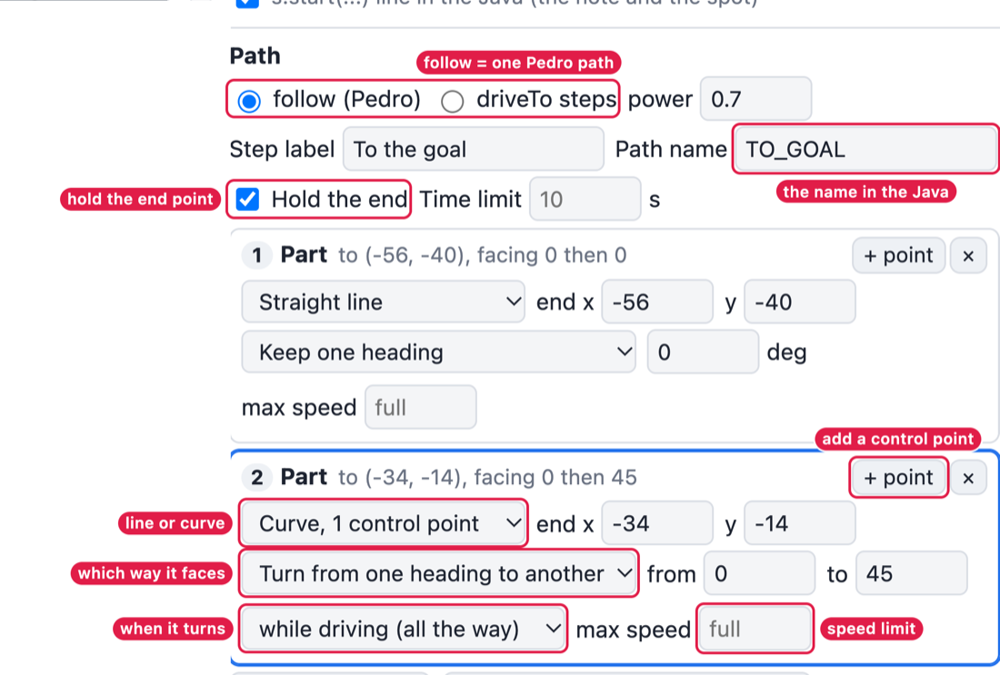
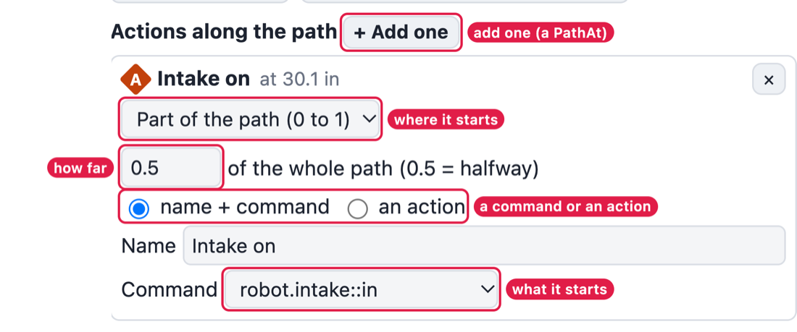

# The auto builder: odometry and Pedro

Build `driveTo` steps and Pedro paths on the field map, run them in the simulator, and copy the Java.

**You need:**

- The auto builder: [The auto builder: steps](06-auto-builder-steps.md).
- For `driveTo` steps: odometry ([Drive to points](04-drive-to-points.md)).
- For a Pedro path: the Pedro add-on and the `follower(...)` line ([Add Pedro paths](05-pedro-paths.md)).
  What each path setting does is on that page.

## In the auto builder

Open the auto builder ([page 6](06-auto-builder-steps.md#open-it)). Pick the mode:

- **Simple steps:** the drives, turns and actions of page 6.
- **Pedro path:** a mecanum robot with odometry. Tap to add lines or curves. Drag the ends and the curve
  points. Pick each part's heading and speed limit. Tick **Hold the end**. Add things to start along the
  path (`PathAt`). The Java has a `follow` with a `PedroPath`, or one `driveTo` per part.

The builder says when your robot cannot do a mode, and **Run** stays off:

- **follow** needs the `follower(...)` line in `Robot.java`.
- **driveTo steps** need only odometry.

The map in **Pedro path** mode, close up. The path has two parts: a straight line, then a curve:

- **Drag the ends** to move a part. **Drag the control point** to bend the curve. The robot does not drive
  through it: it pulls the curve toward it.
- **Drag the heading knob** to change which way the robot faces.

The settings for the path and each part:

**Actions along the path** are the `PathAt` lines: they start something while the robot drives.

**A Pedro plan is one path.** Add the steps before and after it in your file.

## Done when

- The builder runs your `driveTo` steps or your Pedro path in the simulator, as BLUE and as RED.
- The report says `done` for every point or path.
- The Java is in your auto file, with the steps before and after it.

## Problems

| Problem | Why, and the fix |
| --- | --- |
| **Run** stays off in Pedro path mode | `Robot.java` has no `follower(...)` line ([Add Pedro paths](05-pedro-paths.md)) |
| **Run** stays off for driveTo steps | `Robot.java` has no `odometry(...)` line ([Add odometry](../add-to-robot/09-odometry.md)) |
| A step or path ends in the wrong place | See the problems on [Drive to points](04-drive-to-points.md#problems) and [Add Pedro paths](05-pedro-paths.md#fix-a-problem) |

---

**Next:** [Advanced autos](08-advanced-autos.md): beyond the auto builder.

**Look it up:** [the auto builder, every detail](../guides/simulator.md#the-auto-builder).
