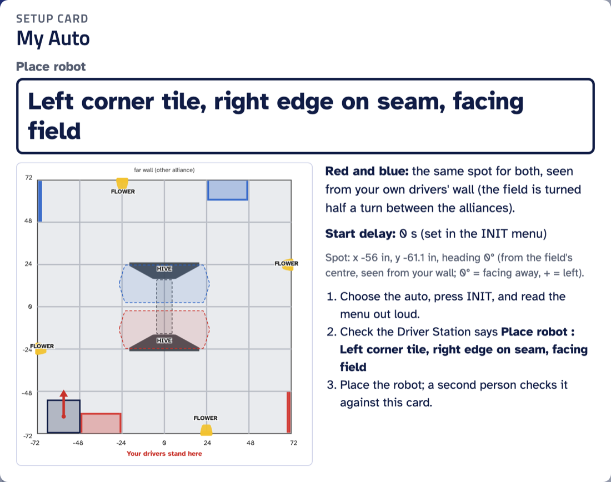

# Match day

Get the auto right at an event: before the event, before each match, and
after it.

A good auto scores nothing when it starts in the wrong place, or runs the wrong plan. Most auto mistakes
at an event are not code mistakes. These checks stop them.

## Before the event

- **Pick the autos you bring.** Each partner is different, so you pick the auto in the talk before each
  match. Bring a few that start in different places or go for
  different pieces. Give each one good default menu settings, and write them on its setup card.
- **Remove what you will not run.** Put `@Disabled` on old and untested autos, and put test routines in
  `group = "Test"`.
- **The first runs of a new auto:** on blocks first, then in PRACTICE, then in COMPETITION
  ([the first run on the robot](02-put-steps-together.md#the-first-run-on-the-robot)).
- **Run every auto on the list** on a real field (or a practice field): as BLUE and as RED, with each menu
  option, in the COMPETITION profile.
- **Save the code you will run:** commit and push it, and tag it
  ([Git and GitHub](../guides/github.md#before-an-event-backups-and-a-tag)). Then you can always get back to it.
- **Print an auto sheet and a setup card** for each auto ([below](#show-your-partners-what-your-robot-does)).

## Show your partners what your robot does

Before each match you plan the auto with your alliance partner. They need to know **exactly** what your
robot does in auto: where it starts, where it drives, what it scores, and when. Then the two robots do not
crash, and they do not go for the same pieces. The auto builder ([page 6](06-auto-builder-steps.md)) makes
the pages for this. Print them before the event.

- **Auto sheet (PDF): for your partner teams.** One page per auto: the start spot, the whole route on the
  field, and every step in plain words, with its time. Show it in the match talk. Bring one sheet for
  each auto you can run, so the partner can help pick the one that fits.
- **Setup card: for your own drive team.** The start note in big letters, the field with the robot's
  start spot and heading, what RED does, the start delay, and three checks. The drive team uses it to
  put the robot down right. Keep one per auto in the drive team's box.

To print: press **Auto sheet (PDF)** or **Print setup card**, then **Print or save as PDF**. Black and white
is fine.

An auto sheet, from the auto builder in the simulator:


A setup card, from the web auto builder:



## Before each match

A checklist for the drive team:

1. **Talk with the partner:** show your auto sheet. Agree who starts where, who goes where, and who needs a delay.
2. **Choose the auto** on the Driver Station. Read its name out loud.
3. Press **INIT**. **Read the menu out loud:** alliance, start delay, your lines.
4. Set the **Alliance**: **X** = BLUE, **B** = RED.
5. Check that **Profile** says **COMPETITION**. A `!! PRACTICE profile` warning at the top means it does not
   ([what changes](#practice-and-competition)).
6. **Place the robot** where the `Place robot` note says. A second person checks the note against the robot.
7. **Look for warnings** on the screen: a camera, the odometry, tuned values that differ from the code.
8. Hands off. Press ▶ when the match starts.

### Wrong alliance?

| When you see it | What to do |
| --- | --- |
| In INIT, before ▶ | Press **X** for BLUE or **B** for RED. Read the menu out loud again. |
| During auto | You cannot change it. Let the auto run. |
| In TeleOp | Hold gamepad 1 **START**, then also hold **BACK**, for 1.5 s. The screen says `Alliance now RED (was BLUE)`. Hold them again to switch back. If you let go before 1.5 s, the alliance stays the same and the debug lines turn on or off. |

**The TeleOp switch is off until you turn it on.** Add one line to `Controls.java`:
`lib.switchAlliance(g1.start, g1.back);` ([switching the alliance in TeleOp](../controls/04-move-library-buttons.md#switching-the-alliance-in-teleop)).
With odometry on BIOBUZZ, a switch turns off aiming by odometry. The robot does not aim at a wrong spot: it does not aim by
odometry at all. The screen says `odometry aim OFF until the pose is set`. To turn it on again, park on the reset spot and hold START
1 s. TeleOp keeps the alliance from the auto, so a wrong alliance in INIT is wrong in TeleOp too. Turn the switch on before the event, and
write **START + BACK, 1.5 s** on the setup card.

### Practice and competition

The **Profile** line in INIT has two settings. The Control Hub remembers it until someone changes it.

| | PRACTICE (in the shop) | COMPETITION (at an event) |
| --- | --- | --- |
| Drive power | the same: `maxPower` (unless you set `practiceMaxPower`) | `maxPower` |
| Debug lines on the screen | on | off |
| Tuning menu (hold GUIDE) | opens | stays closed |
| Camera live view | on | off (it costs speed) |
| A part that is off | a quiet note | a loud `!!` warning |
| The top of the INIT screen | `!! PRACTICE profile` | nothing |
| Your own `Profile.pick(a, b)` | `a` | `b` |

Safety (limits, time limits, jam checks) is the same in both. COMPETITION is the default. Back in the
shop, set PRACTICE again. More: [Profiles](../guides/profiles.md).

## After the match: read the report

When the auto ends, the Driver Station shows `Autonomous finished` and one line per step:

```text
Start: done
Hold the piece: done
To the goal: done
Score high: timed out
Park: done
```

The robot log and TeleOp's INIT screen show the same report, so the drive team can read it while they set
up for TeleOp.

| The word | It means |
| --- | --- |
| `done` | The step finished. |
| `timed out` | A wait or an action ran out of time. The list went on. |
| `STALLED` | A drive could not finish: the robot was stuck. |
| `TIMED_OUT` | A drive took too long. |
| `STOPPED` | Something outside the drive stopped it: someone pressed STOP, or the 30 seconds ended. |
| `NO_ODOMETRY` | A `driveTo` stopped: the odometry did not answer. |
| `cut short (time for park)` | The auto stopped the step early, so the park steps had time. |
| `skipped (time for park)` | The auto did not start the step: no time was left before parking. |
| `skipped: Tunables.Odometry.checked is false` | A `driveTo` on a real robot before the Odometry Tuner. |
| `not seen` | `aimAtGoal` did not see the goal, so the robot did not turn. |
| `not seen in 5 s: went on` (your seconds) | `waitForGoal` did not see the goal in its time. |
| your own words | From your own step, or an action's reason. |

**Write down** every step that does not say `done`. Fix it in the pits:

- `timed out` on an action: the part is slow, or its numbers are off. Check the part.
- `STALLED`: the route hits something. Watch it in the simulator. Use `routeTo` near field parts.
- `cut short` or `skipped (time for park)`: the auto is too long. Remove a step, or drive faster.

Change the number in the step, test it, and commit.

## Common mistakes

| What happens | Why, and the fix |
| --- | --- |
| The robot ran the wrong plan | Nobody changed the menu, so the first option ran. Read the menu out loud before ▶. |
| The robot started in the wrong place | Nobody checked the note. Start the note with the spot in CAPITALS. A second person checks it. |
| The robot drove at low power | `maxPower` in `Tunables.Drive` is still low from the first runs. Or someone set `practiceMaxPower`, and the profile was PRACTICE ([what changes](#practice-and-competition)). |
| The robot went the wrong way in TeleOp | The alliance was wrong in INIT, and TeleOp kept it. [Wrong alliance?](#wrong-alliance) |
| The robot went the wrong way for RED | The alliance was wrong, or `mirrorForRed()` is wrong for this field. |
| The drivers could not find the auto | Too many on the list. Add `@Disabled` to the old ones. |
| TeleOp was not chosen after the auto | `preselectTeleOp` must be the TeleOp's name, exactly. |
| `AUTONOMOUS IS OFF` | `calibrated` is `false` in `Tunables.java` ([Tune the drive first](../five-files/05-autos.md#tune-the-drive-first)). |

## Done when

- Each auto on the list has run on a field, as BLUE and as RED.
- The drive team has a setup card for each auto, and the checklist.
- After a match, the drive team reads the report and writes down each step that is not `done`.

---

**Next:** [Simulator](../simulator/README.md): watch your autonomous and fix it on the laptop.

**Look it up:** [every step](../reference/steps.md#auto). **Go deeper:**
[test an auto with a scenario file](../reference/scenario-files.md).
