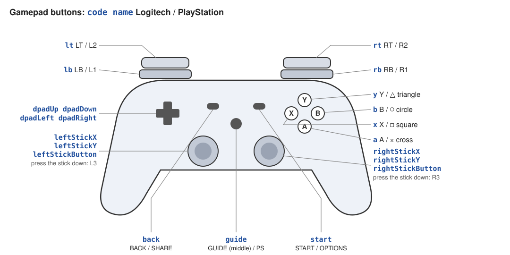

# How buttons work

Who holds which gamepad, the four pieces of a button line, and the rules INIT checks.

## One gamepad, and a second one when you want it

Most teams start with **one gamepad**. One driver drives and runs the parts. The second team member at the
field helps: they watch the field, call out game pieces and time, and watch the robot's parts.

**Gamepad 2 is optional.** Add it when your team wants to split the work, or for jobs that are hard to do
while you drive, like arm control. Then the **driver** (gamepad 1) drives, and the **operator** (gamepad 2)
runs the parts.

| In the code | One gamepad (`oneDriver = true`) | Two gamepads (`oneDriver = false`) |
| --- | --- | --- |
| `g1` | gamepad 1, the driver | gamepad 1, the driver |
| `g2` | **also gamepad 1** | gamepad 2, the operator |

The switch is one line at the top of `Controls.java`. The starting files have `oneDriver = true`.

**Where:** `Controls.java`, at the top of the class.

```java title="Controls.java"
public static boolean oneDriver = true;   // false: gamepad 2 runs the parts
```

**Write the parts' buttons on `g2` from the start.** With one gamepad, `g2` is gamepad 1, so they work
now. When you add gamepad 2 later, change `oneDriver` to `false`, and those lines move to gamepad 2. You
change no other line.

With one gamepad, two lines on the same button stop INIT with a message. The library's own buttons also
move a little with one gamepad (slow goes on the left stick click), so the triggers are free for your parts
([Every library button](04-move-library-buttons.md#every-library-button)).

## The buttons

The docs use the Logitech names (A, B, LB...). A PlayStation controller has the same buttons with other
names. The code name is the same for both. The library's screens (the button map, the tuning menu) show the
names on the controller that is plugged in.



| Buttons | Logitech | PlayStation | Name in the code |
| --- | --- | --- | --- |
| Face buttons | A, B, X, Y | × cross, ○ circle, □ square, △ triangle | `a`, `b`, `x`, `y` |
| Bumpers | LB, RB | L1, R1 | `lb`, `rb` |
| Triggers (they count as pressed past half way) | LT, RT | L2, R2 | `lt`, `rt` |
| D-pad | D-pad | D-pad | `dpadUp`, `dpadDown`, `dpadLeft`, `dpadRight` |
| Stick clicks (press the stick down) | left and right stick | L3, R3 | `leftStickButton`, `rightStickButton` |
| Small buttons | BACK, START, GUIDE (the middle button) | SHARE, OPTIONS, PS | `back`, `start`, `guide` |
| Sticks (a number from -1 to 1, up and right are +) | left and right stick | left and right stick | `leftStickX`, `leftStickY`, `rightStickX`, `rightStickY` |

## The four pieces of a button line

Each button line has up to four pieces, like an order from a menu:

```java
//  1. which button   2. how it starts        3. what it does            4. feedback
    g2.lb             .tap(                   robot.launcher::fire)      .says("fire one").rumble();
```

1. **Which button:** the gamepad, a dot, then the button: `g2.lb`.
2. **How it starts:** the press type, for example `.tap(...)` or `.hold(...)`
   ([Press types](02-press-types.md)).
3. **What it does:** the job (below).
4. **Feedback:** what the drivers see and feel. Optional, but always add `.says(...)`: the words go on
   the button map ([What the drivers see and feel](03-see-and-feel.md)).

**Where:** `Controls.java`, inside `buttons(Robot robot, Pad g1, Pad g2) { ... }`.

```java title="Controls.java"
g2.y.press(robot.claw::open).says("open the claw");
g2.x.press(() -> robot.lift.goTo("low")).says("lift to low");
```

`buttons(...)` runs once, at INIT. It only connects the jobs to the buttons. The library's **loop** then
runs many times a second: each time, it reads the gamepads, runs the jobs that are due, and updates every
part. You never write the loop.

## What a job can be

| Kind | Example | Notes |
| --- | --- | --- |
| A method of a part | `robot.claw::open` | `::` hands over the method, and the button runs it later |
| A few commands | `() -> { robot.claw.open(); robot.intake.stop(); }` | `() ->` starts a small piece of code (a **lambda**) |
| An action (several steps) | `Actions.scoreHigh(robot)` | for `press`, `tap`, `doubleTap`, `taps`, `heldFor`, `with`: the gesture starts it, and the same gesture again cancels it ([Actions.java](../five-files/04-actions-java.md)) |
| A part to switch | `robot.intake` | for `toggle(...)` only |
| A mode to switch | `robot.turret.followMode()` | for `toggle(...)` only ([Modes](#modes), below) |

**A job must never wait.** Put no `sleep(...)` and no `while` loop in a job. The code compiles, but it
freezes the **whole robot** until the job ends: no driving, no other button, no part updates. The Driver
Station then warns: `... took 512 ms: the whole robot stopped that long. No sleep() or while loop in a
button job: use an Action with waitSeconds (docs: Actions.java)`. To wait between steps, make an action with
`waitSeconds(...)` or `waitUntil(...)`, and put the action on the button
([Actions.java](../five-files/04-actions-java.md)).

### Modes

A **mode** is a rule a part follows every loop while the mode is on. For example, the turret follows the
goal, or the robot turns to face the goal. A mode is for an "always" rule. An action is for steps that end.

| Mode | What it does while it is on |
| --- | --- |
| `robot.turret.followMode()` | the turret turns to the goal ([Turret](../reference/parts/turret.md)) |
| `robot.aimMode()` | the whole robot turns to face the goal ([Aim](../reference/parts/aim.md)) |
| `robot.launcher.speedMode()` | the launcher sets its speed from the distance to the goal ([Launcher](../reference/parts/launcher.md)) |
| `robot.aim().movingShotMode()` | the aim corrects for the robot's motion, so it can shoot while it drives (needs odometry, [Aim](../reference/parts/aim.md)) |
| `robot.reverseDriveMode()` | the back of the robot acts as the front: forward and slide flip, turning does not |

A button switches a mode like a part. **Where:** `Controls.java`, inside `buttons(...)`.

```java title="Controls.java"
g2.rightStickButton.toggle(robot.turret.followMode()).rumble().says("follow the goal on/off");
```

With `.rumble()`, the drivers feel it: two buzzes = on, one buzz = off. Some modes turn on only when they
can work: whole-robot aim needs a goal in view. A press that cannot turn it on gives one buzz (off).

An action or an auto can switch a mode too: `robot.turret.followMode().on()`
([Modes in the reference](../reference/steps.md#modes)).

## The library's own buttons

Some of gamepad 1's buttons have library jobs: driving, pause, the menus. You write nothing for them.
**Why:** BACK must always pause the robot, even in a file with a mistake.

| Job | One gamepad (`oneDriver = true`) | Two gamepads |
| --- | --- | --- |
| Drive and slide | left stick | left stick |
| Turn | right stick, left and right | right stick, left and right |
| Slow | left stick click: slow on/off | LT (the further, the slower) |
| Field-centric on/off (mecanum with an IMU or odometry) | right stick click (a double tap) | Y (a double tap) |
| Pause / go on | BACK (a tap) | BACK (a tap) |
| Debug lines | START, then BACK | START, then BACK |
| Set pose here (odometry) | START (held 1 s) | START (held 1 s) |
| Button map on the screen | GUIDE (a tap) | GUIDE (a tap) |
| Tuning menu | GUIDE (held 1 s) | GUIDE (held 1 s) |
| Choose the alliance (in INIT) | X = BLUE, B = RED | X = BLUE, B = RED |

Field-centric on/off needs a **double tap**: two presses within 0.35 s. **Why:** one tap by accident would
turn the sticks around. You can move or free every one of these buttons:
[Move the library's buttons](04-move-library-buttons.md).

## A part's buttons

A part has no buttons until `Controls.java` has its lines. So every button the robot has is a line you can
read in this file. Each part's page has its usual lines, ready to copy ("Buttons to add" in the
[part pages](../reference/README.md)). INIT names each usual button of a part that is still free:
`Intake: usual buttons not in Controls.java: G2 RT (in (hold)), ...`.

## The rules (INIT checks them)

- **One job per button, or several gestures.** A button with `press(...)` and `tap(...)` stops INIT:
  `Controls.java: G2 B has two jobs`. The same gesture twice stops INIT too: `G2 A has two "tap" jobs`.
- **A job of yours on a library button** stops INIT. The message names the button. Move the library's job
  first ([page 4](04-move-library-buttons.md)).
- **Two things on one button:** put both in one lambda:
  `g2.dpadLeft.press(() -> { robot.claw.open(); robot.intake.stop(); }).says("drop")`.
- **`.free()` keeps a button empty**, for example `g2.rightStickX.free()`. INIT then does not name it as
  free.
- **A button that is down as you press ▶** (start on the Driver Hub), or as the tuning menu closes, does
  nothing until you let it go. **Why:** a thumb that rests on a button must not start a job.

## Done when

- Each button line in your `Controls.java` has a `.says(...)`.
- INIT shows no stop message about buttons.
- A tap of GUIDE shows the button map, and it lists every button you wrote.

---

**Next:** [Press types](02-press-types.md).

**Look it up:** [Controls.java reference](../reference/controls.md). **Go deeper:**
[the cookbook's button recipes](../cookbook.md#buttons-and-gestures).
