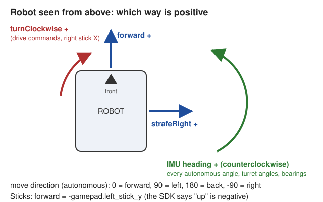

# Signs and units

> **Work in progress:** this library and its docs are still changing. Something wrong or unclear? [Tell us](https://github.com/crossbotics/ftc-helper-lib/issues/new/choose).

Robot code goes wrong most often when two parts disagree about which way is "positive".
This library uses ONE set of rules everywhere. Learn these and you can read any of it.

## Driving

| Value | Positive means | Where you see it |
| --- | --- | --- |
| `forward` | robot moves forward | `MecanumDrive.drive`, `TankDrive.arcade`, the mixers |
| `strafeRight` | robot moves to its right (mecanum only) | `MecanumDrive.drive`, `MecanumMixer.mix` |
| `turnClockwise` | robot turns right (clockwise, seen from above) | same |
| IMU heading | robot turned **left** (counterclockwise) | `ImuSetup.headingDeg`, `AutoDrive.turn`, `AutoDrive.turnTo`, `FieldPose.headingDeg` |
| `move(..., directionDeg, ...)` | clockwise from forward: 0 forward, 90 right, 180 back, -90 left | `AutoDrive.move`, `Steps.move` |
| `moveWithTurn(..., directionDeg, headingDeg, ...)` | the direction clockwise, but from the START heading (fixed on the field, because the robot turns on the way); the heading counterclockwise, 0 = the start heading | `AutoDrive.moveWithTurn`, `Steps.moveWithTurn` |

Why is turning clockwise-positive but heading counterclockwise-positive?

- The right stick's X is positive when pushed right, and pushing right should turn the robot right.
  So `drive(forward, strafe, gamepad1.right_stick_x)` just works.
- The FTC SDK's IMU says heading grows when the robot turns left. That is the math rule
  (counterclockwise = positive) and we do not fight the SDK.

The names tell you which one you have: `turnClockwise`, `headingCcwDeg` ("CCW" = counterclockwise).

## Gamepad sticks

The SDK gives **negative** `left_stick_y` when you push the stick UP (away from you).
So "forward" is `-gamepad1.left_stick_y`. Every example in these docs has the minus sign.

## Servos and motors: which way is "bigger"?

There is **no standard** for this, so the library makes no promise about it:

- A servo position from 0 to 1 is a pulse length: 0 is the short pulse, 1 the long one. Which way a bigger
  number turns the shaft (clockwise or counterclockwise) depends on the servo's brand and model.
- Which way positive power turns a motor also depends on the motor and its gearbox.
- `.reversed()` in Robot.java swaps the ends (servo: 0 and 1; motor: + and -). It changes the numbers, not the
  wiring.

So **check each one by test**, never by its label: in the Servo Finder press D-pad up (a bigger number) and
watch which way the part moves; for a motor, the Motor Finder or the Hardware Check. Then choose the numbers
(or `.reversed()`) so they read the way you think about the part. Any order is fine for named positions:
a claw's `open` can be higher or lower than `closed`.

**Two servos that face each other** (one on each side of a claw, an arm or a pinch): the same number turns them
opposite ways, as seen from outside. That is why such a part uses `alsoServoReversed` (the second servo mirrors
the first); two servos facing the same way use `alsoServo` ([two servos on one part](modules/robot.md#claw)).

## Units

| Thing | Unit |
| --- | --- |
| Distances (drive) | inches |
| Angles | degrees |
| Motor power | -1 to 1 |
| Servo position | 0 to 1 |
| Mechanism positions (lifts, arms) | encoder ticks (counts) |
| Time | seconds, unless the name ends in `Ms` (milliseconds) or `Nanos` |

## Wheel order

Any array of four wheel values is in this order:

`[front-left, front-right, back-left, back-right]`

Standard (tank) drive left/right arrays are `[left, right]`.

`MecanumMixer.FRONT_LEFT` (0), `FRONT_RIGHT` (1), `BACK_LEFT` (2), `BACK_RIGHT` (3) name the positions.
