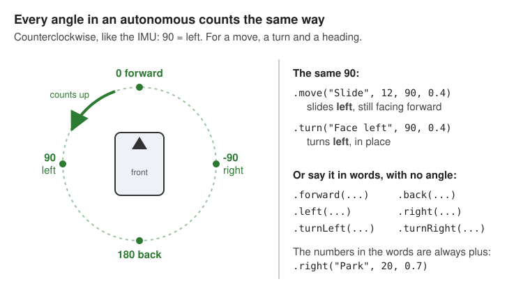

# autos/: your autonomous programs

**The five files, page 5 of 5.**

An **autonomous** (auto) is the program the robot runs by itself, in the first 30 seconds of a match.
`autos/` is a folder. Each file in it is one autonomous, with its own name on the Driver Station.

This page makes the smallest auto: the robot drives out of its start spot. With it, your robot is
the **smallest robot that works**: it drives in TeleOp, and it runs an autonomous.

## Make the folder

In Android Studio's **Project** panel, right-click the `teamcode` folder, then **New > Package**. Type
`autos` after the `teamcode.` that is already there.

**Why "Package":** in Java, a folder of code is a package. More help:
[make a new file or folder](../start-from-zero.md#make-a-new-file-or-folder).

## The smallest auto

Make a new Java file `FirstAuto` in the `autos` folder (right-click `autos`, **New > Java Class**).
Replace everything in it with this. Click a **(+)** to read what a line does.

<!-- recipe: first-auto -->
```java title="autos/FirstAuto.java"
import com.crossbotics.ftchelper.robot.Auto;
import com.crossbotics.ftchelper.robot.Steps;
import com.qualcomm.robotcore.eventloop.opmode.Autonomous;

/** The five files, file 5 of 5: an autonomous. The smallest one: it drives out of the start spot. */
@Autonomous(name = "First Robot Auto", preselectTeleOp = "First Robot TeleOp") // (1)!
public class FirstAuto extends Auto<Robot> { // (2)!

    @Override
    protected void steps(Steps s, Robot robot) { // (3)!
        s.start("Against our wall, facing the field", 0) // (4)!
         .forward("Leave the start", 12, 0.4); // (5)!
    }
}
```

1. `name`: the auto's name on the Driver Station. `preselectTeleOp`: the name of your TeleOp, exactly as
   in `@TeleOp(name = ...)` in `Controls.java`. When the auto ends, the Driver Station has that TeleOp
   chosen and ready.
2. `extends Auto<Robot>`: this file is an autonomous for your robot. `Auto` is the library's autonomous.
   `<Robot>` is your `Robot.java`, so every part on the robot is in `robot`.
3. `steps(...)` is a **list of steps, read top to bottom**. Each step starts on a new line with a dot.
   The last step ends with `;`.
4. `start(...)`: where the drive team puts the robot.
   - The words show on the Driver Hub in INIT. Write them for a nervous driver.
   - `0` is the **heading**: the way the robot faces. 0 = straight away from your drivers.
     TeleOp's field-centric "forward" uses it too, so get it right.
5. `forward(...)`: drive forward. It waits until the move is done, then goes to the next step.
   - `"Leave the start"`: the step's name, in the report at the end.
   - `12`: how far, in inches.
   - `0.4`: the most power it may use (0 to 1). It slows down near the end, so it does not overshoot.

**The first lines of the file** (above the imports) must be:

```text
package org.firstinspires.ftc.teamcode.autos;

import org.firstinspires.ftc.teamcode.Robot;
```

**Why the extra import:** `Robot.java` is in the folder above (`teamcode`), not in `autos`. This line
says where it is. `Controls.java` needs no such line, because it is in the same folder as `Robot.java`.

## The numbers are in the step

Write each distance in the step: `12`, not a name from `Tunables.java`.

**Why:**

- Each auto has its own numbers. When you change one auto, the others do not change.
- The [auto builder](../guides/simulator.md#the-auto-builder) can read the auto, change a number, and
  give you the new file.

`Tunables.java` keeps the **robot's** numbers: speeds, positions and gains. They are the same in
every auto.

## Tune the drive first

On a real robot, an auto **does not move** until you tell it that the drive is tuned. The Driver Hub
says `AUTONOMOUS IS OFF: the drive is not tuned yet`.

**Why:** the robot only knows how far its wheels turned. If the wheel size is a little wrong, every
move is a little wrong. The library stops a robot that could drive much too far.

1. On the Driver Hub, pick **Tune and check** (TeleOp list, group "Finders"). No file is needed.
2. Pick **Drive Tuner**, then run its **Drive** test, and its **Strafe** test for a mecanum robot.
   Each one drives 48 inches. Measure, and enter what you measured.
3. Copy the lines it shows into your files. The wheel size goes in `Robot.java`, and the strafe
   correction goes in `Tunables.java`.
4. In `Tunables.java`, set `calibrated = true` in the `Drive` section.

Every step, and what each screen shows:
[the Drive Tuner](../guides/finders.md#drive-tuner-wheel-size-and-strafe-correction).

**The simulator does not need this.** There, an auto runs before the Drive Tuner, with the warning
`Drive not tuned: runs in the simulator only`.

## What you get with no extra code

You wrote only the list of steps. Every auto also gets these:

| You get | What it does |
| --- | --- |
| An INIT menu | **X** = blue alliance, **B** = red. A start delay (0 to 10 s), to keep out of a partner's way. The PRACTICE or COMPETITION profile. D-pad up/down picks a line, left/right changes it. |
| The 30 s timer | The steps stop when autonomous ends. Everything stops, even after an error. |
| The report | One line per step at the end, like `Leave the start: done`. It is in the robot log, and on TeleOp's INIT screen too. |
| The change to TeleOp | The alliance and the robot's heading go to TeleOp, so field-centric stays right. |

**Red and blue:** a move straight forward or back is the same for both alliances. Moves to the side and
turns can need a change for red: [mirrorForRed, in lesson 6](../tutorials/start/06-first-autonomous.md#2-the-file-line-by-line).

## More steps

The steps you will use first. Each one is a new line, before the `;`:

| Step | What it does | Example |
| --- | --- | --- |
| `.forward(name, inches, power)` | drives forward, then waits until it is there | `.forward("To the goal", 24, 0.5)` |
| `.back(name, inches, power)` | drives backward | `.back("Off the wall", 6, 0.4)` |
| `.left(name, inches, power)`, `.right(...)` | slides to the side, still facing the same way (mecanum only) | `.right("Park", 20, 0.7)` |
| `.turnLeft(name, degrees, power)`, `.turnRight(...)` | turns in place | `.turnLeft("Face the goal", 45, 0.4)` |
| `.waitSeconds(name, s)` | waits this many seconds | `.waitSeconds("Let it settle", 0.5)` |
| `.action(action, s)` | runs an action from `Actions.java`, then waits until it is done (at most `s` seconds) | `.action(Actions.fireWithIntake(robot), 9)` |

Write the numbers in these steps as plus numbers. The word says which way. (A minus number goes the
other way: `back(..., -6, ...)` drives forward. Use the other word.)

**At an angle.** `.move(name, inches, angle, power)` drives at any angle, and `.turn(name, degrees, power)`
turns by any angle. Every angle in an autonomous counts the same way: **counterclockwise, 90 = left**,
like the IMU (the hub's turn sensor). The same is true for the heading in `start(...)`.



More: [signs and units](../conventions.md).

An action in an auto: [Actions.java, use it in an autonomous](04-actions-java.md#use-it-in-an-autonomous).

## Check it

**In the simulator:** pick **Simulator** in the run list next to Android Studio's **Run** button, and
click **Run**. Pick **First Robot Auto** (your auto's name), INIT, ▶. The robot drives forward 12 in.

**Run it again?** Press **Back to start** first (Control Hub panel, Robot tab). This auto gives no spot
on the field, so the simulator leaves the robot where it stopped last time.

**On the robot:**

1. Do [Tune the drive first](#tune-the-drive-first).
2. In INIT, pick the **PRACTICE** profile. It keeps the power low.
3. Put the robot where the `start` words say. Keep a hand near STOP.
4. INIT, read the words, ▶. Read the report at the end.
5. Measure how far it went. Change the number in the step, build and install, and run it again.

**Done when:** the robot drives out of its start spot, and the report says `Leave the start: done`.
Your robot now drives in TeleOp and in autonomous.

## If something goes wrong

| Problem | Why, and the fix |
| --- | --- |
| `AUTONOMOUS IS OFF: the drive is not tuned yet` | `calibrated` is `false`. Do [Tune the drive first](#tune-the-drive-first). |
| The auto is not on the Driver Station | In the TeleOp list: the file needs `@Autonomous`. In no list: build and install again. |
| `cannot find symbol: Robot` | The `import org.firstinspires.ftc.teamcode.Robot;` line is missing. |
| It drives the wrong distance | The wheel size is wrong. Run the Drive Tuner's **Drive** test again. |
| It drives the wrong way | The heading in `start(...)`, or the hub's direction in `imu(...)` in `Robot.java`. |
| The TeleOp is not chosen after the auto | `preselectTeleOp` must be the TeleOp's name, exactly. |

---

## Next

Your robot is the smallest robot that works. Now:

- **Add parts, one at a time:** [Robot.java, add a part](01-robot-java.md#add-a-part).
- **Build better autos:** turns, actions, choices in INIT, several autos, and the auto builder.
  These pages are coming. Until then: [the autonomous builder guide](../guides/autonomous-builder.md)
  and [several autonomous modes](../guides/autos.md).

**Look it up:** [every step](../modules/robot.md#auto). **Go deeper:**
[the cookbook's autonomous recipes](../cookbook.md#autonomous).
