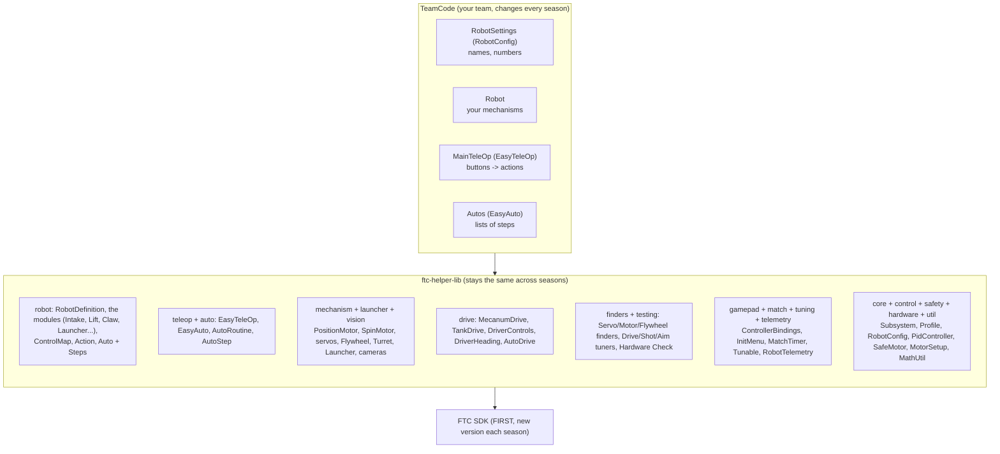
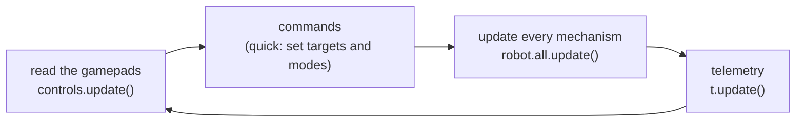

# How it all fits together

> **Work in progress:** this library and its docs are still changing. Something wrong or unclear? [Tell us](https://github.com/crossbotics/ftc-helper-lib/issues/new/choose).

**For:** students who have written a TeleOp and want the big picture. **You need:** nothing to
install; the first [lessons](../tutorials/README.md#start-here-the-main-track) help.

One page to see the whole library, and where your team's code goes. TeamCode is the folder in your
robot project where your team's own code lives.

## The layers

The five-files way ([robot module](../modules/robot.md)) sits on top: the team's `Robot.java`,
`Tunables.java`, `Controls.java`, `Actions.java` and autos use the `robot` package (a package is a
folder of classes that belong together), which builds the
same mechanism, drive, teleop and auto parts underneath. Both ways work; a team can mix them (a module's
`part()` gives the plain part inside).

**Rule of thumb:** if it is true for any game, it goes in the library. If it is about THIS game
(field positions, which tag, how many pieces, scoring heights), it goes in TeamCode.

## One loop, every loop

Every TeleOp has the same shape, whatever the robot:

- **Commands are quick.** A button sets a target ("lift to HIGH"). It never waits.
- **`update()` does the work**, once per loop: PID (the math that moves a motor to a target and
  holds it there), limits, jam checks, timing.
- **No `sleep()` in TeleOp.** While the code sleeps, the robot cannot react. Full guide:
  [Non-blocking code](non-blocking.md). Only autonomous moves and steps block, on purpose.

[`EasyTeleOp`](../modules/teleop.md) runs this loop for you in TeleOp. In autonomous, `AutoRoutine`
runs the same `update()` for you during every move and wait. The exact order, what each part reads
and writes on the hub, when files are written and what stays between OpMode runs:
[what runs every loop](every-loop.md).

You do not have to take all of it: every building block (buttons, `SafeMotor`, `PositionMotor`,
`PidController`, bulk reads, timers, the finders) works alone in your own `LinearOpMode`.
See [use only what you need](use-only-what-you-need.md).

## The interfaces (where new things plug in)

An interface is a short list of methods a class promises to have. Any class that has them can plug in.

| Interface | Ready-made | Write your own when... |
| --- | --- | --- |
| `Subsystem` | every mechanism helper | you build a new kind of mechanism |
| `AutoStep` | `goToStep`, `shootStep`, `runForStep`... | a step needs custom logic |
| `Feeder` | `MotorFeeder`, `ServoFeeder` | the launcher is fed a new way |
| `TargetSource` | `WebcamTags`, `LimelightTags`, `HuskyLensCamera` | a new camera or a new kind of target |

See [Extending the library](extending.md).

## Where each kind of number lives

| Number | Lives in | Changed by |
| --- | --- | --- |
| motor names, directions, gear ratios | TeamCode `RobotSettings` / `Robot` (five files: `Robot.java`) | code |
| every module's numbers (five files) | TeamCode `Tunables.java`, one section per part | tuning menu, then copied into the file (INIT lists the lines) |
| PID gains, positions, shot table | TeamCode, made `tunable(...)` while tuning | tuning menu, then copied into code |
| practice vs competition values | `Profile.pick(a, b)` | the INIT menu's profile line |
| match choices (alliance, delay, route) | `InitMenu` | the drivers, in INIT |
