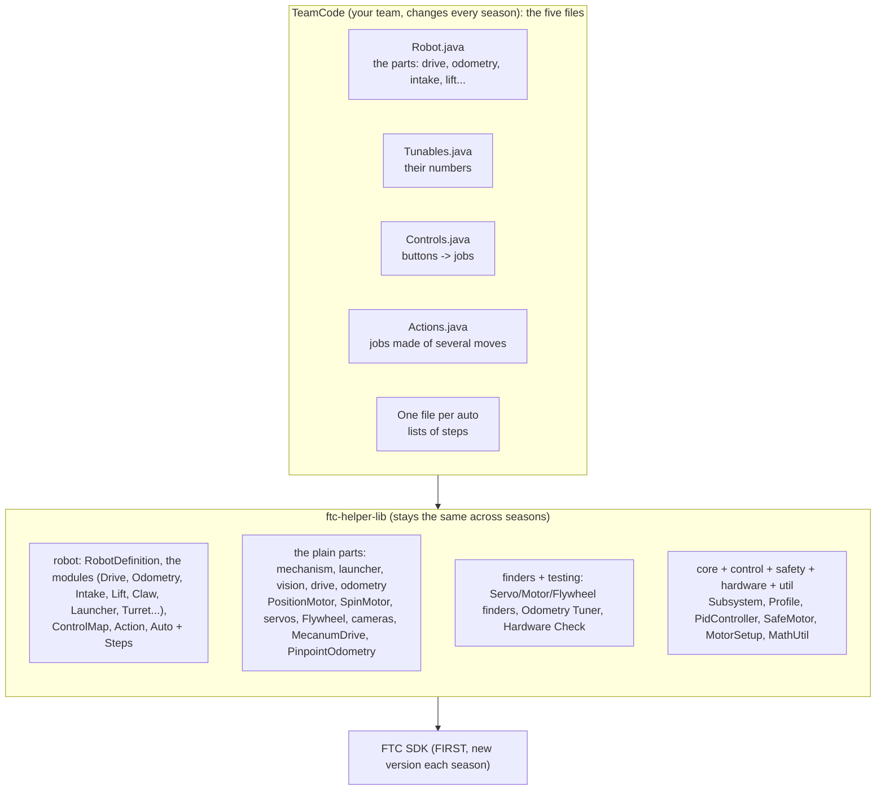
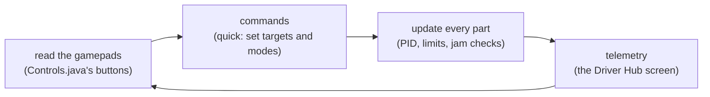

# How it all fits together

> **Work in progress:** this library and its docs are still changing. Something wrong or unclear? [Tell us](https://github.com/crossbotics/ftc-helper-lib/issues/new/choose).

**For:** students who have written a TeleOp and want the big picture. **You need:** nothing to
install. [The five files](../five-files/README.md) helps.

The library has layers, and your team's code goes in the top one. TeamCode is the folder in your
robot project where your team's own code lives.

## The layers

Your team writes the [five files](../five-files/README.md). They use the library's `robot` package (a
package is a folder of classes that belong together). `Robot.java` extends `RobotDefinition`. Each
`add(...)` line makes a module, such as `Intake` or `Lift`. A module is built on the plain parts underneath.
It adds the things every team needs: its numbers in `Tunables.java`, its usual buttons, safety checks, and
the simulator's picture of it.

**The plain parts work alone too.** Your own `LinearOpMode` can use `PositionMotor`, `Flywheel` or
`PidController` with no five files ([use only what you need](use-only-what-you-need.md)). A module's
`part()` gives the plain part inside it. Older programs use `EasyTeleOp` and `EasyAuto` (the
[earlier tutorials](../tutorials/README.md)): they still work, but new code uses the five files.

**Rule of thumb:** when it is true for any game, it goes in the library. When it is about THIS game
(field positions, which tag, how many pieces, scoring heights), it goes in TeamCode.

## One loop, every loop

Every TeleOp has the same shape, whatever the robot:

- **Commands are quick.** A button sets a target ("lift to HIGH"). It never waits.
- **`update()` does the work**, once per loop: PID, limits, jam checks, timing. PID is the math that moves
  a motor to a target and holds it there.
- **No `sleep()` in TeleOp.** While the code sleeps, the robot cannot react. Full guide:
  [Non-blocking code](non-blocking.md). Only autonomous moves and steps block, and they do it on purpose.

The library runs this loop for you: in TeleOp, and during every step of an auto. You never write it.
[What runs every loop](every-loop.md) gives the exact order and what each part reads and writes on the hub.
It also says when the library writes files and what stays between OpMode runs.

## The interfaces (where new things plug in)

An interface is a short list of methods that a class promises to have. Any class that has them can plug in.

| Interface | Ready-made | Write your own when... |
| --- | --- | --- |
| `Module` (a class to extend) | `Intake`, `Lift`, `Claw`, `Launcher`... | a new kind of part for `Robot.java` |
| `Subsystem` | every mechanism helper | you build a new kind of mechanism |
| `AutoStep` | `goToStep`, `shootStep`, `runForStep`... | a step needs custom logic |
| `Feeder` | `MotorFeeder`, `ServoFeeder` | a new kind of feeder feeds the launcher |
| `TargetSource` | `WebcamTags`, `LimelightTags`, `HuskyLensCamera` | a new camera or a new kind of target |

See [Extending the library](extending.md).

## Where each kind of number lives

| Number | Lives in | Changed by |
| --- | --- | --- |
| motor and servo names, directions, gear ratios | `Robot.java` | code |
| every part's numbers: positions, speeds, PID gains, the shot table | `Tunables.java`, one section per part | the finders and the tuning menu, then copied into the file (INIT lists the lines) |
| which button does what | `Controls.java` | code |
| start spots, routes, field points | each auto's steps | code, or the auto builder |
| practice vs competition values | `Profile.pick(a, b)` | the INIT menu's profile line |
| match choices (alliance, delay, which auto) | the INIT menu | the drivers, in INIT |
