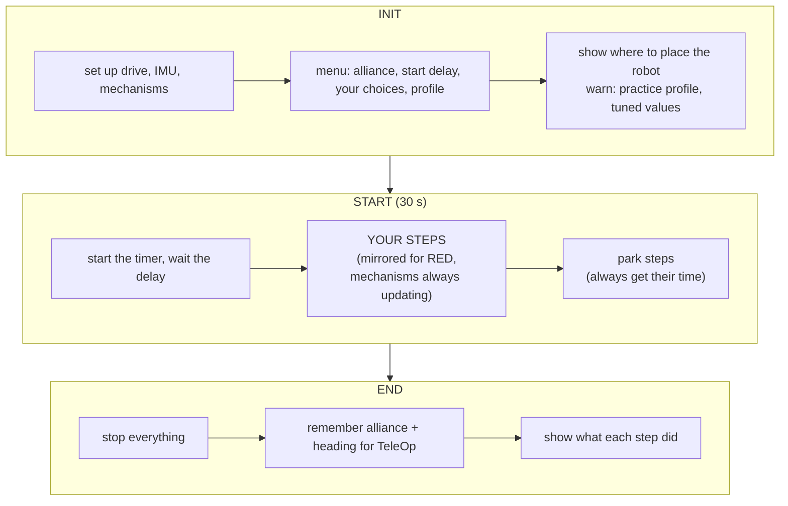
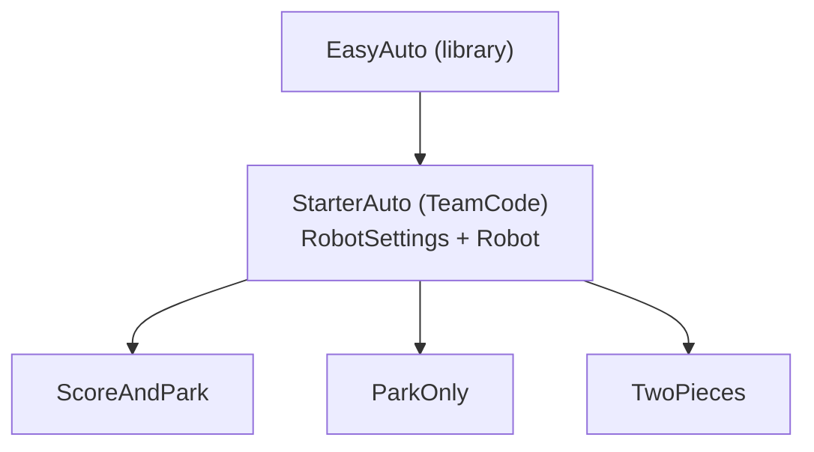

# Easy autonomous modes

> **Work in progress:** this library and its docs are still changing. Something wrong or unclear? [Tell us](https://github.com/crossbotics/ftc-helper-lib/issues).

**For:** teams that use `EasyAuto` and the [starter kit](../starter-kit.md). With a `Robot.java` (the
robot in five files), use [the autonomous builder](autonomous-builder.md) instead. **You need:** a
drive that works in TeleOp and has been tuned ([under-the-hood tutorial 09: Autonomous by hand with AutoDrive](../tutorials/09-first-auto.md)).

How to make an autonomous in a few minutes, and how to make MANY of them without copying code.
`EasyAuto` is the layer under the robot-in-five-files autonomous.

## The idea

An autonomous is a **list of named steps**. You write the list; `EasyAuto` does the rest:



## The smallest autonomous

```java
// preselectTeleOp: after this auto, the Driver Station gets "Main TeleOp" ready
@Autonomous(name = "Park Only", preselectTeleOp = "Main TeleOp")
public class ParkOnly extends StarterAuto {           // StarterAuto = the robot setup (starter kit)
    @Override                                         // fills in the method EasyAuto asks for
    protected void buildRoutine(AutoRoutine r) {
        r.move("Park", 24, 90, 0.6);                  // 24 in to the right (left on RED, unless mirrorForRed() is false)
    }
}
```

That is a complete, safe autonomous: menu, delay, mirroring, timer, stop, TeleOp hand-off.

## Many autos, no copied code

Put the robot setup in ONE base class (`StarterAuto` in the [starter kit](../starter-kit.md)).
Each autonomous `extends` it: it gets all of that setup for free and only lists its steps:



## Steps you can use

| Kind | Steps |
| --- | --- |
| Driving | `move`, `turn`, `turnTo`, `moveWithTurn`, `rememberHeading`, `returnToHeading` |
| Mechanisms | `step(label, lift.goToStep("HIGH"))`, `lift.startStep(...)`, `claw.goToStep(...)`, `intake.inStep()`, `launcher.shootStep(3)`, `turret.aimStep(...)` |
| Simple code | `run(label, () -> ...)` (`() -> ...` is a lambda: a small piece of code to run later) |
| Waiting | `waitFor(label, seconds)`, `waitUntil(label, condition, timeout)` |
| Park | `thenPark()` and the steps after it |

**Do things at the same time:** start a mechanism with a `startStep` (or `run`), then drive. The
mechanism keeps moving during the drive because the routine updates it every loop:

```java
r.step("Lift starts up", lift.startStep("HIGH"))      // does not wait
 .move("Drive to goal", 24, 0, 0.6)                   // lift rises meanwhile
 .waitUntil("Lift is up", lift::isAtTarget, 2.0);     // only waits if it is not there yet
```

`lift::isAtTarget` is a method reference: the method itself, which the wait calls every loop.

## Choices in INIT

```java
@Override protected void addChoices(InitMenu menu) {
    // "Near" is the default (first); the YES/NO line starts at YES
    menu.choice("Route", "Near", "Far").yesNo("Score", true);
}
@Override protected void buildRoutine(AutoRoutine r) {
    // the drivers' choices are known here; equals() compares two pieces of text
    if (choice("Score").equals("YES")) { ... }
    if (choice("Route").equals("Far")) r.move("Long way", 48, 0, 0.7);
}
```

One OpMode with choices is often better than many OpModes: fewer files, and the drive team picks
at the field.

## Red and blue

Write every route for **BLUE**. On RED, `turn`, `turnTo`, sideways `move` directions and
`moveWithTurn` are mirrored for you. Use `alliance()` for anything else
(`alliance().pick(blueTag, redTag)`).

**Check the field drawing each season.** Mirroring is right for a field that is a MIRROR image
between the alliances. If the field is ROTATED (turned 180 degrees) instead, the same robot-relative
route works for both alliances: add `@Override protected boolean mirrorForRed() { return false; }`.

## Time for parking

The main steps stop (or are skipped) when only the reserved seconds are left; the steps after
`thenPark()` always run. The report says which steps were cut short or skipped. In a robot-in-five-files
autonomous the same is one call in the steps: `.parkWithSeconds(4)` ([robot module](../modules/robot.md#keep-time-to-park)).

```java
@Override protected double parkReserveSec() { return 4; }   // seconds kept for parking
...
r.move(...).move(...)          // main steps: cut short when 4 s are left
 .thenPark()
 .move("Park", 20, 90, 0.8);   // always runs
```

## Where to place the robot

`startPosition()` is the note the drive team reads in INIT. `startSpotIn()` (in a five-files autonomous:
`s.start(note, x, y, heading)`) also gives the spot, seen from your drivers' wall and written for BLUE:
x inches right of the field's centre line, y from the centre toward the far wall (negative = your half).
RED uses it like the routes: mirrored, or, on a field turned half a turn like BIOBUZZ (`mirrorForRed()`
false), the same numbers from the red wall. The simulator puts the robot there in INIT. On a field where
both alliances' drivers stand at one wall (like DECODE 2025-26), also add
`@Override protected boolean alliancesOnOneWall() { return true; }`, or the simulator puts BLUE at the far wall.

## Read the report

When the steps are done, autonomous ends at once (even with time left), so the Driver Station moves
to the TeleOp (`preselectTeleOp`) and the drive team can INIT it. The report of each step's result is
shown at the end of autonomous, in the robot log, and again on TeleOp's INIT screen:

```
Grab: done
Drive to goal: STALLED          <- something was in the way
Lift is up: timed out           <- the lift was slow: tune it, or wait longer
Wait for partner: cut short (time for park)  <- the park time came during this step
Score: skipped (time for park)  <- the route is too long
Park: done
```

## Checklist for a new autonomous

1. Copy an existing one, rename the class and the `@Autonomous(name = ...)`.
2. Write `startPosition()` exactly as the drive team should place the robot.
3. Steps for BLUE. Short labels that say what the robot does.
4. Run it at low speed first (`powerLimit` 0.4). Read the report.
5. Run it as RED once. Run it with a start delay once.
6. Time it: it must finish (park included) in under ~28 s.
