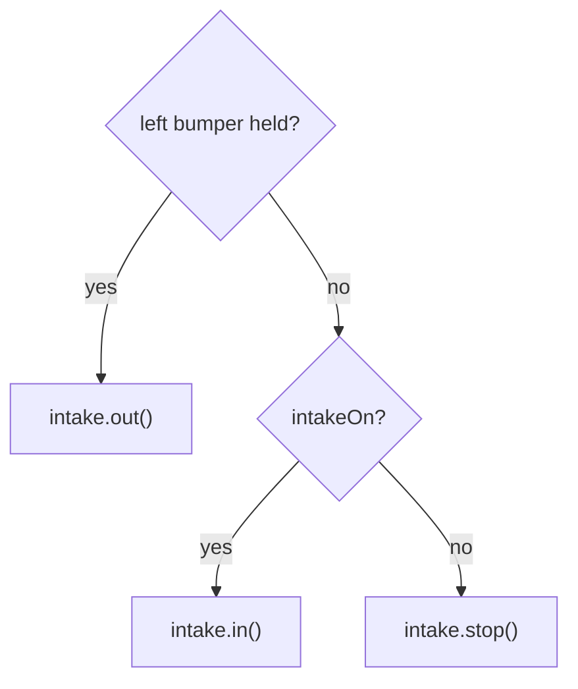

# Example: drive, slow mode, and an intake that starts on

> **Work in progress:** this library and its docs are still changing. Something wrong or unclear? [Tell us](https://github.com/crossbotics/ftc-helper-lib/issues/new/choose).

**For:** students who have driven a robot with the library and want a full TeleOp to copy. **You
need:** lessons [2 (drive)](../tutorials/start/02-drive.md) and [3 (buttons)](../tutorials/start/03-buttons.md),
or the same knowledge.

This is a complete TeleOp for a common robot. It has a mecanum drive with a slow-mode toggle. Its intake
is **ON from the start**. The driver can **stop and start** it, and **reverse it while holding a button**.

**Program:** [`ExampleDriveIntake.java`](../../examples/src/main/java/com/crossbotics/ftchelper/examples/ExampleDriveIntake.java)
**Needs:** motors `front_left`, `front_right`, `back_left`, `back_right`, `intake`.

## The controls (gamepad 1)

| Control | Does |
| --- | --- |
| Left stick | drive (forward/back, sideways) |
| Right stick X | turn |
| Y | slow mode on/off (2 buzzes = on, 1 buzz = off) |
| Right bumper | intake on/off |
| Left bumper (hold) | intake reverse (spit out). Let go: it goes back to what it was doing |
| BACK | debug telemetry on/off |

## How the intake logic works

Two switches decide what the intake does, every loop:



In the code below, `() -> ...` is a lambda: a small piece of code that you hand to a button. It runs when the driver
presses the button (or, with `bindRelease`, lets it go).

```java
private boolean intakeOn = true;          // the intake starts ON
private boolean reversing = false;        // true while the left bumper is held
...
// The buttons only change the two switches. "!" = not, so RB flips intakeOn.
.bindPress(Pad.G1, Btn.RB, () -> intakeOn = !intakeOn)
.bindPress(Pad.G1, Btn.LB, () -> reversing = true)
.bindRelease(Pad.G1, Btn.LB, () -> reversing = false)
...
// every loop:
if (reversing) intake.out();       // reverse wins
else if (intakeOn) intake.in();
else intake.stop();
intake.update();                   // the motor gets its power here
```

**Switches instead of `intake.in()` in the buttons:** with switches, the rules
are in ONE place that you can read top to bottom. "Reverse wins" is one line. When you let go of the
reverse button, the intake goes back to on OR off, whichever it was, with no extra code.

**Calling `in()` every loop is safe:** `SpinMotor.in()` does nothing when it is already running
in. So it does not interrupt anything (like a jam back-out).

**"Defaulted to on":** `intakeOn` starts `true`, and the first loop after ▶ (start on the Driver Hub) turns the intake on. It never
runs during INIT. The library moves nothing before ▶, for safety.

## How slow mode works

```java
// bindToggle(pad, button, code when it turns ON, code when it turns OFF)
.bindToggle(Pad.G1, Btn.Y,
        () -> { slowMode = true;  confirm.play(true); },
        () -> { slowMode = false; confirm.play(false); })
...
double speed = slowMode ? SLOW_SPEED : 1.0;   // "a ? b : c" = if a then b, else c
drive.drive(forward, strafe, turn, speed);    // every wheel power times speed
```

The driver cannot see a toggle, so `ToggleRumble` buzzes: two = on, one = off. A toggle flips at each press.
The first press runs the first action (ON), and the next press runs the second (OFF). `SLOW_SPEED` (0.35) is a
constant at the top of the file, so you can find and change it there.

## The rest of the program

- `"intake"` and the four drive motor names must match the names in YOUR robot configuration.
  For other drive names, set them on a `DriveConfig` ([tutorial 04](../tutorials/04-drive-mecanum.md)).
- `powers(1.0, -0.7)`: in at full power, to grab pieces fast. Out at 70%, so the intake pushes pieces
  out and does not throw them.
- The sticks: `shape(stick, 0.05, 2)` ignores tiny values, because a resting stick is often not exactly 0. It
  squares the rest for fine control. The stick reads negative when pushed up, so `left_stick_y` has a minus
  ([Signs and units](../conventions.md)).
- `t.warn(controls.getSlowActionWarning())`: a button action that takes too long freezes the whole
  robot. The screen says which one.
- `finally` stops the drive and the intake, however the program ends.

## Make it yours

- Two drivers: change the intake bindings to `Pad.G2`.
- Jam protection: add `.jamDetection(80, 0.3, 0.4)` to the intake. It needs the intake motor's encoder cable.
- To tune the slow speed live, use `static final Tunable SLOW = Tunable.number("Drive/slow", 0.35, 0.05);` and
  `SLOW.get()` ([tuning guide](../tuning/15-live-tuning.md)).
- For slow mode on a trigger instead of a toggle, use `StickShaping.slowScale(gamepad1.left_trigger, 0.35)`.
