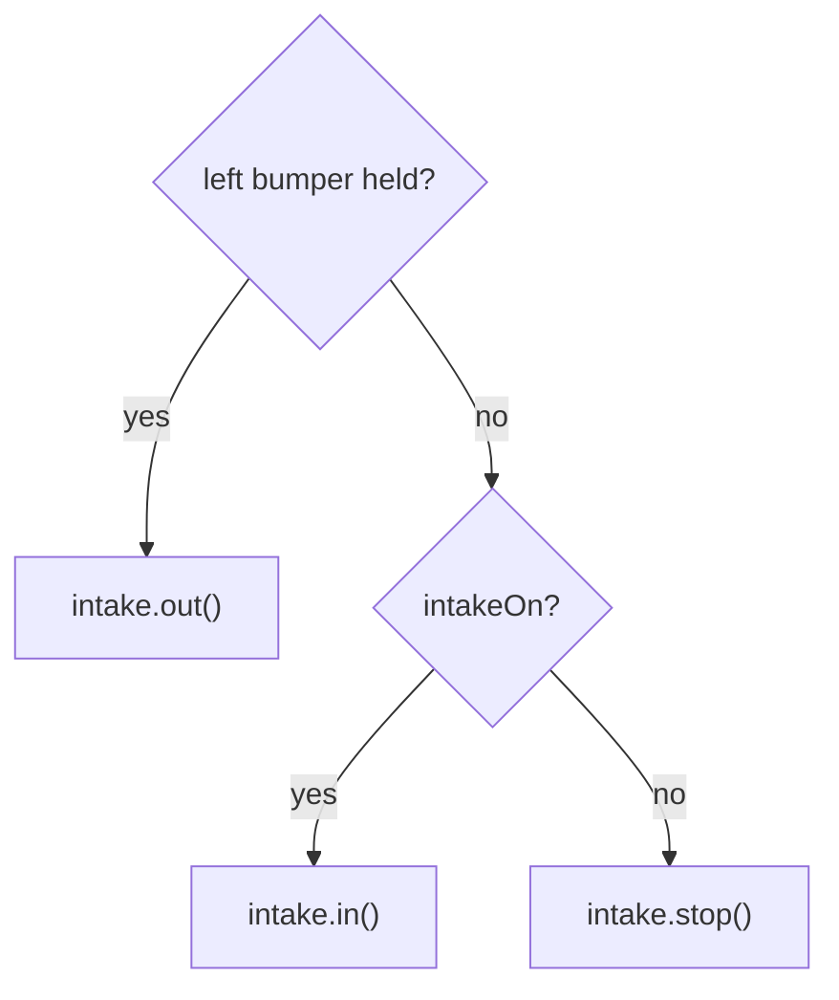

# Example: drive, slow mode, and an intake that starts on

> **Work in progress:** this library and its docs are still changing. Something wrong or unclear? [Tell us](https://github.com/crossbotics/ftc-helper-lib/issues/new/choose).

**For:** students who have driven a robot with the library and want a full TeleOp to copy. **You
need:** lessons [2 (drive)](../tutorials/start/02-drive.md) and [3 (buttons)](../tutorials/start/03-buttons.md),
or the same knowledge.

A complete TeleOp for a common robot: a mecanum drive with a slow-mode toggle, and an intake that
is **ON from the start**, can be **stopped and started**, and **reversed while a button is held**.

**Program:** [`ExampleDriveIntake.java`](../../examples/src/main/java/com/crossbotics/ftchelper/examples/ExampleDriveIntake.java)
**Needs:** motors `front_left`, `front_right`, `back_left`, `back_right`, `intake`.

## The controls (gamepad 1)

| Control | Does |
| --- | --- |
| Left stick | drive (forward/back, sideways) |
| Right stick X | turn |
| Y | slow mode on/off (2 buzzes = on, 1 buzz = off) |
| Right bumper | intake on/off |
| Left bumper (hold) | intake reverse (spit out); let go = back to what it was doing |
| BACK | debug telemetry on/off |

## How the intake logic works

Two simple switches decide what the intake does, every loop:



In the code below, `() -> ...` is a lambda: a small piece of code handed to a button, to run when it is
pressed (or, with `bindRelease`, let go).

```java
private boolean intakeOn = true;          // the intake starts ON
private boolean reversing = false;        // true while the left bumper is held
...
// The buttons only change the two switches. "!" = not, so RB flips intakeOn.
.bindPress(Pad.G1, Btn.RB, () -> intakeOn = !intakeOn)
.bindPress(Pad.G1, Btn.LB, () -> reversing = true)
.bindRelease(Pad.G1, Btn.LB, () -> reversing = false)
...
// every loop:
if (reversing) intake.out();       // reverse wins
else if (intakeOn) intake.in();
else intake.stop();
intake.update();                   // the motor gets its power here
```

**Why switches instead of calling `intake.in()` from the buttons directly?** Because then the rules
are in ONE place you can read top to bottom. "Reverse wins" is one line. When you let go of the
reverse button, the intake goes back to on OR off, whichever it was, with no extra code.

**Why is it safe to call `in()` every loop?** `SpinMotor.in()` does nothing if it is already running
in, so it does not interrupt anything (like a jam back-out).

**"Defaulted to on":** `intakeOn` starts `true`, and the first loop after START turns it on. It never
runs during INIT (the library moves nothing before START: a safety choice).

## How slow mode works

```java
// bindToggle(pad, button, code when it turns ON, code when it turns OFF)
.bindToggle(Pad.G1, Btn.Y,
        () -> { slowMode = true;  confirm.play(true); },
        () -> { slowMode = false; confirm.play(false); })
...
double speed = slowMode ? SLOW_SPEED : 1.0;   // "a ? b : c" = if a then b, else c
drive.drive(forward, strafe, turn, speed);    // every wheel power times speed
```

A toggle is invisible, so `ToggleRumble` buzzes: two = on, one = off. A toggle flips each press:
the first press runs the first action (ON), the next press the second (OFF). `SLOW_SPEED` (0.35) is a
constant at the top of the file, so it is easy to find and change.

## The rest of the program

- `"intake"` and the four drive motor names must match the names in YOUR robot configuration.
  Other drive names: set them on a `DriveConfig` ([tutorial 04](../tutorials/04-drive-mecanum.md)).
- `powers(1.0, -0.7)`: in at full power to grab pieces quickly, out at 70% so pieces are pushed
  out, not thrown.
- The sticks: `shape(stick, 0.05, 2)` ignores tiny values (a resting stick is rarely exactly 0) and
  squares the rest for fine control. The minus on `left_stick_y` is there because the stick reads
  negative when pushed up ([Signs and units](../conventions.md)).
- `t.warn(controls.getSlowActionWarning())`: if a button action took too long, it froze the whole
  robot. The screen says which one.
- `finally` stops the drive and the intake, however the program ends.

## Make it yours

- Two drivers: change the intake bindings to `Pad.G2`.
- Jam protection: add `.jamDetection(80, 0.3, 0.4)` to the intake (needs its encoder cable).
- Tune slow speed live: `static final Tunable SLOW = Tunable.number("Drive/slow", 0.35, 0.05);` and
  `SLOW.get()` ([tuning guide](tuning.md)).
- Trigger slow mode instead of a toggle: `StickShaping.slowScale(gamepad1.left_trigger, 0.35)`.
