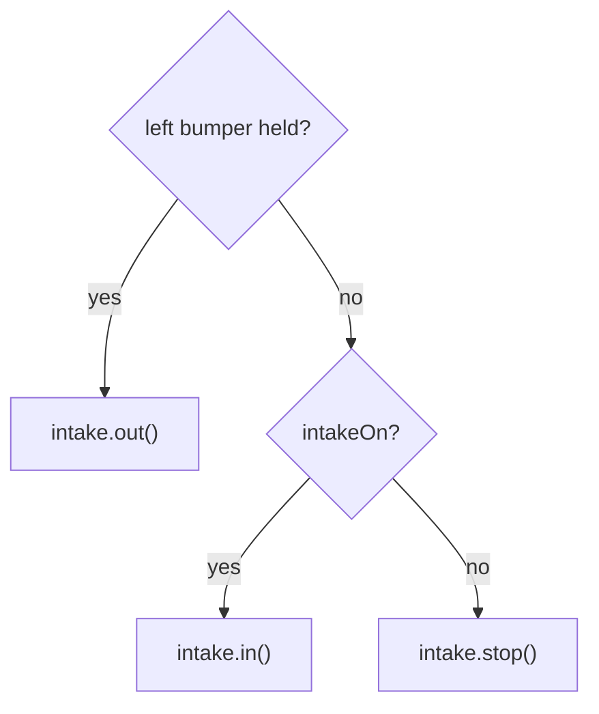

# Example: drive, slow mode, and an intake that starts on

A complete TeleOp for a common robot: a mecanum drive with a slow-mode toggle, and an intake that
is **ON from the start**, can be **stopped and started**, and **reversed while a button is held**.

**Program:** [`ExampleDriveIntake.java`](../../examples/src/main/java/io/github/jasoncross/ftchelper/examples/ExampleDriveIntake.java)
**Needs:** motors `front_left`, `front_right`, `back_left`, `back_right`, `intake`.

## The controls (gamepad 1)

| Control | Does |
| --- | --- |
| Left stick | drive (forward/back, sideways) |
| Right stick X | turn |
| Y | slow mode on/off (2 buzzes = on, 1 buzz = off) |
| Right bumper | intake on/off |
| Left bumper (hold) | intake reverse (spit out); let go = back to what it was doing |
| BACK | debug telemetry on/off |

## How the intake logic works

Two simple switches decide what the intake does, every loop:



```java
private boolean intakeOn = true;          // the intake starts ON
private boolean reversing = false;
...
.bindPress(Pad.G1, Btn.RB, () -> intakeOn = !intakeOn)
.bindPress(Pad.G1, Btn.LB, () -> reversing = true)
.bindRelease(Pad.G1, Btn.LB, () -> reversing = false)
...
// every loop:
if (reversing) intake.out();       // reverse wins
else if (intakeOn) intake.in();
else intake.stop();
intake.update();
```

**Why switches instead of calling `intake.in()` from the buttons directly?** Because then the rules
are in ONE place you can read top to bottom. "Reverse wins" is one line. When you let go of the
reverse button, the intake goes back to on OR off, whichever it was, with no extra code.

**Why is it safe to call `in()` every loop?** `SpinMotor.in()` does nothing if it is already running
in, so it does not interrupt anything (like a jam back-out).

**"Defaulted to on":** `intakeOn` starts `true`, and the first loop after START turns it on. It never
runs during INIT (motors must not move before START).

## How slow mode works

```java
.bindToggle(Pad.G1, Btn.Y,
        () -> { slowMode = true;  confirm.play(true); },
        () -> { slowMode = false; confirm.play(false); })
...
double speed = slowMode ? SLOW_SPEED : 1.0;
drive.drive(forward, strafe, turn, speed);
```

A toggle is invisible, so `ToggleRumble` buzzes: two = on, one = off. `SLOW_SPEED` (0.35) is a
constant at the top of the file, so it is easy to find and change.

## Make it yours

- Two drivers: change the intake bindings to `Pad.G2`.
- Jam protection: add `.jamDetection(80, 0.3, 0.4)` to the intake (needs its encoder cable).
- Tune slow speed live: `static final Tunable SLOW = Tunable.number("Drive/slow", 0.35, 0.05);` and
  `SLOW.get()` ([tuning guide](tuning.md)).
- Trigger slow mode instead of a toggle: `StickShaping.slowScale(gamepad1.left_trigger, 0.35)`.
