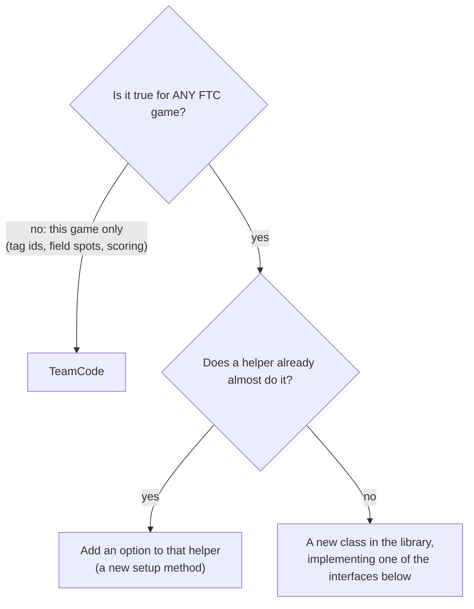

# Extending the library

The library is meant to grow every season. This page shows the four places new things plug in,
with a complete example for each, and the rules that keep it easy for the next team.

## Where does my new code go?



## 1. A new mechanism: implement `Subsystem`

```java
/** A two-servo gripper that closes both sides together. */
public class DualGripper implements Subsystem {
    private final PositionServo left, right;
    private boolean closed = false;

    public DualGripper(HardwareMap hw) {
        left = PositionServo.create(hw, "grip_left").position("OPEN", 0.2).position("CLOSED", 0.7);
        right = PositionServo.create(hw, "grip_right").reversed().position("OPEN", 0.2).position("CLOSED", 0.7);
    }

    public void close() { closed = true; }
    public void open() { closed = false; }

    @Override public void update() {
        String p = closed ? "CLOSED" : "OPEN";
        left.goTo(p); right.goTo(p);
        left.update(); right.update();
    }

    @Override public void addTelemetry(RobotTelemetry t) { t.line("Gripper", closed ? "CLOSED" : "open"); }

    /** Autonomous step. */
    public AutoStep closeStep() {
        return ctx -> { close(); ctx.waitUntil(() -> left.isDone() && right.isDone(), 1.0); };
    }
}
```

It now works in `Subsystems`, in `EasyAuto`, with buttons, and shows telemetry like every other part.

## 2. A new autonomous action: implement `AutoStep`

```java
AutoStep alignWithWall = ctx -> {
    while (ctx.isActive() && !wallSensor.isPressed()) {
        drive.setPowers(new double[]{-0.2, -0.2, -0.2, -0.2});   // back up slowly
        ctx.loop();                                             // mechanisms + telemetry keep running
    }
    drive.stop();
};
routine.step("Back into the wall", alignWithWall);
```

Rules: check `ctx.isActive()` in every loop, call `ctx.loop()` (or `waitFor`/`waitUntil`) while
waiting, have a way out (a time limit), and stop the motors you started.

## 3. A new way to feed the launcher: implement `Feeder`

```java
/** A gate servo that opens briefly to let one piece roll in. */
public class GateFeeder implements Feeder {
    private final Servo gate;
    private double closeAt = -1;
    public GateFeeder(HardwareMap hw) { gate = hw.get(Servo.class, "gate"); }

    @Override public void feedOne() { if (!isBusy()) { gate.setPosition(0.8); closeAt = now() + 0.2; } }
    @Override public boolean isBusy() { return closeAt > 0; }
    @Override public void update() { if (closeAt > 0 && now() >= closeAt) { gate.setPosition(0.1); closeAt = -1; } }
    @Override public void stop() { gate.setPosition(0.1); closeAt = -1; }
    private static double now() { return System.nanoTime() / 1e9; }
}
```

`new Launcher(flywheel, new GateFeeder(hardwareMap))`: everything else (ready checks, timing,
steps, telemetry) is unchanged.

## 4. A new camera or target type: implement `TargetSource`

Return `TargetObservation`s with **bearing positive to the LEFT**, distance in inches (or NaN),
and the picture time in `System.nanoTime()`. Then `AimController`, `Turret.aimBy` and
`Launcher.setDistance` all work with it. Look at `LimelightTags` (about 100 lines) as the model.

## The rules (so the next team can use it)

1. **One sign convention**: forward +, strafe right +, turn clockwise + for drive commands;
   headings, turret angles and bearings counterclockwise + ([Signs and units](../conventions.md)).
2. **Nothing blocks TeleOp**: commands are quick; work happens in `update()`. Only autonomous steps wait.
3. **Hardware setup leaves motors at 0 power.** Nothing moves before START.
4. **Safety stays on in every profile.** Limits, timeouts, jam checks.
5. **Testable**: put the logic in a part with no hardware, or take a clock (`LongSupplier`) and
   devices in the constructor, so tests can use pretend ones (see `library/src/test`).
6. **The six steps**: code, Javadoc, test, module page, tutorial, CHANGELOG ([Contributing](../contributing.md)).
7. **No game-specific numbers** in the library.

## Versions

Adding something new = a new middle number (0.4.0 -> 0.5.0). Changing how something old works =
a new first number, and a "Changed" note in the CHANGELOG that says what teams must change.
