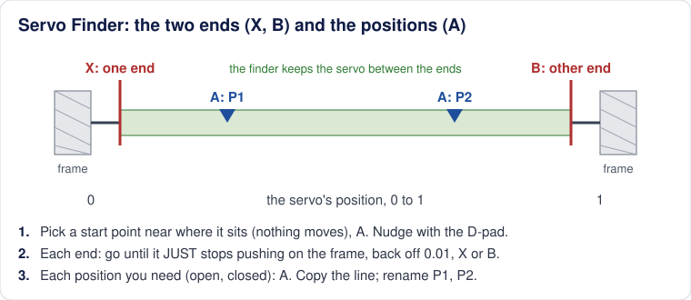
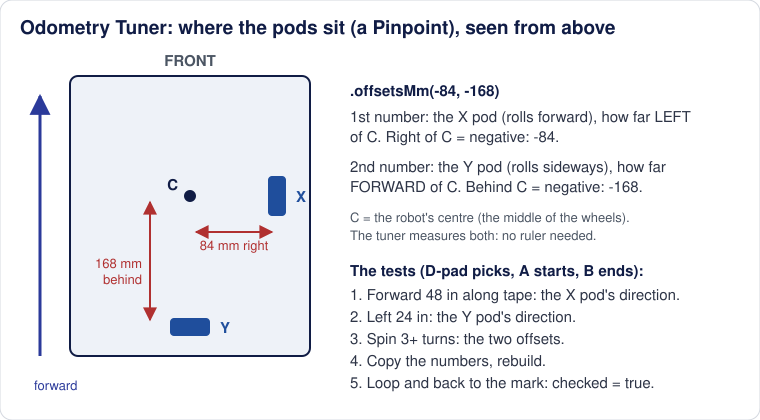
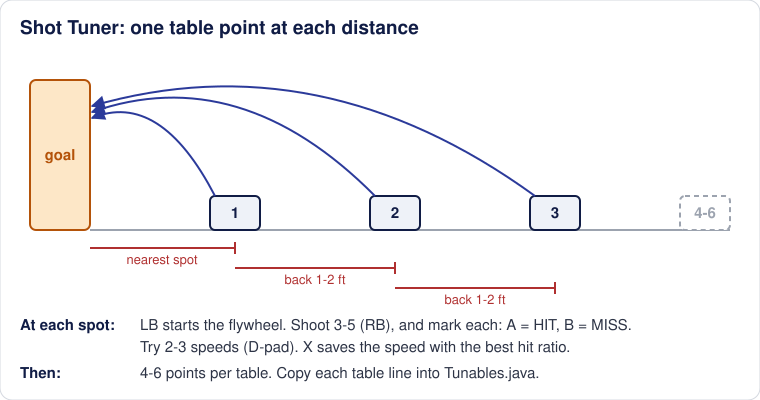

# Finding your numbers (the finders)

> **Work in progress:** this library and its docs are still changing. Something wrong or unclear? [Tell us](https://github.com/crossbotics/ftc-helper-lib/issues/new/choose).

**For:** anyone setting up a robot's numbers for the first time. **You need:** a robot with its
configuration done, the [Hardware Check](testing.md) passed, and a block to lift it.

Every robot program is full of numbers: where a servo opens, how high a lift may go, how fast a
flywheel spins, how big the wheels really are. Guessing them wastes practice time and breaks parts.
The **finders** measure them for you and show the code to copy. Reference: [finders.md](../modules/finders.md).

Each finder shows two kinds of lines. Use the kind that fits your code:

| Your code | Copy the lines that start with | Example |
| --- | --- | --- |
| the robot in five files ([lessons](../tutorials/README.md#start-here-the-main-track)) | `Tunables.` or `Robot.java:` | `Tunables.Lift: min = 0, max = 2580, P1 = 1200` = in `Tunables.java`, section `Lift`, set those three numbers |
| the older helpers | the rest (`PositionMotor.create(...)`, `c.wheelDiameterIn = ...`) | `PositionMotor.create(hardwareMap, "lift").limits(0, 2580)` |

The section is the device's name in CamelCase (each word starts with a capital, no spaces): `lift` ->
`Lift`, `intake_deploy` -> `IntakeDeploy` (unless you gave the part its own section with
`.tunables("Name")` in Robot.java: then copy the numbers into that section).
The finders call positions P1, P2...: give them real names (`low`, `high`, `open`, `closed`).

## Tune and check: all of them in one OpMode

The library adds one OpMode by itself: **Tune and check** (TeleOp list, group "Finders"). There is no
file to copy. It holds the Hardware Check and every finder that fits your Robot.java.

1. Pick **Tune and check** and press INIT. A menu shows.
2. D-pad up/down picks a tool. **A** opens it: you see its own INIT screen. Read its safety note.
3. Press **▶** (start) on the Driver Hub: the tool runs, as it does on its own.
4. Another tool: press STOP, then INIT. The menu starts on the last tool. In a tool's INIT,
   **BACK** goes back to the menu.

The menu lists only the tools that fit your robot. It finds Robot.java by itself (any class in
`org.firstinspires.ftc.teamcode` that extends `RobotDefinition`; two robots: D-pad left/right picks one):

| Tool | In the menu when |
| --- | --- |
| Hardware Check | always |
| Motor Direction Check | there is a Robot.java |
| Servo Finder | the configuration has a servo |
| Hood Finder | the robot has a hood |
| Motor Finder | the robot has a lift or an arm (or there is no Robot.java) |
| Flywheel Finder | the robot has a launcher (or there is no Robot.java) |
| Feed Stop Finder | the launcher has a `.feedStop(...)` |
| Drive Tuner | there is a Robot.java |
| Odometry Tuner | Robot.java has an `odometry(...)` line |
| Shot Tuner | the robot has a launcher |
| Camera Fix Check (**alpha**) | Robot.java has `cameraFix(camera)` ([camera fix](../modules/odometry.md#camera-fix-alpha)). BIOBUZZ teams: ignore it |
| Piece Tuner | the robot has a piece sensor |

Not in the menu: the **Aim Tuner** and the **Characterizer**. They need your camera or your lifts, so they
keep their own file (below). Your own finder files still work: keep them or delete them.

## The order

The same order as the **Tune and check** menu. Two tools keep their own file (not in the menu): the
**Aim Tuner** and the **Characterizer**. A tool for a part your robot does not have is not in the menu: skip it.

```mermaid
flowchart LR
    H["Hardware Check<br/>everything plugged in<br/>and turning the right way"] --> MD["Motor Direction Check<br/>each wheel rolls forward"]
    MD --> S["Servo Finder<br/>ends + positions"]
    S --> HO["Hood Finder<br/>a hood's two stops"]
    HO --> M["Motor Finder<br/>limits + positions"]
    M --> F["Flywheel Finder<br/>gains + recovery"]
    F --> FS["Feed Stop Finder<br/>hold + release"]
    FS --> D["Drive Tuner<br/>wheel size + strafe"]
    D --> O["Odometry Tuner<br/>pod directions + offsets"]
    O --> A["Aim Tuner (own file)<br/>camera offset"]
    A --> T["Shot Tuner<br/>shot table"]
    T --> CF["Camera Fix Check<br/>alpha"]
    CF --> P["Piece Tuner<br/>what each sensor sees"]
    P --> C["Characterizer (own file)<br/>feedforward + simulator"]
```



1. **Hardware Check first** ([testing](testing.md)): every device found, every motor turns the right way.
   Then the **Motor Direction Check**: each drive wheel rolls forward, with Robot.java's directions.
2. **Servo Finder** for each servo, **Hood Finder** for a launcher's hood, **Motor Finder** for each lift,
   arm or turret: put the limits and positions in your code (five files: `min`, `max` and the named heights
   in `Tunables.Lift`, `open` and `closed` in `Tunables.Claw`). Do this BEFORE you drive a mechanism with
   code: a wrong limit breaks parts.
3. **Flywheel Finder**: the gains for your `Flywheel` (five files: `kP` to `kF` in `Tunables.Launcher`).
   Then the **Feed Stop Finder** for a launcher with a feed stop.
4. **Drive Tuner**: the wheel size and strafe correction (five files: `.wheelMm(...)` in `Robot.java`
   and `strafeCorrection` in `Tunables.Drive`, then `Tunables.Drive.calibrated = true`; older helpers:
   `RobotSettings.auto()`), before you write autonomous.
5. **Odometry Tuner** (a robot with an `odometry(...)` line): which way each pod counts and where it
   sits (five files: the offsets in the odometry line of `Robot.java`, then
   `Tunables.Odometry.checked = true`), before autonomous uses `driveTo`.
6. **Aim Tuner**, then **Shot Tuner**: aim first, so the shot table is built with straight shots.
   The **Camera Fix Check** (alpha) only with a `cameraFix(camera)` line.
7. **Piece Tuner** for a robot with game-piece sensors. Nothing moves, so it can also come earlier.
8. **Characterizer** last, when the robot drives and its lifts work: how the motors really move, for
   feedforward and the simulator.

## Before you start

- Put the robot on a block for the Servo, Motor and Flywheel finders (wheels off the floor).
- Eye protection for the Flywheel Finder, Shot Tuner and Aim Tuner. Nobody in the line of fire.
- A charged battery (12.5 V or more) for the Drive Tuner, the Characterizer, the Flywheel Finder and
  the Shot Tuner: their numbers are powers and speeds, so they depend on the battery. Their screens show
  the battery and warn when it is low. Every finder writes the battery at the start (▶) in the results file
  (`== Drive Tuner, 2026-10-24 14:05, battery 12.8 V ==`).
- The easy way: **Tune and check** (above) has every finder that fits your robot, with no file to copy.
  Or, one file per finder: the finders are in the starter kit (`ServoFinder`, `MotorFinder`, `FlywheelFinder`, `DriveTuner`, `Characterizer`)
  and in the examples (`ExampleShotTuner`, `ExampleAimTuner`: put your launcher and camera in them).
  Remove `@Disabled`, build, and they are in the TeleOp list under "Finders".
- The robot in five files: the Servo, Motor and Flywheel finders need no code. The Drive Tuner, the
  Odometry Tuner and the Shot Tuner need one line that names your robot (it makes your `Robot`, so the tuner uses its parts;
  examples: the lesson robot's
  [DriveTuner.java](../../examples/src/main/java/com/crossbotics/ftchelper/examples/lessonbot/DriveTuner.java),
  the turret robot's [ShotTuner.java](../../examples/src/main/java/com/crossbotics/ftchelper/examples/turretbot/ShotTuner.java)):

  ```java
  @Override protected RobotDefinition robot() { return new Robot(); }
  ```

## Help on the robot

Press **GUIDE** (the center button) in any finder (not the Hardware Check, which has no help page), in
INIT or while it runs: a page shows every
button and the steps. No GUIDE button (or it does nothing)? Hold the gamepad's **START** for 1 second instead.
While help is open, the finder's buttons pause and its motors stop. GUIDE again goes back.
Then let go of every stick, trigger and button once: until then the finder ignores them.
Check once on your own Driver Hub and controllers that the help page fits and is easy to read.

**The button names on the screens** are the ones printed on YOUR controller. The library asks the FTC
SDK which kind it is (once the controller is linked with START + A, or OPTIONS + ×):

| Logitech / Xbox (this guide) | A | B | X | Y | LB | RB | LT | RT | BACK | START | GUIDE |
|---|---|---|---|---|---|---|---|---|---|---|---|
| PlayStation (PS4, PS5, Etpark) | × | ○ | □ | △ | L1 | R1 | L2 | R2 | SHARE | OPTIONS | PS |

**▶** on a screen is always the Driver Hub's start button (it starts the OpMode after INIT), never a
gamepad button. **START** is the small button on the gamepad (OPTIONS on a PS controller). This guide
uses the Logitech names.

## Motor Direction Check: each wheel rolls forward

**You need:** the robot on a block (the wheels spin). **Done when:** every drive wheel rolls the way that drives
the robot forward.

It spins ONE drive motor at a time at 30%, set up exactly as Robot.java says (its direction, from
`reversed(...)` on the drive line). The Hardware Check spins a motor in its raw direction; this check uses
yours, so it shows what the robot will really do.

1. Hold **X** (front-left), **Y** (front-right), **A** (back-left) or **B** (back-right). A tank drive: X = left,
   Y = right. The screen shows the motor's name, and "(reversed)" when Robot.java reverses it.
2. Each wheel must roll the way that drives the robot FORWARD (for the robot in five files, the front is
   the end Robot.java says).
3. One rolls backward: add its name to `reversed(...)` on the drive line in Robot.java (or take it out).
   INIT again and check it again.
4. The wrong wheel turns? Its name in the robot configuration is on the wrong port: swap the names on the
   Driver Hub, not the wires.

Run it on every new robot, and again after any motor or wire is changed: a wrong direction makes the robot
drive in circles, strafe the wrong way, or fight itself.

## Servo Finder: ends and positions

**You need:** the robot on a block. **Done when:** every position you use is in `Tunables.java`, between the two ends.

### A new servo part, step by step

The hard part of a new servo is not knowing which way it turns, or where its ends are. Go in this order, slowly.
Use **Tune and check > Servo Finder**: it knows Robot.java (`reversed()`, a second servo, the servo's catalog part).

1. **Arm off.** Put the servo in, but leave its arm (the horn) off, or its screw loose. Then nothing can hit the
   frame while you start.
2. **Go to the middle.** Choose the servo, leave the start point at 0.5, press **A**. The servo goes to the middle
   of its turn and holds there.
3. **Put the arm on in the middle of the part's swing**, so the part can move both ways from here. Tighten the
   screw. Mark the horn and the shaft with a paint pen: a new horn later goes on the same tooth.
4. **Find the direction.** Press **D-pad left** once (a 0.01 step), then **D-pad up** (bigger) a few times and watch the part. Write it down:
   "bigger = open", "bigger = up". There is no standard way a servo turns
   ([why](../conventions.md#servos-and-motors-which-way-is-bigger)); for a catalog servo the screen shows a
   **Hint** (goBILDA: "bigger = clockwise (seller)"), but only your test counts, because the part's way depends
   on how the servo is mounted.
5. **Find each end, slowly.** Move toward one end in small steps (D-pad up/down; D-pad left makes the step
   smaller, down to 0.001) until the part JUST touches the frame. **A servo that hums is pushing on something: back off at once**
   (it gets hot and can strip its gears). Back off 0.01 more and press **X**. The same at the other end: **B**.
6. **Save each position you need** (open, closed, rest, push...): move there, press **A**. Then copy the lines
   into `Tunables.java` (step 3 below).
7. **Want "bigger" the other way?** (For example bigger = up.) Add `.reversed()` to the part in Robot.java, then
   find the positions again (each old number becomes 1 minus it).

**Two servos on one part:** do step 1 for BOTH arms. Choose the FIRST servo: the second moves with it, mirrored.
Then put both arms on at the middle (step 3), so they match, and go on from step 4. If they do not quite meet, set
`alsoTrim` after (in TeleOp).

**At ▶** the part goes straight to its first position from wherever it is (a servo always knows its own
angle). Keep hands clear.

### The finder's buttons



0. **Full range?** If the part has `.fullRange()` in Robot.java (the servo's whole turn: a goBILDA 2000
   servo 300 degrees instead of 270, [why](../modules/hardware.md#full-range)), press **Y** while choosing
   the servo, so the finder uses the same range. Positions found with one range are wrong with the other.
1. Choose the servo (D-pad, A). A servo cannot tell the program where it is, so first choose a START POINT near
   where it sits now (D-pad up/down; nothing moves), then press A: it moves there. Then nudge it with the
   D-pad: up/down moves it by the step; left/right makes the step smaller/bigger (0.1, 0.05, 0.01, 0.005, 0.001; it starts at 0.05, and the screen shows it). Use a big step to get close, then a small one for the exact spot.
2. Move it toward one end until it JUST stops pushing on the frame (listen: a straining servo hums).
   Back off a little (0.01). Press **X**. Do the same at the other end and press **B**. From then on the finder
   keeps the servo between them (hold **LB** while nudging to go past, e.g. to mark an end again). The ends
   are for you: keep every position you save between them (five files have no end lines to copy; the
   older helpers get them as the servo's limits).
3. Move to each position you need (open, closed...) and press **A**. Rename P1, P2 in your code.
   Five files: the line `Tunables.Claw: P1 = 0.210, P2 = 0.770` becomes
   `public static double open = 0.210, closed = 0.770;` in `Tunables.Claw`. Keep every position
   between the ends the finder shows. **Y** undoes the last saved position; **BACK** chooses another
   servo (the lines found so far stay on the screen).

**`reversed()` in Robot.java:** in **Tune and check**, the finder turns the servo the same way (the screen says
`Direction: reversed, as in Robot.java`), so its numbers go straight into Tunables.java. Either order is fine:
`rest` may be higher or lower than `push`, `open` higher or lower than `closed`. Which way a bigger number turns
depends on the servo (there is no standard): D-pad up shows you ([Signs and units](../conventions.md#servos-and-motors-which-way-is-bigger)).

**A part on two servos** (`alsoServoReversed(...)` or `alsoServo(...)` in Robot.java, for example a claw with a
servo for each finger, or two feed arms): choose the FIRST servo. In **Tune and check**, the second servo moves
with it (mirrored or the same way, as Robot.java says), so the two never fight; the screen shows
`Moves with it: claw_right (mirrored)`. The second servo cannot be chosen alone. `alsoTrim` is not used in the
finder: check it after, in TeleOp. A Servo Finder of your own (not from Tune and check) does not know Robot.java
and moves only one servo: it would drag the other, unpowered servo through its gears. Take the other side's arm
off first, or unplug the second servo's wire.

**After a new horn (maintenance):** loosen or take off both arms. In the finder, choose the first servo, set the
start point to your `rest` number and press A: both servos go there and hold. Put the arms on at that position
and tighten them. Move to your other position and check that they meet. Mark the horn and the shaft with a paint
pen, so the next horn goes on the same tooth. One spline tooth on a goBILDA servo is about 0.05 in position.

## Hood Finder

**You need:** the hood mounted, the flywheel off. **Done when:** `posA`, `posB` (or a `calibration` table) and `travelSec` are in `Tunables.Hood`.

For a launcher's [hood](../modules/robot.md#hood) (`Tunables.Hood`). It reads the hood from Robot.java,
so it works before Tunables.Hood has numbers. A hood with `.fullRange()` gets the same full range here.

1. **A servo hood:** choose a START POINT near where the hood sits (D-pad up/down; nothing moves), press **A**.
   Then nudge with the D-pad (up/down moves it by the step; left/right makes the step smaller/bigger (0.1, 0.05, 0.01, 0.005, 0.001; it starts at 0.05, and the screen shows it)). **A motor
   hood:** nothing is powered; start the OpMode with the hood on the stop you want as 0 ticks (the same
   as before a match), then move the hood by hand and watch the encoder.
2. Go to one stop until it JUST touches (a servo hums when it strains), back off a hair, press **X**
   (stop A). The other stop: **B** (stop B). The screen shows `Tunables.Hood: posA = 0.205, posB = 0.648`.
   That is all you need: the hood then works in servo positions, and the Shot Tuner writes positions
   into the table.
3. **Angles (optional).** Measure the hood's angle (an angle app on a phone laid on the hood) at each
   stop: **hold LB + D-pad** to type it in BEFORE you press X / B. You get `angleA = 0, angleB = 25` too.
   Each angle you type is used for ONE place (a stop or a point), so measure again at the next place. An
   angle at only one stop is not written: the screen says which stop still needs its angle.
4. **A linkage** (the angle is not a straight line of the servo position): add points in between: move
   there, type in the angle (LB + D-pad), press **A**. With points and the angles at both stops you get
   a `calibration` line INSTEAD of the posA / posB line (the hood reads one or the other: both stop INIT;
   its first and last rows are the stops). The angles must keep going one way along the hood, as INIT
   checks: a point that breaks that is shown as a warning and no table is written. **Y** undoes the last
   point.
5. Copy the lines into `Tunables.java` (the robot uses the file, not this screen). Then time a
   stop-to-stop move for `travelSec` (servo hood): the launcher waits that long (a share of it for a
   shorter move) before firing.

## Motor Finder: limits, positions, top speed

**You need:** the robot on a block, the mechanism at its bottom. **Done when:** `min`, `max` and every named height are in `Tunables.java`.

1. **Put the mechanism at its bottom**, then choose the motor (D-pad, A): its count starts at 0 there.
2. Move it slowly with the right stick (max power starts at 0.3). Stop just before the bottom and
   press **X**; just before the top and press **B**. From now on the power goes off at those marks; the
   mechanism coasts a little past them (more at a higher max power), so mark them with some room.
3. Press **A** at each height you need. A height outside the two marks gets a warning (the robot stops
   at min and max, so it could never get there): **Y** undoes it.
4. Hold **RT** for a speed test: full power up, stopping before the top. The top speed helps you
   choose a max power and PID gains.
5. Five files: the line `Tunables.Lift: min = 0, max = 2580, P1 = 1200` becomes `min = 0, max = 2580`
   and `low = 1200` (your name) in `Tunables.Lift`. If it also says `Robot.java: add .reversed()`,
   add `.reversed()` to that part in `Robot.java`. An `Arm` reads degrees, not counts: see the
   [reference](../modules/finders.md#motorfinderopmode).

Watch the current (amps): a high number while not moving means it is pushing on something. Stop.

## Flywheel Finder: gains and recovery

**You need:** safety glasses, nobody in the line of fire, a charged battery. **Done when:** the `Tunables.Launcher` gains line is copied and the speed holds the target.

1. Choose the flywheel motor. Let go of A, then hold **A** again: full power until the speed stops
   rising. It works out the gains from the top speed. Wheel spinning the wrong way? Let go, press
   **X** (reverse), try again.
2. Press **B**: it holds a speed (60% of the top). Change it with the D-pad to the speed you shoot at.
3. If the measured speed stays below the target at every speed, press **RB** (more F); above, **LB**.
4. Feed one piece with the robot's own feeder, or push it in with a stick: **never
   with your fingers**, which would be next to a wheel at full speed. Safety glasses on. The screen
   shows the recovery time (on the robot only: the simulator has no piece to feed). Use it for the
   launcher's `shotInterval(...)` (a little longer than the recovery time).
5. Five files: copy the `Tunables.Launcher: kP = ..., kI = ..., kD = 0, kF = ..., nominalVolts = ...` line
   into `Tunables.Launcher` (the section is the motor's name). A slow recovery adds `shotIntervalSec`.
   `nominalVolts` is the battery voltage the gains were found at: the launcher's battery compensation
   (off unless you write `batteryCompensation = true`) uses it, so a low battery spins the wheel back up as fast. The RB/LB F changes are only on the
   screen: copy the line (with the F you ended on) into `Tunables.java`.

## Feed Stop Finder

**You need:** the launcher's Robot.java line with `.feedStop(...)`, one piece. **Done when:** `feedStopHold` and `feedStopRelease` are in `Tunables.java`.

For a launcher with a feed stop (`.feedStop("feed_stop")` in Robot.java): where it holds the pieces back,
and where it lets one through. It is in [Tune and check](#tune-and-check-all-of-them-in-one-opmode) for
such a robot.

1. Put a piece behind the feed stop. The wheel stays off.
2. A servo's position is a number from 0 to 1. With the D-pad, pick a start number near where the feed
   stop sits now (nothing moves yet). **A** moves the servo there.
3. D-pad up/down moves it by the step; left/right makes the step smaller/bigger (0.1, 0.05, 0.01, 0.005, 0.001; it starts at 0.05, and the screen shows it).
4. Where it holds the piece firmly, without straining on the frame: press **X** to save this as the
   hold position. Where the piece rolls through freely: press **B** to save this as the release
   position. **A** then goes between the two, to try them.
5. Copy the line it shows, e.g. `Tunables.Launcher: feedStopHold = 0.150, feedStopRelease = 0.550` (the
   section is your launcher's: a launcher on `shooter` says `Tunables.Shooter`).

The open time (`feedStopOpenSec`) and the push time (`assistSec`) are not measured here. Fire a few pieces
in the PRACTICE profile ([profiles](profiles.md); debug lines show only there) and read the debug lines on
the Driver Station: `Last feed ended: shot seen` is good; `backup time` means the wheel did not see a shot
in time: the piece did not reach the wheel (more `assistSec`, or check the release position), or your
wheel slows by less than 150 RPM per shot (a heavy wheel).

## Drive Tuner: wheel size and strafe correction

**You need:** a charged battery, tape, 5 ft of clear floor. **Done when:** the Drive test (and on a mecanum the Strafe test) measures 48 within 0.5 in, and `calibrated = true` is copied.


**Set up the floor:** a straight line of tape, marked **0** and **48 in**, and 5 ft of clear floor ahead
of the robot and to its right (and its left, for the optional Strafe left test). **Start each test** with the robot's **left wheels touching the tape**
(their outside edge) and the front left wheel's front edge on **0**. **Why the left wheels:** a wheel
edge against a line is easy to keep straight when you push by hand, and easy to measure from: forward
from 0 to that wheel's front edge, sideways from the tape to the left wheels.

1. **Push test:** A, then roll the robot by hand, its left wheels along the tape, until the front left
   wheel's front edge is on 48 in, then B.
   This gives the wheel size from the encoder counts alone. Every wheel must count up by about the
   same amount; if one does not, fix its direction or encoder cable first.
2. **The power:** on the test list, D-pad left/right sets the power the Drive and Strafe tests drive at
   (`Power : 0.5`; 0.3 to 1.0). Set the power your autonomous moves use (`.move("...", 24, 0, 0.6)`: 0.6).
   **Why:** a faster robot slides further when it stops, so the numbers fit the power they were measured
   at. Changing the power means the tests must measure right again. Moves of very different lengths?
   See `Tunables.Drive.slowDownIn` ([tunables](tunables.md#drive)).
3. **Drive test:** A; it drives 48 in. Measure, set the real distance with the D-pad, A. The new
   wheel size is used at once: run it again until it measures 48 (wheels slip a little on tiles, so
   this is the final word). A move that got stuck is not measured. The screen keeps showing the heading
   and the wheel counts while it drives.
4. **Strafe test** (mecanum): back at the start, A; it strafes right, away from the tape. Measure from
   the tape to the left wheels, straight across. The same as the Drive test, for `c.strafeCorrection`.
   No push test sideways: pushed sideways by hand, a mecanum wheel's rollers spin and its encoder
   counts almost nothing. The strafe correction is about the slip of a **powered** strafe, so only the
   robot strafing by itself can measure it.
   **Strafe left** (only if moves to the left come up short or long while moves to the right are
   right): start with the robot's **right** wheels on the tape; it strafes left. Measure from the tape to the
   right wheels. The same steps, for
   `Tunables.Drive: strafeCorrectionLeft`. Not written, the left uses `strafeCorrection` too.
5. **Turn 90 left** (a check, nothing to copy): it turns 90 degrees left; put a square against the
   robot to see it, and the screen shows the IMU's heading (it should say 90).
6. Copy the lines, then switch autonomous on:
   - five files: `Robot.java: .wheelMm(96.8)` goes in the drive line (it replaces `.wheel(...)` if you
     used a catalog wheel), `Tunables.Drive: strafeCorrection = 1.180` in `Tunables.Drive`. Once the
     Drive test (and on a mecanum the Strafe test) measures 48 within 0.5 in, the tuner also shows
     `Tunables.Drive: calibrated = true`: copy that too.
   - older helpers: the `c.` lines go in `RobotSettings.auto()`, then `c.calibrationConfirmed = true`.

## Odometry Tuner: directions, offsets and a loop check

**You need:** a 48 in tape strip with a start mark, room to spin. **Done when:** the Loop test shows `checked = true` and it is in `Tunables.java`.



For a robot in five files with an `odometry(...)` line ([odometry](../modules/odometry.md)). It needs
your robot, in a small file next to `Robot.java` (the odometry robot's
[OdometryTuner.java](../../examples/src/main/java/com/crossbotics/ftchelper/examples/odometrybot/OdometryTuner.java);
the whole file to type: [lesson 7](../tutorials/start/07-odometry.md#5-the-odometry-tuner)). Put a 48 in
strip of tape on the floor with a mark at its start. The sticks drive slowly (30%) in every test; you
can also push the robot by hand. D-pad chooses, **A** starts, **B** ends the test.

1. **Forward 48 in:** drive or push it 48 in straight forward along the tape, B. "Forward OK" (and how
   many % off), or "counted BACKWARD": add `"x"` to `.reversed(...)` (dead wheels: that pod's port
   name). The simulator's Pinpoint works the same way: `odometry.reversed = x` in the robot file is a pod
   wired backward, and the code's `.reversed(...)` (and `.offsetsMm(...)`) is what the Pinpoint is told, so
   a robot file that differs from Robot.java shows the same mistakes as a real robot. An OTOS gets `Tunables.Odometry: linearScalar = ...` to copy (multiply it with the one in use).
   More than 2% off: check the pod type (Pinpoint) or `ticksPerMm(...)` (dead wheels), and the tape.
   More than 10% off: "was it really 48 in?" (a mistake in the test: measure and run it again).
2. **Left 24 in:** drive or push it 24 in to its LEFT, B. "Left OK", or "counted RIGHT": add `"y"` to
   `.reversed(...)` (dead wheels: the sideways pod's name). A tank robot: push it.
3. **Spin 3+ turns:** turn it in place at least 3 times with the right stick, B (fewer: it says how many
   and asks for more). It measures the turn
   from the Pinpoint's own heading, or from the Control Hub's IMU for dead wheels and the OTOS (so they
   need `.imu(...)` in `drive(...)`, or the tuner stops at INIT and says so). It shows the offsets
   as the numbers to change: `Robot.java: in the odometry(...) line, .offsetsMm(-84.2, -167.5)`
   (three wheels: `.trackWidthIn(..).perpForwardIn(..)`; two: `.parallelLeftIn(..).perpForwardIn(..)`).
   Change only those numbers: `.reversed(...)` and the pod type stay as you wrote them.
   An OTOS has no offsets to measure: measure `mountIn` with a tape, and its turn scale
   [by hand](../modules/odometry.md#otos-turn-scale-by-hand).
4. Copy the numbers into your odometry line, rebuild.
5. **Loop and back:** start on the mark, drive anywhere (at least 24 in away: a robot that never left the
   mark proves nothing, and the tuner says so), come back onto the mark facing the same way, B.
   Within 1 in and 2 degrees it shows `Tunables.Odometry: checked = true`: set it in `Tunables.java`.
   Until then, autonomous `driveTo` steps are skipped on the robot.

## Aim Tuner: camera offset

**You need:** its own file, safety glasses, pieces, the target 4-6 ft away. **Done when:** shots go in the middle at two or three distances, and the `cameraOffset` line is copied.

**Before you start:** the Aim Tuner is set up with the older helpers' pieces, not with `robot()`: your
`createCamera()`, and `createTurret()` or `robotConfig()` (to aim by turning the robot), and
`createLauncher()` for test shots ([reference](../modules/finders.md#aimtuneropmode)). For a robot in five
files, `robotConfig()` is `return new Robot().robotConfig();`. The Characterizer is the same: it needs
`robotConfig()`.

1. Park the robot 4-6 ft from the target, facing it. A turret with a home switch: press **X** first.
2. Hold **A**: it aims. Shoot (**RB**). LB stops the flywheel.
3. Shots go LEFT of the middle: press D-pad RIGHT (aim more to the right). Shots go right: LEFT.
4. Repeat until shots go in the middle, at two or three distances. Copy the offset line
   (five files, with a turret: `Tunables.Turret: cameraOffset = -1.5`; aiming by turning the whole robot:
   `Tunables.Aim: cameraOffset = -1.5`).
   If the offset that works changes with distance, the camera is off to the side of the launcher:
   move it onto the launcher's line (or as close as you can), or tune at the distance you shoot from most.

## Shot Tuner: the shot table

**You need:** a charged battery, safety glasses, pieces, the aim tuned. **Done when:** each table has 4-6 points, copied into `Tunables.Launcher`.



It tunes the way experienced teams do: at each distance, shoot 3-5 pieces at a speed and mark each
one **HIT** or **MISS**, try the next speed, and keep the speed with the best **hit ratio** (hits out
of shots: 3 in out of 4 beats 2 out of 3). Every button is on **gamepad 1**.

1. **Pick the table.** With one table per game piece (`speedByDistancePollen`, `speedByDistanceNectar`),
   press **Y** until `> Table`, then **D-pad left / right** picks the table: you tune one table at a
   time, each with its own points. Load that game piece.
2. Park at the nearest distance you will shoot from. The screen shows the distance and where it came
   from: `(camera, 12 readings)`, or `(odometry, ...)` when the camera does not see the goal (with an
   `odometry(...)` line and `Tunables.Aim.goalX, goalY`; put the robot in the middle of the field
   facing away from you before INIT, or override `startSpotIn()`). The distance is the average of the
   last half second of fresh readings, so one noisy picture does not go into the table. Press **LB**
   to start the flywheel (it is off at the start).
3. The speed starts at what your table already gives at this distance (or `Tunables.Launcher.speedRpm`),
   so you only fine-tune. Shoot 3-5 (**RB** one at a time, or hold **RT**) and after each shot press
   **A** = HIT or **B** = MISS (the marks go to the shots in the order they were fired). Each shot keeps
   the speed, hood angle and distance it was **fired** with, so changing the speed or the hood before you
   mark does not move the mark. The screen shows `Hits at 2550: 3/4` and every speed tried here
   (`Tried here: 2450: 1/3, 2550: 3/4 (best)`). Change the speed with the D-pad (**Y** steps through what
   the D-pad changes: SPEED, HOOD with a hood, TABLE with two tables, and DISTANCE: a distance you type in
   when neither the camera nor the odometry gives one) and shoot 3-5 again. 2-3 speeds is usually enough.
   - **Pressed the wrong one?** **Left stick click** takes back the last HIT / MISS; that shot waits to be
     marked again.
   - **A "shot" with no piece** (the wheel slowed down by itself, so `Shots fired` went up):
     **right stick click** drops the last shot that is not marked yet.
4. Press **X** to save: it keeps the speed with the **best hit ratio** at this distance (a tie: the one
   with more shots). Shots not marked yet must be marked first. With no shots marked at all, X only
   warns; X again within 3 s saves the speed now anyway (a guess, not a tested speed), and with a hood the hood angle those shots were fired with. Each point also keeps
   the flywheel speed **measured** as the pieces were fed. If the flywheel was well under the speed
   asked for, it **sagged** (the last shot or a low battery slowed it, and it was not back yet): the
   screen warns. Wait for `Ready: YES` between shots and charge the battery, or the table will not match
   a match. A wrong point: stand there and **hold BACK 1 s** to delete it (a hold, so it is not pressed
   by mistake).
5. Move back 1-2 ft (drive with the sticks) and do it again; the hit counts start again by themselves
   when the distance moves more than 4 in, and shots fired at the old spot that were never marked are
   dropped. `Points: POLLEN 3, NECTAR 0  (4-6 per table)` says how far
   you are: 4-6 points per table cover the field. Then the next table (step 1).
6. **Copy the tables into `Tunables.java`**: the robot uses the file, not the tuner's screen. There is
   one line per table, like `public static double[][] speedByDistancePollen = {{24, 2600}, {48, 3100}};   // in Tunables.Launcher`
   (with a hood: `{{24, 2600, 4}, {48, 3100, 12.5}}`, the third number the hood):
   it replaces the line with the same name in `Tunables.Launcher`. The lines are also saved on the
   Control Hub when you press STOP (`/sdcard/FIRST/ftc-helper/finder-results.txt`). Older helpers: the
   `new ShotTable()` lines go into your Robot class (each with a comment like `// 4/5 in, measured 2531 RPM`).
   Between the points the launcher **blends** the speed (halfway between two points: halfway between
   their speeds); outside them it uses the nearest point.

With `robot()`, the Shot Tuner uses your robot's launcher, camera and drive. A turret stays still and
the "fire only when aimed" checks are off: point the robot at the goal with the sticks. **With a hood**
(`.hood(...)` in Robot.java, or the older helpers' `.hood(servo)`), **Y** also chooses HOOD: the D-pad
then steps it (a fifth / a fiftieth of its range: 5 / 0.5 deg for a 0-25 deg hood). It starts at the
table's hood for this distance, like the speed. Each speed and hood angle is its own try in the hit
counts (`Tried here: 2550 @ hood 10: 3/4 (best), 2550 @ hood 12.5: 1/3`), and X saves the hood the
winning shots were fired with.

Charge the battery before tuning speeds: a weak battery changes how far the shots go (the screen shows
the battery and warns below 12.5 V). The launcher's
speed trim (the D-pad in a match) is not used in the tuner, so the table holds the real speeds.

## Camera Fix Check (alpha)

**You need:** a `cameraFix(camera)` line in Robot.java and AprilTags in view. BIOBUZZ teams: skip it.
**Done when:** `turnDegBlue` and `turnDegRed` are in `Tunables.CameraFix`. Nothing moves.

1. Put the robot on the field facing AWAY from your drivers' wall (heading 0), tags in view.
2. The screen shows where the camera puts the robot. Check it with a tape measure.
3. **X** saves the turn for BLUE. Stand at the RED wall and press **B** for RED.
4. Copy the line into `Tunables.CameraFix`. Details: [camera fix](../modules/odometry.md#camera-fix-alpha).

## Piece Tuner: what each sensor sees

**You need:** one piece of each kind. **Done when:** "It sees" names each piece you hold up, and NONE with nothing there.

For a robot with a [`Pieces` or `PieceSensor`](../modules/robot.md#pieces-and-piecesensor) line. Its
file names your robot, like the Odometry Tuner (the cookbook's [piece-tuner recipe](../cookbook.md#how-do-i-tune-the-piece-sensors)).
Nothing moves, so no block is needed.

1. Mount the sensor where it will stay. Put a piece where it really sits or passes (at the intake: the
   spot where the sensor sees it go by).
2. D-pad up/down: the sensor. D-pad left/right: which kind is in front of it. **A**: measure (20
   readings, about half a second: hold still). Do every kind, then EMPTY (nothing there).
3. Copy the lines into `Tunables.java` (e.g. `Tunables.IntakeColor: POLLEN = 74`), rebuild, and run it
   again: "It sees" should name each piece you hold up, and NONE with nothing there.

Problems it warns about: two kinds that read nearly the same (a colour sensor too far away, a
distance sensor that does not look straight across), and EMPTY that looks like a piece (aim the sensor
at a far wall or a grey or black background).

## Characterizer: how the robot really moves

**You need:** its own file, a charged battery, 5 ft of clear floor. **Done when:** each test ran 2-3 times and the numbers agree.

Last, when the robot drives and its lifts work: the **Characterizer** measures how each motor really
behaves (the power to start moving, the power per speed, how quickly it speeds up, and for a lift the
power that holds it against gravity). Two uses: feedforward in your code (see
[Feedforward](../modules/control.md#feedforward)), and real numbers for the
[simulator](simulator.md#real-numbers-the-characterizer).

1. In `Characterizer.java`, list your lifts/arms with soft limits a little inside the hard stops
   (counts from the bottom) and your flywheels.
2. Drive test: about 5 ft clear in front and behind, on tiles. Turn test: room to turn.
3. Lifts start at the BOTTOM. An arm's high limit stays below straight up.
4. D-pad chooses, **A** runs, **B** stops. It stops by itself if something turns the wrong way, goes
   past a limit, or pushes without moving. Run each test 2-3 times on a charged battery.

Details: [finders module](../modules/finders.md#characterizeropmode).

## The results file

Every finder adds its lines to `/sdcard/FIRST/ftc-helper/finder-results.txt` on the Control Hub when
you press STOP, with the date. The Driver Station says whether it worked. Get it with the REV Hardware Client (file manager) or Android
Studio's Device Explorer. The newest results are at the end.
