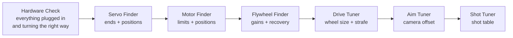

# Finding your numbers (the finders)

Every robot program is full of numbers: where a servo opens, how high a lift may go, how fast a
flywheel spins, how big the wheels really are. Guessing them wastes practice time and breaks parts.
The **finders** measure them for you and show the code to copy. Reference: [finders.md](../modules/finders.md).

## The order

1. **Hardware Check first** ([testing](testing.md)): every device found, every motor turns the right way.
2. **Servo Finder** for each servo, **Motor Finder** for each lift, arm or turret: put the limits
   and positions in `Robot.java`. Do this BEFORE you drive a mechanism with code: a wrong limit
   breaks parts.
3. **Flywheel Finder**: the gains for your `Flywheel`.
4. **Drive Tuner**: the numbers in `RobotSettings.auto()`, before you write autonomous.
5. **Aim Tuner**, then **Shot Tuner**: aim first, so the shot table is built with straight shots.

## Before you start

- Put the robot on a block for the Servo, Motor and Flywheel finders (wheels off the floor).
- Eye protection for the Flywheel Finder, Shot Tuner and Aim Tuner. Nobody in the line of fire.
- The finders are in the starter kit (`ServoFinder`, `MotorFinder`, `FlywheelFinder`, `DriveTuner`)
  and in the examples (`ExampleShotTuner`, `ExampleAimTuner`: put your launcher and camera in them).
  Remove `@Disabled`, build, and they are in the TeleOp list under "Finders".

## Help on the robot

Press **GUIDE** (the center button) in any finder, in INIT or while it runs: a page shows every
button and the steps. No GUIDE button (or it does nothing)? Hold **START** for 1 second instead.
While help is open, the finder's buttons pause and its motors stop. GUIDE again goes back.
Then let go of every stick, trigger and button once: until then the finder ignores them.
Check once on your own Driver Hub and controllers that the help page fits and is easy to read.

## Servo Finder: ends and positions

1. Choose the servo (D-pad, A). A servo cannot tell where it is, so first choose a START POINT near
   where it sits now (D-pad; nothing moves), then press A: it moves there. Then nudge it with the
   D-pad: right/left = 0.01, up/down = 0.05, hold RB for 10 times finer.
2. Move it toward one end until it JUST stops pushing on the frame (listen: a straining servo hums).
   Back off 0.01. Press **X**. Do the same at the other end and press **B**. These are the limits:
   the code will never send the servo past them.
3. Move to each position you need (open, closed...) and press **A**. Rename P1, P2 in your code.

## Motor Finder: limits, positions, top speed

1. **Put the mechanism at its bottom**, then choose the motor (D-pad, A): its count starts at 0 there.
2. Move it slowly with the right stick (max power starts at 0.3). Stop just before the bottom and
   press **X**; just before the top and press **B**. From now on it stops at those marks.
3. Press **A** at each height you need.
4. Hold **RT** for a speed test: full power up, stopping before the top. The top speed helps you
   choose a max power and PID gains.

Watch the current (amps): a high number while not moving means it is pushing on something. Stop.

## Flywheel Finder: gains and recovery

1. Choose the flywheel motor. Let go of A, then hold **A** again: full power until the speed stops
   rising. It works out the gains from the top speed. Wheel spinning the wrong way? Let go, press
   **X** (reverse), try again.
2. Press **B**: it holds a speed (60% of the top). Change it with the D-pad to the speed you shoot at.
3. If the measured speed stays below the target at every speed, press **RB** (more F); above, **LB**.
4. Feed a piece by hand: the screen shows the recovery time. Use it for the launcher's
   `shotInterval(...)` (a little longer than the recovery time).

## Drive Tuner: wheel size and strafe correction

1. **Push test:** A, then roll the robot by hand exactly 48 in along the tape, straight, then B.
   This gives the wheel size from the encoder counts alone. Every wheel must count up by about the
   same amount; if one does not, fix its direction or encoder cable first.
2. **Drive test:** A; it drives 48 in. Measure, set the real distance with the D-pad, A. The new
   wheel size is used at once: run it again until it measures 48 (wheels slip a little on tiles, so
   this is the final word). A move that got stuck is not measured.
3. **Strafe test** (mecanum): the same, for `c.strafeCorrection`.
4. Copy the lines into `RobotSettings.auto()`, then set `c.calibrationConfirmed = true`: autonomous may run.

## Aim Tuner: camera offset

1. Park the robot 4-6 ft from the target, facing it. A turret with a home switch: press **X** first.
2. Hold **A**: it aims. Shoot (**RB**). LB stops the flywheel.
3. Shots go LEFT of the middle: press D-pad RIGHT (aim more to the right). Shots go right: LEFT.
4. Repeat until shots go in the middle, at two or three distances. Copy the offset line.
   If the offset that works changes with distance, the camera is off to the side of the launcher:
   move it onto the launcher's line (or as close as you can), or tune at the distance you shoot from most.

## Shot Tuner: the shot table

1. Park at the nearest distance you will shoot from. The screen shows the camera's distance.
   Press **LB** to start the flywheel (it is off at START).
2. Change the speed (and hood) with the D-pad (**Y** chooses which) and shoot (**RB**, or hold **RT**)
   until the shots go in, several in a row. Press **A** to save the point.
3. Move back 1-2 ft (drive with the sticks) and do it again. 4-6 points cover the field.
4. Copy the `new ShotTable()` lines into your Robot class. Between the points the launcher fills in
   the speed; outside them it uses the nearest point.

Charge the battery before tuning speeds: a weak battery changes how far the shots go.

## The results file

Every finder adds its lines to `/sdcard/FIRST/ftc-helper/finder-results.txt` on the Control Hub when
you press STOP, with the date. The Driver Station says whether it worked. Get it with the REV Hardware Client (file manager) or Android
Studio's Device Explorer. The newest results are at the end.
