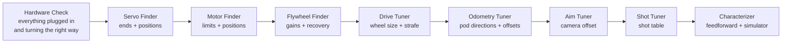

# Finding your numbers (the finders)

> **Work in progress:** this library and its docs are still changing. Something wrong or unclear? [Tell us](https://github.com/crossbotics/ftc-helper-lib/issues).

**For:** anyone setting up a robot's numbers for the first time. **You need:** a robot with its
configuration done, the [Hardware Check](testing.md) passed, and a block to lift it.

Every robot program is full of numbers: where a servo opens, how high a lift may go, how fast a
flywheel spins, how big the wheels really are. Guessing them wastes practice time and breaks parts.
The **finders** measure them for you and show the code to copy. Reference: [finders.md](../modules/finders.md).

Each finder shows two kinds of lines. Use the kind that fits your code:

| Your code | Copy the lines that start with | Example |
| --- | --- | --- |
| the robot in five files ([lessons](../tutorials/README.md#start-here-the-main-track)) | `Tunables.` or `Robot.java:` | `Tunables.Lift: min = 0, max = 2580, P1 = 1200` = in `Tunables.java`, section `Lift`, set those three numbers |
| the older helpers | the rest (`PositionMotor.create(...)`, `c.wheelDiameterIn = ...`) | `PositionMotor.create(hardwareMap, "lift").limits(0, 2580)` |

The section is the device's name in CamelCase (each word starts with a capital, no spaces): `lift` ->
`Lift`, `intake_deploy` -> `IntakeDeploy` (unless you gave the part its own section with
`.tunables("Name")` in Robot.java: then copy the numbers into that section).
The finders call positions P1, P2...: give them real names (`low`, `high`, `open`, `closed`).

## The order



1. **Hardware Check first** ([testing](testing.md)): every device found, every motor turns the right way.
2. **Servo Finder** for each servo, **Motor Finder** for each lift, arm or turret: put the limits
   and positions in your code (five files: `min`, `max` and the named heights in `Tunables.Lift`,
   `open` and `closed` in `Tunables.Claw`). Do this BEFORE you drive a mechanism with code: a wrong
   limit breaks parts.
3. **Flywheel Finder**: the gains for your `Flywheel` (five files: `kP` to `kF` in `Tunables.Launcher`).
4. **Drive Tuner**: the wheel size and strafe correction (five files: `.wheelMm(...)` in `Robot.java`
   and `strafeCorrection` in `Tunables.Drive`, then `Tunables.Drive.calibrated = true`; older helpers:
   `RobotSettings.auto()`), before you write autonomous.
5. **Odometry Tuner** (a robot with an `odometry(...)` line): which way each pod counts and where it
   sits (five files: the offsets in the odometry line of `Robot.java`, then
   `Tunables.Odometry.checked = true`), before autonomous uses `driveTo`.
6. **Aim Tuner**, then **Shot Tuner**: aim first, so the shot table is built with straight shots.
7. **Characterizer** (any time after the Motor Finder): how the motors really move, for feedforward
   and the simulator.

Any time, with no order: the **Piece Tuner** for a robot with game-piece sensors ([below](#piece-tuner-what-each-sensor-sees)).

## Before you start

- Put the robot on a block for the Servo, Motor and Flywheel finders (wheels off the floor).
- Eye protection for the Flywheel Finder, Shot Tuner and Aim Tuner. Nobody in the line of fire.
- The finders are in the starter kit (`ServoFinder`, `MotorFinder`, `FlywheelFinder`, `DriveTuner`, `Characterizer`)
  and in the examples (`ExampleShotTuner`, `ExampleAimTuner`: put your launcher and camera in them).
  Remove `@Disabled`, build, and they are in the TeleOp list under "Finders".
- The robot in five files: the Servo, Motor and Flywheel finders need no code. The Drive Tuner, the
  Odometry Tuner and the Shot Tuner need one line that names your robot (it makes your `Robot`, so the tuner uses its parts;
  examples: the lesson robot's
  [DriveTuner.java](../../examples/src/main/java/com/crossbotics/ftchelper/examples/lessonbot/DriveTuner.java),
  the turret robot's [ShotTuner.java](../../examples/src/main/java/com/crossbotics/ftchelper/examples/turretbot/ShotTuner.java)):

  ```java
  @Override protected RobotDefinition robot() { return new Robot(); }
  ```

## Help on the robot

Press **GUIDE** (the center button) in any finder, in INIT or while it runs: a page shows every
button and the steps. No GUIDE button (or it does nothing)? Hold **START** for 1 second instead.
While help is open, the finder's buttons pause and its motors stop. GUIDE again goes back.
Then let go of every stick, trigger and button once: until then the finder ignores them.
Check once on your own Driver Hub and controllers that the help page fits and is easy to read.

## Servo Finder: ends and positions

1. Choose the servo (D-pad, A). A servo cannot tell where it is, so first choose a START POINT near
   where it sits now (D-pad; nothing moves), then press A: it moves there. Then nudge it with the
   D-pad: right/left = 0.01, up/down = 0.05, hold RB for 10 times finer.
2. Move it toward one end until it JUST stops pushing on the frame (listen: a straining servo hums).
   Back off 0.01. Press **X**. Do the same at the other end and press **B**. These are the limits:
   the code will never send the servo past them.
3. Move to each position you need (open, closed...) and press **A**. Rename P1, P2 in your code.
   Five files: the line `Tunables.Claw: P1 = 0.210, P2 = 0.770` becomes
   `public static double open = 0.210, closed = 0.770;` in `Tunables.Claw`. Keep every position
   between the ends the finder shows.

## Motor Finder: limits, positions, top speed

1. **Put the mechanism at its bottom**, then choose the motor (D-pad, A): its count starts at 0 there.
2. Move it slowly with the right stick (max power starts at 0.3). Stop just before the bottom and
   press **X**; just before the top and press **B**. From now on it stops at those marks.
3. Press **A** at each height you need.
4. Hold **RT** for a speed test: full power up, stopping before the top. The top speed helps you
   choose a max power and PID gains.
5. Five files: the line `Tunables.Lift: min = 0, max = 2580, P1 = 1200` becomes `min = 0, max = 2580`
   and `low = 1200` (your name) in `Tunables.Lift`. If it also says `Robot.java: add .reversed()`,
   add `.reversed()` to that part in `Robot.java`. An `Arm` reads degrees, not counts: see the
   [reference](../modules/finders.md#motorfinderopmode).

Watch the current (amps): a high number while not moving means it is pushing on something. Stop.

## Flywheel Finder: gains and recovery

1. Choose the flywheel motor. Let go of A, then hold **A** again: full power until the speed stops
   rising. It works out the gains from the top speed. Wheel spinning the wrong way? Let go, press
   **X** (reverse), try again.
2. Press **B**: it holds a speed (60% of the top). Change it with the D-pad to the speed you shoot at.
3. If the measured speed stays below the target at every speed, press **RB** (more F); above, **LB**.
4. Feed a piece by hand: the screen shows the recovery time. Use it for the launcher's
   `shotInterval(...)` (a little longer than the recovery time).
5. Five files: copy the `Tunables.Launcher: kP = ..., kI = ..., kD = 0, kF = ..., nominalVolts = ...` line
   into `Tunables.Launcher` (the section is the motor's name). A slow recovery adds `shotIntervalSec`.
   `nominalVolts` is the battery voltage the gains were found at: the launcher's battery compensation
   uses it, so a low battery spins the wheel back up as fast. The RB/LB F changes are only on the
   screen: copy the line (with the F you ended on) into `Tunables.java`.

## Drive Tuner: wheel size and strafe correction

1. **Push test:** A, then roll the robot by hand exactly 48 in along the tape, straight, then B.
   This gives the wheel size from the encoder counts alone. Every wheel must count up by about the
   same amount; if one does not, fix its direction or encoder cable first.
2. **Drive test:** A; it drives 48 in. Measure, set the real distance with the D-pad, A. The new
   wheel size is used at once: run it again until it measures 48 (wheels slip a little on tiles, so
   this is the final word). A move that got stuck is not measured.
3. **Strafe test** (mecanum): the same, for `c.strafeCorrection`.
4. Copy the lines, then switch autonomous on:
   - five files: `Robot.java: .wheelMm(96.8)` goes in the drive line (it replaces `.wheel(...)` if you
     used a catalog wheel), `Tunables.Drive: strafeCorrection = 1.180` in `Tunables.Drive`. Then
     `Tunables.Drive.calibrated = true`.
   - older helpers: the `c.` lines go in `RobotSettings.auto()`, then `c.calibrationConfirmed = true`.

## Odometry Tuner: directions, offsets and a loop check

For a robot in five files with an `odometry(...)` line ([odometry](../modules/odometry.md)). It needs
your robot, in a small file next to `Robot.java` (the odometry robot's
[OdometryTuner.java](../../examples/src/main/java/com/crossbotics/ftchelper/examples/odometrybot/OdometryTuner.java);
the whole file to type: [lesson 7](../tutorials/start/07-odometry.md#5-the-odometry-tuner)). Put a 48 in
strip of tape on the floor with a mark at its start. The sticks drive slowly (30%) in every test; you
can also push the robot by hand. D-pad chooses, **A** starts, **B** ends the test.

1. **Forward 48 in:** drive or push it 48 in straight forward along the tape, B. "Forward OK" (and how
   many % off), or "counted BACKWARD": add `"x"` to `.reversed(...)` (dead wheels: that pod's port
   name). An OTOS gets `Tunables.Odometry: linearScalar = ...` to copy (multiply it with the one in use).
   More than 2% off: check the pod type (Pinpoint) or `ticksPerMm(...)` (dead wheels), and the tape.
   More than 10% off: "was it really 48 in?" (a mistake in the test: measure and run it again).
2. **Left 24 in:** drive or push it 24 in to its LEFT, B. "Left OK", or "counted RIGHT": add `"y"` to
   `.reversed(...)` (dead wheels: the sideways pod's name). A tank robot: push it.
3. **Spin 3+ turns:** turn it in place at least 3 times with the right stick, B. It measures the turn
   from the Pinpoint's own heading, or from the Control Hub's IMU for dead wheels and the OTOS (so they
   need `.imu(...)` in `drive(...)`, or the tuner stops at INIT and says so). It shows the offsets
   as the numbers to change: `Robot.java: in the odometry(...) line, .offsetsMm(-84.2, -167.5)`
   (three wheels: `.trackWidthIn(..).perpForwardIn(..)`; two: `.parallelLeftIn(..).perpForwardIn(..)`).
   Change only those numbers: `.reversed(...)` and the pod type stay as you wrote them.
   An OTOS has no offsets to measure: measure `mountIn` with a tape, and its turn scale
   [by hand](../modules/odometry.md#otos-turn-scale-by-hand).
4. Copy the numbers into your odometry line, rebuild.
5. **Loop and back:** start on the mark, drive anywhere, come back onto the mark facing the same way, B.
   Within 1 in and 2 degrees it shows `Tunables.Odometry: checked = true`: set it in `Tunables.java`.
   Until then, autonomous `driveTo` steps are skipped on the robot.

## Aim Tuner: camera offset

1. Park the robot 4-6 ft from the target, facing it. A turret with a home switch: press **X** first.
2. Hold **A**: it aims. Shoot (**RB**). LB stops the flywheel.
3. Shots go LEFT of the middle: press D-pad RIGHT (aim more to the right). Shots go right: LEFT.
4. Repeat until shots go in the middle, at two or three distances. Copy the offset line
   (five files, with a turret: `Tunables.Turret: cameraOffset = -1.5`).
   If the offset that works changes with distance, the camera is off to the side of the launcher:
   move it onto the launcher's line (or as close as you can), or tune at the distance you shoot from most.

## Shot Tuner: the shot table

It tunes the way experienced teams do: at each distance, shoot 3-5 pieces at a speed and mark each
one **HIT** or **MISS**, try the next speed, and keep the speed with the best **hit ratio** (hits out
of shots: 3 in out of 4 beats 2 out of 3). Every button is on **gamepad 1**.

1. **Pick the table.** With one table per game piece (`speedByDistancePollen`, `speedByDistanceNectar`),
   press **Y** until `> Table`, then **D-pad left / right** picks the table: you tune one table at a
   time, each with its own points. Load that game piece.
2. Park at the nearest distance you will shoot from. The screen shows the distance and where it came
   from: `(camera, 12 readings)`, or `(odometry, ...)` when the camera does not see the goal (with an
   `odometry(...)` line and `Tunables.Aim.goalX, goalY`; put the robot in the middle of the field
   facing away from you before INIT, or override `startSpotIn()`). The distance is the average of the
   last half second of fresh readings, so one noisy picture does not go into the table. Press **LB**
   to start the flywheel (it is off at START).
3. The speed starts at what your table already gives at this distance (or `Tunables.Launcher.speedRpm`),
   so you only fine-tune. Shoot 3-5 (**RB** one at a time, or hold **RT**) and after each shot press
   **A** = HIT or **B** = MISS (the marks go to the shots in the order they were fired). Each shot keeps
   the speed, hood angle and distance it was **fired** with, so changing the speed or the hood before you
   mark does not move the mark. The screen shows `Hits at 2550: 3/4` and every speed tried here
   (`Tried here: 2450: 1/3, 2550: 3/4 (best)`). Change the speed with the D-pad (**Y** chooses SPEED or
   HOOD) and shoot 3-5 again. 2-3 speeds is usually enough.
   - **Pressed the wrong one?** **Left stick click** takes back the last HIT / MISS; that shot waits to be
     marked again.
   - **A "shot" with no piece** (the wheel slowed down by itself, so `Shots fired` went up):
     **right stick click** drops the last shot that is not marked yet.
4. Press **X** to save: it keeps the speed with the **best hit ratio** at this distance (a tie: the one
   with more shots), and with a hood the hood angle those shots were fired with. Each point also keeps
   the flywheel speed **measured** as the pieces were fed. If the flywheel was well under the speed
   asked for, it **sagged** (the last shot or a low battery slowed it, and it was not back yet): the
   screen warns. Wait for `Ready: YES` between shots and charge the battery, or the table will not match
   a match. A wrong point: stand there and **hold BACK 1 s** to delete it (a hold, so it is not pressed
   by mistake).
5. Move back 1-2 ft (drive with the sticks) and do it again; the hit counts start again by themselves
   when the distance moves more than 4 in, and shots fired at the old spot that were never marked are
   dropped. `Points: POLLEN 3, NECTAR 0  (4-6 per table)` says how far
   you are: 4-6 points per table cover the field. Then the next table (step 1).
6. **Copy the tables into `Tunables.java`**: the robot uses the file, not the tuner's screen. There is
   one line per table, like `public static double[][] speedByDistancePollen = {{24, 2600}, {48, 3100}};   // in Tunables.Launcher`:
   it replaces the line with the same name in `Tunables.Launcher`. The lines are also saved on the
   Control Hub when you press STOP (`/sdcard/FIRST/ftc-helper/finder-results.txt`). Older helpers: the
   `new ShotTable()` lines go into your Robot class (each with a comment like `// 4/5 in, measured 2531 RPM`).
   Between the points the launcher **blends** the speed (halfway between two points: halfway between
   their speeds); outside them it uses the nearest point.

With `robot()`, the Shot Tuner uses your robot's launcher, camera and drive. A turret stays still and
the "fire only when aimed" checks are off: point the robot at the goal with the sticks. (The robot in
five files' launcher has no hood. With the older helpers and a hood, each speed and hood angle is its
own try in the hit counts: `Tried here: 2550 @ 10.0 deg: 3/4 (best), 2550 @ 12.5 deg: 1/3`.)

Charge the battery before tuning speeds: a weak battery changes how far the shots go. The launcher's
speed trim (the D-pad in a match) is not used in the tuner, so the table holds the real speeds.

## Piece Tuner: what each sensor sees

For a robot with a [`Pieces` or `PieceSensor`](../modules/robot.md#pieces-and-piecesensor) line. Its
file names your robot, like the Odometry Tuner (the cookbook's [piece-tuner recipe](../cookbook.md#how-do-i-tune-the-piece-sensors)).
Nothing moves, so no block is needed.

1. Mount the sensor where it will stay. Put a piece where it really sits or passes (at the intake: the
   spot where the sensor sees it go by).
2. D-pad up/down: the sensor. D-pad left/right: which kind is in front of it. **A**: measure (20
   readings, about half a second: hold still). Do every kind, then EMPTY (nothing there).
3. Copy the lines into `Tunables.java` (e.g. `Tunables.IntakeColor: POLLEN = 74`), rebuild, and run it
   again: "It sees" should name each piece you hold up, and NONE with nothing there.

Problems it warns about: two kinds that read nearly the same (a colour sensor too far away, a
distance sensor that does not look straight across), and EMPTY that looks like a piece (aim the sensor
at a far wall or a grey or black background).

## Characterizer: how the robot really moves

Last, when the robot drives and its lifts work: the **Characterizer** measures how each motor really
behaves (the power to start moving, the power per speed, how quickly it speeds up, and for a lift the
power that holds it against gravity). Two uses: feedforward in your code (see
[Feedforward](../modules/control.md#feedforward)), and real numbers for the
[simulator](simulator.md#real-numbers-the-characterizer).

1. In `Characterizer.java`, list your lifts/arms with soft limits a little inside the hard stops
   (counts from the bottom) and your flywheels.
2. Drive test: about 5 ft clear in front and behind, on tiles. Turn test: room to turn.
3. Lifts start at the BOTTOM. An arm's high limit stays below straight up.
4. D-pad chooses, **A** runs, **B** stops. It stops by itself if something turns the wrong way, goes
   past a limit, or pushes without moving. Run each test 2-3 times on a charged battery.

Details: [finders module](../modules/finders.md#characterizeropmode).

## The results file

Every finder adds its lines to `/sdcard/FIRST/ftc-helper/finder-results.txt` on the Control Hub when
you press STOP, with the date. The Driver Station says whether it worked. Get it with the REV Hardware Client (file manager) or Android
Studio's Device Explorer. The newest results are at the end.
