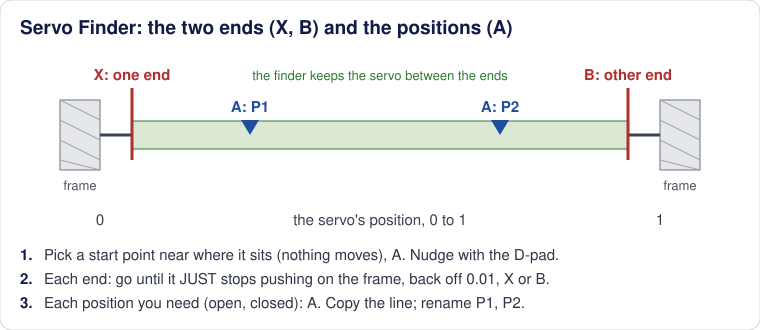
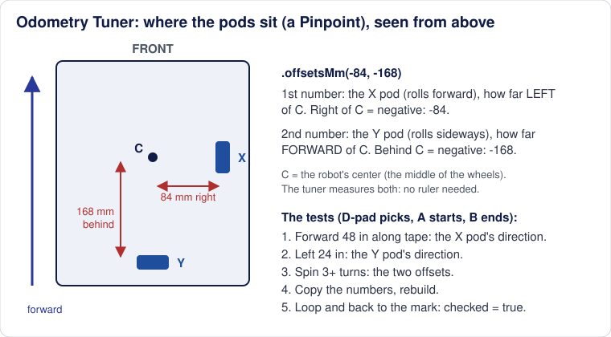
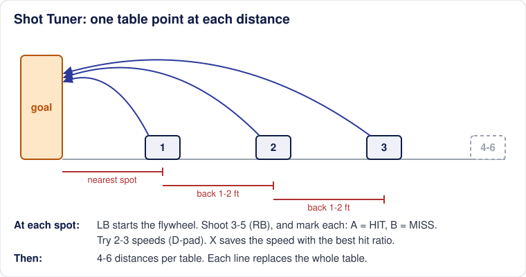

# Finding your numbers (the finders)

> **Work in progress:** this library and its docs are still changing. Something wrong or unclear? [Tell us](https://github.com/crossbotics/ftc-helper-lib/issues/new/choose).

**For:** anyone setting up a robot's numbers for the first time. **You need:** a robot with its
configuration done, the [Hardware Check](testing.md) passed, and a block to lift it.

Every robot program is full of numbers: where a servo opens, how high a lift may go, how fast a
flywheel spins, how big the wheels really are. When you guess them, you waste practice time and break
parts. The **finders** measure them for you and show the code to copy. Reference: [finders.md](../modules/finders.md).

Each finder shows two kinds of lines. Use the kind that fits your code:

| Your code | Copy the lines that start with | Example |
| --- | --- | --- |
| the robot in five files ([lessons](../tutorials/README.md#start-here-the-main-track)) | `Tunables.` or `Robot.java:` | `Tunables.Lift: min = 0, max = 2580, P1 = 1200` = in `Tunables.java`, section `Lift`, set those three numbers |
| the older helpers | the rest (`PositionMotor.create(...)`, `c.wheelDiameterIn = ...`) | `PositionMotor.create(hardwareMap, "lift").limits(0, 2580)` |

The section is the device's name in CamelCase (each word starts with a capital, with no spaces): `lift` ->
`Lift`, `intake_deploy` -> `IntakeDeploy`. When you gave the part its own section with
`.tunables("Name")` in Robot.java, copy the numbers into that section instead.
The finders call positions P1, P2...: give them real names (`low`, `high`, `open`, `closed`).

## Tune and check: all of them in one OpMode

The library adds one OpMode by itself: **Tune and check** (TeleOp list, group "Finders"). You have no
file to copy. It holds the Hardware Check and every finder that fits your Robot.java.

1. Pick **Tune and check** and press INIT. A menu shows.
2. D-pad up/down picks a tool. **A** opens it, and you see its own INIT screen. Read its safety note.
3. Press **▶** (start) on the Driver Hub. The tool runs, the same as on its own.
4. For another tool, press STOP, then INIT. The menu starts on the last tool. In a tool's INIT,
   **BACK** goes back to the menu.

The menu lists only the tools that fit your robot. It finds Robot.java by itself: any class in
`org.firstinspires.ftc.teamcode` that extends `RobotDefinition`. With two robots, D-pad left/right picks one.

| Tool | In the menu when |
| --- | --- |
| Hardware Check | always |
| Motor Direction Check | there is a Robot.java |
| Encoder Check | there is a Robot.java |
| Servo Finder | the configuration has a servo |
| Hood Finder | the robot has a hood |
| Motor Finder | the robot has a lift or an arm (or there is no Robot.java) |
| Flywheel Finder | the robot has a launcher (or there is no Robot.java) |
| Feed Stop Finder | the launcher has a `.feedStop(...)` |
| Drive Tuner | there is a Robot.java |
| Odometry Tuner | Robot.java has an `odometry(...)` line |
| Shot Tuner | the robot has a launcher |
| Camera Fix Check (**alpha**) | Robot.java has `cameraFix(camera)` ([camera fix](../modules/odometry.md#camera-fix-alpha)). BIOBUZZ teams: ignore it |
| Piece Tuner | the robot has a piece sensor |

Two tools are not in the menu: the **Aim Tuner** and the **Characterizer**. They need your camera or your
lifts, so they keep their own file (below). Your own finder files still work: keep them or delete them.

## The order

Use the same order as the **Tune and check** menu. Two tools keep their own file and are not in the menu:
the **Aim Tuner** and the **Characterizer**. The menu leaves out a tool for a part your robot does not
have: skip it.

```mermaid
flowchart LR
    H["Hardware Check<br/>everything plugged in<br/>and moving"] --> MD["Motor Direction Check<br/>each wheel rolls forward"]
    MD --> E["Encoder Check<br/>each encoder cable<br/>in its own port"]
    E --> S["Servo Finder<br/>ends + positions"]
    S --> HO["Hood Finder<br/>a hood's two stops"]
    HO --> M["Motor Finder<br/>limits + positions"]
    M --> F["Flywheel Finder<br/>gains + recovery"]
    F --> FS["Feed Stop Finder<br/>hold + release"]
    FS --> D["Drive Tuner<br/>wheel size + strafe"]
    D --> O["Odometry Tuner<br/>pod directions + offsets"]
    O --> A["Aim Tuner (own file)<br/>camera offset"]
    A --> T["Shot Tuner<br/>shot table"]
    T --> CF["Camera Fix Check<br/>alpha"]
    CF --> P["Piece Tuner<br/>what each sensor sees"]
    P --> C["Characterizer (own file)<br/>feedforward + simulator"]
```



1. **Hardware Check first** ([testing](testing.md)): every device found, every motor and servo moves. It spins a motor in its raw direction, so it does not check `reversed(...)`.
   Then the **Motor Direction Check**: each drive wheel rolls forward, with Robot.java's directions.
   Then the **Encoder Check**: each motor's encoder cable is in that motor's port.
2. **Servo Finder** for each servo, **Hood Finder** for a launcher's hood, **Motor Finder** for each lift,
   arm or turret. Put the limits and positions in your code (five files: `min`, `max` and the named heights
   in `Tunables.Lift`, `open` and `closed` in `Tunables.Claw`). A wrong limit breaks parts, so do this
   BEFORE you drive a mechanism with code.
3. **Flywheel Finder**: the gains for your `Flywheel` (five files: `kP` to `kF` in `Tunables.Launcher`).
   Then the **Feed Stop Finder** for a launcher with a feed stop.
4. **Drive Tuner**: the wheel size and strafe correction, before you write autonomous. Five files:
   `.wheelMm(...)` in `Robot.java` and `strafeCorrection` in `Tunables.Drive`, then
   set `Tunables.Drive.calibrated = true` (the tuner shows that line when the tests measure right). Older helpers: `RobotSettings.auto()`.
5. **Odometry Tuner** (a robot with an `odometry(...)` line): which way each pod counts and where it
   sits, before autonomous uses `driveTo`. Five files: the offsets in the odometry line of `Robot.java`,
   then `Tunables.Odometry.checked = true`.
6. **Aim Tuner**, then **Shot Tuner**: aim first, so you build the shot table with straight shots.
   Run the **Camera Fix Check** (alpha) only with a `cameraFix(camera)` line.
7. **Piece Tuner** for a robot with game-piece sensors. Nothing moves, so it can also come earlier.
8. **Characterizer** last, when the robot drives and its lifts work. It measures how the motors really
   move, for feedforward and the simulator.

## Before you start

- Put the robot on a block for the Servo, Motor and Flywheel finders (wheels off the floor).
- Wear eye protection for the Flywheel Finder, Shot Tuner and Aim Tuner. Keep everybody out of the line of fire.
- Use a charged battery (12.5 V or more) for the Drive Tuner, the Characterizer, the Flywheel Finder and
  the Shot Tuner. Their numbers are powers and speeds, so they depend on the battery. Their screens show
  the battery and warn when it is low. Every finder writes the battery at the start (▶) in the results file
  (`== Drive Tuner, 2026-10-24 14:05, battery 12.8 V ==`).
- The simplest way is **Tune and check** (above). It has every finder that fits your robot, with no file
  to copy. Or use one file per finder. The finders are in the starter kit (`ServoFinder`, `MotorFinder`,
  `FlywheelFinder`, `DriveTuner`, `Characterizer`) and in the examples (`ExampleShotTuner`,
  `ExampleAimTuner`: put your launcher and camera in them). Remove `@Disabled` and build. Then they are in
  the TeleOp list under "Finders".
- The robot in five files: the Servo, Motor and Flywheel finders need no code. The Drive Tuner, the
  Odometry Tuner and the Shot Tuner need one line that names your robot. The line makes your `Robot`, so
  the tuner uses its parts. Examples: the lesson robot's
  [DriveTuner.java](../../examples/src/main/java/com/crossbotics/ftchelper/examples/lessonbot/DriveTuner.java),
  the turret robot's [ShotTuner.java](../../examples/src/main/java/com/crossbotics/ftchelper/examples/turretbot/ShotTuner.java):

  ```java
  @Override protected RobotDefinition robot() { return new Robot(); }
  ```

## Help on the robot

Press **GUIDE** (the center button) in any finder, in INIT or while it runs. A page shows every button and
the steps. The Hardware Check has no help page. When your gamepad has no GUIDE button, or GUIDE does
nothing, hold the gamepad's **START** for 1 second instead.
While help is open, the finder's buttons pause and its motors stop. GUIDE again goes back.
Then let go of every stick, trigger and button once: until then, the finder ignores them.
Check once on your own Driver Hub and controllers that the help page fits and is easy to read.

**The button names on the screens** are the ones printed on YOUR controller. The library asks the FTC
SDK which kind of controller it is, once you link it with START + A, or OPTIONS + ×:

| Logitech / Xbox (this guide) | A | B | X | Y | LB | RB | LT | RT | BACK | START | GUIDE |
|---|---|---|---|---|---|---|---|---|---|---|---|
| PlayStation (PS4, PS5, Etpark) | × | ○ | □ | △ | L1 | R1 | L2 | R2 | SHARE | OPTIONS | PS |

**▶** on a screen is always the Driver Hub's start button (it starts the OpMode after INIT), never a
gamepad button. **START** is the small button on the gamepad (OPTIONS on a PS controller). This guide
uses the Logitech names.

## Motor Direction Check: each wheel rolls forward

**You need:** the robot on a block (the wheels spin). **Done when:** every drive wheel rolls the way that drives
the robot forward.

The Hardware Check spins a motor in its raw direction. This check uses your directions, so it shows what
the robot will really do. It spins ONE drive motor at a time at 30%, set up exactly as Robot.java says:
its direction comes from `reversed(...)` on the drive line.

1. Hold **X** (front-left), **Y** (front-right), **A** (back-left) or **B** (back-right). On a tank drive,
   X = left and Y = right. The screen shows the motor's name, and "(reversed)" when Robot.java reverses it.
2. Each wheel must roll the way that drives the robot FORWARD. For the robot in five files, the front is
   the end that Robot.java says.
3. When a wheel rolls backward, add its name to `reversed(...)` on the drive line in Robot.java (or take it
   out). INIT again and check it again.
4. When the wrong wheel turns, its name in the robot configuration is on the wrong port. Swap the names on
   the Driver Hub, not the wires.

A wrong direction makes the robot drive in circles, strafe the wrong way, or fight itself. So run the check
on every new robot, and again after you change any motor or wire.

## Encoder Check: each encoder cable in its own port

**You need:** the robot on a block (the wheels spin), lifts and arms at their bottom stop, hands clear.
**Done when:** every motor says OK (or "no counts (fine...)" for a motor whose encoder nothing reads).

A motor's encoder counts its turns. It has its own small cable, plugged into the hub next to the motor's
power cable. A lift, an arm, a flywheel's speed and the drive's distances all trust that count. When the
cable is in ANOTHER motor's port, the lift reads the wrong motor and never stops. When the cable is
missing, the count stays at 0 and the lift pushes into its stop.

The check pushes each motor in Robot.java a little (30% power for 0.3 s), one at a time. It reads EVERY
motor port's count, and shows a result for each motor:

| Result | What it means | Fix |
| --- | --- | --- |
| OK: counts up (or down) | its own port counted, the way the check pushed it | nothing |
| NO COUNTS | no port counted | plug in the encoder cable, or replace it. Or the motor did not turn: check that you saw it move |
| counts on "X" instead | another motor's port counted | the encoder cables are swapped: put each one in its own motor's port |
| counts on "lift_right" instead: plug the encoder cable into "lift_left"'s port | a two-motor lift or arm: the library reads only the first motor's encoder | move the cable to the first motor's port |
| counts BACKWARD | its port counted the other way from the push | the motor's power wires are swapped (red and black), or an outside encoder is mounted the other way |
| no counts (fine: nothing reads this encoder) | an intake or feeder with no encoder cable | nothing |
| could not read its encoder | the hub did not answer | press **Y** to check again. When the result stays, check the hub's cables |
| NOT IN THE CONFIGURATION | Robot.java names a motor the configuration does not have | add it to the configuration, or mark the part `optional()` |

1. Put the robot on a block, with lifts and arms down. In **Tune and check**, open **Encoder Check**, then
   press **▶**.
2. Hold **A**. Each motor gets its short push in turn. When you let go of **A**, everything stops at once.
3. Read the results. Fix the cables. Press **Y** to check again.

The check sets up each motor as Robot.java says (its direction). It pushes the motor toward the side where
its part has room, from your `Tunables.java`: a lift up from its bottom stop, a hood toward `posB`, a turret
toward the end of its range that is farther from its start angle. Its count must move the same way.

**Watch each part while the check pushes it.** The count turns with the direction setting, so the check
cannot see a wrong `reversed()` in Robot.java. Only your eyes can. A lift or arm must move UP, away from
its stop. When it moves down, fix `reversed()` on its line in Robot.java. For the drive, use the
[Motor Direction Check](#motor-direction-check-each-wheel-rolls-forward).

Before each push, the check waits until every port is still (for example, until a flywheel spins down).
So it never mistakes one motor for another. When something keeps moving, the screen names it. The check
does not check servos, CR servos, a CR servo turret, or a motor whose port reads something else. Those are
an odometry pod (the [Odometry Tuner](#odometry-tuner-directions-offsets-and-a-loop-check) checks pods) and
a CR servo turret's encoder.

Run it on every new robot, and again after you change any motor or cable.

## Servo Finder: ends and positions

**You need:** the robot on a block. **Done when:** every position you use is in `Tunables.java`, between the two ends.

### A new servo part, step by step

With a new servo, the hard part is that you do not know which way it turns, or where its ends are. Go in
this order, slowly. Use **Tune and check > Servo Finder**: it knows Robot.java (`reversed()`, a second
servo, the servo's catalog part).

1. **Arm off.** Put the servo in, but leave its arm (the horn) off, or its screw loose. Then nothing can hit the
   frame while you start.
2. **Go to the middle.** Choose the servo, leave the start point at 0.5, and press **A**. The servo goes to
   the middle of its turn and holds there.
3. **Put the arm on in the middle of the part's swing**, so the part can move both ways from here. Tighten the
   screw. Mark the horn and the shaft with a paint pen, so a new horn later goes on the same tooth.
4. **Find the direction.** Press **D-pad left** once (a 0.01 step), then press **D-pad up** (bigger) a few
   times and watch the part. Write it down: "bigger = open", "bigger = up". No standard says which way a
   servo turns ([why](../conventions.md#servos-and-motors-which-way-is-bigger)). For a catalog servo, the
   screen shows a **Hint** (goBILDA: "bigger = clockwise (seller)"). But only your test counts, because the
   part's way depends on how you mount the servo.
5. **Find each end, slowly.** Move toward one end in small steps (D-pad up/down; D-pad left makes the step
   smaller, down to 0.001) until the part BARELY touches the frame. **A servo that hums is pushing on
   something: back off at once.** It gets hot and can strip its gears. Back off 0.01 more and press **X**.
   Do the same at the other end, and press **B**.
6. **Save each position you need** (open, closed, rest, push...): move there and press **A**. Then copy the
   lines into `Tunables.java` (step 3 below).
7. **To make "bigger" go the other way** (for example, bigger = up), add `.reversed()` to the part in
   Robot.java. Then find the positions again: each old number becomes 1 minus it.

**Two servos on one part:** do step 1 for BOTH arms. Choose the FIRST servo: the second moves with it,
mirrored. Then put both arms on at the middle (step 3), so they match, and go on from step 4. If they do
not quite meet, set `alsoTrim` afterward, in TeleOp.

**At ▶**, the part goes straight to its first position from wherever it is, because a servo always knows
its own angle. Keep hands clear.

### The finder's buttons



0. **Full range:** when the part has `.fullRange()` in Robot.java, press **Y** while you choose the servo,
   so the finder uses the same range. Full range is the servo's whole turn: for a goBILDA 2000 servo, 300
   degrees instead of 270 ([why](../modules/hardware.md#full-range)). Positions that you find with one range
   are wrong with the other.
1. Choose the servo (D-pad, A). A servo cannot tell the program where it is. So first choose a START POINT
   near where it sits now (D-pad up/down; nothing moves), then press A, and it moves there. Then nudge it
   with the D-pad. Up/down moves it by the step. Left/right makes the step smaller/bigger (0.1, 0.05, 0.01,
   0.005, 0.001). The step starts at 0.05, and the screen shows it. Use a big step to get close, then a
   small one for the exact spot.
2. Move it toward one end until it BARELY stops pushing on the frame. Listen: a straining servo hums.
   Back off a little (0.01), and press **X**. Do the same at the other end, and press **B**. From then on,
   the finder keeps the servo between them. To go past an end, for example to mark it again, hold **LB**
   while you nudge. The ends are for you: keep every position you save between them. In five files, there
   are no end lines to copy. The older helpers get the ends as the servo's limits.
3. Move to each position you need (open, closed...) and press **A**. Rename P1, P2 in your code.
   Five files: the line `Tunables.Claw: P1 = 0.210, P2 = 0.770` becomes
   `public static double open = 0.210, closed = 0.770;` in `Tunables.Claw`. Keep every position
   between the ends that the finder shows. **Y** undoes the last saved position. **BACK** chooses another
   servo, and the lines found so far stay on the screen.

**`reversed()` in Robot.java:** in **Tune and check**, the finder turns the servo the same way. The screen
says `Direction: reversed, as in Robot.java`, so its numbers go straight into Tunables.java. Either order is
fine: `rest` may be higher or lower than `push`, and `open` higher or lower than `closed`. Which way a bigger
number turns depends on the servo, because there is no standard. D-pad up shows you
([Signs and units](../conventions.md#servos-and-motors-which-way-is-bigger)).

**A part on two servos** (`alsoServoReversed(...)` or `alsoServo(...)` in Robot.java): for example, a claw
with a servo for each finger, or two feed arms. Choose the FIRST servo. In **Tune and check**, the second
servo moves with it (mirrored or the same way, as Robot.java says), so the two never fight. The screen shows
`Moves with it: claw_right (mirrored)`. You cannot choose the second servo alone. The finder does not use
`alsoTrim`: check it afterward, in TeleOp. A Servo Finder of your own (not from Tune and check) does not
know Robot.java and moves only one servo. It would drag the other, unpowered servo through its gears. So
take the other side's arm off first, or unplug the second servo's wire.

**After a new horn (maintenance):** loosen or take off both arms. In the finder, choose the first servo, set
the start point to your `rest` number and press A. Both servos go there and hold. Put the arms on at that
position and tighten them. Move to your other position and check that they meet. Mark the horn and the
shaft with a paint pen, so the next horn goes on the same tooth. One spline tooth on a goBILDA servo is
about 0.05 in position.

## Hood Finder

**You need:** the hood mounted, the flywheel off. **Done when:** `posA`, `posB` (or a `calibration` table) and `travelSec` are in `Tunables.Hood`.

The Hood Finder is for a launcher's [hood](../reference/parts/hood.md) (`Tunables.Hood`). It reads the hood
from Robot.java, so it works before Tunables.Hood has numbers. A hood with `.fullRange()` gets the same full
range here.

1. **A servo hood:** choose a START POINT near where the hood sits (D-pad up/down; nothing moves), and press
   **A**. Then nudge it with the D-pad. Up/down moves it by the step. Left/right makes the step
   smaller/bigger (0.1, 0.05, 0.01, 0.005, 0.001). The step starts at 0.05, and the screen shows it.
   **A motor hood:** nothing is powered. Start the OpMode with the hood on the stop that you want as 0 ticks
   (the same as before a match). Then move the hood by hand and watch the encoder.
2. Go to one stop until the hood BARELY touches it (a servo hums when it strains). Back off a hair, and
   press **X** (stop A). At the other stop, press **B** (stop B). The screen shows
   `Tunables.Hood: posA = 0.205, posB = 0.648`. That is all you need: the hood then works in servo
   positions, and the Shot Tuner writes positions into the table.
3. **Angles (optional).** Measure the hood's angle at each stop, with an angle app on a phone laid on the
   hood. **Hold LB + D-pad** to type it in BEFORE you press X / B. Then you get `angleA = 0, angleB = 25`
   too. The finder uses each angle you type for ONE place (a stop or a point), so measure again at the
   next place. When only one stop has an angle, the finder writes no angles, and the screen says which stop
   still needs its angle.
4. **A linkage** (the angle is not a straight line of the servo position): add points in between. Move
   there, type in the angle (LB + D-pad), and press **A**. With points and the angles at both stops, you
   get a `calibration` line INSTEAD of the posA / posB line. The hood reads one or the other, and both
   together stop INIT. The table's first and last rows are the stops. INIT checks that the angles keep
   going one way along the hood. The finder shows a point that breaks this as a warning, and writes no
   table. **Y** undoes the last point.
5. Copy the lines into `Tunables.java`: the robot uses the file, not this screen. Then, for a servo hood,
   time a stop-to-stop move for `travelSec`. The launcher waits that long before firing (a share of it for
   a shorter move).

## Motor Finder: limits, positions, top speed

**You need:** the robot on a block, the mechanism at its bottom. **Done when:** `min`, `max` and every named height are in `Tunables.java`.

1. **Put the mechanism at its bottom**, then choose the motor (D-pad, A). Its count starts at 0 there.
2. Move it slowly with the right stick (max power starts at 0.3). Stop a little before the bottom, and
   press **X**. Stop a little before the top, and press **B**. From now on, the power goes off at those marks.
   The mechanism coasts a little past them (more at a higher max power), so mark them with some room.
3. Press **A** at each height you need. A height outside the two marks gets a warning, because the robot
   stops at min and max and could never get there. **Y** undoes it.
4. Hold **RT** for a speed test: full power up, stopping before the top. The top speed helps you
   choose a max power and PID gains.
5. Five files: the line `Tunables.Lift: min = 0, max = 2580, P1 = 1200` becomes `min = 0, max = 2580`
   and `low = 1200` (your name) in `Tunables.Lift`. When it also says `Robot.java: add .reversed()`,
   add `.reversed()` to that part in `Robot.java`. An `Arm` reads degrees, not counts: see the
   [reference](../modules/finders.md#motorfinderopmode).

Watch the current (amps). A high number while the part does not move means it is pushing on something. Stop.

## Flywheel Finder: gains and recovery

**You need:** safety glasses, nobody in the line of fire, a charged battery. **Done when:** the `Tunables.Launcher` gains line is copied and the speed holds the target.

1. Choose the flywheel motor. Let go of A, then hold **A** again: the wheel runs at full power until the
   speed stops rising. The finder works out the gains from the top speed. When the wheel spins the wrong
   way, let go, press **X** (reverse), and try again.
2. Press **B**: the finder holds a speed (60% of the top). Change it with the D-pad to the speed you shoot at.
3. When the measured speed stays below the target at every speed, press **RB** (more F). When it stays
   above, press **LB**.
4. Feed one piece with the robot's own feeder, or push it in with a stick. **Never use your fingers**:
   they would be next to a wheel at full speed. Put safety glasses on. The screen shows the recovery time
   (on the robot only, because the simulator has no piece to feed). Use it for the launcher's
   `shotInterval(...)`: make that a little longer than the recovery time.
5. Five files: copy the `Tunables.Launcher: kP = ..., kI = ..., kD = 0, kF = ..., nominalVolts = ...` line
   into `Tunables.Launcher` (the section is the motor's name). A slow recovery adds `shotIntervalSec`.
   `nominalVolts` is the battery voltage at which the finder found the gains. The launcher's battery
   compensation uses it, so a low battery spins the wheel back up as fast. The compensation is off unless
   you write `batteryCompensation = true`. The RB/LB F changes are only on the screen: copy the line (with
   the F you ended on) into `Tunables.java`.

## Feed Stop Finder

**You need:** the launcher's Robot.java line with `.feedStop(...)`, one piece. **Done when:** `feedStopHold` and `feedStopRelease` are in `Tunables.java`.

A feed stop holds the pieces back, and lets one through at a time. This finder finds both positions, for a
launcher with `.feedStop("feed_stop")` in Robot.java. For such a robot, it is in
[Tune and check](#tune-and-check-all-of-them-in-one-opmode).

1. Put a piece behind the feed stop. The wheel stays off.
2. A servo's position is a number from 0 to 1. With the D-pad, pick a start number near where the feed
   stop sits now (nothing moves yet). **A** moves the servo there.
3. D-pad up/down moves it by the step. Left/right makes the step smaller/bigger (0.1, 0.05, 0.01, 0.005,
   0.001). The step starts at 0.05, and the screen shows it.
4. Where the stop holds the piece firmly, without straining on the frame, press **X** to save the hold
   position. Where the piece rolls through freely, press **B** to save the release position. **A** then
   goes between the two, so you can try them.
5. Copy the line it shows, for example `Tunables.Launcher: feedStopHold = 0.150, feedStopRelease = 0.550`.
   The section is your launcher's: a launcher on `shooter` says `Tunables.Shooter`.

This finder does not measure the open time (`feedStopOpenSec`) or the push time (`assistSec`). Fire a few
pieces in the PRACTICE profile ([profiles](profiles.md); debug lines show only there). Then read the debug
lines on the Driver Station. `Last feed ended: shot seen` is good. `backup time` means that the wheel did
not see a shot in time. Either the piece did not reach the wheel (more `assistSec`, or check the release
position), or your wheel slows by less than 150 RPM per shot (a heavy wheel).

## Drive Tuner: wheel size and strafe correction

**You need:** a charged battery, tape, 5 ft of clear floor. **Done when:** the Drive test (and on a mecanum the Strafe test) measures 48 within 0.5 in, and `calibrated = true` is copied.


**Set up the floor:** a straight line of tape, marked **0** and **48 in**, and 5 ft of clear floor ahead
of the robot and to its right (and to its left, for the optional Strafe left test). **Start each test**
with the robot's **left wheels touching the tape** (their outside edge) and the front left wheel's front
edge on **0**. **Why the left wheels:** when you push by hand, a wheel edge against a line is easy to keep
straight. It is also easy to measure from: forward from 0 to that wheel's front edge, and sideways from the
tape to the left wheels.

1. **Push test:** press A, then roll the robot by hand, its left wheels along the tape, until the front left
   wheel's front edge is on 48 in. Then press B.
   This gives the wheel size from the encoder counts alone. Every wheel must count up by about the
   same amount. When one does not, fix its direction or encoder cable first.
2. **The power:** on the test list, D-pad left/right sets the power for the Drive and Strafe tests
   (`Power : 0.5`; 0.3 to 1.0). Set the power that your autonomous moves use
   (`.move("...", 24, 0, 0.6)`: 0.6). **Why:** a faster robot slides farther when it stops, so the numbers
   fit the power you measured them at. When you change the power, the tests must measure right again. For
   moves of very different lengths, see `Tunables.Drive.slowDownIn`
   ([tunables](../reference/parts/drive.md#in-tunablesjava)).
3. **Drive test:** press A, and the robot drives 48 in. Measure, set the real distance with the D-pad, and
   press A. The tuner uses the new wheel size at once. Run the test again until it measures 48. Wheels slip
   a little on tiles, so this test has the final word. The tuner does not measure a move that got stuck.
   While the robot drives, the screen keeps showing the heading and the wheel counts.
4. **Strafe test** (mecanum): put the robot back at the start, and press A. It strafes right, away from the
   tape. Measure from the tape to the left wheels, straight across. The steps are the same as in the Drive
   test, for `c.strafeCorrection`. There is no push test sideways. When you push a mecanum robot sideways by
   hand, its wheels' rollers spin, and its encoders count almost nothing. The strafe correction is about
   the slip of a **powered** strafe, so only the robot strafing by itself can measure it.
   **Strafe left:** use it only when moves to the left come up short or long while moves to the right are
   right. Start with the robot's **right** wheels on the tape, and it strafes left. Measure from the tape
   to the right wheels. The steps are the same, for `Tunables.Drive: strafeCorrectionLeft`. When you do not
   write it, the left uses `strafeCorrection` too.
5. **Turn 90 left** (a check, with nothing to copy): the robot turns 90 degrees left. Put a square against
   the robot to see it. The screen shows the IMU's heading, and it should say 90.
6. Copy the lines, then switch autonomous on:
   - five files: `Robot.java: .wheelMm(96.8)` goes in the drive line. It replaces `.wheel(...)` if you
     used a catalog wheel. `Tunables.Drive: strafeCorrection = 1.180` goes in `Tunables.Drive`. Once the
     Drive test (and on a mecanum the Strafe test) measures 48 within 0.5 in, the tuner also shows
     `Tunables.Drive: calibrated = true`: copy that too.
   - older helpers: the `c.` lines go in `RobotSettings.auto()`, then `c.calibrationConfirmed = true`.

## Odometry Tuner: directions, offsets and a loop check

**You need:** a 48 in tape strip with a start mark, room to spin. **Done when:** the Loop test shows `checked = true` and it is in `Tunables.java`.



The Odometry Tuner is for a robot in five files with an `odometry(...)` line ([odometry](../modules/odometry.md)).
It needs your robot, in a small file next to `Robot.java` (the odometry robot's
[OdometryTuner.java](../../examples/src/main/java/com/crossbotics/ftchelper/examples/odometrybot/OdometryTuner.java);
the whole file to type: [lesson 7](../tutorials/start/07-odometry.md#5-the-odometry-tuner)). Put a 48 in
strip of tape on the floor, with a mark at its start. In every test, the sticks drive slowly (30%). You
can also push the robot by hand. The D-pad chooses, **A** starts, and **B** ends the test.

1. **Forward 48 in:** drive or push the robot 48 in straight forward along the tape, and press B. The
   screen says "Forward OK" (and how many % off), or "counted BACKWARD". For BACKWARD, add `"x"` to
   `.reversed(...)` (dead wheels: that pod's port name). The simulator's Pinpoint works the same way.
   `odometry.reversed = x` in the robot file is a pod wired backward. The code's `.reversed(...)` (and
   `.offsetsMm(...)`) is what the library tells the Pinpoint. So a robot file that differs from Robot.java
   shows the same mistakes as a real robot. An OTOS gets `Tunables.Odometry: linearScalar = ...` to copy
   (multiply it with the one in use).
   More than 2% off: check the pod type (Pinpoint) or `ticksPerMm(...)` (dead wheels), and the tape.
   More than 10% off: the screen asks "was it really 48 in?". It is a mistake in the test: measure and run
   it again.
2. **Left 24 in:** drive or push the robot 24 in to its LEFT, and press B. The screen says "Left OK", or
   "counted RIGHT". For RIGHT, add `"y"` to `.reversed(...)` (dead wheels: the sideways pod's name). Push a
   tank robot by hand.
3. **Spin 3+ turns:** turn the robot in place at least 3 times with the right stick, and press B. With
   fewer turns, the screen says how many and asks for more. The tuner measures the turn from the
   Pinpoint's own heading. For dead wheels and the OTOS, it uses the Control Hub's IMU, so they need
   `.imu(...)` in `drive(...)`. Without it, the tuner stops at INIT and says so. The tuner shows the
   offsets as the numbers to change: `Robot.java: in the odometry(...) line, .offsetsMm(-84.2, -167.5)`
   (three wheels: `.trackWidthIn(..).perpForwardIn(..)`; two: `.parallelLeftIn(..).perpForwardIn(..)`).
   Change only those numbers: `.reversed(...)` and the pod type stay as you wrote them.
   With `.podsFromEdgesMm(...)` in the line, write the measured `.offsetsMm(...)` in its place.
   The tuner cannot measure where an OTOS sits. Measure it from the robot's edges with a tape
   (`.robotSizeMm(...).mountFromEdgesMm(...)`), and its turn scale
   [by hand](../modules/odometry.md#otos-turn-scale-by-hand).
4. Copy the numbers into your odometry line, and rebuild.
5. **Loop and back:** start on the mark and drive anywhere, at least 24 in away. A robot that never left
   the mark proves nothing, and the tuner says so. Come back onto the mark, facing the same way, and press
   B. Within 1 in and 2 degrees, the screen shows `Tunables.Odometry: checked = true`: set it in
   `Tunables.java`. Until then, the robot skips autonomous `driveTo` steps.

## Aim Tuner: camera offset

**You need:** its own file, safety glasses, pieces, the target 4-6 ft away. **Done when:** shots go in the middle at two or three distances, and the `cameraOffset` line is copied.

**Before you start:** the Aim Tuner uses the older helpers' pieces, not `robot()`. It needs your
`createCamera()`, and `createTurret()` or `robotConfig()` (to aim by turning the robot), and
`createLauncher()` for test shots ([reference](../modules/finders.md#aimtuneropmode)). For a robot in five
files, `robotConfig()` is `return new Robot().robotConfig();`. The Characterizer is the same: it needs
`robotConfig()`.

1. Park the robot 4-6 ft from the target, facing it. For a turret with a home switch, press **X** first.
2. Hold **A**, and the robot aims. Shoot (**RB**). LB stops the flywheel.
3. When shots go LEFT of the middle, press D-pad RIGHT (aim more to the right). When shots go right, press
   LEFT.
4. Repeat until shots go in the middle, at two or three distances. Copy the offset line
   (five files, with a turret: `Tunables.Turret: cameraOffset = -1.5`; aiming by turning the whole robot:
   `Tunables.Aim: cameraOffset = -1.5`).
   When the offset that works changes with distance, the camera is off to the side of the launcher.
   Move the camera onto the launcher's line (or as close as you can), or tune at the distance you shoot
   from most.

## Shot Tuner: the shot table

**You need:** a charged battery, safety glasses, pieces, the aim tuned. **Done when:** each table has 4-6 points, copied into `Tunables.Launcher`.



The Shot Tuner works the way experienced teams tune. At each distance, shoot 3-5 pieces at a speed, and
mark each one **HIT** or **MISS**. Try the next speed. Keep the speed with the best **hit ratio** (hits out
of shots: 3 in out of 4 beats 2 out of 3). Every button is on **gamepad 1**.

1. **Pick the table.** With one table per game piece (`speedByDistancePollen`, `speedByDistanceNectar`),
   press **Y** until `> Table`. Then **D-pad left / right** picks the table. You tune one table at a
   time, each with its own points. Load that game piece.
2. Park at the nearest distance you will shoot from. The screen shows the distance and where it came
   from: `(camera, 12 readings)`, or `(odometry, ...)` when the camera does not see the goal. Odometry
   needs an `odometry(...)` line and `Tunables.Aim.goalX, goalY`. Before INIT, put the robot in the middle
   of the field facing away from you, or override `startSpotIn()`. The distance is the average of the last
   half second of fresh readings, so one noisy picture does not go into the table. Press **LB** to start
   the flywheel (it is off at the start).
3. The speed starts at what your table already gives at this distance (or `Tunables.Launcher.speedRpm`),
   so you only fine-tune. Shoot 3-5 (**RB** one at a time, or hold **RT**). After each shot, press
   **A** = HIT or **B** = MISS. The marks go to the shots in the order they were fired. Each shot keeps
   the speed, hood angle and distance it was **fired** with. So when you change the speed or the hood before
   you mark, the mark does not move. The screen shows `Hits at 2550: 3/4` and every speed tried here
   (`Tried here: 2450: 1/3, 2550: 3/4 (best)`). Change the speed with the D-pad, and shoot 3-5 again.
   **Y** steps through what the D-pad changes: SPEED, HOOD with a hood, TABLE with two tables, and
   DISTANCE. DISTANCE is a distance you type in when neither the camera nor the odometry gives one. 2-3
   speeds are usually enough.
   - **When you pressed the wrong one,** a **left stick click** takes back the last HIT / MISS. That shot
     waits to be marked again.
   - **A "shot" with no piece:** the wheel slowed down by itself, so `Shots fired` went up. A
     **right stick click** drops the last shot that is not marked yet.
4. Press **X** to save. The tuner keeps the speed with the **best hit ratio** at this distance. In a tie,
   it keeps the one with more shots. You must mark all shots before you save. With no shots marked at all,
   X only warns. X again within 3 s saves the speed now anyway: a guess, not a tested speed. With a hood,
   it also saves the hood angle that those shots were fired with. Each point also keeps the flywheel speed
   **measured** as the pieces were fed. When the flywheel was well under the speed asked for, it
   **sagged**: the last shot or a low battery slowed it, and it was not back yet. Then the screen warns.
   Wait for `Ready: YES` between shots and charge the battery, or the table will not match a match. To
   delete a wrong point, stand there and **hold BACK 1 s**. It is a hold, so that nobody presses it by
   mistake.
5. Move back 1-2 ft (drive with the sticks) and do it again. When the distance moves more than 4 in, the
   hit counts start again by themselves, and the tuner drops the unmarked shots fired at the old spot.
   `Points: POLLEN 3, NECTAR 0  (4-6 per table)` says how far you are: 4-6 points per table cover the
   field. Then go to the next table (step 1).
6. **Copy the tables into `Tunables.java`**: the robot uses the file, not the tuner's screen. There is
   one line per table, like `public static double[][] speedByDistancePollen = {{24, 2600}, {48, 3100}};   // in Tunables.Launcher`
   (with a hood: `{{24, 2600, 4}, {48, 3100, 12.5}}`, where the third number is the hood).
   It replaces the line with the same name in `Tunables.Launcher`. When you press STOP, the tuner also
   saves the lines on the Control Hub (`/sdcard/FIRST/ftc-helper/finder-results.txt`). Older helpers: the
   `new ShotTable()` lines go into your Robot class (each with a comment like `// 4/5 in, measured 2531 RPM`).
   Between the points, the launcher **blends** the speed: halfway between two points, it uses the speed
   halfway between theirs. Outside them, it uses the nearest point.

With `robot()`, the Shot Tuner uses your robot's launcher, camera and drive. A turret stays still, and the
"fire only when aimed" checks are off: point the robot at the goal with the sticks. **With a hood**
(`.hood(...)` in Robot.java, or the older helpers' `.hood(servo)`), **Y** also chooses HOOD. The D-pad then
steps the hood by a fifth / a fiftieth of its range: 5 / 0.5 deg for a 0-25 deg hood. The hood starts at
the table's hood for this distance, like the speed. Each speed and hood angle is its own try in the hit
counts (`Tried here: 2550 @ hood 10: 3/4 (best), 2550 @ hood 12.5: 1/3`). X saves the hood that the
winning shots were fired with.

A weak battery changes how far the shots go, so charge the battery before you tune speeds. The screen
shows the battery and warns below 12.5 V. The tuner does not use the launcher's speed trim (the D-pad in a
match), so the table holds the real speeds.

## Camera Fix Check (alpha)

**You need:** a `cameraFix(camera)` line in Robot.java and AprilTags in view. BIOBUZZ teams: skip it.
**Done when:** `turnDegBlue` and `turnDegRed` are in `Tunables.CameraFix`. Nothing moves.

1. Put the robot on the field facing AWAY from your drivers' wall (heading 0), with tags in view.
2. The screen shows where the camera puts the robot. Check it with a tape measure.
3. **X** saves the turn for BLUE. Stand at the RED wall and press **B** for RED.
4. Copy the line into `Tunables.CameraFix`. Details: [camera fix](../modules/odometry.md#camera-fix-alpha).

## Piece Tuner: what each sensor sees

**You need:** one piece of each kind. **Done when:** "It sees" names each piece you hold up, and NONE with nothing there.

The Piece Tuner is for a robot with a [`Pieces` or `PieceSensor`](../reference/parts/pieces.md) line. Its
file names your robot, like the Odometry Tuner (the cookbook's [piece-tuner recipe](../cookbook.md#how-do-i-tune-the-piece-sensors)).
Nothing moves, so you need no block.

1. Mount the sensor where it will stay. Put a piece where it really sits or passes. At the intake, that is
   the spot where the sensor sees it go by.
2. D-pad up/down chooses the sensor. D-pad left/right chooses which kind is in front of it. **A** measures
   (20 readings, about half a second: hold still). Do every kind, then EMPTY (nothing there).
3. Copy the lines into `Tunables.java` (for example `Tunables.IntakeColor: POLLEN = 74`), rebuild, and run
   it again. "It sees" should name each piece you hold up, and NONE with nothing there.

The tuner warns about two problems. One: two kinds that read nearly the same (a color sensor too far
away, a distance sensor that does not look straight across). Two: EMPTY that looks like a piece. For that,
aim the sensor at a far wall or a gray or black background.

## Characterizer: how the robot really moves

**You need:** its own file, a charged battery, 5 ft of clear floor. **Done when:** each test ran 2-3 times and the numbers agree.

Run the **Characterizer** last, when the robot drives and its lifts work. It measures how each motor really
behaves: the power to start moving, the power per speed, how fast it speeds up, and for a lift the power
that holds it against gravity. You use these numbers in two places: for feedforward in your code (see
[Feedforward](../modules/control.md#feedforward)), and as real numbers for the
[simulator](simulator.md#real-numbers-the-characterizer).

1. In `Characterizer.java`, list your lifts/arms with soft limits a little inside the hard stops
   (counts from the bottom), and your flywheels.
2. Drive test: about 5 ft clear in front and behind, on tiles. Turn test: room to turn.
3. Lifts start at the BOTTOM. An arm's high limit stays below straight up.
4. The D-pad chooses, **A** runs, and **B** stops. The tool stops by itself when something turns the wrong
   way, goes past a limit, or pushes without moving. Run each test 2-3 times on a charged battery.

Details: [finders module](../modules/finders.md#characterizeropmode).

## The results file

When you press STOP, every finder adds its lines to `/sdcard/FIRST/ftc-helper/finder-results.txt` on the
Control Hub, with the date. The Driver Station says whether it worked. Get the file with the REV Hardware
Client (file manager) or Android Studio's Device Explorer. The newest results are at the end.
