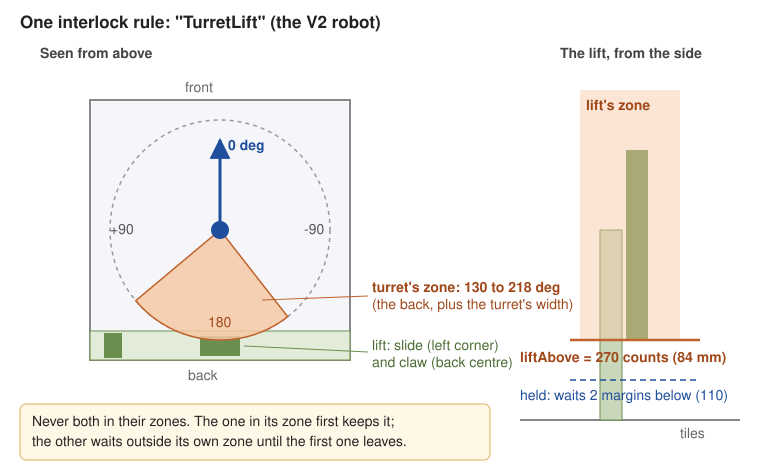
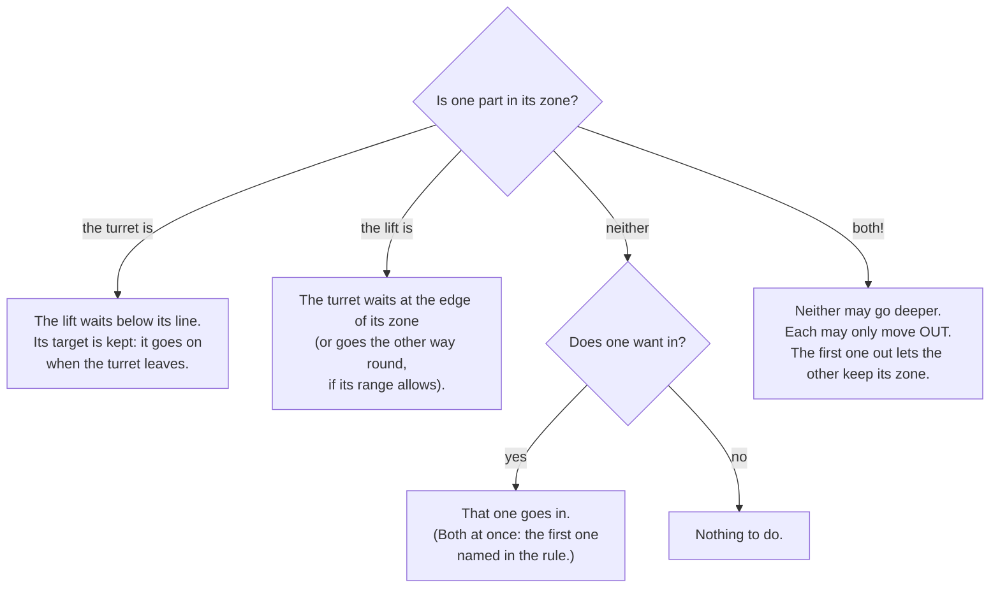

# Two parts that must not collide (interlocks)

> **Work in progress:** this library and its docs are still changing. Something wrong or unclear? [Tell us](https://github.com/crossbotics/ftc-helper-lib/issues).

Some robots have two parts that share space. A turret that swings over the back, and a lift that rises
at the back. An arm that swings down where the intake folds out. A wrist that sticks out past the slide.
Each part on its own is safe inside its limits; **together** they can crash.

An **interlock rule** says: *these two parts are never in their zones at the same time.* You write it
once, in `Robot.java`. The library keeps to it every loop, in TeleOp and in autonomous, whoever moves the
part: a button, a stick, an action, a turret following the goal, an autonomous step.

Reference: [Interlock in the robot module](../modules/robot.md#interlock). Quick recipe:
[How do I stop two parts from hitting each other?](../cookbook.md#how-do-i-stop-two-parts-from-hitting-each-other)

## The idea, with a turret and a lift

Take a robot with a turret in the middle and a lift at the back. When the lift's slide is up, the
turret must not point backward, or the shooter hits the slide. When the turret points backward, the lift
must not rise. (The numbers below are an example. The [V2 robot](#try-it) uses a turret and wrist rule
instead.)



Each part gets a **zone**: the space it must stay out of while the other part is in its own zone.

- The turret's zone: from 109 to 239 degrees (straight back is 180; counterclockwise is +). Say the
  lifter's parts are at 142 to 206, and the turret's own parts reach 33 degrees to each side of where it
  points: 33 degrees more on each side gives 109 to 239.
- The lift's zone: above 270 encoder counts (84 mm: where the slide starts to be in the turret's way).

```java
// Robot.java, after the parts:
keepApart("TurretLift", turret.zone(), lift.zoneAbove());
```

```java
// Tunables.java: the numbers, in each part's own units
public static class TurretLift {
    public static double turretFrom = 109, turretTo = 239;   // degrees
    public static double liftAbove = 270;                    // counts
    public static double liftMargin = 80;                    // optional: see "How a waiting part waits"
}
```

The section name is the rule's name. The field names start with the part's Tunables name with a small
first letter: `Turret` gives `turretFrom` and `turretTo`, `Lift` gives `liftAbove`.

## Who waits?

The rule is simple: **whoever is in its zone first keeps it. The other part waits outside its own zone.**



What the drivers see on the Driver Station, one line per rule, only while something is held:

```
TurretLift : Lift held at 110 counts: Turret is between 109 and 239 deg
TurretLift : Turret held at 124 deg: Lift is above 270 counts
TurretLift : both in their zones (...): move one out (each may only move out)
```

**How a waiting part waits.** It stops two **margins** before its zone (the margin is a safety distance in
the part's units: by default 3 degrees for a turret, about 1/50 of a lift's range, 0.02 for a servo).
Its target is kept, so it goes on by itself the moment the other part leaves. A part counts as "in its
zone" within one margin of it. Set `<part>Margin` in the rule's section if your part coasts further.
**A fast lift needs more:** a goBILDA Viper-Slide on a 435 RPM motor (about 2800 counts a second) went 54 counts past where it
was told to stop when pushed up at full power in the simulator, more than the default 27. With
`liftMargin = 80` it waits at 270 - 2 x 80 = 110 counts. Measure yours: push the stick fully toward
the line and see how far past the "held" point it goes.

**A turret crossing its zone.** A turret at 80 degrees asked to go to 190 has to pass through the back.
With the lift up it stops at 103 (two margins of 3 before 109) and waits. If its range lets it reach 190 the other way round (a turret
that turns -270 to 270, or a slip ring), it goes that way instead and never waits.

**Both in their zones.** This should never happen, but it can: at START, after the robot was pushed, or
when a part was moved by hand. Then nobody keeps a zone: neither part may go deeper, each may only move
out. As soon as one is out, the other keeps its zone.

**A part whose position is not known.** A turret that has not found its home switch yet could be pointing
anywhere; a servo cannot say where it is. Until they are known, they count as "maybe in the zone", so the
other part waits. A servo counts as anywhere between where it was and where it was sent, until its
`travelSec` says it has arrived. A wrist that must be folded before the lift goes down is really folded
before the lift moves.

## More examples

**A wrist that must be folded before the lift goes low.** The wrist sticks out past the slide; low down it
would hit the robot's frame.

```java
keepApart("WristLift", wrist.zone(), lift.zoneBelow());

public static class WristLift {
    public static double wristFrom = 0.45, wristTo = 1.0;   // servo positions: folded out
    public static double liftBelow = 300;                   // counts: low
}
```

**An arm that must not come down while the intake is folded out.**

```java
keepApart("ArmIntake", arm.zoneBelow(), intakeDeploy.zone());

public static class ArmIntake {
    public static double armBelow = 30;                         // degrees
    public static double intakeDeployFrom = 0.5, intakeDeployTo = 1.0;
}
```

**A claw that must be closed above a height.**

```java
keepApart("ClawLift", claw.zone(), lift.zoneAbove());

public static class ClawLift {
    public static double clawFrom = 0.0, clawTo = 0.6;     // anything short of closed (closed = 0.75)
    public static double liftAbove = 1800;
}
```

**Something the library cannot move** (your own sensor or device): a condition.

```java
keepApart("ArmBucket", arm.zoneBelow(), Zone.when("the bucket is up", () -> bucketUp.isPressed()));
```

Any number of rules, between any parts with a position: turret, lift, arm, claw, wrist, positioner, hood.
A robot with no rules works exactly as before.

## Checked at INIT

The OpMode stops at INIT with the reason if a rule has no Tunables section, a number is missing, a zone is
empty (from not below to), outside the part's range, or covers its whole range (the part could never be
out of it), a margin is negative, or a part has no position (an intake roller: use `Zone.when`). The INIT
screen lists each rule:
`Interlock TurretLift: Turret between 109 and 239 deg / Lift above 270 counts`.

## Why the numbers are not live

The zones are read once at INIT and are not in the tuning menu. A zone that moved while the parts were
moving could suddenly put both in their zones. Change the numbers in `Tunables.java`, then INIT again.

## What it does not do

- It does not replace hard stops, and it does not see another robot pushing yours.
- It does not move a part out of the way by itself (no surprise moves): a waiting part waits, and the
  drivers move the other one.
- It only knows what you tell it: measure the zones on the real robot (move one part into the other
  slowly, by hand, and write down where they touch), then add the margins.

## Try it

The [v2bot example](../../examples/src/main/java/com/crossbotics/ftchelper/examples/v2bot/Robot.java) has a
turret, a lift with a wrist and a claw, and a rule from team 8938's measured designs:
`keepApart("TurretClaw", turret.zone(), wrist.zone())`. Its claw only reaches the turret while the wrist
is folded or at pick-up (0 to 47 degrees), at any lift height, so the rule is between the turret and
the **wrist**, not the lift: the turret stays out of 147 to 217 degrees while the wrist is low. The
reasons and the numbers are in its `Tunables.TurretClaw`. Run its TeleOp in the
[simulator](simulator.md): with the wrist folded, turn the turret toward the back with the stick (it
stops at the edge), then score in a FLOWER (G2 Y: the wrist swings out, and the turret is free).
