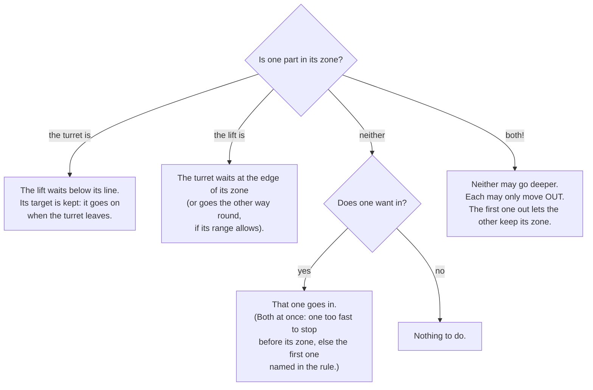

# Two parts that must not collide (interlocks)

> **Work in progress:** this library and its docs are still changing. Something wrong or unclear? [Tell us](https://github.com/crossbotics/ftc-helper-lib/issues/new/choose).

Some robots have two parts that share space. A turret that swings over the back, and a lift that rises
at the back. An arm that swings down where the intake folds out. A wrist that sticks out past the slide.
Each part on its own is safe inside its limits; **together** they can crash.

An **interlock rule** says: *these two parts are never in their zones at the same time.* You write it
once, in `Robot.java`. The library keeps to it every loop, in TeleOp and in autonomous, whoever moves the
part: a button, a stick, an action, a turret following the goal, an autonomous step.

Reference: [Interlock in the robot module](../modules/robot.md#interlock). Quick recipe:
[How do I stop two parts from hitting each other?](../cookbook.md#how-do-i-stop-two-parts-from-hitting-each-other)

## The idea, with a turret and a lift

Take a robot with a turret in the middle and a lift at the back. When the lift's slide is up, the
turret must not point backward, or the shooter hits the slide. When the turret points backward, the lift
must not rise. (The numbers below are an example. The [V2 robot](#the-v2-robot) uses a turret and wrist rule
instead.)


Each part gets a **zone**: the space it must stay out of while the other part is in its own zone.

- The turret's zone: from 109 to 239 degrees (straight back is 180; counterclockwise is +). Say the
  lifter's parts are at 142 to 206, and the turret's own parts reach 33 degrees to each side of where it
  points: 33 degrees more on each side gives 109 to 239.
- The lift's zone: above 270 encoder counts (84 mm: where the slide starts to be in the turret's way).

```java
// Robot.java, after the parts:
keepApart("TurretLift", turret.zone(), lift.zoneAbove());
```

```java
// Tunables.java: the numbers, in each part's own units
public static class TurretLift {
    public static double turretFrom = 109, turretTo = 239;   // degrees
    public static double liftAbove = 270;                    // counts
    public static double liftStopSec = 0.2;                  // optional: see "Stop distance"
}
```

The section name is the rule's name. The field names start with the part's Tunables name with a small
first letter: `Turret` gives `turretFrom` and `turretTo`, `Lift` gives `liftAbove`.

## Who waits?

The rule is simple: **whoever is in its zone first keeps it. The other part waits outside its own zone.**



What the drivers see on the Driver Station, one line per rule, only while something is held:

```
TurretLift : Lift held at 110 counts: Turret is between 109 and 239 deg
TurretLift : Turret held at 124 deg: Lift is above 270 counts
TurretLift : both in their zones (...): move one out (each may only move out)
```

**How a waiting part waits.** It stops two **margins** before its zone (the margin is a safety distance in
the part's units: by default 3 degrees for a turret, about 1/50 of a lift's range, 0.02 for a servo).
Its target is kept, so it goes on by itself the moment the other part leaves. A part counts as "in its
zone" within one margin of it.

### Stop distance: a fast part brakes in time

A motor does not stop the moment it is told to. Two things carry it on:

1. **The loop.** The robot only looks and decides once per loop. A loop is usually 10 to 30 ms, but a
   camera, a busy hub or a slow sensor can make some loops 100 ms or more. Until the next loop, the part
   keeps going at full speed. (And the position it reads is from the last loop, so count that loop too.)
2. **Braking.** With its power cut (BRAKE), a motor still coasts a little while it slows down.

So every loop the rule measures each motor part's **speed** (from its encoder) and works out its **stop
distance**: how far it would still go if it were told to stop now.

```
stop distance = speed x (2 x the slowest of the last 25 loops + half of <part>StopSec)
```

A part that must wait may only use the power that lets it stop in time: it slows down as it comes near
its waiting point, and brakes (power 0) as soon as its stop distance would take it past it. Its top speed
comes from its motor (`Turret.motor(..., "gobilda-5203-312")`, `Arm.motor`, `Lift.slide(...).part(...)`),
or from the fastest the rule has seen it move. Example: the v2bot's turret turns about 680 degrees a
second; in the simulator, at full stick toward the back with the wrist folded, it slows down and stops at
its waiting point (-137), 6 degrees outside its zone, even with the computer so busy that loops get slow.

A part moving so fast that it **could not stop before its zone** counts as already in it: the other part
waits, so the two never both start into their zones.

`<part>StopSec` (optional, default 0.15 s): how long the part takes to stop from full speed once its
power is cut. A heavy slide or a big turret may take longer: test it with the stick fully toward the zone;
if it ever ends past its waiting point, raise it. The margin is now extra safety on top (an encoder that
slips, a part that bends), not the room to coast. A servo needs no stop distance: it is never sent past
its fence, and until its `travelSec` is over it counts as anywhere between where it was and where it was
sent.

**A part whose way crosses its zone.** A lift at 0 asked to go to 1000 through a zone from 400 to 600
asks for the zone just like a target inside it: it goes when the other part is out (which is then held
out), instead of waiting below the zone for ever.

**A turret crossing its zone.** A turret at 80 degrees asked to go to 250 degrees (the same direction as
-110) would pass through the back (109 to 239) turning counterclockwise. If its range lets it reach -110
the other way round (a range like -190 to 190, or a slip ring), it turns clockwise instead and never
waits. If not (a range of -90 to 90 cannot reach either), it stops at 103 (two margins of 3 before 109)
and waits while the lift is up.

**Both in their zones.** This should never happen, but it can: at START, after the robot was pushed, or
when a part was moved by hand. Then nobody keeps a zone: neither part may go deeper, each may only move
out. As soon as one is out, the other keeps its zone.

**A part whose position is not known.** A turret that has not found its home switch yet could be pointing
anywhere; a servo cannot say where it is. Until they are known, they count as "maybe in the zone", so the
other part waits. A servo counts as anywhere between where it was and where it was sent, until its
`travelSec` says it has arrived. A wrist that must be folded before the lift goes down is really folded
before the lift moves. The Driver Station says why the other part waits:

```text
TurretLift : Lift held at 110 counts: Turret angle unknown (not homed yet)
TurretLift : LiftLeft held at 268 counts: Turret angle unknown (not sent anywhere yet: it goes to its start angle at START)
```

A servo turret is sent to its `startAngle` (or the middle of its range) at START, so this lasts only until
the first loop after START.

**And the other way round:** a part whose position is not known does not move at all (no homing, no
stick, no first servo move) while the other part is in its zone: from "anywhere" it could sweep through
it. A turret waits to home while the lift is up, and homes as soon as the lift is down (its homing time
limit waits too). A first move that cannot go into the zone from anywhere (a wrist sent to "folded",
below a zone at the top of its range) does not wait.

```text
TurretLift : Turret waits (not homed yet): Lift is above 620 counts; move Lift out of its zone first
```

**At START** the rules look first, before any START command is sent (a hood going to its `startAngle`, a
turret homing, an `atStart` action): a START command into a zone the other part is in waits at the fence
like any other command.

## More examples

**A wrist that must be folded before the lift goes low.** The wrist sticks out past the slide; low down it
would hit the robot's frame.

```java
keepApart("WristLift", wrist.zone(), lift.zoneBelow());

public static class WristLift {
    public static double wristFrom = 0.45, wristTo = 1.0;   // servo positions: folded out
    public static double liftBelow = 300;                   // counts: low
}
```

**An arm that must not come down while the intake is folded out.**

```java
keepApart("ArmIntake", arm.zoneBelow(), intakeDeploy.zone());

public static class ArmIntake {
    public static double armBelow = 30;                         // degrees
    public static double intakeDeployFrom = 0.5, intakeDeployTo = 1.0;
}
```

**A claw that must be closed above a height.**

```java
keepApart("ClawLift", claw.zone(), lift.zoneAbove());

public static class ClawLift {
    public static double clawFrom = 0.0, clawTo = 0.6;     // anything short of closed (closed = 0.75)
    public static double liftAbove = 1800;
}
```

**Something the library cannot move** (your own sensor or device): a condition.

```java
keepApart("ArmBucket", arm.zoneBelow(), Zone.when("the bucket is up", () -> bucketUp.isPressed()));
```

Any number of rules, between any parts with a position: turret, lift, arm, claw, wrist, positioner, hood.
A robot with no rules works exactly as before.

## Checked at INIT

The OpMode stops at INIT with the reason if a rule has no Tunables section, a number is missing, a zone is
empty (from not below to), outside the part's range, or covers its whole range (the part could never be
out of it), a margin is negative, a `StopSec` is outside 0 to 2 seconds, or a part has no position (an intake roller: use `Zone.when`). The INIT
screen lists each rule:
`Interlock TurretLift: Turret between 109 and 239 deg / Lift above 270 counts`.

A rule with a part that is not on the robot yet ([`optional()`](../modules/robot.md#parts-not-on-the-robot-yet),
its device not in the configuration) is off: there is nothing to hit, so it needs no Tunables section and
holds nothing back. INIT says `Interlock TurretLift: off (Lift is not on the robot)`.

## Why the numbers are not live

The zones are read once at INIT and are not in the tuning menu. A zone that moved while the parts were
moving could suddenly put both in their zones. Change the numbers in `Tunables.java`, then INIT again.

## What it does not do

- It does not replace hard stops, and it does not see another robot pushing yours.
- It does not move a part out of the way by itself (no surprise moves): a waiting part waits, and the
  drivers move the other one.
- It only knows what you tell it: measure the zones on the real robot (move one part into the other
  slowly, by hand, and write down where they touch), then add the margins.

## The V2 robot

The [v2bot example](../../examples/src/main/java/com/crossbotics/ftchelper/examples/v2bot/Robot.java) has a
turret, a lift with a wrist and a claw, and a rule from team 8938's measured designs (turret v8.1GB and
the "pincer" lifter):
`keepApart("TurretClaw", turret.zone(), wrist.zone())`. Its claw only reaches the turret while the wrist
is folded or at pick-up (0 to 47 degrees), at any lift height, so the rule is between the turret and
the **wrist**, not the lift: the turret stays out of 147 to 217 degrees while the wrist is low. The
reasons and the numbers are [below](#the-turretclaw-rule). Every number not measured on a built robot
says "example" in its `Tunables.java`.

The robot, part by part:

- A mecanum drive with a goBILDA Pinpoint (odometry): the turret keeps aiming from the robot's place
  when the camera loses the goal.
- An intake, a color sensor that counts the pieces (BIOBUZZ allows 4 at a time, G407), and an indexer
  servo that feeds the launcher. The `Pieces` line comes **above** the intake line, so the count is up to
  date before the intake asks "full?".
- A turret on a goBILDA Gear-Driven Turret bearing, turned by a 312 RPM motor (2.75 motor turns per
  turret turn). It turns -190 to +190 degrees and finds its angle on a magnetic home switch at START
  ([Setting up a turret](turret-setup.md#four-complete-examples), example A).
- A flywheel launcher with a hood on a servo: speed and hood angle from the distance to the goal. It
  fires only when the turret is aimed and there is a piece to fire.
- A lift at the back: a goBILDA 4-stage Viper-Slide on a 435 RPM motor. On its top stage: a wrist (a
  servo on an 8 mm axle across the slide, that swings the claw out the back, 0 to 145 degrees between
  hard stops: a stop collar and a pin) and a two-finger claw.

Run its TeleOp in the
[simulator](simulator.md): with the wrist folded, turn the turret toward the back with the stick (it
stops at the edge), then score in a FLOWER (G2 Y): while the wrist is out, the turret is free to turn to
the back. When the action folds the wrist again at the end, the rule is back on: a turret at the back
then holds the wrist out (it waits until the turret turns away).

### The V2 robot's buttons

The parts bring their buttons, all on gamepad 2 (the operator): RT intake on/off (held 1 s: in even when
the count says full), LT push out (hold), LB flywheel spin up/down, RB fire (hold: keep firing), D-pad
up/down speed trim, D-pad right the next shot table, left stick Y hood trim, right stick X turret by
hand, BACK turret following on/off, B claw open/close, D-pad left the wrist's previous position, left
stick button held 1 s: piece count = 0.

`Controls.java` adds: A grab, Y score in a FLOWER, X stow the lifter, the lift by hand on the right
stick Y, a buzz when the turret is on target, and the light's colors (orange while the rule holds a
part back).

Some module suggestions find their button taken by a part added earlier in `Robot.java`. The INIT
screen lists them, e.g. `Lift by hand: no button (G2 left stick Y is taken by Hood)`. That is the
library's check doing its job: one job per button. `Controls.java` gives the lift its own stick.

### The lifter's steps

The actions in `Actions.java` keep team 8938's order:

1. Pick up with the slide down and the wrist 20 degrees out, so the ball is not under the robot.
2. Swing the wrist out to 90 degrees BEFORE lifting, then lift, then tip the wrist over the FLOWER.
   Drive there first: the robot's back to the FLOWER, about 28 mm away (the design's release point).
3. Coming back: wrist to 90, lift down, then fold.

Each wait lets a part get there (a servo: about its `travelSec`; the lift: its encoder says it
arrived). Every wait has a time limit, so a stuck part never stops the robot for good: the action ends
and says which step timed out.

The rule is always on. While the turret points back, the wrist waits above 47 degrees by itself (the
claw would hit the turret lower down; the Driver Station says `TurretClaw : Wrist held at ...`). So
`grab` first turns the turret forward, and lets it follow the goal again once the wrist is back out
at carry. Scoring needs nothing: the wrist is out at 90 degrees and more, where the turret may point
anywhere. `stow` folds the wrist last: it waits there if the turret points back. In the autonomous
too: had a step raised the wrist into its zone while the turret pointed back, it would wait.

### Where the V2 robot's numbers come from

**The lift** (`Tunables.Lift`), in encoder counts from the bottom stop. 0 is where it is at INIT, so
start with the slide down. The top stage moves 120 mm per motor turn and the 435 RPM motor counts 384.5
per turn: 3.2 counts per mm (the lifter design log).

- `pickup` 0: slide down. With the wrist at 20 degrees the claw reaches a ball on the tiles.
- `stowed` 44 (13.7 mm): the folded claw clears the tiles.
- `flower` 1330 (415.1 mm): the ball over the FLOWER's top opening (wrist at 122.8 degrees).
- `max` 1350: just under the hard stop at 425.1 mm (1362). `min` 0: the bottom stop.
- `kP` to `tolerance`: examples. Tune your own ([lesson 4](../tutorials/start/04-lift-and-claw.md)).

**The wrist** (`Tunables.Wrist`), servo positions. The goBILDA 2000 servo turns 0.15 degrees per
microsecond of signal (300 degrees over 500-2500 us). The hub's normal signal is 600-2400 us, so 0 to 1
turns it 270 degrees: one degree is 1/270. The wrist needs only 145 degrees, so it keeps the normal
range (no [`.fullRange()`](../modules/robot.md#claw)).

- Angles from straight down (the lifter design): folded 0, pickup 20, carry 90, flower 122.8. The hard
  stop is at 145 (0.637).
- `folded = 0.10` is an example: find yours with the Servo Finder. Each other position = folded +
  degrees / 270 (pickup 0.174, carry 0.433, flower 0.555).
- `travelSec`: the Speed servo turns 60 degrees in 0.09 s, so 145 degrees take 0.22 s. 0.3 s adds a bit.

**The claw** (`Tunables.Claw`, the "pincer"): two fingers on one goBILDA Torque servo (2000-0025-0002),
geared together. The fingers turn 1.2 times the servo's angle. Open: fingers at +17 degrees (servo +14);
closed on a POLLEN: -10 degrees (servo -8); a NECTAR stops them at 0. The positions around 0.50 are
examples: find yours with the Servo Finder.

**The hood** works like the turret robot's ([lesson 9](../tutorials/start/09-shooter-and-camera.md#a-hood-the-shot-angle)).
The aim's goal point (`goalX`, `goalY`) is explained in
[lesson 9, section 9](../tutorials/start/09-shooter-and-camera.md#9-when-the-camera-loses-the-goal-the-odometry).
`shooterForwardIn = 1`: the turret's axis is 1 in forward of the robot's centre (turret v8.1GB). It
matters only when shooting on the move (off until tested on the real robot).

### The TurretClaw rule

Team 8938's pincer model was run against turret v8.1GB (2026-10-22). No lifter part ever comes inside
the turret's reach (201.1 mm from its axis). But with the wrist between 3 and 44.5 degrees, the claw
body comes within 2 mm of it, at +/-4 degrees of straight back, at EVERY lift height. With the wrist
above 47 degrees (carry 90, flower 122.8), every lifter part is at least 206.7 mm away: clear.

- **The turret's zone.** Its parts farther than 190 mm from the axis sit from -32.3 to +28.8 degrees
  of where it points (the v8.1GB reach measurements). The claw is at 176 to 184 degrees. So they meet
  when the turret points from 176 - 28.8 = 147 to 184 + 32.3 = 217 degrees (0 forward,
  counterclockwise +, back = 180): `turretFrom = 147`, `turretTo = 217`.
- **The wrist's zone.** 0 to 47 degrees (the measured 3 to 44.5, with a margin). In servo positions:
  `wristTo` = folded + 47 / 270 = 0.10 + 0.174 = 0.274. `wristFrom = 0`: the wrist cannot go below
  folded (its stop), so the zone starts at the bottom. Change `folded`? Change `wristTo` too.
- **The lift needs no zone:** the wrist's rule covers every lift height.
- **No `turretMargin` or `turretStopSec`:** the defaults fit. The turret is fast (a 312 RPM motor,
  2.75:1: about 680 degrees a second), but the rule measures its speed every loop and slows it down
  near the zone ([Stop distance](#stop-distance-a-fast-part-brakes-in-time)). It waits two margins
  (2 x 3 degrees) from the zone: at 147 - 6 = 141 (or -143 + 6 = -137). On the built robot, push the
  stick fully toward the back. If the turret ever ends past its waiting point, raise `turretStopSec`
  (how long it takes to stop, default 0.15 s).

On the field: while the wrist is folded or at pick-up, the turret aims anywhere from -137 to 141
degrees. Once the wrist swings out to carry, it may point anywhere again (its -190 to 190).
