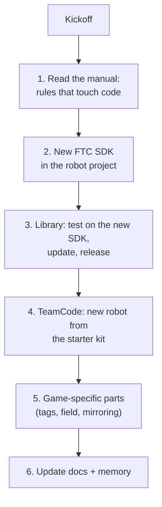

# A new season: what to do

> **Work in progress:** this library and its docs are still changing. Something wrong or unclear? [Tell us](https://github.com/crossbotics/ftc-helper-lib/issues).

**For:** the programming lead and mentor at the start of a season. **You need:** last season's robot
project, and the new Competition Manual.

FTC changes the game every September. It changes the SDK (the FTC software your code builds on) at
least once a year. Most of the library carries over unchanged. This page is the checklist, in order.

## 1. Read the manual (the parts that touch code)

Search the new Competition Manual for these, and update [README "Rules check"](../../README.md#rules-check-2026-27-biobuzz-manual-tu01)
and anything below that changed:

| Topic | Why it matters | 2026-27 (BIOBUZZ, TU01) |
| --- | --- | --- |
| Reusing software | can the library be used? | R304: allowed, also software made before Kickoff |
| Size limits / extension | soft limits are not enough | R105 B: limits must hold WITHOUT software |
| Match timing | `MatchTimer` lengths and cues | 0:30 auto, 8 s transition, 2:00 TeleOp; cues 1:00 and 0:20 |
| Field symmetry | `Alliance.mirror` | check: mirrored or rotated? |
| AprilTags | ids, sizes, do they move? | tags on moving HIVE cells: aim yes, localize no |
| Driver Station / controllers | gamepad buttons | |

Also check the Team Updates during the season.

## 2. New FTC SDK

In the robot project, follow FIRST's instructions (usually: update `build.dependencies.gradle`
and the `FtcRobotController` folder). Read the SDK release notes for **breaking changes**
(2026-27: AprilTag detections split into single tags and clusters).

## 3. The library

Gradle is the tool that builds the code; `./gradlew ...` runs it from the `ftc-helper-lib` folder.

1. Change `ftcSdkVersion` in `library/build.gradle`, `examples/build.gradle` and `sim/build.gradle` to the new version.
2. Build and test: `./gradlew :library:testDebugUnitTest :examples:assembleDebug :examples:testDebugUnitTest`
   and `python3 tools/check_docs.py`.
3. Fix what broke (usually vision, sometimes hardware classes). Add a test for each fix.
4. Update `docs/02-keep-up-to-date.md` (the SDK version), `README.md` ("Works with"), the CHANGELOG.
5. Release a new version (see [Contributing](../contributing.md#releasing-a-version)).

## 4. TeamCode: the new robot

1. Start from the [robot in five files](../tutorials/start/01-robot-in-five-files.md): `./gradlew :sim:newRobot`
   writes them from your robot configuration. (Teams that use the [starter kit](../starter-kit.md) copy its 6 files.)
2. `RobotSettings`: drive type, motor names, IMU mounting. TeleOp and every autonomous read it.
3. `Robot`: delete last year's mechanisms, add this year's (one `PositionMotor`/`SpinMotor`/servo
   line each). Keep anything that still fits.
4. Hardware Check, then tutorial 09's tuning for the drivetrain.

## 5. Game-specific parts (in TeamCode, never in the library)

| Thing | Where |
| --- | --- |
| Which AprilTag id or cluster name is the target | TeamCode constants; `alliance().pick(blueId, redId)` |
| Field positions, routes | your `EasyAuto` classes |
| A ROTATED field (not mirrored) | `mirrorForRed()` returns false in your autos: the same robot-relative route then works for both alliances. BIOBUZZ 2026-27 is rotated (its field CAD: each red part's twin is turned half a turn about the centre). |
| Scoring heights, shot table | `Robot` positions (`tunable`), `ShotTable` |
| Match-time cues | `MatchTimer.cueAt(...)` in the TeleOp |

If something is useful for ANY game (a new mechanism type, a sensor helper), put it in the library
instead: [Extending the library](extending.md).

## 6. Docs and records

- Library: CHANGELOG, the module pages, the tutorials that changed, this page's table.
- Robot project: its own README / design log.
- AI agents: `AGENTS.md` is read every session; update it if the rules or layout changed.
