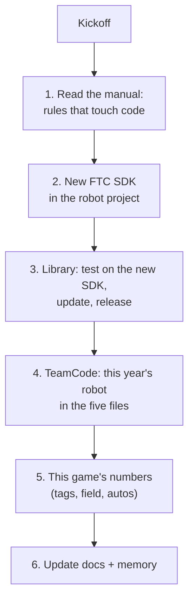

# A new season: what to do

> **Work in progress:** this library and its docs are still changing. Something wrong or unclear? [Tell us](https://github.com/crossbotics/ftc-helper-lib/issues/new/choose).

**For:** the programming lead and mentor at the start of a season. **You need:** last season's robot
project, and the new Competition Manual.

FTC changes the game every September. It changes the SDK (the FTC software your code builds on) at
least once a year. Most of the library carries over unchanged. Work through the checklist below in order.

## 1. Read the manual (the parts that touch code)

Search the new Competition Manual for these topics. Update [README "Rules check"](../../README.md#rules-check-2026-27-biobuzz-manual-tu01)
and anything below that changed:

| Topic | Why it matters | 2026-27 (BIOBUZZ, TU01) |
| --- | --- | --- |
| Reusing software | whether teams may use the library | R304: allowed, also software made before Kickoff |
| Size limits / extension | soft limits are not enough | R105 B: limits must hold WITHOUT software |
| Match timing | `MatchTimer` lengths and cues | 0:30 auto, 8 s transition, 2:00 TeleOp; cues 1:00 and 0:20 |
| Field symmetry | `Alliance.mirror` | check whether it is mirrored or rotated |
| AprilTags | ids, sizes, and whether they move | tags on moving HIVE cells: aim yes, localize no |
| Driver Station / controllers | gamepad buttons | |

Also check the Team Updates during the season.

## 2. New FTC SDK

In the robot project, follow FIRST's instructions. Usually you update `build.dependencies.gradle`
and the `FtcRobotController` folder. Read the SDK release notes for **breaking changes**
(2026-27: AprilTag detections split into single tags and clusters).
Also check the SDK's normal servo pulse (`PwmControl.PwmRange.defaultRange`: 600-2400 microseconds in
SDK 12.0). The library's servo degrees and `.fullRange()` assume it (`ServoSetup.SDK_PULSE_LOW_US`,
`SDK_PULSE_HIGH_US`, and `SimParts.SDK_LOW_US`/`SDK_HIGH_US` in the simulator).

## 3. The library

Gradle is the tool that builds the code. `./gradlew ...` runs it from the `ftc-helper-lib` folder.

1. Change `ftcSdkVersion` in `library/build.gradle`, `examples/build.gradle` and `sim/build.gradle` to the new version.
2. Build and test: run the checks in [Contributing](../contributing.md) (the Gradle builds and tests,
   and the `tools/check_*` scripts).
3. Fix what broke (often vision, sometimes hardware classes). Add a test for each fix.
4. Update `docs/02-keep-up-to-date.md` (the SDK version), `README.md` ("Works with") and the CHANGELOG.
5. Release a new version (see [Contributing](../contributing.md#releasing-a-version)).

## 4. TeamCode: this year's robot

A robot is [five files](../five-files/README.md) in TeamCode: `Robot.java` (the parts), `Tunables.java`
(their numbers), `Controls.java` (the buttons), `Actions.java` (jobs made of several moves) and one file
per auto. Most of last season's files carry over. Change only what the new robot changes.

1. **A new robot, or a big change:** make the robot configuration on the Driver Hub first. Then the
   library writes the five files from it ([Start from a blank slate: your own robot](../pick-your-start/03-blank-slate.md#way-a-from-your-configuration)).
   A starter bot can start from its [ready files](../pick-your-start/01-starter-bot.md).
2. **`Robot.java`:** delete last year's parts, and add this year's: one `add(...)` line each
   ([the part pages](../reference/README.md)). Check the `drive(...)` and `odometry(...)` lines.
3. **`Tunables.java`:** delete the sections of the parts you removed. INIT lists every section a new part
   still needs.
4. **`Controls.java` and `Actions.java`:** put the new parts on buttons. Each part page has a "Buttons to add".
5. Run the Hardware Check, then the [finders](../tuning/README.md) for each new part.

## 5. This game's numbers (in TeamCode)

The library knows the game (the field, the rules, the piece names, for the simulator). Your team's own
choices go in TeamCode:

| Thing | Where |
| --- | --- |
| Start spots, routes, field points | each auto's steps ([Building autos](../building-autos/README.md)) |
| A field that is TURNED for red, not mirrored | `mirrorForRed()` returns `false` in each auto ([how](../building-autos/02-put-steps-together.md)). BIOBUZZ 2026-27 is turned: in its field CAD, each red part's twin is turned half a turn about the center. Also `Tunables.Odometry.mirrorForRed` for the reset spot |
| Which AprilTag is the target, a number that differs for red | `alliance().pick(blue, red)` ([Advanced autos](../building-autos/08-advanced-autos.md#a-different-number-for-red)) |
| Scoring heights, positions, the shot table | `Tunables.java`, found with the tuning menu and the finders |
| Something at a set time in TeleOp (park, a buzz) | `atSecondsLeft(seconds, job)` in `Controls.java` |

**For the library (the mentor):** a new season also needs its season files in the simulator:
`sim/fields/<season>.json` (made from the official field CAD by a script) and `sim/fields/<season>.rules.json`
(the rules, typed from the manual with section numbers).

When something is useful for ANY game (a new mechanism type, a sensor helper), put it in the library
instead: [Extending the library](extending.md).

## 6. Docs and records

- Library: CHANGELOG, the part pages, the walkthrough pages that changed, this page's table.
- The camera fix (alpha): look again when the field has fixed tags on the walls
  ([Possible later work](../design/possible-work.md)).
- The Shot Tuner's field map: change the goal and the spots in `tools/shot_spots.py`, run it, and change
  the season paragraph in `docs/tuning/13-shot-tuner.md`.
- Robot project: its own README / design log.
- AI agents: they read `AGENTS.md` every session. Update it when the rules or the layout change.
