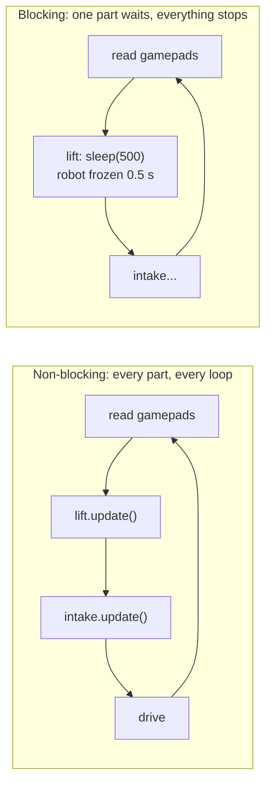

# Non-blocking code: keep the loop running

> **Work in progress:** this library and its docs are still changing. Something wrong or unclear? [Tell us](https://github.com/crossbotics/ftc-helper-lib/issues/new/choose).

**For:** anyone writing TeleOp or autonomous code. **You need:** a first OpMode
([Robot.java](../five-files/01-robot-java.md) or [tutorial 01](../tutorials/01-opmode-basics.md)).

A robot program is ONE loop that runs 50-200 times per second. Every part of the robot gets a turn
in every loop. When any one piece of code **waits** (sleeps, loops until something happens, waits for
a network answer), the whole robot freezes for that time. It does not drive, stop at limits, or
react to STOP. The name for this is **blocking**.



## The rule in this library

| Kind of code | Blocks? |
| --- | --- |
| Everything you call in TeleOp: mechanism commands, `update()`, `ControllerBindings`, telemetry, timers, menus, cameras, the launcher | **Never.** Each call does a little work and returns. |
| Slow hardware requests (Limelight pipeline switch and heading, webcam exposure, a REV 2m Distance Sensor in `PieceSensor.distance`, the battery voltage for the launcher: `Hw.batteryReader`) | Never: the library sends them on a background thread (`BackgroundWorker`). |
| Setup in INIT (`create(...)`, `ImuSetup.get`, camera `start()`) | A short moment, once, in INIT. Never in the loop. |
| `AutoDrive.move/turn/turnTo/moveWithTurn`, `AutoRoutine.runAll`, `AutoStep`s, `EasyAuto` | **Yes, on purpose**, and only in autonomous. While they wait, they keep updating your mechanisms and check STOP. Each has a time limit. |

Each blocking method says **BLOCKS** in its Javadoc. The Javadoc is the explanation above the method in the code,
and it is also in the [reference](../reference/javadoc.md).

## How to wait without blocking

Say you want "open the claw, then close it 0.3 s later". Do not sleep. Remember WHEN, and check every loop:

```java
// WRONG: freezes the robot for 0.3 s
claw.goTo("OPEN");
sleep(300);
claw.goTo("CLOSED");

// RIGHT: a tiny state machine (it remembers WHEN to act, and checks every loop)
private double closeAt = -1;   // seconds; -1 = nothing planned
...
// getRuntime() = seconds since the OpMode started: close 0.3 s from now
.bindPress(Pad.G2, Btn.A, () -> { claw.goTo("OPEN"); closeAt = getRuntime() + 0.3; })
...
// every loop:
if (closeAt > 0 && getRuntime() >= closeAt) {
    claw.goTo("CLOSED");
    closeAt = -1;              // done: nothing planned any more
}
```

The helpers already work this way inside. `PositionMotor` moves toward a target a bit each loop.
`SpinServo.runFor` stops itself in `update()`. `Launcher.shoot(3)` feeds one piece per loop when
ready. `SpinMotor` times its jam back-out.

## In autonomous

In autonomous you want to wait, but your mechanisms must keep working while you wait. Use the
library's waits, never `sleep()`:

| Instead of | Use |
| --- | --- |
| `sleep(500)` between steps | `routine.waitFor("Settle", 0.5)` |
| `while (!lift.isAtTarget()) {}` | `routine.waitUntil("Lift up", lift::isAtTarget, 2.0)` (time limit!) |
| a custom waiting loop | inside an `AutoStep`: `ctx.waitFor(...)`, `ctx.waitUntil(...)`, or call `ctx.loop()` in your loop |

`lift::isAtTarget` is a method reference: it hands over the method itself, so the wait can call it
again every loop.

## The alarms

The library watches for blocking code, and the Driver Station shows a warning:

| Warning | Means | Fix |
| --- | --- | --- |
| `G2:A button job took 250 ms: the whole robot stopped that long. ...` | a button action waited | remove the sleep or loop, and use a state machine (above) |
| `Lift update took 120 ms: update() must not wait or sleep` | a mechanism's `update()` waited | same |
| Loop speed under ~30 Hz (`LoopTimer`; Hz = loops per second) | something is slow every loop | bulk reads, fewer telemetry lines, look for waits |

Show the button warning in your TeleOp:

```java
// "" means all good; anything else is a warning text to show
if (!controls.getSlowActionWarning().isEmpty()) t.warn(controls.getSlowActionWarning());
```

`Subsystems.addTelemetry` shows the update warning for you.

## Background jobs

Some hardware requests must wait for an answer, like a network request to the Limelight. The library
runs those on a `BackgroundWorker` thread: a second line of work that runs at the same time as your
loop. So your loop goes on. When you add such a request, write:

```java
BackgroundWorker worker = new BackgroundWorker("my-sensor");   // its own thread (a 2nd worker)
worker.submitLatest("setting", () -> sensor.slowSetting(value));   // returns at once
...
worker.shutdown();      // in stop()
```

Rules for background jobs: never touch motors or servos from them, because only the loop does that.
Use `submitLatest` for anything you send again and again, so the worker sends only the newest value.

## Checked automatically

`tools/check_blocking.py` runs on every push. It fails the build when the library has a `sleep(`, `Thread.sleep` or
`.join(`. It also fails on a `while` loop outside the methods that block on purpose (the script lists them, each with the reason).
Another kind of wait fails it too, such as `.await(`, `.acquire(`, `.take(`, a `Future` or `LockSupport.park`. Examples may not sleep or wait
either.

The script only reads the words of the code, so two things stay your job. The first is a wait for a lock (a lock lets only one thread
use something at a time). Never hold a lock that the loop also needs while you write a file or talk to a device. The second is a slow request inside a call: some SDK methods wait for a device.
