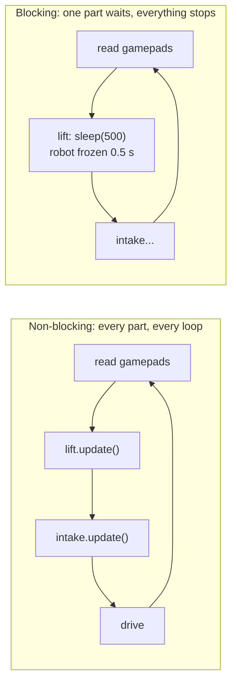

# Non-blocking code: keep the loop running

> **Work in progress:** this library and its docs are still changing. Something wrong or unclear? [Tell us](https://github.com/crossbotics/ftc-helper-lib/issues).

A robot program is ONE loop that runs 50-200 times per second. Every part of the robot gets a turn
in every loop. If any one piece of code **waits** (sleeps, loops until something happens, waits for
a network answer), the whole robot freezes for that time: no driving, no stopping at limits, no
reaction to STOP. That is called **blocking**.



## The rule in this library

| Kind of code | Blocks? |
| --- | --- |
| Everything you call in TeleOp: mechanism commands, `update()`, `ControllerBindings`, telemetry, timers, menus, cameras, the launcher | **Never.** Each call does a little work and returns. |
| Slow hardware requests (Limelight pipeline switch and heading, webcam exposure) | Never: the library sends them on a background thread (`BackgroundWorker`). |
| Setup in INIT (`create(...)`, `ImuSetup.get`, camera `start()`) | A short moment, once, in INIT. Not in the loop. |
| `AutoDrive.move/turn/turnTo/moveWithTurn`, `AutoRoutine.runAll`, `AutoStep`s, `EasyAuto` | **Yes, on purpose**, and only in autonomous. While they wait they keep updating your mechanisms, check STOP, and have time limits. |

Each blocking method says **BLOCKS** in its Javadoc.

## How to wait without blocking

You want "open the claw, then 0.3 s later close it". Do not sleep. Remember WHEN, and check every loop:

```java
// WRONG: freezes the robot for 0.3 s
claw.goTo("OPEN");
sleep(300);
claw.goTo("CLOSED");

// RIGHT: a tiny state machine (it remembers WHEN to act, and checks every loop)
private double closeAt = -1;   // seconds; -1 = nothing planned
...
// getRuntime() = seconds since the OpMode started: close 0.3 s from now
.bindPress(Pad.G2, Btn.A, () -> { claw.goTo("OPEN"); closeAt = getRuntime() + 0.3; })
...
// every loop:
if (closeAt > 0 && getRuntime() >= closeAt) {
    claw.goTo("CLOSED");
    closeAt = -1;              // done: nothing planned any more
}
```

The helpers already work this way inside: `PositionMotor` moves toward a target a bit each loop,
`SpinServo.runFor` stops itself in `update()`, `Launcher.shoot(3)` feeds one piece per loop when
ready, `SpinMotor` times its jam back-out.

## In autonomous

Waiting IS the point in autonomous, but your mechanisms must keep working while you wait. Use the
library's waits, never `sleep()`:

| Instead of | Use |
| --- | --- |
| `sleep(500)` between steps | `routine.waitFor("Settle", 0.5)` |
| `while (!lift.isAtTarget()) {}` | `routine.waitUntil("Lift up", lift::isAtTarget, 2.0)` (time limit!) |
| a custom waiting loop | inside an `AutoStep`: `ctx.waitFor(...)`, `ctx.waitUntil(...)`, or call `ctx.loop()` in your loop |

## The alarms

The library watches for blocking code and tells you on the Driver Station:

| Warning | Means | Fix |
| --- | --- | --- |
| `G2:A action took 250 ms: actions must not wait or sleep` | a button action waited | remove the sleep/loop; use a state machine (above) |
| `Lift update took 120 ms: update() must not wait or sleep` | a mechanism's `update()` waited | same |
| Loop speed under ~30 Hz (`LoopTimer`) | something is slow every loop | bulk reads, fewer telemetry lines, look for waits |

Show the button warning in your TeleOp:

```java
// "" means all good; anything else is a warning text to show
if (!controls.getSlowActionWarning().isEmpty()) t.warn(controls.getSlowActionWarning());
```

(`Subsystems.addTelemetry` shows the update warning for you.)

## Background jobs

Some hardware requests must wait for an answer (a network request to the Limelight). The library
runs those on a `BackgroundWorker` thread, so your loop goes on. If you ever add such a request:

```java
BackgroundWorker worker = new BackgroundWorker("my-sensor");   // its own thread (a 2nd worker)
worker.submitLatest("setting", () -> sensor.slowSetting(value));   // returns at once
...
worker.shutdown();      // in stop()
```

Rules for background jobs: never touch motors or servos from them (only the loop does that), and
use `submitLatest` for anything sent repeatedly, so only the newest value is sent.

## Checked automatically

`tools/check_blocking.py` (run on every push) fails the build if a `sleep(`, `Thread.sleep`, or a
`while` loop appears in the library outside the classes that block on purpose, or a `sleep(`
appears in any example.
