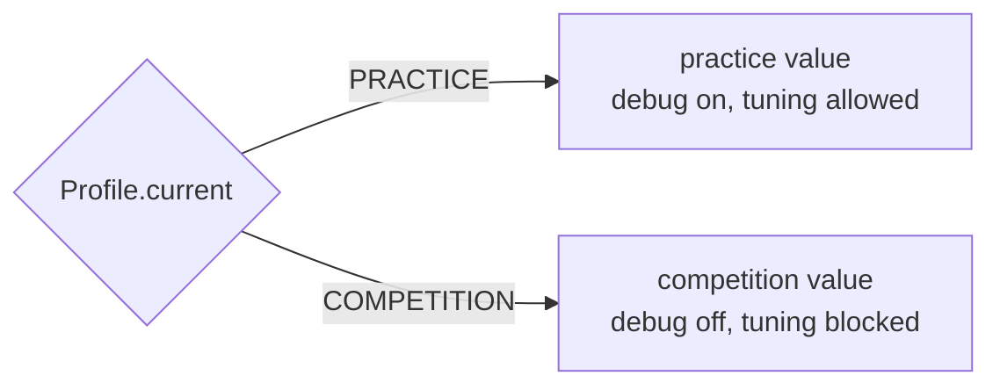

# Profiles: practice vs competition

> **Work in progress:** this library and its docs are still changing. Something wrong or unclear? [Tell us](https://github.com/crossbotics/ftc-helper-lib/issues/new/choose).

**For:** teams getting ready for practice and events. **You need:** a TeleOp or autonomous that
runs (any robot in five files: [The five files](../five-files/README.md)).

The same robot code should be **helpful in the shop**: debug numbers, live tuning.
It should also be **safe at an event**: no tuning menu, no surprise values, nothing extra on the screen.
A profile switches between the two, and you do not change the code.

## The two profiles

| | PRACTICE | COMPETITION |
| --- | --- | --- |
| Drive power | the same: `maxPower` (unless you set `practiceMaxPower`) | `maxPower` |
| Debug telemetry | starts ON | starts OFF |
| Tuning menu | can open | stays closed |
| INIT screen | warns "PRACTICE profile" | normal |
| A part that is off ([`optional()`](../reference/robot-java.md#parts-not-on-the-robot-yet), device not in the configuration) | a quiet note | a loud `!!` warning at the top, and `!! OFF` on the button map |
| Your `Profile.pick(a, b)` values | `a` | `b` |

**The drive power is the same in both,** so the drivers practice at match speed. `practiceMaxPower` in
`Tunables.Drive` can set a lower top power for PRACTICE only, for example for a brand-new driver's first day.

**COMPETITION is the default**, so a robot that nobody set up is in the safe mode.

## Choosing the profile

The Control Hub saves the profile, and it stays until you change it. You can change it in two ways:

1. **INIT menu** (the easier way): every autonomous (`EasyAuto`, `Auto`) has a "Profile" line. Press the D-pad to reach it,
   and left/right to change it. A TeleOp has no such line (it only warns when PRACTICE is on). A TeleOp you write
   yourself can add `.profile()` to an `InitMenu`.
2. **Code**: `Profile.set(Profile.PRACTICE)`.

To see which one is on, any OpMode can show `Profile.current()`.

## Using it in your code

```java
// Numbers: Profile.pick(value in PRACTICE, value in COMPETITION)
int logEvery = Profile.pick(1, 10);                     // log every loop in the shop, every 10th at events

// Features
boolean liveView = Profile.pick(true, false);          // camera preview only in practice
// or ask directly which profile is on:
if (Profile.current().isPractice()) { ...extra checks, logging... }
```



## Event checklist

At the event, before the first match:

1. INIT any autonomous and set **Profile: COMPETITION** in its menu.
2. Check that the INIT screen has **no** "PRACTICE profile" warning.
3. Check that there is no "tuned value(s) differ from the code" warning, or that you meant it.
4. Check that there is no `!! COMPETITION: "..." not in the configuration: ... is OFF` warning for a part
   that IS on the robot. That warning means a misspelled or lost configuration name. At the shop (PRACTICE), a part that
   you have not built yet gives only a note. At an event the warning is loud on purpose.

After the event, set PRACTICE again for the shop.

## What should NOT differ between profiles

Safety stays the same: limits, hard stops, jam handling, timeouts. Never make a profile turn off a safety feature.
Profiles change only comfort and convenience.
