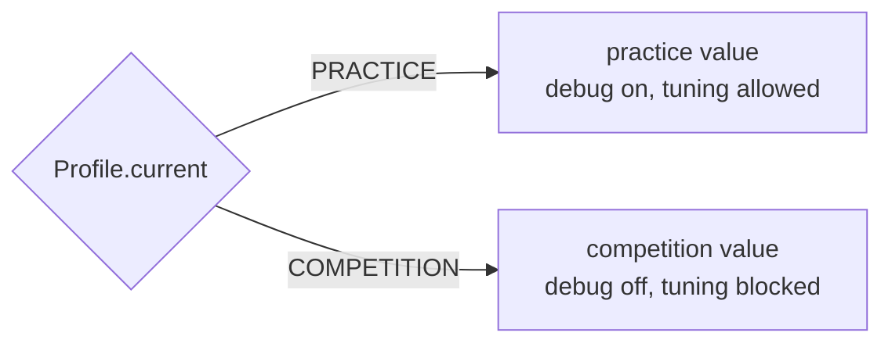

# Profiles: practice vs competition

> **Work in progress:** this library and its docs are still changing. Something wrong or unclear? [Tell us](https://github.com/crossbotics/ftc-helper-lib/issues).

**For:** teams getting ready for practice and events. **You need:** a TeleOp or autonomous that
runs (any [lesson](../tutorials/README.md#start-here-the-main-track) robot).

The same robot code should be **helpful in the shop** (debug numbers, gentle speeds, live tuning)
and **safe at an event** (no tuning menu, no surprise values, nothing extra on the screen).
A profile switches between the two without changing the code.

## The two profiles

| | PRACTICE | COMPETITION |
| --- | --- | --- |
| Debug telemetry | starts ON | starts OFF |
| Tuning menu | can open | stays closed |
| INIT screen | warns "PRACTICE profile" | normal |
| Your `Profile.pick(a, b)` values | `a` | `b` |

**COMPETITION is the default**, so a robot that was never set up is in the safe mode.

## Choosing the profile

It is saved on the Control Hub and stays until changed. Two ways:

1. **INIT menu** (easiest): every autonomous (`EasyAuto`, `Auto`) has a "Profile" line. D-pad to it,
   left/right to change. A TeleOp has none (it only warns when PRACTICE is on); a TeleOp you write
   yourself can add `.profile()` to an `InitMenu`.
2. **Code**: `Profile.set(Profile.PRACTICE)`.

To see which one is on, any OpMode can show `Profile.current()`.

## Using it in your code

```java
// Numbers: Profile.pick(value in PRACTICE, value in COMPETITION)
c.powerLimit = Profile.pick(0.6, 1.0);                  // gentle in the shop, full at events
double slowest = Profile.pick(0.25, 0.35);

// Features
boolean liveView = Profile.pick(true, false);          // camera preview only in practice
// or ask directly which profile is on:
if (Profile.current().isPractice()) { ...extra checks, logging... }
```



## Event checklist

At the event, before the first match:

1. INIT any autonomous and set **Profile: COMPETITION** in its menu.
2. Check the INIT screen has **no** "PRACTICE profile" warning.
3. Check there is no "tuned value(s) differ from the code" warning (or that you meant it).

After the event, set PRACTICE again for the shop.

## What should NOT differ between profiles

Safety: limits, hard stops, jam handling, timeouts. Never make a profile turn off a safety feature.
Profiles change comfort and convenience, not protection.
