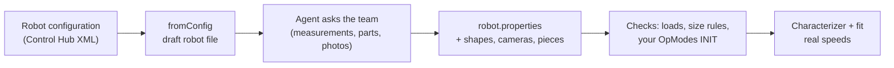

# Your robot in the simulator: the robot-file skill

> **Work in progress:** this library and its docs are still changing. Something wrong or unclear? [Tell us](https://github.com/crossbotics/ftc-helper-lib/issues/new/choose).

**For:** teams that want the [simulator](simulator.md) to act like their own robot. **You need:** an AI
coding agent (Claude Code, Codex or similar), your robot project with ftc-helper-lib in it, and a tape
measure.

The simulator moves like YOUR robot only if its robot file (`simulator/robot.properties` in your robot
project) describes your robot: every device name, the motors and servos, the size, the mechanisms and
cameras. Writing it by hand works ([simulator guide](simulator.md)); an AI coding agent can do most of
it for you with the **robot-file skill**. A skill is a set of written instructions the agent follows;
this one is in `ftc-helper-lib/skills/robot-file/`.



## Set it up

Do this once, in your robot project.

- **Claude Code**: copy (or link) the skill into your robot project:
  ```bash
  mkdir -p .claude/skills && cp -r ftc-helper-lib/skills/robot-file .claude/skills/
  ```
  Then ask: "Make our simulator robot file" (or "our robot has a new arm: update the robot file").
- **Other agents (Codex and others)**: add one line to your robot project's `AGENTS.md`:
  "To make or update the simulator robot file, follow ftc-helper-lib/skills/robot-file/SKILL.md."

## What it does

1. Reads your **robot configuration** (`/sdcard/FIRST/<name>.xml` on the Control Hub: get it with the
   REV Hardware Client or Android Studio's Device Explorer) and makes a draft with the tool below.
2. Reads your **TeamCode** (motor names, directions, limits, finder results).
3. **Asks you** the rest, a few questions at a time: sizes (bring a tape measure), which motors and
   servos, the lift's and arm's hard stops (from the Motor Finder), where the cameras are, how the robot
   picks up and scores pieces. Photos of the robot help it draw the mechanisms.
   **Have CAD of the whole robot?** Give it the STEP file: it reads the exact sizes, places, spin axes and
   seller part numbers from it, guesses which motor drives which part (and asks you only when it is not
   sure), and draws your real parts in the 3D view (`skills/robot-file/cad.md`, tools in `tools/cad/`).
   **Robot.java in five files?** The sizes and shapes it learns go into Robot.java (`part(...)`,
   `looks(...)`, `chassisMm`), and `./gradlew :sim:fromRobot` writes the robot file from it, so the code
   and the simulator stay one description. To fix a shape by eye afterwards, use the simulator's
   **Edit robot** mode and copy the `.looks(...)` lines it shows into Robot.java.
4. **Checks** the result in the simulator (it loads, the size rules, your OpModes start) and writes a
   small scenario so it stays checked.
5. Tells you what is still unknown, and how to get real speeds (the Characterizer).

It never makes up a number without saying so: each number in the file has a note saying where it came
from (measured, the configuration, a seller page, a photo estimate, a default).

## The draft tool on its own

```bash
./gradlew :sim:fromConfig -Pconfig=path/to/config.xml -Pout=../simulator/robot.properties
```

Run it from the `ftc-helper-lib` folder. `-Pconfig=` is the configuration file to read, `-Pout=` the
robot file to write. It lists every device of the configuration, writes a robot file with
each one under its exact name, matches the motor types that pin down a part (REV HD Hex 20:1 and 40:1,
Core Hex, NeveRest) to the parts catalog, marks everything else `TODO`, checks the draft loads, and
prints the questions still open. It finds the drivetrain from the motor names (front/back and
left/right in any form: `front_left`, `leftFront`, `fl`...). A goBILDA Pinpoint or SparkFun OTOS becomes
the `odometry = ...` line (with a `TODO` for its offsets or mounting). Devices the simulator does not
have yet (colour and distance sensors, LEDs) are listed as notes. If the robot file exists,
the draft goes next to it (`robot.properties.draft`). An example configuration is
`sim/configs/example-config.xml`.

| Configuration type | Becomes |
| --- | --- |
| a motor type (goBILDA 5202/3/4, REV HD Hex, Core Hex, NeveRest, unspecified...) | `motor.NAME` (or the drivetrain); the part when the type tells it |
| `Servo`, `ServoFullRange` | `servo.NAME` |
| `ContinuousRotationServo`, `RevSPARKMini` | `crservo.NAME` |
| any type with "imu" in its name (`ControlHubImuBHI260AP`, `LynxEmbeddedIMU`, `RevExternalImu`...) | `imu` |
| `RevTouchSensor`, `DigitalDevice`, `ModernRoboticsAnalogTouchSensor` | `touch.NAME` |
| `Webcam` | `camera.KEY = name=...` |
| `EthernetDevice` (a Limelight) | `limelight.KEY = name=...` |
| `HuskyLens` | `huskylens.KEY = name=...` (then add `hfov=` and `taught=`) |
| anything else | a note: not simulated yet |
