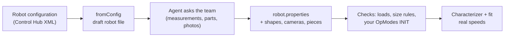

# Your robot in the simulator: the robot-file skill

> **Work in progress:** this library and its docs are still changing. Something wrong or unclear? [Tell us](https://github.com/crossbotics/ftc-helper-lib/issues/new/choose).

**For:** teams that want the [simulator](../simulator/README.md) to act like their own robot. **You need:** an AI
coding agent (Claude Code, Codex or similar), your robot project with ftc-helper-lib in it, and a tape
measure.

The simulator moves like YOUR robot only when its robot file (`simulator/robot.properties` in your robot
project) describes your robot: every device name, the motors and servos, the size, the mechanisms and
cameras. You can write it by hand ([simulator guide](../simulator/README.md)). An AI coding agent can do most of
it for you with the **robot-file skill**. A skill is a set of written instructions that the agent follows.
This one is in `ftc-helper-lib/skills/robot-file/`.



## Set it up

Do this once, in your robot project. To turn on this skill and the ftc-helper skill (answers to "how do I"
questions) together, follow [Ask an AI agent](ask-an-ai-agent.md#set-it-up) instead.

- **Claude Code**: copy (or link) the skill into your robot project:
  ```bash
  mkdir -p .claude/skills && cp -r ftc-helper-lib/skills/robot-file .claude/skills/
  ```
  Then ask: "Make our simulator robot file" (or "our robot has a new arm: update the robot file").
- **Other agents (Codex and others)**: add one line to your robot project's `AGENTS.md`:
  "To make or update the simulator robot file, follow ftc-helper-lib/skills/robot-file/SKILL.md."

## What it does

1. Reads your **robot configuration** and makes a draft with the tool below. The configuration is
   `/sdcard/FIRST/<name>.xml` on the Control Hub. Get it with the REV Hardware Client or Android Studio's Device Explorer.
2. Reads your **TeamCode** (motor names, directions, limits, finder results).
3. **Asks you** the rest, a few questions at a time: sizes (bring a tape measure), which motors and
   servos, the lift's and arm's hard stops (from the Motor Finder), where the cameras are, how the robot
   picks up and scores pieces.
   **With photos and a tape measure (no CAD):** give it photos of the robot from the side, the top and
   the front, and of each moving part at both ends of its travel, with a field tile or a tape measure in
   view. It reads where each part sits from the photos, then asks you for the few numbers that decide a
   rule (measured from the robot's edges and the floor). It checks its 3D robot against your photos with
   you. Photos stay on your computer (`skills/robot-file/photos.md`).
   **With CAD of the whole robot:** give it the STEP file. It reads the exact sizes, places, spin axes and
   seller part numbers from it. It guesses which motor drives which part, and asks you only when it is not
   sure. It draws your real parts in the 3D view (`skills/robot-file/cad.md`, tools in `tools/cad/`).
   **With Robot.java in five files:** the sizes and shapes it learns go into Robot.java (`part(...)`,
   `looks(...)`, `chassisMm`). Then `./gradlew :sim:fromRobot` writes the robot file from it, so the code
   and the simulator stay one description. To fix a shape by eye afterwards, use the simulator's
   **Edit robot** mode, and copy the `.looks(...)` lines it shows into Robot.java.
4. **Checks** the result in the simulator (it loads, the size rules, your OpModes start). It writes a
   small scenario, so the check runs again later.
5. Tells you what is still unknown, and how to get real speeds (the Characterizer).

It never makes up a number without saying so. Each number in the file has a note that says where it came
from (measured, the configuration, a seller page, a photo estimate, a default).

## The draft tool on its own

**Where:** Android Studio's **Terminal** tab, in the **`ftc-helper-lib` folder** (type `cd ftc-helper-lib` first).

```bash
./gradlew :sim:fromConfig -Pconfig=path/to/config.xml -Pout=../simulator/robot.properties
```

Run it from the `ftc-helper-lib` folder. `-Pconfig=` is the configuration file to read, and `-Pout=` is the
robot file to write. The tool:

- lists every device of the configuration, and writes a robot file with each one under its exact name;
- matches the motor types that pin down a part (REV HD Hex 20:1 and 40:1, Core Hex, NeveRest) to the parts catalog;
- marks everything else `TODO`, checks that the draft loads, and prints the questions still open.

It finds the drivetrain from the motor names (front/back and
left/right in any form: `front_left`, `leftFront`, `fl`...). A goBILDA Pinpoint or SparkFun OTOS becomes
the `odometry = ...` line, with a `TODO` for its offsets or mounting. Color and distance sensors and lights
get their lines too. The tool lists devices that the simulator does not have yet as notes. When the robot file exists,
the draft goes next to it (`robot.properties.draft`). An example configuration is
`sim/configs/example-config.xml`.

| Configuration type | Becomes |
| --- | --- |
| a motor type (goBILDA 5202/3/4, REV HD Hex, Core Hex, NeveRest, unspecified...) | `motor.NAME` (or the drivetrain), and the part when the type tells it |
| `Servo`, `ServoFullRange` | `servo.NAME` |
| `ContinuousRotationServo`, `RevSPARKMini` | `crservo.NAME` |
| any type with "imu" in its name (`ControlHubImuBHI260AP`, `LynxEmbeddedIMU`, `RevExternalImu`...) | `imu` |
| `RevTouchSensor`, `DigitalDevice`, `ModernRoboticsAnalogTouchSensor` | `touch.NAME` |
| `Webcam` | `camera.KEY = name=...` |
| `EthernetDevice` (a Limelight) | `limelight.KEY = name=...` |
| `HuskyLens` | `huskylens.KEY = name=...` (then add `hfov=` and `taught=`) |
| anything else | a note: not simulated yet |
