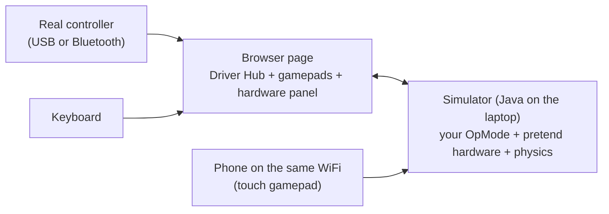

# The simulator: a pretend Control Hub and Driver Hub

> **Work in progress:** this library and its docs are still changing. Something wrong or unclear? [Tell us](https://github.com/crossbotics/ftc-helper-lib/issues/new/choose).

**For:** anyone who wants to try robot code without a robot. **You need:** a laptop with Android
Studio installed (it brings Java and the Android SDK), and the ftc-helper-lib folder.

The simulator runs your real OpMode code on a laptop. The motors, servos, switches, turn sensor (IMU),
webcam and the robot on the field are pretend, with simple physics. You drive the robot from a web page.

- **Good for:** checking buttons and screens, testing the finders and camera code, learning the
  controls, and catching crashes before a meeting.
- **Not for:** exact speeds, real shots, real camera pictures.



## Start it

**In Android Studio (the simplest way):** pick **Simulator** in the list next to the green Run button, and
click Run. When the simulator is ready, the page (http://localhost:8780) opens in your browser. When no
browser opens, find the address in the Run window (`Open http://localhost:8780`). It is a blue link: click
it. The red square **Stop** button stops the simulator. **Simulator tests** in the same list runs every test
in your `simulator/scenarios` folder. The library adds the buttons when Android Studio syncs. When they are
not in the list yet, close the project (**File > Close Project**) and open it again
([Step 7 of Add the library](../setup/04-add-the-library.md#the-simulator-buttons-you-do-nothing)).
The buttons need no laptop setup.

**In the Terminal:** the first time on this laptop, do the [laptop setup](#laptop-setup-once) below first.

1. Open a terminal in the `ftc-helper-lib` folder. In Android Studio, that is the **Terminal** tab at the
   bottom, then `cd ftc-helper-lib` if your robot project holds it. **Why:** the commands work only from
   that folder.
2. Run:

   **Where:** Android Studio's **Terminal** tab, in the **`ftc-helper-lib` folder** (type `cd ftc-helper-lib` first).

   ```bash
   ./gradlew :sim:run
   ```

   **Why:** `./gradlew` runs Gradle, the tool that builds the code. `:sim:run` is the job to do: the
   `run` job of the `sim` (simulator) part. (Gradle calls a job a **task**.) It builds the code, makes
   the robot file from your `Robot.java` ([how](#a-robot-file-from-robotjava)), and starts the simulator.
3. Open **http://localhost:8780** in a browser. **Why:** that page is your Driver Hub, gamepads and field.

Press Ctrl+C in the terminal to stop it.

**When you change your code,** stop the simulator and start it again (Run, or `./gradlew :sim:run`).
**Why:** the simulator builds your code and makes the robot file only when it starts.

**What you see:** the Driver Hub on the left, the field in 3D in the middle with the gamepads under it,
and the Control Hub's panels on the right. Try it: pick an OpMode with the TeleOp button, press INIT, then
▶ (start on the Driver Hub, the same big button). Drive with the keyboard: set gamepad 1's list to
"Keyboard". The left stick is W A S D, and the right stick is the arrows. [The page](#the-page) explains
every part.

It works on Windows, macOS and Linux, and on a Chromebook with Linux turned on.

### Laptop setup (once)

The library is its own Gradle build, separate from your robot project's. So it needs these, even when
the robot project already builds:

- **Java.** The commands need `JAVA_HOME` (where Java is). Android Studio has its own Java, in its
  `jbr` folder: Mac `/Applications/Android Studio.app/Contents/jbr/Contents/Home`, Windows
  `C:\Program Files\Android\Android Studio\jbr`. Check that the folder exists on your computer. Then set
  it in the terminal (it lasts until you close that terminal): Mac
  `export JAVA_HOME="/Applications/Android Studio.app/Contents/jbr/Contents/Home"`, Windows PowerShell
  `$env:JAVA_HOME = "C:\Program Files\Android\Android Studio\jbr"`.
  **When there is no such folder,** look in Android Studio: **Settings > Build, Execution, Deployment >
  Build Tools > Gradle**. The **Gradle JDK** line names the Java that Android Studio uses, with its folder:
  use that folder. On a Mac, `/usr/libexec/java_home -V` in the Terminal also lists the Javas on the
  laptop. **When there is still none,** install a JDK 17 or 21 (a **JDK** is Java with the tools that
  build code), for example Eclipse Temurin from [adoptium.net](https://adoptium.net), and use its folder.
  You do **not** need the Java from java.com.
- **The Android SDK.** If the first command stops with `SDK location not found`, make a file
  `ftc-helper-lib/local.properties` with one line: Mac `sdk.dir=/Users/<you>/Library/Android/sdk`,
  Windows `sdk.dir=C\:\\Users\\<you>\\AppData\\Local\\Android\\Sdk` (your user name in place of `<you>`).
  **Why:** the library is its own build, so your robot project's own `local.properties` does not count.
  Android Studio shows the SDK path in **Settings > Languages & Frameworks > Android SDK**.
- **Windows:** type `gradlew.bat` (or `.\gradlew` in PowerShell) instead of `./gradlew`.
- **Normal warnings you can ignore:** `source value 8 is obsolete` (and `target value 8`), `SDK processing. This
  version only understands SDK XML versions up to 3`, `Deprecated Gradle features were used`,
  `[Incubating] Problems report`, `A restricted method in java.lang.System has been called` (Gradle on a
  new Java). Since v0.20.2, the library hides most of them in the simulator's own build.
  **Android Studio's "Project update recommended: Start AGP Upgrade Assistant" note: do not click it.** The
  FTC SDK sets its own Android build version, and an upgrade can break the robot build. Close the note.
- **A fast build check:** `./gradlew :sim:fromRobot` builds your TeamCode first. So it also tells you,
  on a laptop with no Control Hub, whether your code builds.

### Options

A `-P` word after the command is an option. `-Pname=value` gives the command a setting. A few options,
like `-Plan`, are only on or off, and need no value.

**Where:** Android Studio's **Terminal** tab, in the **`ftc-helper-lib` folder** (type `cd ftc-helper-lib` first).

```bash
./gradlew :sim:run -Probot=sim/robots/my-robot.properties -Plan
```

`-Probot` uses another **robot file**: the text file that describes the robot to the simulator (its
size, parts, motors and shapes). A team's robot file is `simulator/robot.properties` in the robot project
(see [The robot file](#the-robot-file)). `-Plan` lets phones and tablets on the same WiFi join. Windows
asks about the firewall the first time. With `-Plan`, anyone on that WiFi can open the page and run
OpModes in the simulator. So use it on a team or home network, not on open school WiFi.

Run every simulator command from the ftc-helper-lib folder. `-PteamCode=` points at your robot project's
TeamCode. Without it, the command finds `../TeamCode` when the library sits in a robot project.

| Command | Does | Options |
| --- | --- | --- |
| `./gradlew :sim:run` (the **Simulator** button) | the simulator page; first makes the robot file from `Robot.java` | `-Probot=FILE` (default: your `simulator/robot.properties`, else the library's example), `-Plan` (phones on the WiFi), `-Pport=8781` (another port, to run two at once; default 8780), `-PteamCode=DIR`, `-PnoFromRobot` (use the robot file as it is), `-Popen` (open the page in the browser, as the button does) |
| `./gradlew :sim:scenario -Pfile=a.sim` (the **Simulator tests** button: no `-Pfile`) | runs test scripts ([below](#scenario-files-test-without-a-browser)); with no `-Pfile` in a robot project: every test in `simulator/scenarios`; first makes the robot file from `Robot.java` | `-Pfile=a.sim,b.sim` (a comma list) or a folder (every `.sim` in it), `-Probot=`, `-PteamCode=`, `-PnoFromRobot` |
| `./gradlew :sim:fromRobot` | only makes the robot file from your `Robot.java` (`:sim:run` and `:sim:scenario` do it first) | `-ProbotClass=` (which class), `-Pout=FILE`, `-Pfield=NAME` (default `biobuzz-2026`) |
| `./gradlew :sim:updateLibrary` (the **Update library** button) | switches the library folder to its newest release and prints what changed; commits nothing ([Keep it up to date](../02-keep-up-to-date.md#update-the-update-library-button)) | `-PlibVersion=v0.20.1` (a specific version, or back) |
| `./gradlew :sim:installButtons` | adds the **Simulator** and **Simulator tests** buttons to Android Studio now (a Gradle sync in Android Studio adds them too) | |
| `./gradlew :sim:fromConfig -Pconfig=FILE.xml` | a first robot file from a robot configuration | `-Pout=FILE`, `-Pfield=NAME` |
| `./gradlew :sim:newRobot -Pconfig=FILE.xml` | the five files (Robot.java, ...) from a configuration | `-PteamCode=DIR`, `-Ppackage=` (default `org.firstinspires.ftc.teamcode`) |
| `./gradlew :sim:fit` | fits Characterizer logs ([below](#real-numbers-the-characterizer)) | `-Plog=`, `-Probot=`, `-Pwrite`, `-Pforce` |

## The page

The page fits one laptop screen. On a narrow screen, the parts stack and the page scrolls.

- **Left: the Driver Hub**, drawn like the Driver Station app. It shows the robot battery, gamepad 1
  and 2 (lit while used), the Auto and TeleOp buttons (each lists the OpModes of that kind), one big
  button that is INIT, then ▶ (start), then STOP, the match time, and the telemetry.
- **Middle: the field in 3D**, with the gamepads under it. The on-screen gamepads look like a real
  controller (Xbox 360 / Logitech layout, with the button names the SDK uses). A pressed button gets a
  white ring. When you drive with the keyboard, a real controller or a phone, **Hide gamepads** gives the
  field more room. On a short laptop screen, the gamepads start hidden. **Show gamepads** brings them
  back, and this browser remembers your choice.
- **Right: the Control Hub**, in panels: Robot (the field from above, pushing the robot, size and
  pieces, battery), Motors, Servos & switches, Cameras. Each of its buttons shows or hides a panel.
  The panels stack in that order, and this browser remembers your choice for the next run.

**When the simulator stops.** An OpMode that stopped says "press INIT to run it again" under the Driver
Hub: press INIT. The simulator program itself can stop: you clicked the red Stop button, or closed Android
Studio. Then a red bar across the top of the page says so, and says how to start it again. Pick
**Simulator** next to the green Run button and click Run (or `./gradlew :sim:run`). The page connects
again by itself, so you do not need to reload it.

**Driver Hub** (left): choose an OpMode, then INIT, ▶, STOP, like on the real one. The screen shows
the telemetry about as wide as a real Driver Hub. OpModes marked "(hidden on robot)" have `@Disabled`, and
the simulator shows them anyway. Autonomous stops by itself after 30 s, and TeleOp after 2:00, like the
real Driver Station with its timer on. The clock counts down, and a box under it turns each timer off.
An error in the OpMode shows in red, with the line where it happened. After an error, the same OpMode
stays chosen (an autonomous does not switch to its TeleOp), so you can fix it and press INIT again.

**Gamepads** (middle): each gamepad has its own source. Your own game controller works: plug it in (USB
or Bluetooth) and press one of its buttons. Gamepad 1 takes it if it is still on-screen, else
gamepad 2 takes it. You can also choose it in the gamepad's list. Until the page finds a controller, the
list says how.

| Source | How |
| --- | --- |
| On-screen | click or touch the buttons; drag the sticks; slide the triggers. **Sticky buttons** (the box under the gamepads): a click holds a button until the next click and sticks stay where you leave them, so you can hold two things at once with one mouse. |
| Keyboard | left stick W A S D, right stick arrows, D-pad T F G H, A/B/X/Y K L J I, LB/RB Q E, LT/RT Z C, BACK Backspace, START Enter, GUIDE M |
| Controller | plug in a USB or Bluetooth controller, choose it, press any of its buttons once (a browser rule). Xbox, PS4, PS5 everywhere; Logitech F310 on Windows (on a Mac set its back switch to "D"). Chrome and Edge work best. |
| Phone / other page | start with `-Plan`, open `http://<computer address>:8780/?phone=2` on the phone (the page shows the address): the phone becomes gamepad 2 (`?phone=1`: gamepad 1). Set that gamepad here to "Phone / other page"; if you forget, the page says another page is using it. |

When both gamepads are set to Keyboard, the same keys work both. A browser tab in the background sends
gamepad updates only once a second. After 2.5 s without news, the simulator lets go of every button, like
a pulled cable. So keep the simulator tab visible while you drive.

The GUIDE (PS) button often does not reach the browser, because Windows and macOS keep it. Use the
on-screen GUIDE, the M key, or hold the gamepad's START (the Enter key) for 1 second. The finders accept
that too.

**Control Hub** (right):

- the field from above, with the drivers at the bottom. To move the robot, drag it on the field, or type
  **x**, **y** and **heading**. Use the **Face** buttons, and tick **Snap** to go against a wall and line
  up with the tiles. These are the same controls as the auto builder's start spot, in the numbers that
  `s.start` takes.
- the **Push the robot** buttons, folded. They roll the robot like a hand push, also while a program runs.
  So its wheels and odometry feel it: the Drive Tuner's push test uses this.
- **Start over** (Back to start, Reset field).
- every motor: power, count, speed, current, and "STOP" when it is at a hard stop.
- every servo: where it is and where it is going.
- the switches: click a switch to hold it pressed.
- the cameras and the tags they see.
- the battery voltage. Lower it to see a weaker robot.

**Path lines** (on the field map and in the 3D view): an orange dashed line is the path that a Pedro
`follow` step drives (the plan). A green line is where the robot really went in its last 30 seconds of
driving (the trail). The plan stays, faded, after its step ends, so you can compare the two. **Clear
lines** clears both. Untick **Path lines** to hide them. More: [Pedro module](../modules/pedro.md#the-simulator).

**Field in 3D** (middle, above the gamepads; at the bottom on a narrow screen): the field and the robot in
3D. Drag to turn the view, scroll to zoom, and right-drag (or use two fingers) to slide. The **View** menu
(keys 1 to 8) looks from these places, and this browser remembers your choice:

| Key | View | From where |
|---|---|---|
| 1 | Drivers | your alliance's wall: the alliance the running program uses (autonomous's INIT menu, or TeleOp's choice); red until a program says. The button says which wall it is now. |
| 2 | Red wall | behind the red drivers (BIOBUZZ: the bottom of the field map, y = -72) |
| 3 | Blue wall | behind the blue drivers (y = +72) |
| 4 | Audience side | the side the audience sits on (BIOBUZZ: the red drivers' right, +x) |
| 5 | Far side | across from the audience (-x) |
| 6 | From above | straight down, your alliance's wall at the bottom |
| 7 | Follow robot | behind the robot (turning the view by hand ends it) |
| 8 | HIVE close-up | your alliance's HIVE up close (a field with no HIVEs: the goal nearest the robot) |

The sides come from the field file's frame (its `frameNote` says which wall is which). **Layers** (next to
View) adds lines and maps over the 3D view: see [Layers](#layers) below. **Tests** records a test of your
code, runs it and updates it: see [Record a test](#record-a-test). **Auto builder** (next to Tests)
builds an autonomous on the field and runs it with your code: see [The auto builder](#the-auto-builder).

**Where the robot starts.** On the page, INIT of an autonomous is a new match. Every game piece goes back
where the match starts them (with the preload), and the robot goes to its start spot. A TeleOp's INIT
keeps the field as it is, so the TeleOp goes on from the autonomous. Scenario files set up their own field.

In INIT, the simulator puts the robot where the program says:

- An autonomous that names its start spot (`s.start(note, x, y, heading)`, or `startSpotIn()` in an
  EasyAuto) puts the robot there, for the alliance chosen in its menu.
- An autonomous with its spot only in words (`startPosition()`, or `s.start(note, heading)`) puts the
  robot on the chosen alliance's side (the robot file's start). The Driver Hub asks you to drag the robot
  to the exact spot. At ▶, the simulator remembers that spot for this autonomous (in
  `sim-start-spots.properties`, next to the simulator's settings). The next INIT puts the robot there.
  For the other alliance, it uses the same spot on that alliance's side. Or give the spot in inches in the
  code (`s.start(note, x, y, heading)`), so the robot goes there by itself.
- A TeleOp with no autonomous before it puts the robot at the robot file's start for RED, or at that
  spot's mirror image for BLUE, as the drivers choose the alliance (X / B). Until they choose, the robot
  stands on BLUE's spot, and the page looks from the blue wall. The reason: the TeleOp says
  `Alliance : BLUE until you choose`, and aims and drives for BLUE.
- After an autonomous, TeleOp leaves the robot where autonomous ended.

**Move it by hand:** while no program runs (or in INIT), drag the robot on the field map (Control Hub,
Robot tab), and turn it with the mouse wheel over it. Or use the 3D view: double-click the robot, then
drag it to move it, or drag its yellow ring to turn it. Double-click again to stop. Under the map, the page
shows the spot as an autonomous start spot from your alliance's wall, ready for
`s.start("...", x, y, heading)`.

The robot is a gray box from the robot file (`robot.lengthIn` x `widthIn` x `chassisHeightIn`), with a
white arrow at the front. It turns red when it bumps into something. Its shapes (below) move with their
motors and servos. Rollers and wheels have dark stripes, so you see them turn, and which way. A roller
glows **green** while it takes pieces in, and **orange** while it pushes them out. A flywheel or other
spinner glows **yellow** while it turns. A passive part (moved by gravity or springs) **blinks yellow**
while it moves.

The page builds the field from the field file's shapes (tiles, walls, tape, solid and overhead parts),
with each AprilTag as a square with its ID. With a 3D model of the field, the page shows that model
instead, with the tag squares on top. The library has BIOBUZZ's model, made from FIRST's field CAD, and a
robot file can name its own with `field.model`. "Field CAD model" in the **View** menu switches between
them. Each camera shows as a cone (webcam yellow, Limelight green). "Camera view" in the View menu shows a
camera's picture in the corner (pick the camera when there are two). The page redraws it 15 times a
second, smaller than the screen, so it costs little. The game pieces are striped balls, so you can see
them roll and spin. A tipping HIVE turns smoothly. With a rules file, the simulator turns it over its
`tipSeconds`, and the page plays the same turn. Without one, the simulator tips it at once, and the page
still turns it over half a second. The 3D library (three.js, MIT license) comes with the simulator, so the
page works without the internet. On a slow computer, untick "Show the 3D view" in the View menu.

The toolbar over the 3D view has how to look on the left: **View** (where it looks from, and the "Show",
"Field CAD model" and "Camera view" boxes) and **Layers** (lines and maps over the field). It has what to
do on the right: **Tests**, **Edit robot**, **Auto builder**.

**Smooth motion.** The simulator moves everything 100 times a second. It sends the page where everything
is 50 times a second (a stream: `GET /stream`), with its own clock. The page draws the moment about 1/20 s
in the past, and glides between the two updates around it. So the robot and the balls move smoothly at
any frame rate, and they do not jump 10 times a second. Across a jump (Back to start, Reset field, the
robot put somewhere by hand), the page does not glide. When the stream cannot open (a very old browser,
too many pages open), the page asks for `/state` 10 times a second instead. It still glides, but further
behind.

### The Match panel and the score bar

With a rules file (BIOBUZZ has one: [Game rules and the score](#game-rules-and-the-score)), the Control
Hub's **Match** button shows the game. A score bar sits over the 3D view: click it to open the panel.

- **The score and the clock**: RED and BLUE, the period (AUTO, TELEOP, "AUTO done", FINAL or free play)
  and the time left. **The score counts like a referee** (manual 10.5). HIVE TIPs count when they happen.
  LEAVE and AUTO PARK count at the end of AUTO. Pieces in the CELLs, FLOWERs and GARDENs and TELEOP PARK
  count **only at the end of the match**, because they change all match long (a TIP spills the CELL's
  pieces). Until then, they show **gray, as "+N"**: what they would add if the match ended now. When
  TeleOp ends (or you stop it), the score is **FINAL** and held. When you move the robot after that, it
  changes nothing. A new autonomous, or a TeleOp after a FINAL, starts a new match. BIOBUZZ starts each
  side at "+10": the field's own pieces in the up CELLs and GARDENs.
- **Where the points come from**: click a side. The table is grouped like FIRST's score calculator: AUTO
  (LEAVE, PARK, TIPs), TELEOP (TIPs, CELL, FLOWERs, the bottom NECTAR bonus, GARDEN, PARK), FOUL (the other
  side's fouls), the total, and the **RANKING POINTS**. These are SWARM (LEAVE + PARK points, 16 to earn
  it) and POLLINATOR 1 and 2 (4 and 7 TIPs), each with a tick or a cross and the count. The end-of-match
  rows have a * until the end. A line says whether a NECTAR into a FLOWER is allowed now (G410).
- **FLOWERs**: each FLOWER's owner, and its stack from the bottom up. Each piece is a dot in its color, and
  a hollow dot is outside the scoring rings. In 3D, a ring over each FLOWER shows its owner's color (gray:
  none) and how many pieces count.
- **Shots**: the tally of verdicts (clean, rim, other HIVE, frame, miss) and the last few shots. In 3D, the
  page shows the verdict over the piece when the simulator judges it. The piece's trail (Layers: Ball
  trails) takes the verdict's color.
- **Scatter**: off (every shot the same), realistic, rough, or as the robot file says (`/cmd action=scatter`).
- **Hit rate**: 400 pretend shots from the robot as it is now (`GET /hit-rate`), judged like real ones.
  It shows how many go in cleanly, with its plus-or-minus, and the word Good (80 % or more), Risky
  (50-80 %) or Poor. It also says why the others did not go in. Pick the piece, or the next one in the
  robot.
- **Fouls**: each foul charged (G407, G410), newest first. A new one shows over the 3D view for 5 s.

### Layers

The **Layers** button over the 3D view turns each of these on or off. This browser remembers your choice.

| Layer | What it shows |
|---|---|
| Camera sight lines | A line from the chosen camera to each tag in front of it. **Green**: the camera sees it (with about how many pixels across). **Pink "blocked?"**: the camera model sees it, but a field part is in the way of the line (the simulator's camera sees through field parts; a real one does not, so do not count on that tag from there). **Orange**: too slanted (the tag's face is turned more than 60 degrees from the camera). **Red**: too small (fewer pixels across than the tag finder needs: 6.5 per step of decimation, so 20 at the SDK's decimation 3). **Gray, faint**: out of the picture (left, right, above or below). **Purple**: the pretend lighting does not work with the camera's setting now (`goodPipelines`, `goodExposureMs`). Not seen: only the nearest four lines of each kind. The words at the bottom left list every tag. "Not open" means the OpMode has no camera running, so it gets nothing even where the lines are green. |
| Camera view cone | The camera's view, 36 in long. |
| Floor map | Where on the field the chosen camera can see tags: each 4 in square is shaded by how many tags the camera would see with the robot standing there (light: 1, darker: 2 or 3, darkest: 4 or more). The simulator works it out with the same camera rules the OpMode gets (field parts do not block in this map), with the robot facing the way it faces now, or, ticked "turned any way", the best of 24 headings. Turret and other parts stay as they are now. It updates once a second. |
| Shot arc | Where each launcher would send its next piece if it fired now: a dashed yellow line from the launcher, with its peak height (check the venue's ceiling and lights). The simulator works it out from the flywheel's speed now, the shot angle (the hood's angle if it has one) and a shot table's average, with the same air drag and spin lift as a real shot, but it flies through everything (no goal, no walls, no other pieces). The words at the bottom left give the angle, speed and peak ("shoots backward, 33° up" for a launcher that throws over the robot's back); a stopped flywheel says so. |
| Ball trails | The last half second of each loose ball's path, in its color: how it flew and bounced. |
| Path lines | The Pedro plan and the trail (the same as **Path lines** in the Robot tab). |
| Robot size box | A box around everything the robot has out now (green while it fits 18 x 24 in and 29 in tall, red when not; worked out from the shapes' boxes, not the CAD models) and the 18 in start cube, dashed. |

The page's helpers (gliding between updates, the striped ball, the labels) are in `sim/.../simview.js`.
It is a small file with no other library in it, so another page (like a team's own shot simulator) can
load it too.

## The auto builder

Build an autonomous on the field and press **Run**. The simulator runs it with **your real code**: your
`Robot.java`, your parts' methods and your `Actions.java`, the library's real `Auto` and `Steps` (the INIT
menu, the 30 s timer, the park time, the report) and, for a path, the real Pedro follower. Then copy the
Java into your project. It is the [web path builder](https://crossbotics.com/ftc-helper/path-builder/)
(a page that needs no install, for any team) with the run added: the same plan gives the same Java.

**Open it** with the **Auto builder** button over the 3D view. It takes the Control Hub's place. Close it
with the x to get the hub back. On a narrow screen, it sits under the 3D view.

What a team does, step by step:

0. **Load an existing auto** (at the top, when your TeamCode has autonomous OpModes written with `Steps`).
   Pick one and press Load to start from it. The builder reads its Java. It works out numbers written as
   names from your compiled code: `Tunables.Auto.parkSeconds`, a constant in the auto (`START_X`), a small
   formula, or a static method of the auto that gives a number (`turnToField(PARK_HEADING)`).
   **The Java you copy back keeps the `Tunables` names** while the number is unchanged. The auto's own
   names become numbers, because they are not in the builder's file, and a note lists them. The builder
   lists what it could not read. It does not change your file: copy the Java when you are done.
   The builder keeps **setup lines** in `steps()` such as `robot.deployAtStart = false;` (a public
   `boolean` or number field of your Robot, set to a plain value). **Run** does them too, like your real
   auto. The builder lists any other line in `steps()`, and an override such as `atInit()`, as not carried
   over. Run does not do it, so the run can differ from your real auto. After Load, the copy list says
   **only the steps**: paste it over everything inside `steps()`, and your file keeps its comments,
   constants and other methods. The builder does not keep comments inside `steps()` (a note gives the
   number).
1. **Robot and alliance.** The builder finds the Robot classes (your `Robot.java`) in the code that the
   simulator runs (your TeamCode, or the library's examples). The auto drives that robot: its drive, its
   size and its parts. With one Robot class, the builder says which one. With several, you pick one from a
   list. "Best match" is the one that finds every device it needs in the simulator's robot file (motors,
   servos, sensors, the odometry, cameras), then the one that uses the most of them. Pick another if it
   guessed wrong. These things come from your code and the robot file:
   - its drive (tank or mecanum) and the robot's size.
   - the suggestions in the command and action boxes (your parts' methods, the named positions in
     Tunables, your `Actions.java`).
   - a new step's first guess.
   - **TeleOp next** (the TeleOp written for that Robot class), until you type your own.
   - the Java's package, from your Robot class.

   A new plan has no steps ("Load the example auto" puts the example robot's auto in). **Run as** RED or BLUE, and
   set **Red's side**: **Rotated 180°** (BIOBUZZ: each red part is the blue one turned half a turn about
   the field's center) or **Mirrored**. The builder writes `mirrorForRed()` in the Java for you (false /
   true).
   **What this robot can do** lists the library's ready-made features for that Robot class, worked out
   from its parts. Each one is ready (with the line to use it) or not ready (with what to add). For example:
   "Fire 1" to "Fire 4", "Fire all" and "Ready to launch" with a launcher; "Aim at the goal" and aim mode
   with a camera that has a goal (or odometry and a goal point); "Turret follows the goal" with a following
   turret. Ready actions are the first ones in the Action list. The same list is `robot.features()` in
   Java ([What your robot can do](../reference/robot-java.md#what-your-robot-can-do)).
2. **Choose the mode.**
   - **Simple steps** (any drive). The steps are:
     - drive, strafe (mecanum), turn, turn to, wait.
     - start something (a command).
     - an action: the library's ready ones like `robot.launcher.fireAction(2)`, or one from
       `Actions.java`. Its time limit starts at 10 s.
     - **aim at the goal** (`aimAtGoal`): the whole robot turns to the goal with the camera or the
       odometry backup, or a following turret aims. It never turns blind, and the report says "not seen".
       It is only for a robot that can aim. The plan's preview does not turn for it, but the run does.
     - **ready to launch** (`readyToLaunch`): spins the launcher up and waits until it is at speed. It is
       only for a robot with a launcher.
     - **wait for the goal** (`waitForGoal`): waits until the camera sees the goal and the goal stays still
       for 1 s, then goes on. Use it for a start where the goal is not in view yet, for example behind the
       HIVE before a tip. Tick "go on after X s" to go on anyway when the camera does not see the goal. Or
       leave it unticked to wait until "park from here" takes over. It is only for a robot with a camera
       that has a goal. The time estimate counts the whole limit, or 0 with no limit.
     - "park from here" (`parkWithSeconds`).

     A button adds its step at the end.
     **Put a step between two:** point between two steps in the list, and press the **+** that shows
     there. The buttons move into that gap. Each one you press (and each tap on the map) goes in there,
     one after the other, until you press **Done**. **Start over** (beside Undo) removes every step, and
     Undo brings them back.
     **A fire action's own speed:** a launcher's "Fire" action (`fireAction(n)`, `fireAllAction()`) has a
     **flywheel** box. Empty means the usual speed (`speedRpm`, or the shot table with a camera). A number
     means that shot's own speed in RPM, then back to the usual one. For a robot with no camera, this is
     the way to shoot from two spots at two speeds (the code gets `fireAllAction(2250)`).
     Tap the field map to add a drive to that spot. The drive uses the way the robot already faces. A spot
     ahead drives forward, and a spot behind **backs up**. A mecanum robot slides straight there, with no
     turn. A tank drive makes the smaller turn first: its front toward a spot more ahead, its back toward a
     spot more behind. To make the robot turn around instead, add a turn first (**turn to face**).
     "Tap adds" chooses what a tap does:
     - **drive there**.
     - **turn to face**: a turn toward the spot.
     - **an action**: an action step at the nearest point on the route. On a drive's line, the drive
       splits there. At a point, the action goes right after the drive that arrives.
     - nothing.

     Or use the list: each step has its numbers, arrows to move it, and its own warnings. The step numbers
     on the map are white on a dark badge.
     **Drag a point** (the blue dot at the end of a drive) anywhere. The drive and the turn before it
     change so the robot ends there (a tank drive gets a turn when it needs one). **The other points stay
     where they were.** The next drive turns and stretches to reach its point again, and the heading after
     it is kept: a turn after it turns more or less, or the builder adds a "Turn back" step. This works when
     at most one turn or "turn to" sits between the point and the next drive. With more steps that turn
     between (two turns, an aim, a turn back), the builder keeps only the heading, so the later points can
     move. A team's own step names stay. The "To (x, y)" and "Face (x, y)" names follow the point. With a
     mecanum drive and no turn before the drive, the drive changes direction instead (a strafe).
     **Put a point between two:** move the pointer over a drive's line, and a white dot with a plus slides
     along it. Click to split that drive in two there (the route stays the same). Then drag the new point,
     or press the **+** after its step in the list to add something there. Press and drag does both at
     once. A click away from the lines still adds a drive at the end.
     **Turn a turn on the map:** after each turn step (turn, turn to, or a drive that turns), the map draws
     the robot facing the way it ends, with a yellow knob in front of it. Drag the knob around, and the step
     turns to face it (15° steps with "Snap" on, else 5°). A turn turns by what it needs. A "turn to" and a
     drive that turns get the new heading. A turn or "turn to" right before its drive aims that drive, so
     the drive swings with it (its point moves). Any other turn keeps the next point where it was.
     **Mecanum: turn then, or turn while driving.** A drive and a turn are two steps: the robot drives,
     THEN turns (or turns, then drives). Tick **turn while driving** on a drive to make it one step that
     drives and turns at the same time (`Steps.moveWithTurn`). A turn right before the drive goes into it,
     so the robot ends at the same spot, facing the same way. The drive's direction is then fixed on the
     field: degrees counterclockwise from the way the robot faced at the start (90 = left), like the heading
     of "turn to". Untick it to get a drive and a "turn to" again. A tank drive cannot do this. On a tank
     drive, a drive that turns becomes a turn, a drive and a turn (INIT also refuses one on a tank robot).
     **Numbers are places, letters are things the robot does.** The points it drives to have a number on a
     dark round badge. Each step that does something (an action, start something, ready to launch, aim at
     the goal) has an orange diamond with a letter (A, B, C...) at the spot where it happens. The same
     letter is beside its step in the list. Click a diamond to select its step. Pedro paths do the same:
     the parts have numbers, and the actions along the path have letters (in the order the robot reaches
     them).
     **A command or an action is a list** of the ones your code has (for example
     `Actions.fireAll(robot)` to shoot). Pick one, or pick "type your own..." to write it.
     **A tank drive cannot strafe, so the builder never makes a strafe for it.** There is no Strafe button,
     and a drive's direction is only forward or back. A tap adds a turn and a drive, and a dragged point
     changes the turn before its drive (or adds one). The steps may already have a strafe (from a mecanum
     plan, the example auto or a saved plan). When the chosen Robot code has a tank drive, the builder
     changes each strafe into three steps: a turn, the drive forward (or back, when that turns less), and a
     turn back to the heading it had. It leaves the turn back out when a turnTo comes next. So the robot
     drives the same route, and a box above the steps lists each change. If a strafe still reaches the
     Built Auto on a tank robot, INIT stops with "a strafe ..., not possible on a tank drive", and nothing
     runs.
   - **Pedro path** (mecanum with odometry): tap to add lines or curves, and drag the ends and the control
     points. Choose each part's heading rule and speed limit, hold the end, and add things to start along
     the path (`PathAt`: inches done or left, part of the path, start of a part, near a point).
     A new part to a spot behind the robot gets **Drive backwards along it**, and a part to a spot ahead
     gets **Face along the path**, so it needs no turn. A part that keeps a heading passes it on.
     **Turn to face** (Tap adds): the selected part (or the last) ends facing the spot you tap. With no part
     yet, the start robot turns to face it.
     **Put a point between two** the same way: the white dot slides along a part, and a click splits the
     part in two there. The shape stays the same, and the two new parts share a turn. Or press **+ point**
     on a part to split it in the middle. A part that keeps a heading or turns gets a yellow knob at its
     end: drag it to set the end heading. **Turn from one heading to another** also says WHEN: **while
     driving** (all the way), **first, then drive** (in the first 30% of the part) or **drive, then turn**
     (in the last 30%): `PedroPath.turnTo(a, b, from, until)`. Pedro steers to the heading but does not
     wait for it. So when the LAST part ends, a turn at its end can be cut short: tick **Hold the end** (the
     builder warns). **follow** needs a `follower(...)` line in Robot.java (the pedro module). **driveTo
     steps** need only odometry. When your robot cannot do the mode, the builder says so, and Run stays
     off.
   - **Right-click on the map** (or press and hold on a touch screen) for a short menu of what you can do
     there. On a point: add an action at it, add a step after it, turn while driving (mecanum), remove it.
     On a line: put a point here, add an action here. On the field: drive here, turn to face here (Pedro:
     line or curve to here, turn to face here). The menu does nothing that a button cannot do: it saves
     trips.
3. **Edit in 3D too:** with "Edit in the 3D view" ticked, the same points are balls in the 3D view. Drag
   them, or tap the field to add a step or a part (not near the robot). The purple dashed line is the plan.
4. **The start spot and the note for the drive team.** Pick a ready-made spot (against your wall, each one
   checked against the start rules), or drag the green dot. **The robot must touch the field wall** (G304:
   a corner, or turned 45°, is fine). A drag or typed numbers away from every wall go to the nearest one
   (your wall or a side wall). With **Snap to the walls and the tile lines** ticked (on at first), the
   robot also goes against a wall that is within 3 in. Its center lines up with a tile middle or seam, or a
   side lines up with a seam or **the edge of the tiles' teeth**, within 1.5 in. The result is a spot that
   the drive team can copy by eye.
   The map shows the real tiles: 141.17 in inside the walls, 6 tiles of 23.53 in, and each seam with its
   band of interlocking teeth (0.4 in each side, from the official field CAD). **Turn the start** with the
   yellow knob in front of the robot (15° steps while snapping), the **Face** arrows (0°, 45°, 90° ...) or
   the 15° buttons. A tap on the start robot adds no step. The line under the map measures the spot like a
   tape: each side from its side wall, and the back from your wall. It also names the tile ("Centered on
   tile 4 from the left", "Left side on the seam 2|3", "at the teeth's edge"). Against a side wall, the
   robot lines up along that wall the same way.
   The **note** is what the Driver Station shows at INIT as `Place robot : ...`, so the drive team reads
   it at match setup. About 50 characters fit one line. **Write it for me** writes the note from the spot
   ("Our wall, left corner tile, facing the field"). It follows the robot until you type your own words.
   It also puts the place in the tile in the note: "Our wall, tile 3 from left, centered, facing field",
   "Tile 3 from left, left edge on seam, ...", "Left wall, 4th tile out, near edge at teeth, ...". Near and
   far mean the edge nearer to or farther from your wall.
   **Print setup card** shows the card for the drive team in the page, and you print it from there. The
   card has the note in big letters, the field with the robot's start footprint and heading, red and blue,
   and the first step. **Auto sheet (PDF)** is one page to show another team what the auto does. It has
   the field with the start spot, the whole route, a number where each step ends, and the steps in plain
   words ("Fire all pieces", "drive 42.8 in forward and left") with their planned times. Click **Print or
   save as PDF**, then choose "Save as PDF" in the print window. Black and white prints are fine.
5. **Checks** before a run: the field walls and parts along the way, the start rules (touching the wall, on
   your half, not in the LOADING ZONE, inside the 18 in box), more than 30 s, the park time, and names left
   empty. The time is a plan from simple speed numbers. An action counts its whole time limit.
6. **Run in the simulator.** The simulator INITs the **Built Auto** (its own autonomous, listed in the
   Driver Hub under "Builder") with your plan. It puts the field's pieces back and the preload in the robot
   (a fresh match, whatever a TeleOp did before). It chooses the alliance, puts the robot on the start spot
   and presses ▶. Each Run is one INIT. To run the plan again, press Run again. An INIT of the Built Auto
   from the Driver Hub's list has no plan, and says so. The last run's results go away when a new run
   starts. The clock beside Run counts the autonomous's seconds in real time, like a match, with no fast
   forward. A **purple robot** drives the plan beside your robot. Each of its steps starts when your
   robot's step starts, so you see where they part. The green line is where your robot really went.
7. **Read the result:** a table with each step's word from the report (done, STALLED, timed out, skipped
   for park, not fired) and how far off the plan it ended, the match score, and **what to change**. Some
   changes have an **Apply** button:
   - a 0.3 s wait before a turn (or a new direction) that came right after a drive. The robot still rolls
     when a drive ends, so it slides on a few inches.
   - holding a Pedro path's end.
   - slowing a Pedro path's last part.

   Press Run again to check.
8. **Copy the Java.** For Simple steps, copy the whole file, or only the steps, which replace everything
   inside `steps()`. For a Pedro path, copy the imports, the `PedroPath` field and the steps to paste, the
   same as the web builder.
   **Save the scenario** writes a scenario file ([scenario files](#scenario-files-test-without-a-browser)).
   It checks the note, the start spot, and that every step is "done" by its number in the report
   (`expect step 3 done`). That includes actions, and two steps with one name each get their own check. It
   also checks the end, within the inches and degrees you set. A plan that drives off the field gets no end
   check, only a comment. Tick **with the end from the last run** to check the end that your robot really
   reached. Use it for a route that is right as it drives, so the test catches a later change that moves
   the end. That box works only after a run of this plan where every step was done (not after a STALLED
   step). The page forgets a run when it reloads. This browser keeps the plan.

**What it can call in your code.** You write a command or an action as Java, and the simulator reads only
these shapes: `robot.part::method`, `robot::method`, `() -> robot.part.method(...)`,
`() -> robot.method(...)`, `Actions.name(robot, ...)` and `robot.part.method(...)` that gives an Action,
with plain values (text in quotes, numbers, true/false, `robot`). It finds the public field (your part)
and the public method by its name. **Why only these:** safety and plainness. Nothing else in your code or
on the laptop can be reached from the page, and nothing is compiled or run as a script. INIT refuses
anything else (`Tunables.Lift.high`, two calls in one) with a message, like a part that is not on the
robot. Write it as a method in Robot.java or Actions.java, and name that method. A name that is not there
stops INIT with the names there are (`Robot.java has no part called claw (its parts: intake, launcher)`).
INIT finds and checks every name in the plan before it builds the first step. An action must be a method
that gives an `Action`. When a command is named where an action goes (`robot.intake.in()`), INIT refuses
it without running it.

**Shared with the web builder.** The plan, its checks, the Java, the scenario, the start note, the
setup card and the auto sheet come from the same files as the web builder: `pathcore.js`, `stepscore.js`,
`mapdraw.js` and `setupcard.js` in `sim/src/test/resources/sim/builder/`. **The library is their source**:
change them here, and release them. The web site's `scripts/sync-path-builder.mjs` copies them, with the
field file, from the release. `node tools/check_builder.mjs` does three checks:

- The Java and the scenario for a set of plans must be letter for letter what the shared files wrote when
  the fixtures were made (`sim/src/test/resources/builder/fixtures.json`;
  `--write-fixtures sim/src/test/resources/sim/builder` makes them again after an intended change).
- It checks the simulator-only part (`simcore.js`).
- When it finds a checkout of the site, it fails when the site's copies differ from the release that the
  site names.

The fixtures are a snapshot: they find a change, but not a first answer that was wrong. So one small plan
has its numbers worked out by hand. The site copies these files and the field from that release, never
from your working folder.

**Not covered:** the INIT menu (`menuChoice`, `onlyIf`), your own steps (`step(...)`) and `waitUntil`.
Load an existing auto lists them as not read. A Pedro plan is one path (one `follow`, or one `driveTo` per
part): add the steps before and after it in your file. Commands take plain values only.

## Edit robot: shape your robot

It is hard to type where each part sits in mm. **Edit robot** (the button over the 3D view) lets you shape
the robot with the mouse. Then it gives you the Java to copy into `Robot.java`. `Robot.java` stays the one
record of your robot: the editor writes no file.


1. Click **Edit robot**. The simulator holds still (nothing moves, nothing drives), the field goes away,
   and the view turns round your robot, close.
2. See-through guides show the size rules: the **18 in start cube** (R102) at the start of the match, and
   the 18 x 24 in box with the **29 in** line (R105) in any other pose. A part that sticks out turns red,
   and the panel says how far and which way.
3. Click a shape to pick it. The panel shows its part, its kind and its numbers in mm: `atMm` (place),
   `sizeMm` (size), or length and diameter for a roller or flywheel, and its angles.
4. Change it:
   - **Drag** the picked shape, and it moves flat. **Shift + drag** moves it up and down. With **Size** on,
     a drag makes it bigger or smaller.
   - **Arrow keys** move it forward, back, left and right. **Page Up / Page Down** move it up and down.
     Each key press moves it 1 mm, or 10 mm with Shift.
   - Or type the numbers (whole mm) in the boxes.
   - Change the axis and the tilt (`axis`, `tiltDeg`) where the shape has them.
5. **Poses:** each moving part has buttons for its named positions (`stowed`, `deployed`...), its hard stops
   and its start. Click each one and check that the robot fits. When you change a named angle, the poses
   move with it. **Start of the match** puts every part back where it starts. **Every part out** puts each
   moving part at its named pose farthest from the start (an intake deployed, a slide up), so you can see
   and change the parts there. A **yellow arrow** shows each launcher and the way its shots leave (the shot
   angle from Robot.java). So you can find the launcher among the boxes, and line up a ramp or a hood with
   it. The panel also says whether **every** pose fits (the same check as "at full reach" in the Control
   Hub panel).
6. **Copy into Robot.java:** the panel shows the Java for each part you changed, and where it goes. Click
   **Copy** (or **Copy all**) and paste it there:
   - One short shape: `.looks(Shape.flywheel("gobilda-hogback-96").atMm(-40, 0, 200))`, on the line that
     adds the part, in place of its `.looks(...)`.
   - Two or more shapes (or one long one): one `Shape` line each, then `.looks(intakeArm, roller)`. Put the
     `Shape` lines in `define()`, above the line that adds the part. Then use the `.looks(...)` on that line.
   - A part that had only a guessed shape (marked "guess", "TODO measure" in the robot file): add the
     `.looks(...)` to the line that adds the part, right before the bracket that closes `add(...)`.
   - A `fixed(Shape.box(...))` part: in place of that `Shape.box(...)` inside `fixed(...)`.

   Everything you did not change stays as it was: `dropsWhen`, `on(...)`, the part ids, the notes. Then
   stop the simulator and start it again: it writes the robot file from `Robot.java` when it starts.
7. **Shot angle:** each launcher's angle, in degrees up from its front (90 = straight up, more than 90 = out
   of the back). The arrow shows it. This is `.shotAngle(...)` in `Robot.java` (`angle=` on a robot file's
   `shoot.` line). A shape such as a ramp does not change a shot, so when you move one, the arrow does not
   move. A launcher with a hood or a shot table gets its angle from that, and the panel says so. Copy the
   new `.shotAngle(...)` into `Robot.java`, then run your auto's scenario again.
8. **Try it** puts the changed shapes and shot angles into the running simulator (in memory only). Click
   **Back to driving**: the field and the match come back as they were, and game pieces hit the new shapes.
   **Undo all** goes back to the robot file's shapes.

Notes:
- `.looks(...)` is optional. Without it, the simulator still runs with guessed boxes. But then the size
  check, and where pieces touch the robot, are guesses too.
- The editor finds `Robot.java` from the robot file's first line ("made from ..."). The simulator writes
  that line when it makes the robot file. `-ProbotClass=...` on `:sim:run` names another class. For a robot
  file written by hand, the editor gives robot file lines (`shape.NAME = ...`) to copy instead.
- The editor draws boxes, not CAD models.

## The robot file

**Quick start:** an AI coding agent can write most of it for you, from your robot configuration,
TeamCode and a tape measure. See the [robot-file skill](robot-file-skill.md).

The robot file is a plain text file of `name = value` lines (a "properties" file). Text after `#` is a
note for people. The file describes the pretend robot: every device with the SAME name as in the robot
configuration, the motors and servos from the parts catalog, the robot's size, where it starts, and the
season's field. The library's example is `sim/robots/starter.properties`. The sellers' BIOBUZZ starter
bots (five: goBILDA has two) are in `sim/robots/starter-bot-*.properties` ([starter-bots.md](starter-bots.md)).
A team keeps its own in its robot project as `simulator/robot.properties`, and the simulator uses it
automatically (see below).

```properties
field = biobuzz-2026                  # the season's field (sim/fields/biobuzz-2026.json)
field.model = fields/biobuzz-2026.glb # optional: the field's 3D model for the 3D view (path from this file)
robot.lengthIn = 18                   # size, for bumping into field elements
robot.widthIn = 18
robot.heightIn = 18                   # the chassis box with no shapes, and which overhead field parts it bumps (with shapes, the shapes decide the size rules)
robot.tallestIn = 12                  # optional: a part the shapes do not draw reaches this high (size rules count it)
start.x = -56                         # where it starts (inches from the field center; y away from the drivers)
start.y = -61.55                      # BIOBUZZ G304: touching the wall, outside the LOADING ZONE
start.heading = 0                     # degrees, counterclockwise; 0 = facing away from the drivers
drive.type = mecanum
drive.motors = front_left, front_right, back_left, back_right
drive.part = gobilda-5203-312         # from the parts catalog: speed, encoder counts, current
drive.wheelDiameterIn = 3.90          # the REAL wheel (the Drive Tuner should find it)
drive.gearRatio = 1                   # motor turns per wheel turn (default 1)
drive.strafeEfficiency = 0.85         # mecanum: how much of a strafe really happens (default 0.85)
imu = imu
motor.lift = lift, part=gobilda-5203-312, min=0, max=2750, gravity=0.06
motor.flywheel = flywheel, part=gobilda-5203-6000, feeder=feeder, shotDrop=0.15   # feeder: a motor, CR servo or servo
servo.claw = 0.5, part=gobilda-2000-torque
camera.front = name=Webcam 1, forward=7, up=12, pitch=20   # see "Cameras" below
touch.lift_bottom = lift, below=20
```

### Every setting

The example above shows the common settings. This table has all of them, with their defaults. A missing
line takes the default.

| Line | Default | Means |
| --- | --- | --- |
| `field = NAME` | `biobuzz-2026` | the field file in `sim/fields/` |
| `field.model = FILE` | the library's model of the field (`sim/fields/<field>.glb`, BIOBUZZ has one) | the field's 3D model for the 3D view (path from the robot file) |
| `parts = FILE.json` | none | your own parts catalog, added to the library's ([parts catalog](parts-catalog.md)) |
| `battery = V` | 12.8 | battery volts at the start (the page's slider: 11 to 13.5) |
| `robot.lengthIn`, `robot.widthIn` | 18 | the footprint, for bumping into field parts |
| `robot.heightIn` | 18 | the chassis box with no shapes, and which overhead field parts it bumps |
| `robot.chassisHeightIn` | 4 with shapes, else `heightIn` | the height of the chassis box |
| `robot.tallestIn` | none | a part the shapes do not draw reaches this high (the size rules count it) |
| `drive.type` | `none` | `mecanum`, `tank` (2 or 4 motors) or `none` (a test rig) |
| `drive.motors = a, b, ...` | none | the wheel motors |
| `drive.part` | none | the wheels' motor from the catalog |
| `drive.wheelDiameterIn` | 3.78 | wheel size |
| `drive.trackWidthIn`, `drive.wheelBaseIn` | 15, 13 | left-right and front-back wheel spacing |
| `drive.mirrored` | `left` | which side's motors are mounted mirrored (turn the other way for the same power) |
| `drive.strafeEfficiency` | 0.85 | how much of a strafe really happens (mecanum) |
| `drive.kS`, `drive.accelSec`, `drive.turnDegPerCount` | 0, 0.15, worked out | from the Characterizer ([below](#real-numbers-the-characterizer)) |
| `imu = NAME` | none | the IMU's name |
| `missing = a, b` | none | devices described in this file but NOT in the configuration: a part not on the robot yet ([below](#a-part-not-on-the-robot-yet)) |
| `odometry = KIND NAMES` | none | pretend odometry from the robot's true motion: `pinpoint NAME`, `otos NAME`, `threeWheels L, R, P` or `twoWheels PAR, PERP` ([odometry](../modules/odometry.md#the-simulator)) |
| `odometry.offsetsMm = X, Y` | 0, 0 | Pinpoint: where the pods sit (X pod mm left, Y pod mm forward); sets the raw pod counts the Odometry Tuner's Spin test reads |
| `odometry.mountIn = F, L, H` | | OTOS: where it sits (written from Robot.java); the pretend OTOS reports the center's pose, so it does not change the simulation |
| `odometry.trackWidthIn` | 12 | three dead wheels: left to right pod, inches |
| `odometry.parallelLeftIn`, `odometry.perpForwardIn` | 0, 0 | dead wheels: the forward pod's inches left (two wheels), the sideways pod's inches forward |
| `odometry.ticksPerIn` | 505.3 | dead wheels: pod counts per inch (goBILDA 4-bar pods) |
| `odometry.reversed = names` | none | these pods count backward (as wired; the code's `reversed(...)` turns them back): dead-wheel port names, or `x`/`y` for a Pinpoint's pods |
| `odometry.scaleError` | 0 | noise: 0.01 = it measures 1% too far (wheel slip, a wrong pod size) |
| `odometry.driftDegPerMin` | 0 | noise: the heading creeps this many degrees per minute |
| `motor.NAME = KIND, ...` | | a motor: `free`, `lift` or `flywheel`, then `part=`, `ticksPerRev=` (catalog, else 537.7 or 28 for a flywheel), `rpm=` or `maxTicksPerSec=` (catalog, else 2780), `min=`, `max=` (counts), `gravity=` (0), `kS=` (0), `accelSec=`, `coastSec=`, `feeder=` (a motor, CR servo or servo that feeds a flywheel), `feederPush=` (a servo feeder: where it goes to push; a push counts once it is half way there. Without it, once it is 0.15 from its start. `:sim:fromRobot` writes it from `Tunables` `push`), `shotDrop=` (0.15: how much a shot slows the wheel), `stage=CRSERVO` (a feed wheel that brings the pieces to a servo `feeder`: a push sends a piece only if this wheel ran at least 0.05 s before the arm started to move out; `:sim:fromRobot` writes it for [`feedWheel(...)`](../reference/robot-java.md)), `stop=SERVO`, `stopOpen=` (0.5) (a feed stop: pieces get through only while that servo is within 0.05 of `stopOpen`; `:sim:fromRobot` writes it for [`feedStop(...)`](../reference/parts/launcher.md#firing-shot-modes-feed-stop-piece-path)), `drivenBy=CRSERVO` (no motor on this port: only an encoder, on a shaft that CR servo turns, e.g. a CR servo turret's Through Bore), `with=FIRST` (a second motor on the same slide or arm as the motor `FIRST`: both turn one shaft and both push, so each carries half its `gravity`; `mirrored=true`: its shaft turns the other way, two motors facing each other. `:sim:fromRobot` writes it for [`alsoMotor`](../reference/parts/lift.md#two-motors-on-one-lift-or-arm)) |
| `servo.NAME = START, ...` | start 0.5 | a servo: `part=` (catalog), or `rangeDeg=` and `secPer60=` for one not in the catalog. `pwm=500-2500`: the robot's code uses the servo's full range (`.fullRange()`; `:sim:fromRobot` writes it); the start position and every position in the file are then in that range. Like the hub, the simulated servo gets the normal 600-2400 us at each INIT and the code's `setPwmRange` after, so 0 to 1 turns a goBILDA 2000 servo 270 degrees, or 300 with full range |
| `servo.speed` | 1.0 | positions per second for a servo with no part |
| `crservo.NAME =` | | a continuous servo (the value is not used) |
| `light.NAME = gobilda` or `blinkin` | | a colored light ([`Lights`](../reference/parts/lights.md)): a goBILDA RGB Indicator Light (a servo) or a REV Blinkin; the page shows its color on the robot, on the 3D view and in the Servos tab |
| `touch.NAME = MOTOR, below=N` | below 20 | a switch pressed while that motor is within N counts of its `min` (reads `getState()` false when pressed) |
| `touch.NAME = MOTOR, at=C, width=W` | width 10 | a switch part way along: pressed while that motor is within W counts of C (counts from where it starts), e.g. a turret's home switch |
| `analog.NAME = MOTOR, offsetDeg=D` | offsetDeg 0 | an absolute encoder on that motor's shaft (0 to 3.3 V per turn), reading D degrees at the start: a CR servo turret's angle sensor |
| `color.NAME = at=ready` | | a color sensor with distance (REV Color Sensor V3) that sees the piece at one spot: `at=ready` (next to fire) or `at=intake` ([game pieces](#game-pieces)) |
| `distance.NAME = at=intake, acrossMm=150` | `acrossMm=150` | a distance sensor across a channel: `acrossMm` minus the piece's size when one is there ([game pieces](#game-pieces)) |
| `camera.NAME = ...` | | a webcam or Limelight ([cameras](#cameras)); `on=turret`: it turns with the turret |
| `huskylens.NAME = ...` | | a HuskyLens ([cameras](#cameras)); `taught=` says what it was taught |
| `shape.NAME = TYPE, ...` | | a part to draw and check ([robot shapes](#robot-shapes)). Sizes when `size=` is left out: slide 2x2x12, arm 10x2x2, turret 8x8x2, claw 3x1x3, roller 2x12x2, flywheel 4x2x4 |
| `collect.NAME = shape=a+b, motor=M, holds=N` | `reach=0.75`, `holds=4` | takes pieces in ([game pieces](#game-pieces)); `crservo=` instead of `motor=`, `inward=-`; `limits=NECTAR:0+POLLEN:3`: the most of one kind (`0` = never that kind; a name matches every kind that contains it). Preload pieces that do not fit wait on the tiles behind the robot |
| `shoot.NAME = shape=S, ...` | `angle=40`, `share=0.5` | shoots pieces: `spin=`, `speed=` (a fixed speed, in/s), `table=` (a shot table, path from the robot file), `flywheel=` (which flywheel, when there are two), `hood=SERVO, hoodAt0=A, hoodAt1=B` (the angle follows a hood servo: A with the servo at 0, B at 1) |
| `grab.NAME = shape=S, servo=V, closedBelow=X` | `reach=0.5` | a claw that holds a piece (`closedAbove=` for one that closes toward 1) |
| `start.x`, `start.y`, `start.heading` | | where the robot starts |
| `preload = on/off` | on | the field file's preload in the robot at the start |
| `physics = engine/simple` | engine | the physics engine, or the old "a bump stops the move" rule |
| `tunable.SECTION.FIELD = N` | none | a stand-in for a Tunables number written `MEASURE`: the simulator uses N in its place ([MEASURE in the simulator](#measure-in-the-simulator)) |

A flywheel's rim speed comes from its `flywheel` shape. The diameter is the larger of the shape's
forward and up sizes.

### A robot file from Robot.java

A team that writes its robot in five files ([The five files](../five-files/README.md)) gets
its robot file from the code. **It is automatic:** each time the simulator starts (`:sim:run`,
`:sim:scenario`, or their buttons), it first makes the robot file from the Robot class and prints one line:

```text
Robot file made from Robot.java: simulator/robot.properties
```

The simulator picks the Robot class in this order: the one that `-ProbotClass=` names, else the one the
robot file was made from (its first line), else `org.firstinspires.ftc.teamcode.Robot`, else a class in
TeamCode that extends `RobotDefinition`. With no Robot class (a team without the five files), it makes
nothing. When the file and the code disagree (below), it writes nothing and prints why, and the simulator
uses the file as it is. `-PnoFromRobot` (or `-Probot=FILE`) skips this step. To make the file alone, with
no simulator:

**Where:** Android Studio's **Terminal** tab, in the **`ftc-helper-lib` folder** (type `cd ftc-helper-lib` first).

```bash
./gradlew :sim:fromRobot [-ProbotClass=org.firstinspires.ftc.teamcode.Robot] [-Pout=...]
```

It writes `simulator/robot.properties` (or `-Pout`) from `Robot.java` and `Tunables.java`: every device
name, the drive (type, motors, wheel, which side the code reverses: `drive.mirrored`), the lift's and
turret's stops, the claw's open and closed positions, the `odometry` lines, one shape per module, and the
`collect.`, `shoot.` and `grab.` lines. Each line it writes ends with `# from Robot.java`, and it rewrites
that line every time. Every other line is yours, and it keeps that line, even for the same setting (a
measured `shape.lift` wins).

- Two kinds of marked line keep a number that you write on them: a `TODO` line and a `tunable.` stand-in.
  The code only guesses those numbers.
- When the code changes any other marked line, it prints the change and keeps the old file as
  `robot.properties.bak`. To keep your own number on such a line, delete its `# from Robot.java` note.
- A robot file that you wrote by hand (no "made from" line at the top) does not change when the simulator
  starts. `:sim:fromRobot` adds the code's lines to it.
- It removes the lines for parts that are no longer in the code.
- It stops, and writes nothing, when the file describes a device differently from the code (`motor.claw`
  in the file, a claw servo in the code), or names other drive motors.

Sizes and places come from Robot.java when it gives them (`chassisMm`, each part's `looks(...)`:
[Shapes](../reference/robot-java.md#shapes-and-parts)). A part with no `looks(...)` gets a guessed shape,
marked `TODO measure` until someone measures it (or the [robot-file skill](robot-file-skill.md) fills it
in). The guesses start from what the code knows:

- **The robot's sizes:** the chassis from `chassisMm` (else 18 x 18 x 4 in), the height from `heightMm`.
- **A typical place:** the intake roller across the front, low (2 in across, 14 in long or 2 in less than
  the chassis is wide), so pieces the robot drives onto touch it. A lift at the back. A turret on top in
  the middle. An arm's hinge in the middle, above the turret and flywheel.
- **The other parts:** a claw on the end of the wrist, the arm or the lift. A wrist on the end of the arm
  or on top of the lift. The flywheel on the robot's one turret.
- **The numbers:** the flywheel's size from the parts catalog (a 96 mm goBILDA wheel). An arm's angles
  and a lift's counts from `Tunables` (`min` and `max`).
- **The size rules:** it makes a lift's stage and travel, and an arm's length, so the robot fits the
  18 in start cube and stays under 29 in at full reach. The guesses do not overlap at the start.

The note on each guessed line says what was guessed, for example
`# TODO measure: place, size and travel (at the back; ...)`.

It also runs **the same Tunables name checks as INIT**, and prints them after it writes the file. It finds
a field that no part reads: INIT will stop on it, with a "did you mean". It also finds a section that looks
meant for a part, but that no part reads (`Tunables.Launcher is not read by any part: your launcher's section is
Tunables.Shooter ...`; INIT warns). When all is well, it prints
`Tunables.java: names checked like INIT does: fine.`
A lift or arm on [two motors](../reference/parts/lift.md#two-motors-on-one-lift-or-arm) gets a second line,
`motor.lift_right = lift, part=..., with=lift_left, mirrored=true`, so both motors turn one slide. When you
have a line of your own for that motor, not marked `# from Robot.java`, the tool keeps your line instead.
Delete it to get the generated one.

### MEASURE in the simulator

A Tunables number written `MEASURE` ([DEFAULT and MEASURE](../reference/tunables.md#default-and-measure))
stops INIT on the robot until you measure it. In the simulator, that would stop you too, before the robot
is even built. So `:sim:fromRobot` writes one **stand-in** line for each `MEASURE` it finds:

```properties
tunable.IntakeDeploy.deployed = 0.5   # from Robot.java. Simulator only: a stand-in for MEASURE (the library's default). ...
```

- At INIT, the simulator uses 0.5 in place of `MEASURE`. It says so under the Driver Hub (and in a
  scenario's report): `Tunables.IntakeDeploy.deployed = MEASURE: the simulator uses the stand-in 0.5 from
  the robot file (the real robot stops here)`. When the OpMode stops, the number is `MEASURE` again.
- The robot never reads the robot file, so the real robot still stops at INIT. Safety on the robot does
  not change.
- The value is the library's default for that field: a Positioner's `stowed` 0 and `deployed` 0.5, a
  claw's `open` 0.2 and `closed` 0.75, a wrist's guesses, a lift's `min` 0 and `max` 2600 (the same as its
  `motor.` line), a lift position by its name (`high` 2400) or else the middle of the range, a hood's
  `posA` and `posB` at the ends. A field with no library value gets 0, marked TODO: write a number there.
- The simulator uses a stand-in only while the code says `MEASURE`. When you write the real number in
  Tunables.java, the code's number wins, and the next `:sim:fromRobot` takes the line away.
- To change a stand-in, remove its `# from Robot.java` note and write your number. Then the line is yours,
  and `:sim:fromRobot` keeps it.
- A scenario's `set tunable` wins over a stand-in, for its file ([scenario files](#scenario-files-test-without-a-browser)).

`./gradlew :sim:newRobot -Pconfig=config.xml -PteamCode=../TeamCode` writes the five files themselves
from the robot configuration ([robot module](../reference/robot-java.md#making-the-files)).

### A part not on the robot yet

A part marked `optional()` in Robot.java ([parts not on the robot yet](../reference/robot-java.md#parts-not-on-the-robot-yet))
is off while its device is not in the configuration. `:sim:fromRobot` still writes it, so nothing changes
on the day the part is built. To try the robot WITHOUT the part, as it is today, add a line of your own:

```properties
missing = intake_deploy
```

The device stays in the file (drawn, simulated), but the code cannot find it. This is exactly like a robot
whose configuration does not have the device yet: INIT says `IntakeDeploy is off`, its buttons are off,
and actions skip it. A part that falls over when that servo pushes it (`Shape.dropsWhen`) starts down, as
if the team put it down by hand before the match. A scenario can do the same for one run:
`set device intake_deploy missing` (and `present` to put it back), before `init`.

## Robot shapes

The simulator can draw the robot as simple shapes: the chassis box, plus parts from a short menu, each
moved by its motor or servo. The 3D view draws them, and the simulator checks the size rules with them:
the 18 in start cube, and 18 x 24 in and 29 in tall (R105), now and **at full reach** (every moving part
tried over its whole range). The Control Hub panel shows the sizes in green or red.

```properties
robot.chassisHeightIn = 4
# shape.NAME = TYPE, on=PARENT, at=forward,left,up, size=forward x left-right x up, then what moves it
shape.lift = slide, at=-7,0,4, size=2x8x8, axis=up, motor=lift, ticksPerIn=344
shape.arm = arm, on=lift, at=0,0,8, size=9x1.5x1.5, axis=left, motor=arm, gear=3.5, start=-90
shape.wrist = arm, on=arm, at=9,0,0, size=2.5x1.5x1.5, servo=wrist, pos0=-90, pos1=90
shape.claw = claw, on=wrist, at=2.5,0,-1.5, size=2x0.5x3, servo=claw, pos0=0, pos1=3
shape.intake = roller, at=8,0,1.5, size=2x14x2, motor=intake
shape.flywheel = flywheel, at=-1,0,4, size=4x2x4, motor=flywheel
```

Any shape can also take `tilt=DEG`: mounted at an angle on its parent, turned about the left-right line,
front up +. A roller can take `reversed=yes`: it turns the other way from its motor, through gears. It can
also take `soft=yes`, for soft tubing or flaps that bend. Game pieces touch a soft roller, but the field
does not stop it, and it still counts for the size rules.

| Type | What it is | Where `at` points | Moves by |
| --- | --- | --- | --- |
| `box` | a part that does not move | the middle of its bottom | nothing |
| `slide` | a lift or extension: a fixed stage and a moving stage along `axis` (up, down, forward, back, left, right); `size=` is ONE stage | the bottom of the fixed stage | motor: `ticksPerIn=` or `spoolIn=` (spool diameter, one-stage only: a cascade's top moves faster than its string); servo: `pos0=`/`pos1=` inches |
| `arm` | turns about a hinge; `axis` is the hinge line (`left`, the default: + raises the front; 0 = level forward, +90 up, -90 down) | the hinge; the box reaches forward from it | motor: `ticksPerDeg=`, or `gear=` (motor turns per arm turn: counts per degree = the motor's counts per turn x gear / 360), and `start=` degrees at the bottom stop; servo: `pos0=`/`pos1=` degrees |
| `turret` | turns about up (+ = left) | the middle of its bottom | like `arm` |
| `claw` | two fingers: `size=` palm depth x finger thickness x finger length; the fingers point up from the palm (in the claw's frame) and open left-right | the middle of the palm | servo: `pos0=`/`pos1=` the gap in inches |
| `roller` | an intake roller (a cylinder along `axis`, default across the robot) | its center | spins with its `motor=` or `crservo=` |
| `flywheel` | a launcher wheel | its center | spins with its `motor=` |

Notes:
- `passive=yes` (arm or slide): gravity or springs move it, not the code (a floating intake, a sprung
  flywheel mount). The simulator draws it at `start=`. The size rules try its whole range (`minDeg=`/`maxDeg=`
  or `travel=`). `drop=SERVO>0.6` (or `<`) with `fallsTo=`: once that servo passes the position, the part
  falls to that end and stays. An example is an intake folded up at the start and pushed over at ▶. A new
  match puts it back. `Robot.java` writes these with `Shape.passive()` and `Shape.dropsWhen(...)`
  ([robot module](../reference/robot-java.md#shapes-and-parts)).
- `on=` puts a part on another (default: the chassis). A part on a slide rides on its moving stage
  (`at=0,0,<stage length>` is the moving stage's top). A part on an arm turns with it. Its `at=` is from the
  hinge, so `at=9,0,0` is the tip of a 9 in arm.
- Directions are the robot's: forward, left, up. `at=` is in inches from the parent's mounting point.
- The range of motion comes from the motor's hard stops (`min=`/`max=` on `motor.NAME`), the servo's
  `pos0`..`pos1`, or `travel=` (slide) / `minDeg=`, `maxDeg=` (arm, turret). The size check at full reach
  uses it. A real robot needs hard stops there too: inspectors check the biggest it can get.
- With `physics = engine` (the default), the shapes' boxes also bump into the field and push game pieces.
- Mistakes stop the simulator with the line's name:
  - an unknown parent, motor or servo.
  - a loop.
  - a moving part with no range of motion. Give the motor `min=` and `max=`, or `travel=` / `minDeg=`
    `maxDeg=`.
  - a word with no `=` after the first one. `at=-7,0,4` is fine: it is a list of numbers.
- A `#` after a space starts a note. `color=#ff0000` is a color, not a note.
- Nothing may go below the tiles. The panel and `expect size floor ok` show it. A part there would hit
  the floor on a real robot, so the shapes or the hard stops are wrong.

Scenario checks: `expect size start ok` (fits the 18 in cube now), `expect size match ok` (18 x 24 x 29
now), `expect size most ok` (every pose at full reach), `expect size floor ok` (nothing below the tiles
now). `fail` instead of `ok` checks the opposite. Also `print size`, and `print cad` (see CAD models below).

How the simulator checks "at full reach": it tries every combination of the moving parts' important
values. A slide or claw is biggest at an end of its range. A hinge (arm, turret) is tried at both ends, at
each multiple of 90 degrees, and every few degrees between. That is every 5 degrees or less with a few
moving parts, and coarser with many, to stay under 50,000 poses. The panel shows the worst pose. It is a
careful check, not a proof: leave a little margin, and measure the real robot at its hard stops.

### CAD models of the parts

A team with CAD (Onshape, Fusion, SolidWorks...) can draw its real parts in place of the boxes. The size
rules then use the CAD's shape too. Physics and game pieces keep using the boxes (`size=`), so build
the shapes first.

**1. Put the CAD robot in its start pose.** That is the robot as the simulator shows it when it opens:
each lift and arm at its `start=` value (0 if you wrote none; with a motor whose `min=` is not 0, check
the 3D view), and each servo part at the position on its `servo.NAME` line. A part that is somewhere else
in your CAD gets `cadPose=` (below).

**2. Make the robot's center on the floor simple to find.** The simplest way: in the assembly, place the
drive frame so the CAD origin is the middle of the drive frame, at the bottom of the wheels (where they
touch the tiles). Then write `cad.origin = 0,0,0`. Otherwise, measure that point from the origin (Onshape:
Measure tool; Fusion: Inspect > Measure) and write it in CAD units.

**3. Export each group of parts that move together as one STL file, in the assembly's positions.**
The chassis and everything fixed to it is one group. The lift's moving stage and what rides on it is
another, and so on. A coarse export is fine.
- **Onshape:** work in the **Assembly** tab, never a Part Studio. A Part Studio export puts parts where
  they were drawn, not where the assembly put them. Select every part of the group, then right-click >
  Export. Choose the format STL (`model=` also takes .obj), and **untick** "Export unique parts as
  individual files". Pick the units in that window.
- **Fusion:** hide every part that is not in the group. Right-click the **top** component > Save As
  Mesh, STL, one file. When you export one body on its own, Fusion can move it to the origin. Note the
  unit it uses.
- When you already have one file per part, list them: `model=cad/rail-l.stl; cad/rail-r.stl; cad/carriage.stl`.

**4. Name the files in the robot file.** Put them next to it, or in a folder under it:

```properties
cad.units = mm                 # the unit in the export window: mm, cm, m or in (required)
cad.axes = y,-x,z              # the CAD axes that point the robot's forward, left and up (required)
cad.origin = 0,0,0             # the robot's center on the floor, in CAD units (default 0,0,0)
robot.model = cad/chassis.stl  # drawn in place of the chassis box
shape.lift = slide, ..., model=cad/lift-stage.stl, baseModel=cad/lift-base.stl
shape.arm = arm, ..., model=cad/arm.stl
```

- `cad.axes`: look at the CAD's axis triad. Onshape and SolidWorks have up = z (if the robot's front
  points along +y: `y,-x,z`). Fusion usually has up = y (front along +x: `x,-z,y`). A minus sign means
  the other way. The simulator refuses a choice that would draw the robot mirrored.
- `model=` rides the moving part: a slide's moving stage, an arm or turret, a claw's palm (its fingers
  stay boxes, so the gap shows), a roller (it spins), a box. `baseModel=` is a slide's fixed stage.
- `cadPose=` on a shape: the value (inches or degrees) that the part is at in the CAD, when that is not
  the start.
- A roller's or flywheel's model must hold only the parts that spin (wheels, hubs, shaft). The size
  rules count a spinning model as the whole circle it sweeps. So a servo bracket in it would make the
  robot look bigger than it is.
- When the `robot.model` CAD already draws a fixed `box` shape (a tower, a hood), you can delete the box:
  the CAD now decides the size there. Keep the box only if it should bump into things on its own.

**5. Check it.** `print cad` in a scenario prints the settings in words. Then it prints each model next to
the box it covers: its size, and how far its middle is from the box's. "FAR from its box" means that
`cad.origin`, `cad.axes` or the shape's `at=` is wrong (for `robot.model`, almost always `cad.origin`).
"25 times smaller" means that `cad.units` is wrong. Then make each `size=` close to its CAD size, because
the boxes are what bump into things. Look at the 3D view too.

- The simulator can read up to 12,000,000 triangles in all. It simplifies a model with more than 300,000
  for the 3D view: small details like bolt threads blur, and `print cad` says so. The size rules use each
  model's outside (its convex hull), plus a small margin (about 1/200 of the part's size). So they never
  call a robot smaller than its CAD. A roller's model counts as everything it reaches while it spins.
- CAD from a seller (a kit's STEP or Onshape files) belongs to the seller. Keep it in your team's
  repository, not in a public one, unless the seller's terms allow it.

## Game pieces

With the physics engine, the field file's game pieces are on the field. BIOBUZZ: the 4 POLLEN in each
GARDEN; POLLEN 2.8 in and NECTAR 3.6 in from manual 9.8; 25 g and 41 g from AndyMark's am-5851/am-5852
pages, not the manual. The pieces roll and bounce, and the robot pushes them. The FLOWER tops are goals
(the opening's center and height measured in the FLOWER CAD). The robot file says which robot shapes
handle the pieces:

```properties
# take in a piece within 0.75 in of the intake shape while motor "intake" turns inward (power above 0.2;
# inward=- if negative power takes in; crservo= instead of motor=); it holds 4. Several shapes with +
# (shape=intake+left_spinner+right_spinner): a piece comes in at any of them
collect.intake = shape=intake, motor=intake, holds=4
# each flywheel shot (motor.flywheel = flywheel, feeder=feeder) sends a held piece off this shape.
# The feeder is a motor or CR servo (a piece each time it starts; one more every 0.3 s from 0.45 s on
# while it keeps running), or a servo that pushes
# (an indexer: it feeds while it is more than 0.15 away from where it starts). The shot leaves
# 45 degrees up from the shape's forward (angle= defaults to 40), at half the wheel's rim speed
shoot.launcher = shape=flywheel, angle=45, share=0.5
# the claw holds a piece in its fingers while servo "claw" is below 0.3, and drops it when it opens
# (a claw that closes toward 1: closedAbove=0.5 instead)
grab.claw = shape=claw, servo=claw, closedBelow=0.3
```

A robot with a `collect.` or `shoot.` line starts with the field file's preload inside it. BIOBUZZ: 4
POLLEN, and `holds=4` is the game's rule (no more than 4 at a time). A robot with only a `grab.` line gets
the preload on the tiles, touching its back. A robot with none of the three gets none. With a `shoot.`
line, a shot needs a piece: no piece, no shot. A piece that comes into a goal (a FLOWER top) scores. It
drops onto that FLOWER's stack and stays there ([Game rules and the score](#game-rules-and-the-score)).
"Back to start" puts the pieces back. The Control Hub panel shows what the robot holds, what it shot and
what scored. The 3D view and the field from above draw the pieces.

The match starts with every piece that the manual stages on the field (10.3.1), placed from the official
field CAD: 4 POLLEN in each GARDEN (loose on the tiles), 4 POLLEN in each FLOWER and 3 NECTAR in each
upward CELL. A FLOWER is solid above its bottom opening, the Retrieval Opening. That opening is 9-99 mm up,
and open toward the field and both sides. So the POLLEN above the opening hold their places (the field
file's `stacks`). The bottom POLLEN sits in the opening as a real piece. It stays still until the robot or
another piece comes near, and a part that reaches in can knock it out. An intake running inward (or a
closed claw) at the opening takes it. Either way, the next one drops into its place about 0.12 s later.
The robot rolls over the FLOWER's thin floor plate (0.35 in), and pieces rest on it.

**Pretend piece sensors** are for [`Pieces` and `PieceSensor`](../reference/parts/pieces.md).
`:sim:fromRobot` writes these lines from Robot.java:

```properties
# a color sensor at the "ready to fire" slot: it sees the next piece to fire (the oldest held) in the
# field file's color, 15 mm away; nothing there: dark gray, 120 mm
color.ready_color = at=ready
# at=intake: it sees each piece the intake takes in, for 0.25 s
color.intake_color = at=intake
# a distance sensor across a 150 mm channel: 150 minus the piece's size (POLLEN 79 mm, NECTAR 59 mm)
distance.intake_distance = at=intake, acrossMm=150
```

The colors are the screen colors of the field file, not a real sensor's. Measure the real ones with the
Piece Tuner (it also runs here). A motor or CR servo feeder sends one piece each time it is turned on.
If it keeps running, it sends one more every 0.3 s from 0.45 s on. So keep an indexer's `feedSec` under
0.45 s. Otherwise one feed fires two pieces here, and the count is off by one.
A second webcam's colors are not simulated: it says "not found" and sees nothing.

**Rollers turn the pieces they touch.** A roller or spinner (any `roller` or `flywheel` shape) drags a
piece along with its surface, at its real surface speed, as far as the grip allows. So spinners can pull
a piece in, or fling one away, even when the robot cannot take it (when it is full).

**The HIVEs tip** (manual 9.6, 10.5.1). Each CELL is an open box: its floor, back, sides and roof, from
the field CAD, about 20 x 14 in open and 12 in deep. So a shot can go in, roll down to the back and stay.
The 3 staged NECTAR rest in each up CELL. A piece counts when it has come to rest in a HIVE's up CELL
(slow for 0.3 s). When those pieces weigh 187 g or more, the HIVE turns 60 degrees. The number comes from
the team's field tests: no tip at about 175 g, and a tip at about 199-200 g. The 3 NECTAR are 123 g, so the
3rd POLLEN tips it. When the HIVE turns, the other CELL comes up, and the pieces in the CELL that went down
fall out. The 8 AprilTags on its CELLs move with it, and cameras see them where they are now. The HIVE
turns over 2 s (slow, fast, slow). That is the rules file's `tipSeconds`, an estimate until someone films a
real tip: real HIVEs tip slowly. Its CELLs carry their pieces and push what they meet. The HIVE counts as
TIPPED when it gets there (10.5.1). In a match, only LAUNCHED pieces may tip it (10.5.1, G417). A robot may
not catch what falls out until it has touched something else (G409). The simulator does not referee
either rule. The page shows the pieces in each up CELL (they score if they are still there at the end) and
the tips. When a piece goes over a wall, the simulator takes it off and counts it ("left the field").
`print pieces` lists it all. Scenario checks: `expect cell "Red" >= 2`, `expect tips "Red" >= 1`,
`expect left >= 1`.

The 3D view shows what the robot holds, in its top-left corner: a dot in each piece's color, an empty dot
for each free place (its `holds=`), and the count ("In the robot: 3 / 4 · 3 POLLEN").

On the page (Control Hub, Robot tab):

- **Back to start** puts the robot on its start spot, and every piece where the match starts it.
- **Reset field** puts the pieces back and leaves the robot where it is.
- **Preloaded** (ticked by default) gives the robot the preload now and at every reset. Untick it for an
  empty robot.

In the robot file, `preload = off` starts the robot empty. In a scenario, use `set preload on|off` and
`set field start`.

Scenario lines: `set piece POLLEN X Y [Z]`, `set scatter off|realistic|rough|file`, `expect stored >= 1`,
`expect launched >= 1`, `expect scored "FLOWER" >= 1` (pieces that went into goals whose name has the text;
`"all"` = every goal), `expect cell "Red" >= 1`, `expect tips "Red" >= 1`, `expect left >= 1`,
`expect points "red" >= 20` (the alliance's match points now), `expect clean >= 1` (shots that went
cleanly into an up CELL), `print pieces` (also the points and the shot verdicts).

Not in the simulator yet:

- the alliance areas' NECTAR (the human player's, and the one a tip lets them enter, G426).
- the HIVE's arm between its CELLs: a piece there passes through.
- the tip judged at the damper (10.5.1). The simulator calls it TIPPED when the turn ends.
- a held piece's weight on the arm.
- robot parts that stop when they hit a piece.

How far a ball rolls on the tiles is a guess (about 2 m from 1 m/s) until someone times a real one. What
the rules cover and what they do not: [Game rules and the score](#game-rules-and-the-score).

### Game rules and the score

A season's rules sit in a second file next to the field file: `sim/fields/biobuzz-2026.rules.json`.
Someone types it by hand from the game manual, and each part says which section. (A script makes the field
file itself from the CAD.) With the rules file, the simulator plays by the manual and keeps the score.
Without one (an older or home-made field), the simulator counts a piece in a goal and takes it off, HIVEs
tip at once, and there is no score.

What it models (BIOBUZZ, Competition Manual TU01):

| Rule | Manual | In the simulator |
| --- | --- | --- |
| Pieces stay in a FLOWER | 9.7 | A piece that falls into the top lands on the FLOWER's stack (each piece resting on the one below; the lowest in or on the lower ring). A full FLOWER (8 POLLEN) takes no more: the next one stays on top. |
| FLOWER scoring volume | 10.5.2 | A piece at least partly between the middle ring's top (5.26 in, field CAD) and the top ring's top (21.4 in) counts. At the start, 3 of each FLOWER's 4 POLLEN are in it; the bottom one is not. |
| FLOWER owner | 10.5.2 | The alliance with the top-most NECTAR in the volume owns the FLOWER: 2 points for every piece in it, whoever put them there. |
| Bottom NECTAR bonus | 10.5.2 | 5 points to the alliance with the bottom-most NECTAR in the volume. |
| NECTAR in the last minute | G410 | NECTAR into a FLOWER before the last 60 s of TELEOP (or in AUTO) is a MAJOR FOUL: 20 points to the other alliance. It still counts in the FLOWER. |
| No more than 4 at a time | G407 | A MAJOR FOUL (20 points to the other alliance), once per match, when it looks STRATEGIC: 6 or more pieces in the robot at once, or 5 for more than 3 s (MOMENTARY), twice. 5 for a moment is no foul. The simulator takes as many pieces as `holds=` lets it. |
| Only POLLEN from the bottom | 9.7, G418 | A NECTAR is too tall for the Retrieval Opening: once it is the lowest piece it stays in, and nothing above it can be taken out. |
| HIVE TIP | 10.5.1 | 20 points to the HIVE's alliance, AUTO or TELEOP by when the turn ended. |
| Pieces in the up CELL | 10.5.1 | 2 points each (the 3 staged NECTAR count too), for the HIVE's alliance. |
| GARDEN | 10.5.3 | 1 point for each piece at least partly in a GARDEN (center under 6 in: the manual gives no height), for that GARDEN's alliance. |
| LEAVE, PARK | 10.5.4 | At the end of AUTO: LEAVE (3) if the robot no longer touches the wall, PARK (5) if it is at least partly in its LOADING ZONE. TELEOP PARK (5): where it is now. |

The robot is the alliance that its program chose in the INIT menu, or red when the program chose none. The
match clock comes from the Driver Station. A running autonomous is AUTO (30 s). A running TeleOp is TELEOP
(2:00). "Seconds left" counts down from the TeleOp's ▶, even with the TeleOp timer off. With no OpMode
running, it is free play: no fouls, and tips count as TELEOP. The score is live ("if the match ended now").
It starts again at "Back to start", at "Reset field" and when an autonomous starts.

Not modeled:

- the other three robots.
- the human player and the alliance areas' NECTAR (one per tip, all of them in the last 60 s).
- the 8 s transition between AUTO and TELEOP.
- the ranking points (SWARM, POLLINATOR).
- every other foul (G408 opponent NECTAR, G409 catching what a tipped HIVE drops, G417 touching the HIVE,
  and so on), and G407's VERBAL WARNING and YELLOW CARD.

FLOWER points scored before the last minute count, as the manual says ("still scored, but subject to
penalties"). The simulator charges only the NECTAR foul (G410) and the 4-piece foul (G407). The simulator
is not a referee: it counts what it can see.

### Clean shots, scatter and the hit rate

**Each shot gets a verdict.** The simulator judges it the same way as the team's turret shot simulator (a
line-by-line port of its `judge()`):

- **clean** when the shot comes through an up CELL's opening going down at least 10 degrees, clears the
  rim by its own radius, and first touched neither the frame, the outside of its own CELL nor the other
  HIVE.
- **rim** when it touched the rim going in: it may bounce out.
- **other HIVE** or **frame** when it would have gone in, but hit that first.
- **miss** otherwise.

The simulator keeps the last 20 shots' verdicts and a count of each, for the page and `print pieces`. The
judge's rule gives the verdict. The physics decides whether the piece stays in (and tips the HIVE). For the
judge, the CELLs count 1 in bigger (the frame tube, as in the turret simulator). The HIVE frame is the field
file's blocks. The arm between the CELLs is not there (it is not in the physics either). A test
(`SimCellJudgeTest`) checks the port against the turret simulator's `judge()` on 600 shared shots, 120 of
each verdict. They agree on every one.

**Scatter.** Real shots differ: the ball's wear and size, the wheel speed, the hood's play. On the
`shoot.` line, `scatter=realistic` makes each shot differ a little. One standard deviation is: exit speed
1.5 %, launch angle 0.35 degrees, aim 0.25 degrees left-right, spin 10 %. The first three are the turret
simulator's "Realistic" for a launcher without a feed table. The spin share is a guess.
`scatter=rough` gives about double, and `scatter=off` (the default) gives none. You can set each part on
its own: `scatterSpeed=` (%), `scatterAngle=`, `scatterAim=` (degrees), `scatterSpin=` (%).
Ball wear: `wear=red NECTAR:8+blue NECTAR:8` adds that much speed spread (%) for those pieces. In the
turret's feed model, a new NECTAR leaves about 30 % slower than a medium one at the same settings. Balls a
quarter of that apart give about 8 %. With a shot table, the table's spread replaces the speed, angle and
spin parts, and aim and wear still apply. The page can switch every launcher at once (`/cmd`
`action=scatter`: off, realistic, rough, or `file` for the robot file's). In a scenario, use
`set scatter realistic`.

**Hit rate.** `GET /hit-rate` (for the page) fires 400 pretend shots from where the robot is now. The shots
are not on the field, so nothing moves. They use the launcher as it is now (wheel speed, hood, the robot's
own speed) and the scatter (realistic if scatter is off). The simulator judges each one, for example "57 %
clean (plus or minus 5), Risky". **Good** is 80 % or more, **Risky** 50 to 80 %, **Poor** under 50 % (the
turret simulator's words). It assumes an empty CELL and single shots.

For the page (and your own tools):

- `/state` has a `game` object: the clock, the score by alliance and by kind, each FLOWER's stack and
  owner, each HIVE's tip progress, the last shots' verdicts, the scatter and the fouls.
- `GET /hit-rate?n=400&piece=POLLEN` answers with the hit rate as JSON.
- `POST /cmd` with `action=scatter&mode=realistic` sets the scatter.

### How shots fly, and shot tables

A shot leaves the launcher shape at `angle=` (degrees up from its forward; default 40). Its speed is
`share=` of the wheel's rim speed (default 0.5: a guess). It has `spin=`: 1 = backspin as if the ball
rolled along a still hood, -1 topspin, 0 none. In flight, the air slows it. The drag uses Cd 0.5, which is
assumed, not measured for POLLEN or NECTAR. A piece type can set `dragCd` in the field file. Spin lifts or
drops the shot: the Magnus force, with lift coefficient = radius x spin / speed, at most 0.5.

**A hood.** With `hood=SERVO, hoodAt0=80, hoodAt1=30`, the shot angle follows where that servo really is,
instead of `angle=`: 80 at position 0, 30 at 1, and a straight line between. With a shot table, the table's
scatter goes around the hood's angle. `:sim:fromRobot` writes it for a launcher whose `Hood.servo(...)` has
`shotAngles(atA, atB)` (the shot angle at the hood's two stops). A motor hood does not move the shot angle
in the simulator yet.

**Shot tables** replace the guesses with how the launcher really throws: `shoot.NAME = shape=flywheel,
table=launcher-table.json`. For each piece and wheel speed, the table gives the likely exit speed, angle,
spin and exit point, and how much they scatter. Each shot picks its numbers from that spread, so shots
scatter like real ones. A share of feeds that do not become shots drop out. Make a table with the
**launcher program** (`tools/launcher/`). It cuts your robot's CAD along the ball's path. It runs many shots
through it, with the ball as a soft disc squeezed against the spinning wheel and the hood. Some numbers the
CAD cannot give, so it tries them over ranges: how soft the balls are, how much the wheel and hood grip,
where the ball comes in. Then it writes the table. It is still a model: film a few real shots (a phone's
slow motion, next to a tape measure) and compare.

## Real numbers: the Characterizer

The simulator moves each motor by the same "feedforward" model that a real motor follows: power (at
12.8 V) = kS (to start moving) + speed / maxTicksPerSec + accelSec / maxTicksPerSec x speeding-up (+
gravity for a lift). Without measurements, it uses the parts catalog's top speed and typical values. To
make the simulated robot move like YOURS:

1. Run the **Characterizer** on the real robot (a finder: [finders](../modules/finders.md#characterizeropmode)):
   Drive, Turn, each lift/arm and flywheel, 2-3 times each, on a charged battery.
2. Copy its logs from the Control Hub (`/sdcard/FIRST/ftc-helper/characterizer/*.csv`, with the REV
   Hardware Client or Android Studio's Device Explorer) into a folder on the laptop.
3. From `ftc-helper-lib`, run `./gradlew :sim:fit -Plog=path/to/that/folder`. It prints the numbers.
   Add `-Pwrite` to put them into the robot file. Other settings and notes stay, and the tool keeps the old
   file as `robot.properties.bak`. Check the file and commit it. The tool reports a poor fit (r2 below 0.9)
   or a number that makes no sense (kS below 0), and leaves it out. `-Pforce` uses it anyway. It writes
   only to your team's robot file (`simulator/robot.properties`, or `-Probot=`). With no `-Probot` and no
   team file, it uses the library's example and refuses to write. It writes only to motors already in the
   file: add a motor first, with its kind, part and limits.

Or copy the lines that the Characterizer shows on the Driver Hub. The settings it fills in:

| Setting | Means |
| --- | --- |
| `drive.kS`, `drive.maxTicksPerSec`, `drive.accelSec` | the wheels: power to start moving, speed per unit of power (counts/s), seconds to reach ~63% of a new speed |
| `drive.turnDegPerCount` | degrees the robot turns per wheel count of turning ((left - right) / 2): wheels slip when a robot turns |
| `motor.NAME = ..., kS=, maxTicksPerSec=, accelSec=, gravity=` | a lift or arm (gravity = power that holds it) |
| `motor.NAME = ..., kS=, maxTicksPerSec=, accelSec=, coastSec=` | a flywheel (coastSec: seconds to lose ~63% of its speed with power off) |

`maxTicksPerSec` is the speed gained per unit of power: at full power, the speed is (1 - kS) x this.
When the Characterizer runs in the simulator, it writes its logs in `sim/build/sim-data/characterizer`.
`./gradlew :sim:fit` (no -Plog) reads those. A test (SimCharacterizerTest) gives the simulated robot known
numbers and checks that the fit finds them again.

## The parts catalog

**Every part, with its numbers and links: [parts-catalog.md](parts-catalog.md).** It also shows how to
use a part that is not in the catalog: numbers in the robot file, or the team's own parts file with
`parts = parts.json`.

`sim/parts/parts.json` lists the common FTC motors and servos with their real part numbers. Their numbers
come from the seller's page, with the date someone checked them. The list has goBILDA Yellow Jacket (5203
and 5204, every ratio), REV HD Hex (bare, UltraPlanetary combinations, spur gearboxes) and Core Hex,
AndyMark NeveRest, goBILDA 2000 series servos, REV Smart Robot Servos and Axon servos. A robot file names a
part by its `id` (`part=gobilda-5203-312`). The simulator takes these numbers from it: for a motor, the top
speed, encoder counts per turn and current; for a servo, the speed and range. When the seller does not
publish a number, the catalog leaves it empty, with a note. The catalog uses real ratios (an UltraPlanetary
"5:1" is 5.23:1). Servo speeds use the seller's row closest to 5 V. A Control Hub servo port gives about
5 V, and the headline number is often for 6 V.

Motor kinds:

- `free`: it only spins.
- `lift`: hard stops, gravity.
- `flywheel`: it coasts. While its `feeder` (a motor or a CR servo) runs, pieces go through and slow it
  down: one each time the feeder starts, then one every 0.3 s from 0.45 s on.

`ticksPerRev=` sets a motor's encoder counts per turn (default 537.7; flywheel 28). On a robot, `setPower`
in RUN_USING_ENCODER aims for the top speed of the motor TYPE chosen in the configuration. Here it aims for
the robot file's `maxTicksPerSec`. The wheel motors are on the left/right sides of the robot, like on a real
one, with one side's motors mounted mirrored. So motor directions in your code matter here too. That side
is the left unless `drive.mirrored = right`. Write the side that your code reverses to drive straight
(goBILDA's starter bot reverses the right one). If your code drives forward with negative power, write the
other side. Check it: the drive stick forward must drive the robot forward.

## Your own robot code

When the library is a submodule of a robot project (`ftc-helper-lib/` next to `TeamCode/`), run the
simulator from the `ftc-helper-lib` folder. It then builds **that project's TeamCode** too, lists only its
OpModes, and uses `simulator/robot.properties` from the robot project. Iterative OpModes
(`init()`/`loop()`) and LinearOpModes both run.

- For another TeamCode folder, use `-PteamCode=<folder>` (the TeamCode module: it must have
  `src/main/java`). For the library's own examples instead, use `-PteamCode=none`.
- When TeamCode uses other libraries (Road Runner, FTC Dashboard...), put their Gradle lines in
  `simulator/sim-dependencies.gradle` in the robot project, like the example below. You do not need this
  for Pedro Pathing: it comes with the library's `pedro` module. Pedro's tuning library from [Add Pedro paths](../building-autos/05-pedro-paths.md#3-find-its-numbers)
  is added by itself when `build.dependencies.gradle` or `TeamCode/build.gradle` has it.

```groovy
repositories { maven { url = 'https://maven.brott.dev/' } }
dependencies { testImplementation 'com.acmerobotics.dashboard:dashboard:0.4.16' }
```

## Record a test

**Students: read [Record a test](../tests/01-record-a-test.md) first.
This section lists every detail.**

The page writes a test for you. Open **Tests**, over the 3D view:

- **Record a test**: the field starts fresh. The running OpMode stops, the robot goes to its start spot,
  every piece goes back, and the Tunables numbers are the ones the code wrote. A test runs with the code,
  not with numbers tuned on the page. A red bar shows the time. Choose an OpMode, INIT, choose the
  alliance, press ▶, and do the job. Then press **Stop recording**. **Record from now** starts with the
  robot where it is (a `set pose` line). It is faster to start, but less reliable.
- What it writes:
  - `init`, `start`, `stop`.
  - every gamepad change from any source (keyboard, controller, on-screen, phone) as `press` (a tap
    shorter than 0.35 s), `hold` and `release`. A stick changes in steps of 0.25, and a sweep counts where
    it ended. When three or more let go at once, it writes `release g1.all`.
  - the time between them as `wait`. Before ▶, a wait is at most 1 s, because the wait changes nothing.
  - the robot or a piece moved by hand (`set pose`, `set piece`, `push`, `set field start`).
  - the page's settings that differ from a fresh simulator (`set battery`, `set preload off`,
    `set scatter`, `set autotimer off`).
  - An autonomous that ends by itself in the middle of the recording becomes
    `expect within T phase STOPPED`.

  It writes only commands of the [scenario language](#scenario-files-test-without-a-browser). The auto
  builder's Run is not one of them, so record your own autonomous instead.
- **Stop recording** opens the checks. The simulator suggests them from what it sees now.
  - **Goal checks** (ticked): the autonomous finishes (`phase STOPPED`, within 1.5 times the time it
    took), each step of its report that is `done`, pieces shot, scored or picked up and the points (`>=`),
    no error, no bumping into anything, a TeleOp still running. For a driving test with no pieces: where
    the robot ends.
  - **Details** (not ticked): where the robot ends (x and y give or take 3 in, the heading 5 degrees), the
    time since ▶ (`<` 1.5 times), and Driver Station lines. A Driver Station line check keeps only the
    line's steady part: the recorder cuts the line off from the first number on, because numbers change
    from run to run.

  You can change every check's numbers, operator and `within` time before you save. The checks that wait
  come first, then the others.
- **Save** writes `simulator/scenarios/NAME.sim` in the robot project (letters, digits, `-` and `_`).
  It asks before it replaces a file. The file gets a header: made by the recorder, the date, the OpMode,
  and how to run it. When the page runs another robot file than `simulator/robot.properties`, the test gets
  a `robot` line. When you started with `-PteamCode=none` (no robot project), use **Download** instead.
- **Run it now** runs the test on the page while you watch, from a fresh start like `:sim:scenario`. The
  page's gamepads and buttons wait, and **Stop the test** ends it. The result: PASSED, or FAILED with each
  failed line and the value it saw.
- **Run all tests** (in the Tests menu) runs every test in `simulator/scenarios`, one after another. Each
  runs exactly like `:sim:scenario`: a new simulator of its own, with the test's `robot` line. The page's
  robot waits meanwhile. The bar says `Running all tests: 2 of 5`, and **Stop the test** ends the run. The
  result: passed or failed for each test, with the failed lines. Click a test's name to open it, to run it
  alone or update it. The run uses the code that the simulator started with. So after a code change, stop
  the simulator and start it again first.
- **Open a test** lists the tests in `simulator/scenarios` (or opens a file from the computer) and runs one.
  It can fail after a change that you made **on purpose**. Then **The change was on purpose: update the
  test** runs it once more and measures. A `within` may then wait up to 3 times as long, to see how long it
  takes now. The page then shows each failed check with its new number:
  - `=` takes the value seen.
  - `>=`/`>` and `<=`/`<` take the value seen as the new limit.
  - `time <` and a late `within` take 1.5 times what it took.

  The steps, the tolerances and the checks that passed stay. A word check (`phase`, `step`, `screen`,
  `error`) cannot take a number, so the page lists it for you to change by hand. Press **Save the update**,
  then run the test again.

The page reads and writes only `.sim` files in `simulator/scenarios`, by a plain name (no folders). It
does this only for a page on the computer that runs the simulator. A phone joined with `-Plan` cannot.

## Scenario files: test without a browser

A scenario file (`.sim`) is a short script. It drives the simulator like a person and checks what
happens. Anyone can run one. Every scenario also runs as an automatic test: the library's in
`sim/scenarios/`, a team's in `simulator/scenarios/`. The [recorder](#record-a-test) writes one for you.
Learn the language below to read and change them.

**Where:** Android Studio's **Terminal** tab, in the **`ftc-helper-lib` folder** (type `cd ftc-helper-lib` first).

```bash
./gradlew :sim:scenario -Pfile=../simulator/scenarios/main-teleop.sim
./gradlew :sim:scenario                      # in a robot project: every test in simulator/scenarios
```

**Each file starts like a robot right after you turn it on**: a fresh simulator, the field at the match
start, and nothing kept from the file before. It keeps none of these: the alliance and the autonomous
report, a turret's angle, a launcher's trim, numbers tuned in the tuning menu or saved on the pretend
Control Hub. The Tunables numbers are the ones in your code. When you run several files, the command ends
with a list of which passed.

```text
# lines starting with # are notes
robot ../robots/starter-bot-rev.properties  # optional: run this scenario with this robot file (path from
                                       # the scenario's folder) instead of the usual one
init "Main TeleOp"                     # INIT an OpMode (waits for its first screen)
start                                  # press ▶
press g1.a                             # press and let go (held until the OpMode surely saw it)
hold g1.left_stick_y -1                # set a stick or button and keep it
release g1.left_stick_y                # let go (release g1.all / release all)
wait 0.5                               # seconds
loops 3                                # wait for 3 OpMode loops
push 24 0 2                            # roll the robot by hand: forward in/s, right in/s, seconds
set battery 12.0
set touch lift_bottom on               # hold a switch pressed (off = let go)
set pose -56 -61.55 0                  # put the robot somewhere (x y heading)
set autotimer off                      # no 30 s autonomous stop
set teletimer off                      # no 2:00 TeleOp stop
set gamepad 1 ps                       # gamepad 1 is a PS controller: the screens say × ○ □ △ (letters = A B X Y;
                                       # the recorder does not write it: add it by hand)
set preload off                        # the robot holds no preload (now and after each reset); on: it does
set field start                        # every game piece back where the match starts it (the robot stays)
set device intake_deploy missing       # take a device out of the configuration from the next INIT
                                       # (a part not on the robot yet); present = put it back
set encoder lift none                  # a wiring fault for the Encoder Check: lift's port has no encoder
                                       # cable; set encoder lift flywheel = it has the flywheel's cable
                                       # (swapped); set encoder lift own = right again. Works at once
set tunable IntakeDeploy.deployed 0.6  # a Tunables number for this file only (before init; see below)
expect screen has "Ready"              # or: screen not "..."
expect value "Lift" > 500              # the number on the screen line that starts with Lift
expect time < 25                       # seconds since ▶ (e.g. how long an autonomous took)
expect touch lift_bottom pressed       # or: open
expect error none                      # or: error has "..."
expect phase RUNNING                   # IDLE | INIT | RUNNING | STOPPED
expect step 3 done                     # the autonomous report's 3rd step (after "Start"): done, STALLED ...
expect motor lift power > 0.1          # power | ticks | velocity | amps; > < >= <= =  (= VALUE TOLERANCE)
expect servo claw target = 0.53 0.01   # target | actual
expect light status = GREEN            # what a light (light.NAME = gobilda or blinkin) shows: GREEN, RED, off ...
expect shape intake_arm < 0            # a shape's angle (arm, turret), inches (slide) or gap (claw)
expect robot y > -30                   # x | y | heading | imu | shots
expect bumped none                     # or: bumped "Red HIVE"
expect camera "Webcam 1" sees 31       # a tag id in the picture; or: sees none | sees "RED SCORING" (webcam only:
                                       # a Limelight reports single tags; LimelightTags makes the groups)
expect size most ok                    # size start|match|most ok|fail (see "Robot shapes")
expect stored >= 1                     # game pieces in the robot; also: launched, scored, cell, tips, left (see "Game pieces")
expect points "red" >= 20              # the alliance's match points now ("blue" too)
expect clean >= 1                      # shots that went cleanly into an up CELL (see "Game pieces")
set piece POLLEN 30 -20                # put a game piece on the field (x y [z])
expect within 2 motor lift ticks > 500 # wait up to 2 s for it to become true
expect within 30 phase STOPPED         # e.g. wait for an autonomous to finish
stop
print screen                           # also: print motors | servos | cameras | size | pieces | robot | cad (not counted as checks)
```

The simulator ignores a note after `#` (outside quotes). A misspelled check fails with a message, and it
never passes. Button presses wait for the OpMode's loops. The simulator counts the loops by the OpMode's
screen updates, or by `loop()` calls in an iterative OpMode. It cannot count the loops of an OpMode that
never sends telemetry. Then each step waits 3 s, and the report says so.

Gamepad names: `g1.`/`g2.` plus `a b x y lb rb lt rt back start guide ls rs`, `dpad_up` (or `up`),
`left_stick_x` (or `lx`), `right_trigger` (or `rt`) and the other SDK names. The report shows each line
as ok or FAIL, with the value it saw. The command fails when any check failed.

**Button names in a scenario are not the Java names.** A scenario uses the FTC SDK's names (or the
short names). `Controls.java` uses the library's names. These are the ones that differ:

| In `Controls.java` (Java) | In a scenario |
| --- | --- |
| `g2.dpadUp`, `dpadDown`, `dpadLeft`, `dpadRight` | `g2.dpad_up` (or `g2.up`), `dpad_down` (`down`), `dpad_left` (`left`), `dpad_right` (`right`) |
| `leftStickButton`, `rightStickButton` | `left_stick_button` (or `ls`), `right_stick_button` (or `rs`) |
| `leftStickX`, `leftStickY`, `rightStickX`, `rightStickY` | `left_stick_x` (`lx`), `left_stick_y` (`ly`), `right_stick_x` (`rx`), `right_stick_y` (`ry`) |
| `lb`, `rb` | `lb`, `rb` (or `left_bumper`, `right_bumper`) |
| `lt`, `rt` | `lt`, `rt` (or `left_trigger`, `right_trigger`); a value from 0 to 1 |
| `a b x y back start` | the same |

So `g2.dpadLeft.press(...)` in Java is `press g2.dpad_left` in a scenario.

**Another number for one test: `set tunable`.** A Tunables number written as `MEASURE` stops INIT until
you measure it on the robot. In the simulator, the robot file's stand-in takes its place
([MEASURE in the simulator](#measure-in-the-simulator)), so most tests need nothing. A test that wants
another value sets it: `set tunable IntakeDeploy.deployed 0.6` sets `Tunables.IntakeDeploy.deployed` to
0.6 for this file only. It wins over the stand-in. `set tunable IntakeDeploy.deployed MEASURE` checks
that INIT stops.

- Put it before `init` (or after `stop`), because the parts read their numbers at INIT. While an OpMode is
  in INIT or running, the line fails.
- It works for numbers (`double`, `int`, `float`, `long`) and `true`/`false`. `MEASURE` and `DEFAULT` work too.
- It sets the field in the Tunables class that your Robot.java uses. The simulator finds that class the way
  INIT finds it: `Tunables` next to Robot.java, or the class you give with `tunables(...)`. It also sets the
  field in every other class named Tunables that has it.
- At the end of the file, the number goes back to the value in your code. The next file starts fresh.
- A misspelled name fails and names what exists: `Tunables.IntakeDeploy has no field "deployd" (did you
  mean deployed?)`.

When you measure the real number, write it in Tunables.java. Delete the `set tunable` line when it only
stood in for the `MEASURE`.

**Check a `show(...)` line.** A `show("Intake on", ...)` line is on the screen as `Label : value`
(the label, a space, a colon, a space, the value). Check it with its words:

```text
expect screen has "Intake on : true"
```

`expect value "Intake on" = true` does not work. `expect value` compares numbers only, and the
scenario stops with `"true" is not a number. To check words on the screen
(true/false, a name), use: expect screen has "Label : true"`.

## Fields: one file per season

`sim/fields/<season>.json` holds a season's field: solid elements (the robot bumps into them), floor
zones and tape lines, things overhead, and the AprilTags with their position and the way they face. The
robot file picks one (`field = biobuzz-2026`). The page draws the field. When the robot bumps into an
element, the robot turns red and the panel names the element. When the robot file loads, the simulator
refuses a start position that overlaps a wall or an element. A new season is a new file. A script made the
BIOBUZZ file from the official field CAD. The script is not in this library yet (ask the maintainer). The
same kind of script works for the next CAD.

**Physics.** The robot moves with a physics engine (ode4j, pure Java). The wheels say how fast the robot
wants to go. The drive pushes the robot's body toward that speed as hard as the wheels' grip allows. Walls
and the field's solid and overhead parts are solid shapes: each part's footprint, from its lowest to its
highest point. The robot stops at them or slides along them. Its parts (the robot shapes) hit them too: a
tall lift can hit the HIVE's overhead frame. When something blocks the body, the wheels keep turning (they
slip). So the wheel encoders keep counting while the robot pushes, like on a real robot. An encoder-driven
autonomous can "arrive" while the robot is pinned. Robot file settings:

```properties
robot.massKg = 15        # the robot's mass (default 15)
drive.grip = 1.0         # how hard the wheels can push, as a share of the robot's weight (about 1 on tiles)
physics = engine         # the default; "simple" = the old rule: a bump stops the whole move, no sliding
```

The body follows the wheels a little behind: its grip takes about 0.02 s to catch up. So an
encoder-driven autonomous ends within about half an inch of where `physics = simple` would put it.

Limits:

- The engine holds the robot flat, so it never tips or climbs.
- The robot's parts are solid boxes on it, and they do not stop their own motors. An arm that swings into
  the HIVE pushes the robot, and the arm does not stall.
- Field parts are simple prisms: a FLOWER is solid all the way up.

Game pieces in the field file: `pieceTypes` (name, `diameterIn`, `massG`, `color`, `bounce`), `pieces`
(where each starts: type, x, y, z), `goals` (name, x, y, the opening's height `z`, `radiusIn`) and
`preload` (how many of each type a robot starts with).

A season's rules go in `sim/fields/<season>.rules.json`, next to the field file (see
[Game rules and the score](#game-rules-and-the-score)). The rules are the points, match times, which pieces
and zones are each alliance's, FLOWER heights, the HIVE's tip time and the clean-shot rules. Someone types
them from the manual, section by section, so a re-made field file never loses them. For a field file given
by path, the simulator looks for the rules file in the same folder, with the same name.

Coordinates: inches from the field center, +x to the right and +y away from the drivers (drawn at the
bottom), z up from the tiles. Headings and tag facing are in degrees, counterclockwise from +x for tags.

The 3D view uses a field's 3D model: a `.glb` file in the same frame, in inches, z up. It sits next to the
field file, with the same name. `sim/fields/biobuzz-2026.glb` is BIOBUZZ's, made from FIRST's official
field CAD, and every robot file with `field = biobuzz-2026` uses it. A robot file can name another model
with `field.model` (a path from the robot file). Without a model, the 3D view builds the field from the
field file.

## Cameras

With a webcam in the robot file, your real camera code runs: `WebcamTags`, or the SDK's own
`VisionPortal` and `AprilTagProcessor`. The simulator has pretend copies of the SDK's camera classes, made
by the SDK's own builders.

```properties
# name = the name in the robot configuration. Where it sits: inches forward/left/up from the robot's
# center on the floor; yaw (+ = turned left) and pitch (+ = tilted up) in degrees. hfov = how wide it
# sees, in degrees (Logitech C920 at 640x480: about 70; C270: 42.5). Defaults: 0, 0, 10, 0, 0, 70.4, 640, 480.
camera.front = name=Webcam 1, forward=7, left=0, up=12, yaw=0, pitch=20, hfov=70.4, width=640, height=480
```

For a robot in five files, `:sim:fromRobot` makes this line from Robot.java. Its `pitch` is the camera's
`pitchDeg` in Tunables when you wrote one, else 30 (a guess). Change `forward`, `up` and `hfov` to your
robot's.

What it does: the camera opens about 1 s after the OpMode makes it, then sends 30 pictures a second.
For each picture, it works out which of the field file's AprilTags are in view. A tag is in view when it
is inside the picture, faces the camera (within 60 degrees), and is big enough to find at the OpMode's
decimation. That is about 6.5 pixels across per step of decimation, which matches the FTC docs' ranges.
The simulator then turns the tags into the SDK's own detections, the way the SDK makes them. A tag in one
of the tag library's clusters gives a cluster detection. BIOBUZZ: the SDK 12 library has one cluster per
CELL group of 4 tags, "RED SCORING" and so on. Any other tag gives a single-tag detection, without a pose
when the library does not know the tag. `ftcPose` uses the SDK's own formulas, so range, bearing (positive
= left) and elevation mean the same as on the robot.

On the page, the Control Hub panel lists each camera with the tags in its picture and what it found.
The 3D view draws the camera's view as a cone on the robot (webcam yellow, Limelight green). "Camera view"
shows the picture from the camera, and the tags it sees turn green. A camera on a turret (`on=turret`)
moves with the turret in the 3D view too. The **Layers** menu draws the camera's sight lines to the tags,
with the reason it cannot see each one. It also draws a floor map of where the camera can see them
([Layers](#layers)).

**Limelight 3A**: the same settings with `limelight.` (hfov default 54.5, from its spec sheet).

```properties
limelight.ll = name=limelight, forward=6, left=-3, up=14, yaw=0, pitch=25
```

**HuskyLens**: the same settings with `huskylens.`. It gives boxes in its 320 x 240 screen. The hfov default
60 is a guess: use the number you measured. `taught=` lists what you taught it, in order: tag numbers, or
piece names from the field file for colors and objects. `-` skips a number.

```properties
huskylens.h = name=huskylens, forward=6, up=12, pitch=30, hfov=60, taught=34|35|36|37
huskylens.p = name=piececam, forward=8, up=8, pitch=-15, taught=POLLEN|NECTAR
```

It sends what the SDK's driver sends: boxes with the taught number (0 for an untaught tag), at most 6. Its
smallest box is a guess (13 pixels for a tag, 6 for a piece). Not simulated: wrong matches, light, a piece
hiding another, line and face modes, the buttons.

**A camera on a turret** (or an arm or slide): add `on=` and the shape's name. The camera then turns
(and moves) with that part. Measure forward/left/up/yaw with the turret pointing straight forward (its
angle 0). `:sim:fromRobot` writes `on=turret` by itself when Robot.java has a turret that
`follows(camera)` (without `cameraOnBody()`). It also puts the flywheel on the turret, so the shots go
where the turret points. Without `on=`, the camera stays fixed to the chassis while the turret turns. The
turret then turns to its limit, or stops off the goal while it says AIMED.

```properties
shape.turret = turret, at=0,0,8, size=6x6x2, motor=turret, ticksPerDeg=7.467
limelight.ll = name=limelight, forward=6, left=0, up=12, yaw=0, pitch=30, on=turret
```

The hardware map gives your code a Limelight3A: the SDK's own class, with its network part replaced. So
`LimelightTags` and code that calls `getLatestResult()` directly work. About 0.5 s after `start()`, it
sends 50 results a second. The simulator makes them as the same JSON a real Limelight sends, and the SDK's
own `LLResult` reads them: `isValid()`, `tx`/`ty`/`ta` (the biggest tag), and one `FiducialResult` per tag.
A Limelight does not group tags into clusters. Each result has `tx` (+ = right), `ty` (+ = up), `ta`, the
pixel position and `getTargetPoseCameraSpace()` (meters; x right, y down, z out of the lens). Every
pipeline finds AprilTags, and `pipelineSwitch` changes the index it reports. Not simulated: botpose /
MegaTag (no field map), robot-space poses, Python, color and neural pipelines, snapshots.

**Pretend venue lighting** lets you try the library's [lighting test](../modules/vision.md#venue-lighting).
`goodPipelines=1|2` on a `limelight.` line finds tags only on those pipelines. `goodExposureMs=4-10` on a
`camera.` line finds tags only with a manual exposure in that range. Put 0 in the range for the camera's
own automatic exposure. Without them, every setting finds tags.

```properties
limelight.ll = name=limelight, forward=6, up=14, pitch=25, goodPipelines=2
camera.front = name=Webcam 1, forward=7, up=12, pitch=20, goodExposureMs=5-8
```

Limits:

- The poses are exact: no noise, blur or lag beyond the Limelight's reported latency.
- Field parts do not block the view.
- The camera does not find tags slanted more than 60 degrees.
- The webcam's `robotPose` is always null.
- Only the AprilTag finder gets webcam pictures. Other VisionProcessors get `init()` and nothing more.
- Phone cameras are not simulated.
- The resolution comes from the robot file, not from `setCameraResolution`.

## Not simulated

Phone cameras, and a webcam's colors (`PieceSensor.camera`). The simulator has color and distance sensors
only as [piece sensors](#game-pieces). The Shot and Aim tuners work without a camera when `createCamera()`
returns null. The physics is a model: you must still find the real numbers (gains, speeds, shot tables)
on the robot.

Differences to know:

- The screen here updates as fast as the OpMode sends. A real Driver Station redraws about 4 times a
  second, so a flickering line looks steadier there.
- The loop runs faster than on a robot, and hardware answers at once. So code that counts loops, instead
  of using time, can act differently on the robot.
- The IMU never drifts, and it ignores how the hub is mounted, so the simulator does not check your
  `.imu(...)` line. On a robot, a wrong line can make pitch, roll and the turn speed wrong, and it can start
  the yaw at a wrong angle. So check it on the real robot. With the Hardware Check, turn left, and yaw goes
  UP. In TeleOp with field-centric, stick up goes away from you.
- STOP works like on a robot: a `sleep()` ends at once. An OpMode that ignores STOP for 3 s loses the
  hardware: restart the simulator to run another.
- Each INIT here forgets `MatchMemory.chosen()` and the start spot of the last program, so the simulator
  does not put the robot on an old program's spot. A real robot keeps them until a program sets them. So
  your own OpMode must not read them before it has set them. The library's autonomous and TeleOp do this
  for you.

## Automatic tests

`sim/src/test/.../FinderSafetyTest.java` runs whole OpModes with scripted button presses, on every
push. For example, it checks that help stops the motors, and that a stick held through help does not
count. It checks that the Drive Tuner's push test finds the real wheel size. It also runs every example
with the sticks and a trigger held, and checks that no motor stays on by itself at STOP. It looks before
the simulator switches the motors off. Its first run found a real bug: every finder crashed at INIT in
v0.7.2.

**Where:** Android Studio's **Terminal** tab, in the **`ftc-helper-lib` folder** (type `cd ftc-helper-lib` first).

```bash
./gradlew :sim:testDebugUnitTest
```

`SimRecorderTest` plays a recording session the way the page sends it, and saves the test. It replays the
test (PASSED), changes the robot (FAILED), updates the test from a measuring run, and replays it (PASSED).

`BuiltAutoTest` runs the [auto builder](#the-auto-builder)'s plans with the example robots (a Simple steps
plan on goBILDA's starter bot, a Pedro path on the Pedro robot). It checks that they end near the plan.
The builder's page code has its own check (Node.js), also on every push:

**Where:** Android Studio's **Terminal** tab, in the **`ftc-helper-lib` folder** (type `cd ftc-helper-lib` first).

```bash
node tools/check_builder.mjs
```
