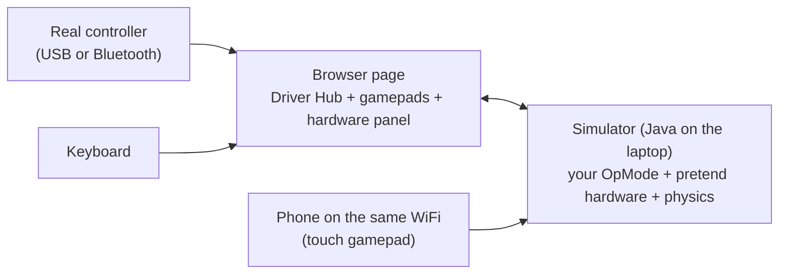

# The simulator: a pretend Control Hub and Driver Hub

Try OpModes without a robot. Your real OpMode code runs on the laptop; the motors, servos, switches,
turn sensor (IMU) and the robot on the field are pretend, with simple physics. Good for: checking
buttons and screens, testing the finders, learning the controls, catching crashes before a meeting.
Not for: exact speeds, real shots, camera pictures.



## Start it

From the ftc-helper-lib folder:

```bash
./gradlew :sim:run
```

Then open **http://localhost:8780** in a browser. Ctrl+C in the terminal stops it. It needs what
building the library needs: Java and the Android SDK, which Android Studio installs (if Gradle says
"SDK location not found", see [Contributing](../contributing.md)). Windows, macOS and Linux; a
Chromebook with Linux turned on.

Options:

```bash
./gradlew :sim:run -Probot=sim/robots/my-robot.properties -Plan
```

`-Probot` uses another robot file. `-Plan` lets phones and tablets on the same WiFi join (Windows asks
about the firewall the first time). With `-Plan`, anyone on that WiFi can open the page and run
OpModes in the simulator: use it on a team or home network, not open school WiFi.

## The page

**Driver Hub** (left): choose an OpMode, then INIT, START, STOP, like the real one. The screen shows
the telemetry about as wide as a real Driver Hub. OpModes marked "(hidden on robot)" have `@Disabled`:
the simulator shows them anyway. Autonomous stops by itself after 30 s (the box turns it off).
An error in the OpMode shows in red, with the line where it happened.

**Gamepads** (middle): each gamepad has its own source:

| Source | How |
| --- | --- |
| On-screen | click or touch the buttons; drag the sticks; slide the triggers. **Sticky** (the box under the gamepads): a click holds a button until the next click and sticks stay where you leave them, so you can hold two things at once with one mouse. |
| Keyboard | left stick W A S D, right stick arrows, D-pad T F G H, A/B/X/Y K L J I, LB/RB Q E, LT/RT Z C, BACK Backspace, START Enter, GUIDE M |
| Controller | plug in a USB or Bluetooth controller, choose it, press any of its buttons once (a browser rule). Xbox, PS4, PS5 everywhere; Logitech F310 on Windows (on a Mac set its back switch to "D"). Chrome and Edge work best. |
| Phone / other page | start with `-Plan`, open `http://<computer address>:8780/?phone=2` on the phone (the page shows the address): the phone becomes gamepad 2 (`?phone=1`: gamepad 1). Set that gamepad here to "Phone / other page"; if you forget, the page says another page is using it. |

If both gamepads are set to Keyboard, the same keys work both. A browser tab in the background sends
gamepad updates only once a second, and after 2.5 s without news the simulator lets go of every
button (like a pulled cable): keep the simulator tab visible while you drive.

The GUIDE (PS) button often does not reach the browser (Windows and macOS keep it): use the on-screen
GUIDE, the M key, or hold START for 1 second (the finders accept that too).

**Control Hub** (right): the field from above (the drivers are at the bottom), "push by hand"
buttons (for the Drive Tuner's push test), every motor (power, count, speed, current; "STOP" when it
is at a hard stop), every servo (where it is and where it is going), the switches (click to hold
one pressed), and the battery voltage (lower it to see a weaker robot).

## The robot file

`sim/robots/starter.properties` describes the pretend robot: every device with the SAME name as the
robot configuration, plus simple physics numbers. Copy it for your robot and change names and numbers:

```properties
drive.type = mecanum
drive.motors = front_left, front_right, back_left, back_right
drive.wheelDiameterIn = 3.90          # the REAL wheel (the Drive Tuner should find it)
imu = imu
motor.lift = lift, maxTicksPerSec=2796, min=0, max=2750, gravity=0.06
motor.flywheel = flywheel, maxTicksPerSec=2800, feeder=feeder, shotDrop=0.15
servo.claw = 0.5
touch.lift_bottom = lift, below=20
```

Motor kinds: `free` (just spins), `lift` (hard stops, gravity), `flywheel` (coasts; while its `feeder`
motor runs, a piece goes through every 0.3 s and slows it down). `ticksPerRev=` sets a motor's encoder
counts per turn (default 537.7; flywheel 28). On a robot, `setPower` in RUN_USING_ENCODER aims for the
top speed of the motor TYPE chosen in the configuration; here it is the robot file's `maxTicksPerSec`. The wheel motors are on the left/right sides of the robot like a
real one (the left ones mounted mirrored), so motor directions in your code matter here too.

## Your own OpModes

The simulator lists every OpMode in the library's examples and starter kit, and any OpMode in the
package `org.firstinspires.ftc.teamcode`. To try your team's own OpMode, copy the file into
`examples/src/main/java/org/firstinspires/ftc/teamcode/` in the library folder (keep its package line),
and restart the simulator. (Running TeamCode straight from the robot project is a later step.)

## Not simulated

Cameras (webcam and Limelight): an OpMode that needs one stops with "No WebcamName named...". The Shot and Aim
tuners work without a camera when `createCamera()` returns null. Iterative OpModes (`init()/loop()`)
are not run yet; the library's OpModes are all LinearOpModes. Physics is simple: real numbers
(gains, speeds, shot tables) must still be found on the robot.

Differences to know: the screen here updates as fast as the OpMode sends (a real Driver Station
redraws about 4 times a second, so a flickering line looks steadier there). STOP works like on a
robot: a `sleep()` ends at once, and an OpMode that ignores STOP for 3 s is cut off from the hardware
(restart the simulator to run another).

## Automatic tests

`sim/src/test/.../FinderSafetyTest.java` runs whole OpModes with scripted button presses, on every
push. It checks, for example, that help stops the motors, that a stick held through help does not
count, that the Drive Tuner's push test finds the real wheel size, and that every example starts and
stops with all motors off. Its first run found a real bug: every finder crashed at INIT in v0.7.2.

```bash
./gradlew :sim:testDebugUnitTest
```
