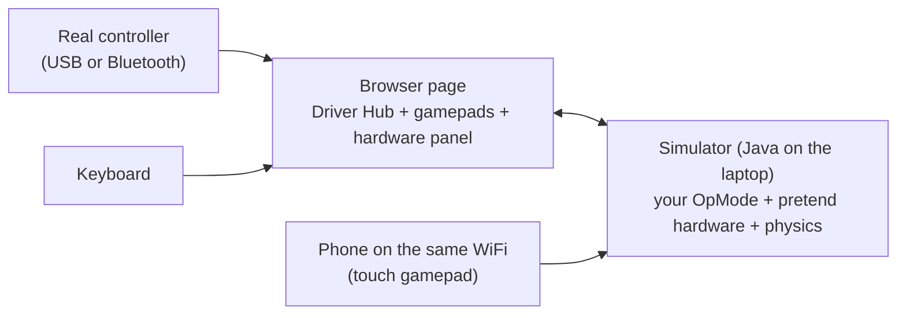

# The simulator: a pretend Control Hub and Driver Hub

Try OpModes without a robot. Your real OpMode code runs on the laptop; the motors, servos, switches,
turn sensor (IMU), webcam and the robot on the field are pretend, with simple physics. Good for:
checking buttons and screens, testing the finders and camera code, learning the controls, catching
crashes before a meeting. Not for: exact speeds, real shots, real camera pictures.



## Start it

From the ftc-helper-lib folder:

```bash
./gradlew :sim:run
```

Then open **http://localhost:8780** in a browser. Ctrl+C in the terminal stops it. It needs what
building the library needs: Java and the Android SDK, which Android Studio installs (if Gradle says
"SDK location not found", see [Contributing](../contributing.md)). Windows, macOS and Linux; a
Chromebook with Linux turned on.

Options:

```bash
./gradlew :sim:run -Probot=sim/robots/my-robot.properties -Plan
```

`-Probot` uses another robot file. `-Plan` lets phones and tablets on the same WiFi join (Windows asks
about the firewall the first time). With `-Plan`, anyone on that WiFi can open the page and run
OpModes in the simulator: use it on a team or home network, not open school WiFi.

## The page

**Driver Hub** (left): choose an OpMode, then INIT, START, STOP, like the real one. The screen shows
the telemetry about as wide as a real Driver Hub. OpModes marked "(hidden on robot)" have `@Disabled`:
the simulator shows them anyway. Autonomous stops by itself after 30 s (the box turns it off).
An error in the OpMode shows in red, with the line where it happened.

**Gamepads** (middle): each gamepad has its own source:

| Source | How |
| --- | --- |
| On-screen | click or touch the buttons; drag the sticks; slide the triggers. **Sticky** (the box under the gamepads): a click holds a button until the next click and sticks stay where you leave them, so you can hold two things at once with one mouse. |
| Keyboard | left stick W A S D, right stick arrows, D-pad T F G H, A/B/X/Y K L J I, LB/RB Q E, LT/RT Z C, BACK Backspace, START Enter, GUIDE M |
| Controller | plug in a USB or Bluetooth controller, choose it, press any of its buttons once (a browser rule). Xbox, PS4, PS5 everywhere; Logitech F310 on Windows (on a Mac set its back switch to "D"). Chrome and Edge work best. |
| Phone / other page | start with `-Plan`, open `http://<computer address>:8780/?phone=2` on the phone (the page shows the address): the phone becomes gamepad 2 (`?phone=1`: gamepad 1). Set that gamepad here to "Phone / other page"; if you forget, the page says another page is using it. |

If both gamepads are set to Keyboard, the same keys work both. A browser tab in the background sends
gamepad updates only once a second, and after 2.5 s without news the simulator lets go of every
button (like a pulled cable): keep the simulator tab visible while you drive.

The GUIDE (PS) button often does not reach the browser (Windows and macOS keep it): use the on-screen
GUIDE, the M key, or hold START for 1 second (the finders accept that too).

**Control Hub** (right): the field from above (the drivers are at the bottom), "push by hand"
buttons (for the Drive Tuner's push test), every motor (power, count, speed, current; "STOP" when it
is at a hard stop), every servo (where it is and where it is going), the switches (click to hold
one pressed), the cameras and the tags they see, and the battery voltage (lower it to see a weaker robot).

**Field in 3D** (bottom, full width): the field and the robot in 3D. Drag to turn the view, scroll to
zoom, right-drag (or two fingers) to slide. View buttons: Drivers, Audience, From above, Follow robot
(behind the robot; turning the view by hand ends it). The robot is a box its size from the robot file
(`robot.lengthIn/widthIn/heightIn`) with a white arrow at the front; it turns red when it bumps into
something. The field is built from the field file's shapes (tiles, walls, tape, solid and overhead
parts) with each AprilTag as a square with its ID. If the robot file names a 3D model of the field
(`field.model`), the page shows that model instead (with the tag squares on top); the "Field CAD model"
box switches between them. Each camera shows as a cone (webcam yellow, Limelight green); "Camera
view" shows a camera's picture in the corner (pick the camera when there are two). The 3D library (three.js, MIT license) comes with the simulator, so the page
works without the internet. Untick "Show" on a slow computer.

## The robot file

The robot file describes the pretend robot: every device with the SAME name as the robot
configuration, the motors and servos from the parts catalog, the robot's size, where it starts, and the
season's field. The library's example is `sim/robots/starter.properties`; a team keeps its own in its
robot project as `simulator/robot.properties` (used automatically, see below).

```properties
field = biobuzz-2026                  # the season's field (sim/fields/biobuzz-2026.json)
field.model = fields/biobuzz-2026.glb # optional: the field's 3D model for the 3D view (path from this file)
robot.lengthIn = 18                   # size, for bumping into field elements
robot.widthIn = 18
start.x = -56                         # where it starts (inches from the field center; y away from the drivers)
start.y = -61.55                      # BIOBUZZ G304: touching the wall, outside the LOADING ZONE
start.heading = 0                     # degrees, counterclockwise; 0 = facing away from the drivers
drive.type = mecanum
drive.motors = front_left, front_right, back_left, back_right
drive.part = gobilda-5203-312         # from the parts catalog: speed, encoder counts, current
drive.wheelDiameterIn = 3.90          # the REAL wheel (the Drive Tuner should find it)
imu = imu
motor.lift = lift, part=gobilda-5203-312, min=0, max=2750, gravity=0.06
motor.flywheel = flywheel, part=gobilda-5203-6000, feeder=feeder, shotDrop=0.15
servo.claw = 0.5, part=gobilda-2000-torque
camera.front = name=Webcam 1, forward=7, up=12, pitch=20   # see "Cameras" below
touch.lift_bottom = lift, below=20
```

## Robot shapes

The robot can be drawn as simple shapes: the chassis box plus parts from a short menu, each moved by
its motor or servo. The 3D view draws them, and the simulator checks the size rules with them: the 18
in start cube, and 18 x 24 in and 29 in tall (R105) now and **at full reach** (every moving part tried
over its whole range). The Control Hub panel shows the sizes in green or red.

```properties
robot.chassisHeightIn = 4
# shape.NAME = TYPE, on=PARENT, at=forward,left,up, size=forward x left-right x up, then what moves it
shape.lift = slide, at=-7,0,4, size=2x8x8, axis=up, motor=lift, ticksPerIn=344
shape.arm = arm, on=lift, at=0,0,8, size=9x1.5x1.5, axis=left, motor=arm, gear=3.5, start=-90
shape.wrist = arm, on=arm, at=9,0,0, size=2.5x1.5x1.5, servo=wrist, pos0=-90, pos1=90
shape.claw = claw, on=wrist, at=2.5,0,-1.5, size=2x0.5x3, servo=claw, pos0=0, pos1=3
shape.intake = roller, at=8,0,1.5, size=2x14x2, motor=intake
shape.flywheel = flywheel, at=-1,0,4, size=4x2x4, motor=flywheel
```

| Type | What it is | Where `at` points | Moves by |
| --- | --- | --- | --- |
| `box` | a part that does not move | the middle of its bottom | nothing |
| `slide` | a lift or extension: a fixed stage and a moving stage along `axis` (up, down, forward, back, left, right) | the bottom of the fixed stage | motor: `ticksPerIn=` or `spoolIn=` (spool diameter); servo: `pos0=`/`pos1=` inches |
| `arm` | turns about a hinge; `axis` is the hinge line (`left`: + raises the front) | the hinge; the box reaches forward from it | motor: `ticksPerDeg=` or `gear=` (with the motor's counts per turn), `start=` degrees at the bottom stop; servo: `pos0=`/`pos1=` degrees |
| `turret` | turns about up (+ = left) | the middle of its bottom | like `arm` |
| `claw` | two fingers | the middle of the palm | servo: `pos0=`/`pos1=` the gap in inches |
| `roller` | an intake roller (a cylinder along `axis`, default across the robot) | its center | spins with its `motor=` or `crservo=` |
| `flywheel` | a launcher wheel | its center | spins with its `motor=` |

Notes:
- `on=` puts a part on another (default: the chassis). A part on a slide rides on its moving stage; a
  part on an arm turns with it (`at=` from the hinge, so `at=9,0,0` is the tip of a 9 in arm).
- Directions are the robot's: forward, left, up. `at=` is in inches from the parent's mounting point.
- The range of motion comes from the motor's hard stops (`min=`/`max=` on `motor.NAME`), the servo's
  `pos0`..`pos1`, or `travel=` (slide) / `minDeg=`, `maxDeg=` (arm, turret). The size check at full
  reach uses it: a real robot needs hard stops there too (inspectors check the biggest it can get).
- The shapes are for the picture and the size rules. They do not bump into the field yet (the
  chassis footprint still does); a physics engine is planned for that.
- Mistakes stop the simulator with the line's name: an unknown parent, motor or servo; a loop; a moving
  part with no range of motion (give the motor `min=` and `max=`, or `travel=` / `minDeg=` `maxDeg=`);
  a word with no `=` after the first one (`at=-7,0,4` is fine: a list of numbers).
- A `#` after a space starts a note; `color=#ff0000` is a color, not a note.
- Nothing may go below the tiles: the panel and `expect size floor ok` show it (a part there would hit
  the floor on a real robot, so the shapes or the hard stops are wrong).

Scenario checks: `expect size start ok` (fits the 18 in cube now), `expect size match ok` (18 x 24 x 29
now), `expect size most ok` (every pose at full reach), `expect size floor ok` (nothing below the tiles
now); `fail` instead of `ok` checks the opposite; `print size`.

How "at full reach" is checked: every combination of the moving parts' important values is tried. A
slide or claw is biggest at an end of its range; a hinge (arm, turret) is tried at both ends, at each
multiple of 90 degrees, and every few degrees between (5 or finer with a few moving parts; coarser with
many, to stay under 50,000 poses). The worst pose is shown. It is a careful check, not a proof: leave a
little margin, and measure the real robot at its hard stops.

## The parts catalog

**Every part, with its numbers and links: [parts-catalog.md](parts-catalog.md).** It also shows how to
use a part that is not in the catalog (numbers in the robot file, or the team's own parts file with
`parts = parts.json`).

`sim/parts/parts.json` lists the common FTC motors and servos with their real part numbers and the
numbers from the seller's page (and the date they were checked): goBILDA Yellow Jacket (5203 and 5204,
every ratio), REV HD Hex (bare, UltraPlanetary combinations, spur gearboxes) and Core Hex, AndyMark
NeveRest, goBILDA 2000 series servos, REV Smart Robot Servos and Axon servos. A robot file names a part
by its `id` (`part=gobilda-5203-312`); the simulator takes the top speed, encoder counts per turn and
current (motors) or speed and range (servos) from it. Numbers the seller does not publish are left
empty, with a note. Real ratios are used (an UltraPlanetary "5:1" is 5.23:1). Servo speeds use the
seller's row closest to 5 V (a Control Hub servo port gives about 5 V; the headline number is often 6 V).

Motor kinds: `free` (just spins), `lift` (hard stops, gravity), `flywheel` (coasts; while its `feeder`
motor runs, a piece goes through every 0.3 s and slows it down). `ticksPerRev=` sets a motor's encoder
counts per turn (default 537.7; flywheel 28). On a robot, `setPower` in RUN_USING_ENCODER aims for the
top speed of the motor TYPE chosen in the configuration; here it is the robot file's `maxTicksPerSec`. The wheel motors are on the left/right sides of the robot like a
real one (the left ones mounted mirrored), so motor directions in your code matter here too.

## Your own robot code

When the library is a submodule of a robot project (`ftc-helper-lib/` next to `TeamCode/`), run the
simulator from the `ftc-helper-lib` folder: it builds **that project's TeamCode** too, lists only its
OpModes, and uses `simulator/robot.properties` from the robot project. Iterative OpModes
(`init()`/`loop()`) and LinearOpModes both run.

- Another TeamCode folder: `-PteamCode=<folder>`; the library's own examples instead: `-PteamCode=none`.
- TeamCode uses other libraries (Road Runner, Pedro Pathing, FTC Dashboard...)? Put their Gradle lines in
  `simulator/sim-dependencies.gradle` in the robot project, for example:

```groovy
repositories { maven { url = 'https://maven.brott.dev/' } }
dependencies { testImplementation 'com.acmerobotics.dashboard:dashboard:0.4.16' }
```

## Scenario files: test without a browser

A scenario file (`.sim`) drives the simulator like a person and checks what happens. Anyone can run
one, and every scenario also runs as an automatic test (the library's in `sim/scenarios/`, a team's in
`simulator/scenarios/`):

```bash
./gradlew :sim:scenario -Pfile=../simulator/scenarios/main-teleop.sim
```

```text
# lines starting with # are notes
init "Main TeleOp"                     # INIT an OpMode (waits for its first screen)
start                                  # START
press g1.a                             # press and let go (held until the OpMode surely saw it)
hold g1.left_stick_y -1                # set a stick or button and keep it
release g1.left_stick_y                # let go (release g1.all / release all)
wait 0.5                               # seconds
loops 3                                # wait for 3 OpMode loops
push 24 0 2                            # roll the robot by hand: forward in/s, right in/s, seconds
set battery 12.0
set touch lift_bottom on               # hold a switch pressed (off = let go)
set pose -56 -61.55 0                  # put the robot somewhere (x y heading)
set autotimer off                      # no 30 s autonomous stop
expect screen has "Ready"              # or: screen not "..."
expect value "Lift" > 500              # the number on the screen line that starts with Lift
expect time < 25                       # seconds since START (e.g. how long an autonomous took)
expect touch lift_bottom pressed       # or: open
expect error none                      # or: error has "..."
expect phase RUNNING
expect motor lift power > 0.1          # power | ticks | velocity | amps; > < >= <= =  (= VALUE TOLERANCE)
expect servo claw target = 0.53 0.01   # target | actual
expect robot y > -30                   # x | y | heading | imu | shots
expect bumped none                     # or: bumped "Red HIVE"
expect camera "Webcam 1" sees 31       # a tag id in the picture; or: sees none | sees "RED SCORING" (webcam only:
                                       # a Limelight reports single tags; LimelightTags makes the groups)
expect size most ok                    # size start|match|most ok|fail (see "Robot shapes")
expect within 2 motor lift ticks > 500 # wait up to 2 s for it to become true
expect within 30 phase STOPPED         # e.g. wait for an autonomous to finish
stop
print screen                           # also: print motors | servos | cameras | size | robot (not counted as checks)
```

A note after `#` is ignored (outside quotes). A misspelled check fails with a message, never passes.
Button presses wait for the OpMode's loops, counted by its screen updates (or by `loop()` calls in an
iterative OpMode); an OpMode that never sends telemetry cannot be counted, so each step then waits 3 s
and the report says so.

Gamepad names: `g1.`/`g2.` plus `a b x y lb rb lt rt back start guide ls rs`, `dpad_up` (or `up`),
`left_stick_x` (or `lx`), `right_trigger` (or `rt`) and the other SDK names. The report shows each line
as ok or FAIL with the value it saw; the command fails if any check failed.

## Fields: one file per season

`sim/fields/<season>.json` holds a season's field: solid elements (the robot bumps into them), floor
zones and tape lines, things overhead, and the AprilTags with their position and the way they face. The
robot file picks one (`field = biobuzz-2026`). The page draws it; the robot turns red and the panel names
the element when it bumps into one. A start position that overlaps a wall or an element is refused when
the robot file loads. Limits: a bump stops the whole move (the robot does not slide along a wall), and
its wheels keep turning, so wheel encoders keep counting while it pushes (like a real robot): an
encoder-driven autonomous can "arrive" while pinned. Solid footprints are taken from the floor up to
29 in, so a short robot may be stopped a little early by a leaning part. A new season is a new file: the BIOBUZZ file is made from the official
field CAD by a script (in the team's design repo), and the same kind of script works for the next CAD.

Coordinates: inches from the field center, +x to the right and +y away from the drivers (drawn at the
bottom), z up from the tiles; headings and tag facing in degrees, counterclockwise from +x for tags.

A field's 3D model (for the 3D view) is a `.glb` file in the same frame, in inches, z up. It is not in
the library: models made from FIRST's field CAD belong in the team's own robot project
(`simulator/fields/`), named by `field.model` in the robot file. Without one, the 3D view builds the field
from the field file. The BIOBUZZ model is made by `export_sim_field_glb.py` in the team's design repo
from the field CAD export.

## Cameras

A webcam in the robot file lets your real camera code run: `WebcamTags`, or the SDK's own
`VisionPortal` and `AprilTagProcessor` (the simulator has pretend copies of the SDK's camera classes,
made by the SDK's own builders).

```properties
# name = the name in the robot configuration. Where it sits: inches forward/left/up from the robot's
# center on the floor; yaw (+ = turned left) and pitch (+ = tilted up) in degrees. hfov = how wide it
# sees, in degrees (Logitech C920 at 640x480: about 70). Defaults: 0, 0, 10, 0, 0, 70.4, 640, 480.
camera.front = name=Webcam 1, forward=7, left=0, up=12, yaw=0, pitch=20, hfov=70.4, width=640, height=480
```

What it does: the camera opens about 1 s after the OpMode makes it, then sends 30 pictures a second.
For each picture it works out which of the field file's AprilTags are in view: inside the picture,
facing the camera (within 60 degrees), and big enough to find at the OpMode's decimation (about 6.5
pixels across per step of decimation, which matches the FTC docs' ranges). The tags then become the
SDK's own detections, the way the SDK makes them: a tag in one of the tag library's clusters gives a
cluster detection (BIOBUZZ: the SDK 12 library has one cluster per CELL group of 4 tags, "RED SCORING"
and so on); any other tag gives a single-tag detection (without a pose if the library does not know
it). `ftcPose` uses the SDK's own formulas, so range, bearing (positive = left) and elevation mean the
same as on the robot.

On the page, the Control Hub panel lists each camera with the tags in its picture and what was found.
The 3D view draws its view as a cone on the robot (webcam yellow, Limelight green), and "Camera view" shows the picture from the
camera (the tags it sees turn green).

**Limelight 3A**: the same settings with `limelight.` (hfov default 54.5, its spec sheet).

```properties
limelight.ll = name=limelight, forward=6, left=-3, up=14, yaw=0, pitch=25
```

The hardware map gives your code a Limelight3A (the SDK's own class, with its network part replaced),
so `LimelightTags` and direct `getLatestResult()` code work. About 0.5 s after `start()` it sends 50
results a second, made as the same JSON a real Limelight sends and read by the SDK's own `LLResult`:
`isValid()`, `tx`/`ty`/`ta` (the biggest tag), and one `FiducialResult` per tag (a Limelight does not
group tags into clusters) with `tx` (+ = right), `ty` (+ = up), `ta`, pixel position and
`getTargetPoseCameraSpace()` (metres; x right, y down, z out of the lens). Every pipeline finds
AprilTags; `pipelineSwitch` changes the index it reports. Not simulated: botpose / MegaTag (no field
map), robot-space poses, Python, color and neural pipelines, snapshots.

Limits: the poses are exact (no noise, blur or lag beyond the Limelight's reported latency); field
parts do not block the view; tags slanted more than 60 degrees are not found; the webcam's `robotPose`
is always null; only the AprilTag finder gets webcam pictures (other VisionProcessors get `init()` and
nothing more); phone cameras are not simulated; the resolution comes from the robot file, not from
`setCameraResolution`.

## Not simulated

Phone cameras and game pieces. The Shot and Aim tuners work without a camera when `createCamera()` returns null. Physics is
simple: real numbers (gains, speeds, shot tables) must still be found on the robot.

Differences to know: the screen here updates as fast as the OpMode sends (a real Driver Station
redraws about 4 times a second, so a flickering line looks steadier there). STOP works like on a
robot: a `sleep()` ends at once, and an OpMode that ignores STOP for 3 s is cut off from the hardware
(restart the simulator to run another).

## Automatic tests

`sim/src/test/.../FinderSafetyTest.java` runs whole OpModes with scripted button presses, on every
push. It checks, for example, that help stops the motors, that a stick held through help does not
count, that the Drive Tuner's push test finds the real wheel size, and that every example starts and
stops with all motors off. Its first run found a real bug: every finder crashed at INIT in v0.7.2.

```bash
./gradlew :sim:testDebugUnitTest
```
