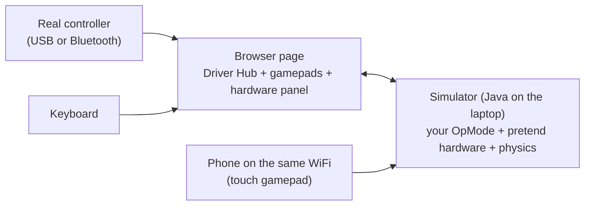

# The simulator: a pretend Control Hub and Driver Hub

> **Work in progress:** this library and its docs are still changing. Something wrong or unclear? [Tell us](https://github.com/crossbotics/ftc-helper-lib/issues).

**For:** anyone who wants to try robot code without a robot. **You need:** a laptop with Android
Studio installed (it brings Java and the Android SDK), and the ftc-helper-lib folder.

The simulator runs your real OpMode code on a laptop. The motors, servos, switches, turn sensor (IMU),
webcam and the robot on the field are pretend, with simple physics. You drive it from a web page.

- **Good for:** checking buttons and screens, testing the finders and camera code, learning the
  controls, and catching crashes before a meeting.
- **Not for:** exact speeds, real shots, real camera pictures.



## Start it

First time on this laptop? Do the [laptop setup](#laptop-setup-once) just below first.

1. Open a terminal in the `ftc-helper-lib` folder (in Android Studio: the **Terminal** tab at the
   bottom, then `cd ftc-helper-lib` if your robot project holds it). **Why:** the commands only work
   from that folder.
2. Run:

   ```bash
   ./gradlew :sim:run
   ```

   **Why:** `./gradlew` runs Gradle, the tool that builds the code. `:sim:run` is the job to do: the
   `run` job of the `sim` (simulator) part. (Gradle calls a job a **task**.) It builds the code and starts the simulator.
3. Open **http://localhost:8780** in a browser. **Why:** that page is your Driver Hub, gamepads and field.

Press Ctrl+C in the terminal to stop it.

**What you see:** the Driver Hub on the left, the field in 3D in the middle with the gamepads under it,
and the Control Hub's panels on the right. Try it: pick an OpMode with the TeleOp button, press INIT,
then START (the same big button), and drive with the keyboard (set gamepad 1's list to "Keyboard"; left
stick W A S D, right stick the arrows). [The page](#the-page) explains every part.

It works on Windows, macOS and Linux, and on a Chromebook with Linux turned on.

### Laptop setup (once)

The library is its own Gradle build, separate from your robot project's. So it needs these, even when
the robot project already builds:

- **Java.** The commands need `JAVA_HOME` (where Java is). Android Studio has its own Java, in its
  `jbr` folder: Mac `/Applications/Android Studio.app/Contents/jbr/Contents/Home`, Windows
  `C:\Program Files\Android\Android Studio\jbr`. Check the folder exists on your computer, then set
  it in the terminal (it lasts until you close that terminal): Mac
  `export JAVA_HOME="/Applications/Android Studio.app/Contents/jbr/Contents/Home"`, Windows PowerShell
  `$env:JAVA_HOME = "C:\Program Files\Android\Android Studio\jbr"`.
  **No such folder?** Look in Android Studio: **Settings > Build, Execution, Deployment > Build Tools >
  Gradle**. The **Gradle JDK** line names the Java Android Studio uses, with its folder: use that
  folder. On a Mac, `/usr/libexec/java_home -V` in the Terminal also lists the Javas on the laptop.
  **Still none?** Install a JDK 17 or 21 (a **JDK** is Java with the tools that build code), for
  example Eclipse Temurin from [adoptium.net](https://adoptium.net), and use its folder. You do
  **not** need the Java from java.com.
- **The Android SDK.** If the first command stops with `SDK location not found`, make a file
  `ftc-helper-lib/local.properties` with one line: Mac `sdk.dir=/Users/<you>/Library/Android/sdk`,
  Windows `sdk.dir=C\:\\Users\\<you>\\AppData\\Local\\Android\\Sdk` (your user name in place of `<you>`).
  **Why:** your robot project's own `local.properties` does not count; the library is its own build.
  (Android Studio shows the SDK path in **Settings > Languages & Frameworks > Android SDK**.)
- **Windows:** type `gradlew.bat` (or `.\gradlew` in PowerShell) instead of `./gradlew`.
- **Normal warnings you can ignore:** `source value 8 is obsolete` (and `target value 8`), `SDK processing. This
  version only understands SDK XML versions up to 3`, `Deprecated Gradle features were used`,
  `[Incubating] Problems report`.
- **A quick build check:** `./gradlew :sim:fromRobot -PteamCode=../TeamCode` builds your TeamCode
  first, so it also tells you on a laptop, with no Control Hub, whether your code builds.

### Options

A `-P` word after the command is an option: `-Pname=value` gives the command a setting (a few, like
`-Plan`, are just on or off and need no value).

```bash
./gradlew :sim:run -Probot=sim/robots/my-robot.properties -Plan
```

`-Probot` uses another **robot file**: the text file that describes the robot to the simulator (its
size, parts, motors and shapes; a team's is `simulator/robot.properties` in the robot project, see
[The robot file](#the-robot-file)). `-Plan` lets phones and tablets on the same WiFi join (Windows asks
about the firewall the first time). With `-Plan`, anyone on that WiFi can open the page and run
OpModes in the simulator: use it on a team or home network, not open school WiFi.

Every simulator command, from the ftc-helper-lib folder (`-PteamCode=` points at your robot project's
TeamCode; with none, it finds `../TeamCode` when the library sits in a robot project):

| Command | Does | Options |
| --- | --- | --- |
| `./gradlew :sim:run` | the simulator page | `-Probot=FILE` (default: your `simulator/robot.properties`, else the library's example), `-Plan` (phones on the WiFi), `-Pport=8781` (another port, to run two at once; default 8780), `-PteamCode=DIR` |
| `./gradlew :sim:scenario -Pfile=a.sim` | runs test scripts ([below](#scenario-files-test-without-a-browser)) | `-Pfile=a.sim,b.sim` (a comma list), `-Probot=`, `-PteamCode=` |
| `./gradlew :sim:fromRobot` | writes the robot file from your `Robot.java` | `-ProbotClass=` (which class), `-Pout=FILE`, `-Pfield=NAME` (default `biobuzz-2026`) |
| `./gradlew :sim:fromConfig -Pconfig=FILE.xml` | a first robot file from a robot configuration | `-Pout=FILE`, `-Pfield=NAME` |
| `./gradlew :sim:newRobot -Pconfig=FILE.xml` | the five files (Robot.java, ...) from a configuration | `-PteamCode=DIR`, `-Ppackage=` (default `org.firstinspires.ftc.teamcode`) |
| `./gradlew :sim:fit` | fits Characterizer logs ([below](#real-numbers-the-characterizer)) | `-Plog=`, `-Probot=`, `-Pwrite`, `-Pforce` |

## The page

The page fits one laptop screen. On a narrow screen the parts stack and the page scrolls.

- **Left: the Driver Hub**, drawn like the Driver Station app. It shows the robot battery, gamepad 1
  and 2 (lit while used), the Auto and TeleOp buttons (each lists the OpModes of that kind), one big
  button that is INIT, then START (play), then STOP, the match time, and the telemetry.
- **Middle: the field in 3D**, with the gamepads under it. The on-screen gamepads look like a real
  controller (Xbox 360 / Logitech layout, with the button names the SDK uses). A pressed button gets a
  white ring. **Hide gamepads** gives the field more room when you drive with the keyboard, a
  real controller or a phone (on a short laptop screen they start hidden; **Show gamepads** brings
  them back, and this browser remembers your choice).
- **Right: the Control Hub**, in panels: Robot (the field from above, pushing the robot, size and
  pieces, battery), Motors, Servos & switches, Cameras. Each of its buttons shows or hides a panel.
  The panels stack in that order, and this browser remembers your choice for the next run.

**Driver Hub** (left): choose an OpMode, then INIT, START, STOP, like the real one. The screen shows
the telemetry about as wide as a real Driver Hub. OpModes marked "(hidden on robot)" have `@Disabled`:
the simulator shows them anyway. Autonomous stops by itself after 30 s, and TeleOp after 2:00, like the
real Driver Station with its timer on (the clock counts down; a box under it turns each timer off).
An error in the OpMode shows in red, with the line where it happened.

**Gamepads** (middle): each gamepad has its own source:

| Source | How |
| --- | --- |
| On-screen | click or touch the buttons; drag the sticks; slide the triggers. **Sticky** (the box under the gamepads): a click holds a button until the next click and sticks stay where you leave them, so you can hold two things at once with one mouse. |
| Keyboard | left stick W A S D, right stick arrows, D-pad T F G H, A/B/X/Y K L J I, LB/RB Q E, LT/RT Z C, BACK Backspace, START Enter, GUIDE M |
| Controller | plug in a USB or Bluetooth controller, choose it, press any of its buttons once (a browser rule). Xbox, PS4, PS5 everywhere; Logitech F310 on Windows (on a Mac set its back switch to "D"). Chrome and Edge work best. |
| Phone / other page | start with `-Plan`, open `http://<computer address>:8780/?phone=2` on the phone (the page shows the address): the phone becomes gamepad 2 (`?phone=1`: gamepad 1). Set that gamepad here to "Phone / other page"; if you forget, the page says another page is using it. |

If both gamepads are set to Keyboard, the same keys work both. A browser tab in the background sends
gamepad updates only once a second, and after 2.5 s without news the simulator lets go of every
button (like a pulled cable): keep the simulator tab visible while you drive.

The GUIDE (PS) button often does not reach the browser (Windows and macOS keep it): use the on-screen
GUIDE, the M key, or hold START for 1 second (the finders accept that too).

**Control Hub** (right): the field from above (the drivers are at the bottom), "push by hand"
buttons (for the Drive Tuner's push test), every motor (power, count, speed, current; "STOP" when it
is at a hard stop), every servo (where it is and where it is going), the switches (click to hold
one pressed), the cameras and the tags they see, and the battery voltage (lower it to see a weaker robot).

**Path lines** (on the field map and in the 3D view): an orange dashed line is the path a Pedro `follow`
step drives (the plan), and a green line is where the robot really went in its last 30 seconds of
driving (the trail). The plan stays, faded, after its step ends, so you can compare the two. **Clear
lines** clears both; untick **Path lines** to hide them. More: [Pedro module](../modules/pedro.md#the-simulator).

**Field in 3D** (middle, above the gamepads; at the bottom on a narrow screen): the field and the robot in 3D. Drag to turn the view, scroll to
zoom, right-drag (or two fingers) to slide. The **View** menu (keys 1 to 8; your choice is remembered in
this browser) looks from:

| Key | View | From where |
|---|---|---|
| 1 | Drivers | your alliance's wall: the alliance the running program uses (autonomous's INIT menu, or TeleOp's choice); red until a program says. The button says which wall it is now. |
| 2 | Red wall | behind the red drivers (BIOBUZZ: the bottom of the field map, y = -72) |
| 3 | Blue wall | behind the blue drivers (y = +72) |
| 4 | Audience side | the side the audience sits on (BIOBUZZ: the red drivers' right, +x) |
| 5 | Far side | across from the audience (-x) |
| 6 | From above | straight down, your alliance's wall at the bottom |
| 7 | Follow robot | behind the robot (turning the view by hand ends it) |
| 8 | HIVE close-up | your alliance's HIVE up close (a field with no HIVEs: the goal nearest the robot) |

The sides come from the field file's frame (its `frameNote` says which wall is which). **Layers** (next to
View) adds lines and maps over the 3D view: see [Layers](#layers) below. **Auto builder** (next to Layers)
builds an autonomous on the field and runs it with your code: see [The auto builder](#the-auto-builder).

**Where the robot starts.** In INIT the robot is put where the program says: an autonomous that names its
start spot (`s.start(note, x, y, heading)`, or `startSpotIn()` in an EasyAuto) puts it there for the
alliance chosen in its menu; a TeleOp with no autonomous before it puts it at the robot file's start for
RED, or that spot's mirror image for BLUE, once the drivers choose the alliance (X / B). After an
autonomous, TeleOp leaves it where autonomous ended. **Move it by hand:** while no program runs (or in
INIT), drag the robot on the field map (Control Hub, Robot tab) and turn it with the mouse wheel over it,
or in the 3D view: double-click the robot, then drag it to move it or drag its yellow ring to turn it
(double-click again to stop). Under the map, the spot is shown as an autonomous start spot from your
alliance's wall, ready for `s.start("...", x, y, heading)`. The robot is a box from the robot file
(`robot.lengthIn` x `widthIn` x `chassisHeightIn`) with a white arrow at the front; it turns red when it bumps into
something. Its shapes (below) move with their motors and servos. Rollers and wheels have dark
stripes, so you see them turn and which way; a roller glows **green** while it takes pieces in and
**orange** while it pushes them out, a flywheel or other spinner glows **yellow** while it turns, and a
passive part (moved by gravity or springs) **blinks yellow** while it moves. The field is built from the field file's shapes (tiles, walls, tape, solid and overhead
parts) with each AprilTag as a square with its ID. If the robot file names a 3D model of the field
(`field.model`), the page shows that model instead (with the tag squares on top); the "Field CAD model"
box switches between them. Each camera shows as a cone (webcam yellow, Limelight green); "Camera
view" shows a camera's picture in the corner (pick the camera when there are two; it is redrawn 15 times
a second, smaller than the screen, so it costs little). The game pieces are striped balls, so you can see
them roll and spin. A tipping HIVE turns smoothly (with a rules file the simulator turns it over its
`tipSeconds` and the page plays the same turn; without one the simulator tips it at once and the page
still turns it over half a second). The 3D library (three.js, MIT license) comes with the simulator, so the page
works without the internet. Untick "Show" on a slow computer.

**Smooth motion.** The simulator moves everything 100 times a second and sends the page where everything
is 50 times a second (a stream: `GET /stream`), with its own clock. The page draws the moment about
1/20 s in the past, gliding between the two updates around it, so the robot and the balls move smoothly
at any frame rate (they do not jump 10 times a second). Across a jump (Back to start, Reset field, the
robot put somewhere by hand) it does not glide. If the stream cannot open (a very old browser, too many
pages open), the page asks for `/state` 10 times a second instead and still glides, just further behind.

### The Match panel and the score bar

With a rules file (BIOBUZZ has one: [Game rules and the score](#game-rules-and-the-score)), the Control
Hub's **Match** button shows the game, and a score bar sits over the 3D view (click it to open the panel):

- **The score and the clock**: RED and BLUE totals, the period (AUTO, TELEOP or free play) and the time
  left. Click a total to see where its points come from (LEAVE, PARK, TIPs, pieces in the up CELL, FLOWERs
  owned and the pieces in them, the bottom NECTAR bonus, the GARDEN, the other side's fouls). A line says
  whether a NECTAR into a FLOWER is allowed now (G410).
- **FLOWERs**: each FLOWER's owner and its stack from the bottom up (a dot per piece in its colour; a hollow
  dot is outside the scoring rings). In 3D, a ring over each FLOWER in its owner's colour (grey: none) with
  how many pieces count.
- **Shots**: the tally of verdicts (clean, rim, other HIVE, frame, miss), the last few shots, and in 3D the
  verdict over the piece when it is judged; its trail (Layers: Ball trails) takes the verdict's colour.
- **Scatter**: off (every shot the same), realistic, rough, or as the robot file says (`/cmd action=scatter`).
- **Hit rate**: 400 pretend shots from the robot as it is now (`GET /hit-rate`), judged like real ones:
  how many go in cleanly, with its plus-or-minus, Good (80 % or more), Risky (50-80 %) or Poor, and why the
  others did not. Pick the piece, or the next one in the robot.
- **Fouls**: each foul charged (G410), newest first; a new one shows over the 3D view for 5 s.

### Layers

The **Layers** button over the 3D view turns each of these on or off; your choice is remembered in this
browser.

| Layer | What it shows |
|---|---|
| Camera sight lines | A line from the chosen camera to each tag in front of it. **Green**: the camera sees it (with about how many pixels across). **Pink "blocked?"**: the camera model sees it, but a field part is in the way of the line (the simulator's camera sees through field parts; a real one does not, so do not count on that tag from there). **Orange**: too slanted (the tag's face is turned more than 60 degrees from the camera). **Red**: too small (fewer pixels across than the tag finder needs: 6.5 per step of decimation, so 20 at the SDK's decimation 3). **Grey, faint**: out of the picture (left, right, above or below). **Purple**: the pretend lighting does not work with the camera's setting now (`goodPipelines`, `goodExposureMs`). Not seen: only the nearest four lines of each kind. The words at the bottom left list every tag. "Not open" means the OpMode has no camera running, so it gets nothing even where the lines are green. |
| Camera view cone | The camera's view, 36 in long (as before). |
| Floor map | Where on the field the chosen camera can see tags: each 4 in square is shaded by how many tags the camera would see with the robot standing there (light: 1, darker: 2 or 3, darkest: 4 or more). The simulator works it out with the same camera rules the OpMode gets (field parts do not block in this map), with the robot facing the way it faces now, or, ticked "turned any way", the best of 24 headings. Turret and other parts stay as they are now. It updates once a second. |
| Shot arc | Where each launcher would send its next piece if it fired now: a dashed yellow line from the launcher, with its peak height (check the venue's ceiling and lights). The simulator works it out from the flywheel's speed now, the shot angle (the hood's angle if it has one) and a shot table's average, with the same air drag and spin lift as a real shot, but it flies through everything (no goal, no walls, no other pieces). The words at the bottom left give the angle, speed and peak; a stopped flywheel says so. |
| Ball trails | The last half second of each loose ball's path, in its color: how it flew and bounced. |
| Path lines | The Pedro plan and the trail (the same as **Path lines** in the Robot tab). |
| Robot size box | A box around everything the robot has out now (green while it fits 18 x 24 in and 29 in tall, red when not; worked out from the shapes' boxes, not the CAD models) and the 18 in start cube, dashed. |

The page's helpers (gliding between updates, the striped ball, the labels) are in `sim/.../simview.js`,
a small file with no other library in it, so another page (like a team's own shot simulator) can load it
too.

## The auto builder

Build an autonomous on the field, press **Run**, and the simulator runs it with **your real code**: your
`Robot.java`, your parts' methods and your `Actions.java`, the library's real `Auto` and `Steps` (the INIT
menu, the 30 s timer, the park time, the report) and, for a path, the real Pedro follower. Then copy the
Java into your project. It is the [web path builder](https://crossbotics.com/ftc-helper/path-builder/)
(a page that needs no install, for any team) with the run added: the same plan gives the same Java.

**Open it:** the **Auto builder** button over the 3D view. It takes the Control Hub's place (close it with
the x to get the hub back; on a narrow screen it sits under the 3D view).

What a team does, step by step:

1. **Robot and alliance.** The builder finds the Robot classes in the code the simulator runs (your
   TeamCode, or the library's examples) and picks the one whose device names match the robot file
   ("Best fit"); pick another in the list if it guessed wrong. Its drive (tank or mecanum) and the robot's
   size come from your code and the robot file. **Run as** RED or BLUE, and say whether RED's routes are
   mirrored (`mirrorForRed()`; BIOBUZZ's turned field: "false (turned field)").
2. **Choose the mode.**
   - **Simple steps** (any drive): drive, strafe (mecanum), turn, turn to, wait, start something (a
     command), an action from `Actions.java`, and "park from here" (`parkWithSeconds`). Tap the field map
     to add a drive to that spot (a tank drive gets a turn first), drag the blue dot at the end of a drive to
     change it, or use the list: each step has its numbers, arrows to move it, and its own warnings.
   - **Pedro path** (mecanum with odometry): tap to add lines or curves, drag the ends and the control
     points, choose each part's heading rule and speed limit, hold the end, and add things to start along the
     path (`PathAt`: inches done or left, part of the path, start of a part, near a point). **follow** needs a
     `follower(...)` line in Robot.java (the pedro module); **driveTo steps** need only odometry. The builder
     says so when your robot cannot do the mode, and Run stays off.
3. **Edit in 3D too:** with "Edit in the 3D view" ticked, the same points are balls in the 3D view: drag
   them, or tap the field to add a step or a part (not near the robot). The purple dashed line is the plan.
4. **The start spot and the note for the drive team.** Pick a ready-made spot (against your wall, each one
   checked against the start rules) or drag the green dot. The **note** is what the Driver Station shows
   at INIT as `Place robot : ...`, so the drive team reads it at match setup: about 50 characters fit one
   line. **Write it for me** writes it from the spot ("Our wall, left corner tile, facing the field"); it
   follows the robot until you type your own words. **Print setup card** opens one page for the drive
   team: the note in big letters, the field with the robot's start footprint and heading, red and blue,
   and the first step.
5. **Checks** before a run: the field walls and parts along the way, the start rules (touching the wall, on
   your half, not in the LOADING ZONE, inside the 18 in box), more than 30 s, the park time, a tank strafe,
   names left empty. The time is a plan from simple speed numbers (an action counts its whole time limit).
6. **Run in the simulator.** The simulator INITs the **Built Auto** (its own autonomous, listed in the
   Driver Hub under "Builder") with your plan, chooses the alliance, puts the robot on the start spot and
   presses START. The clock beside Run counts the autonomous's seconds (real time, like a match: no fast
   forward). A **purple robot** drives the plan beside your robot; each of its steps starts when your
   robot's step starts, so you see where they part. The green line is where your robot really went.
7. **Read the result:** a table with each step's word from the report (done, STALLED, timed out, skipped
   for park, not fired) and how far off the plan it ended, the match score, and **what to change**. Some
   changes have an **Apply** button: a 0.3 s wait before a turn (or a new direction) that came right after a
   drive (the robot still rolls when a drive ends, so it slides on a few inches), holding a Pedro path's
   end, or slowing its last part. Press Run again to check.
8. **Copy the Java** (the whole file for Simple steps, or only the steps; for a Pedro path the `PedroPath`
   field and the steps to paste, the same as the web builder), **Save the scenario** (a scenario file that
   checks the note, the start spot, each step "done" and the end, within the inches and degrees you set;
   [scenario files](#scenario-files-test-without-a-browser)), and tick **with the end from the last run** to
   check the end your robot really reached (for a route that is right as it drives, so a later change that
   moves the end is caught). The plan is kept in this browser.

**What it can call in your code.** A command or an action is written as Java, and the simulator reads
these shapes only: `robot.part::method`, `robot::method`, `() -> robot.part.method(...)`,
`() -> robot.method(...)`, `Actions.name(robot, ...)` and `robot.part.method(...)` that gives an Action,
with plain values (text in quotes, numbers, true/false, `robot`). It finds the public field (your part)
and the public method by its name. **Why only these:** safety and plainness. Nothing else in your code or
on the laptop can be reached from the page, and nothing is compiled or run as a script. Anything else
(`Tunables.Lift.high`, two calls in one) is refused at INIT with a message, like a part that is not on the
robot: write it as a method in Robot.java or Actions.java and name that method. A name that is not there
stops INIT with the names there are (`Robot.java has no part called claw (its parts: intake, launcher)`).

**Shared with the web builder.** The plan, its checks, the Java, the scenario, the start note and the
setup card come from the same files as the web builder: `pathcore.js`, `stepscore.js`, `mapdraw.js` and
`setupcard.js` in `sim/src/test/resources/sim/builder/`. **The library is their source**: change them here,
then copy them to the web site (its `scripts/sync-path-builder.mjs` copies them with the field file).
`node tools/check_builder.mjs` checks that the Java and the scenario for a set of plans are letter for letter
what the web builder wrote (`sim/src/test/resources/builder/fixtures.json`), checks the simulator-only part
(`simcore.js`), and, when it finds a checkout of the site, that the site's copies are the same.

**Not covered:** the INIT menu (`menuChoice`, `onlyIf`), your own steps (`step(...)`), `waitUntil`, and
reading Java back in (the web builder reads Java in). A Pedro plan is one path (one `follow`, or one
`driveTo` per part); add the steps before and after it in your file. Commands take plain values only.

## The robot file

**Quick start:** an AI coding agent can write most of it for you from your robot configuration,
TeamCode and a tape measure: see the [robot-file skill](robot-file-skill.md).

The robot file is a plain text file of `name = value` lines (a "properties" file). Text after `#` is a
note for people. It describes the pretend robot: every device with the SAME name as the robot
configuration, the motors and servos from the parts catalog, the robot's size, where it starts, and the
season's field. The library's example is `sim/robots/starter.properties`; the four sellers' BIOBUZZ starter bots are in `sim/robots/starter-bot-*.properties` ([starter-bots.md](starter-bots.md)); a team keeps its own in its
robot project as `simulator/robot.properties` (used automatically, see below).

```properties
field = biobuzz-2026                  # the season's field (sim/fields/biobuzz-2026.json)
field.model = fields/biobuzz-2026.glb # optional: the field's 3D model for the 3D view (path from this file)
robot.lengthIn = 18                   # size, for bumping into field elements
robot.widthIn = 18
robot.heightIn = 18                   # the chassis box with no shapes, and which overhead field parts it bumps (with shapes, the shapes decide the size rules)
robot.tallestIn = 12                  # optional: a part the shapes do not draw reaches this high (size rules count it)
start.x = -56                         # where it starts (inches from the field center; y away from the drivers)
start.y = -61.55                      # BIOBUZZ G304: touching the wall, outside the LOADING ZONE
start.heading = 0                     # degrees, counterclockwise; 0 = facing away from the drivers
drive.type = mecanum
drive.motors = front_left, front_right, back_left, back_right
drive.part = gobilda-5203-312         # from the parts catalog: speed, encoder counts, current
drive.wheelDiameterIn = 3.90          # the REAL wheel (the Drive Tuner should find it)
drive.gearRatio = 1                   # motor turns per wheel turn (default 1)
drive.strafeEfficiency = 0.85         # mecanum: how much of a strafe really happens (default 0.85)
imu = imu
motor.lift = lift, part=gobilda-5203-312, min=0, max=2750, gravity=0.06
motor.flywheel = flywheel, part=gobilda-5203-6000, feeder=feeder, shotDrop=0.15   # feeder: a motor, CR servo or servo
servo.claw = 0.5, part=gobilda-2000-torque
camera.front = name=Webcam 1, forward=7, up=12, pitch=20   # see "Cameras" below
touch.lift_bottom = lift, below=20
```

### Every setting

The example above shows the common ones. All of them, with their defaults (a missing line takes the
default):

| Line | Default | Means |
| --- | --- | --- |
| `field = NAME` | `biobuzz-2026` | the field file in `sim/fields/` |
| `field.model = FILE` | none | the field's 3D model for the 3D view (path from the robot file) |
| `parts = FILE.json` | none | your own parts catalog, added to the library's ([parts catalog](parts-catalog.md)) |
| `battery = V` | 12.8 | battery volts at the start (the page's slider: 11 to 13.5) |
| `robot.lengthIn`, `robot.widthIn` | 18 | the footprint, for bumping into field parts |
| `robot.heightIn` | 18 | the chassis box with no shapes, and which overhead field parts it bumps |
| `robot.chassisHeightIn` | 4 with shapes, else `heightIn` | the height of the chassis box |
| `robot.tallestIn` | none | a part the shapes do not draw reaches this high (the size rules count it) |
| `drive.type` | `none` | `mecanum`, `tank` (2 or 4 motors) or `none` (a test rig) |
| `drive.motors = a, b, ...` | none | the wheel motors |
| `drive.part` | none | the wheels' motor from the catalog |
| `drive.wheelDiameterIn` | 3.78 | wheel size |
| `drive.trackWidthIn`, `drive.wheelBaseIn` | 15, 13 | left-right and front-back wheel spacing |
| `drive.mirrored` | `left` | which side's motors are mounted mirrored (turn the other way for the same power) |
| `drive.strafeEfficiency` | 0.85 | how much of a strafe really happens (mecanum) |
| `drive.kS`, `drive.accelSec`, `drive.turnDegPerCount` | 0, 0.15, worked out | from the Characterizer ([below](#real-numbers-the-characterizer)) |
| `imu = NAME` | none | the IMU's name |
| `missing = a, b` | none | devices described in this file but NOT in the configuration: a part not on the robot yet ([below](#a-part-not-on-the-robot-yet)) |
| `odometry = KIND NAMES` | none | pretend odometry from the robot's true motion: `pinpoint NAME`, `otos NAME`, `threeWheels L, R, P` or `twoWheels PAR, PERP` ([odometry](../modules/odometry.md#the-simulator)) |
| `odometry.offsetsMm = X, Y` | 0, 0 | Pinpoint: where the pods sit (X pod mm left, Y pod mm forward); sets the raw pod counts the Odometry Tuner's Spin test reads |
| `odometry.mountIn = F, L, H` | | OTOS: where it sits (written from Robot.java); the pretend OTOS reports the centre's pose, so it does not change the simulation |
| `odometry.trackWidthIn` | 12 | three dead wheels: left to right pod, inches |
| `odometry.parallelLeftIn`, `odometry.perpForwardIn` | 0, 0 | dead wheels: the forward pod's inches left (two wheels), the sideways pod's inches forward |
| `odometry.ticksPerIn` | 505.3 | dead wheels: pod counts per inch (goBILDA 4-bar pods) |
| `odometry.reversed = names` | none | these pods count backward (as wired; the code's `reversed(...)` turns them back): dead-wheel port names, or `x`/`y` for a Pinpoint's pods |
| `odometry.scaleError` | 0 | noise: 0.01 = it measures 1% too far (wheel slip, a wrong pod size) |
| `odometry.driftDegPerMin` | 0 | noise: the heading creeps this many degrees per minute |
| `motor.NAME = KIND, ...` | | a motor: `free`, `lift` or `flywheel`, then `part=`, `ticksPerRev=` (catalog, else 537.7 or 28 for a flywheel), `rpm=` or `maxTicksPerSec=` (catalog, else 2780), `min=`, `max=` (counts), `gravity=` (0), `kS=` (0), `accelSec=`, `coastSec=`, `feeder=` (a motor, CR servo or servo that feeds a flywheel), `shotDrop=` (0.15: how much a shot slows the wheel), `drivenBy=CRSERVO` (no motor on this port: only an encoder, on a shaft that CR servo turns, e.g. a CR servo turret's Through Bore) |
| `servo.NAME = START, ...` | start 0.5 | a servo: `part=` (catalog), or `rangeDeg=` and `secPer60=` for one not in the catalog. `pwm=500-2500`: the robot's code uses the servo's full range (`.fullRange()`; `:sim:fromRobot` writes it); START and every position in the file are then in that range. Like the hub, the simulated servo gets the normal 600-2400 us at each INIT and the code's `setPwmRange` after, so 0 to 1 turns a goBILDA 2000 servo 270 degrees, or 300 with full range |
| `servo.speed` | 1.0 | positions per second for a servo with no part |
| `crservo.NAME =` | | a continuous servo (the value is not used) |
| `light.NAME = gobilda` or `blinkin` | | a colored light ([`Lights`](../modules/robot.md#lights)): a goBILDA RGB Indicator Light (a servo) or a REV Blinkin; the page shows its color on the robot, on the 3D view and in the Servos tab |
| `touch.NAME = MOTOR, below=N` | below 20 | a switch pressed while that motor is within N counts of its `min` (reads `getState()` false when pressed) |
| `touch.NAME = MOTOR, at=C, width=W` | width 10 | a switch part way along: pressed while that motor is within W counts of C (counts from where it starts), e.g. a turret's home switch |
| `analog.NAME = MOTOR, offsetDeg=D` | offsetDeg 0 | an absolute encoder on that motor's shaft (0 to 3.3 V per turn), reading D degrees at the start: a CR servo turret's angle sensor |
| `color.NAME = at=ready` | | a colour sensor with distance (REV Color Sensor V3) that sees the piece at one spot: `at=ready` (next to fire) or `at=intake` ([game pieces](#game-pieces)) |
| `distance.NAME = at=intake, acrossMm=150` | `acrossMm=150` | a distance sensor across a channel: `acrossMm` minus the piece's size when one is there ([game pieces](#game-pieces)) |
| `camera.NAME = ...` | | a webcam or Limelight ([cameras](#cameras)); `on=turret`: it turns with the turret |
| `shape.NAME = TYPE, ...` | | a part to draw and check ([robot shapes](#robot-shapes)). Sizes when `size=` is left out: slide 2x2x12, arm 10x2x2, turret 8x8x2, claw 3x1x3, roller 2x12x2, flywheel 4x2x4 |
| `collect.NAME = shape=a+b, motor=M, holds=N` | `reach=0.75`, `holds=4` | takes pieces in ([game pieces](#game-pieces)); `crservo=` instead of `motor=`, `inward=-` |
| `shoot.NAME = shape=S, ...` | `angle=40`, `share=0.5` | shoots pieces: `spin=`, `speed=` (a fixed speed, in/s), `table=` (a shot table, path from the robot file), `flywheel=` (which flywheel, when there are two), `hood=SERVO, hoodAt0=A, hoodAt1=B` (the angle follows a hood servo: A with the servo at 0, B at 1) |
| `grab.NAME = shape=S, servo=V, closedBelow=X` | `reach=0.5` | a claw that holds a piece (`closedAbove=` for one that closes toward 1) |
| `start.x`, `start.y`, `start.heading` | | where the robot starts |
| `preload = on/off` | on | the field file's preload in the robot at the start |
| `physics = engine/simple` | engine | the physics engine, or the old "a bump stops the move" rule |

A flywheel's rim speed comes from its `flywheel` shape: the diameter is the larger of the shape's
forward and up sizes.

### A robot file from Robot.java

A team that writes its robot in five files ([lesson 1](../tutorials/start/01-robot-in-five-files.md)) gets
its robot file from the code:

```bash
./gradlew :sim:fromRobot -PteamCode=../TeamCode [-ProbotClass=org.firstinspires.ftc.teamcode.Robot] [-Pout=...]
```

It writes `simulator/robot.properties` (or `-Pout`) from `Robot.java` and `Tunables.java`: every device
name, the drive (type, motors, wheel, which side the code reverses: `drive.mirrored`), the lift's and
turret's stops, the claw's open and closed positions, the `odometry` lines, one shape per module, and the `collect.`,
`shoot.` and `grab.` lines. Each line it writes ends with `# from Robot.java` and is rewritten every
time; every other line is yours and is kept, even for the same setting (a measured `shape.lift` wins).
Lines for parts no longer in the code are removed. It stops, writing nothing, when the file describes
a device differently from the code (`motor.claw` in the file, a claw servo in the code) or names
other drive motors. Sizes and places come from Robot.java when it gives them (`chassisMm`, each part's
`looks(...)`: [Shapes](../modules/robot.md#shapes-and-parts)); otherwise the generated shapes are guesses
marked `TODO` until someone measures them (or the [robot-file skill](robot-file-skill.md) fills them in).

`./gradlew :sim:newRobot -Pconfig=config.xml -PteamCode=../TeamCode` writes the five files themselves
from the robot configuration ([robot module](../modules/robot.md#making-the-files)).

### A part not on the robot yet

A part marked `optional()` in Robot.java ([parts not on the robot yet](../modules/robot.md#parts-not-on-the-robot-yet))
is off while its device is not in the configuration. `:sim:fromRobot` still writes it (the day it is
built, nothing changes). To try the robot WITHOUT it, as it is today, add a line of your own:

```properties
missing = intake_deploy
```

The device stays in the file (drawn, simulated), but the code cannot find it, exactly like a robot
whose configuration does not have it yet: INIT says `IntakeDeploy is off`, its buttons are off, and
actions skip it. A part that falls over when that servo pushes it (`Shape.dropsWhen`) starts down, as
if the team put it down by hand before the match. A scenario can do the same for one run:
`set device intake_deploy missing` (and `present` to put it back), before `init`.

## Robot shapes

The robot can be drawn as simple shapes: the chassis box plus parts from a short menu, each moved by
its motor or servo. The 3D view draws them, and the simulator checks the size rules with them: the 18
in start cube, and 18 x 24 in and 29 in tall (R105) now and **at full reach** (every moving part tried
over its whole range). The Control Hub panel shows the sizes in green or red.

```properties
robot.chassisHeightIn = 4
# shape.NAME = TYPE, on=PARENT, at=forward,left,up, size=forward x left-right x up, then what moves it
shape.lift = slide, at=-7,0,4, size=2x8x8, axis=up, motor=lift, ticksPerIn=344
shape.arm = arm, on=lift, at=0,0,8, size=9x1.5x1.5, axis=left, motor=arm, gear=3.5, start=-90
shape.wrist = arm, on=arm, at=9,0,0, size=2.5x1.5x1.5, servo=wrist, pos0=-90, pos1=90
shape.claw = claw, on=wrist, at=2.5,0,-1.5, size=2x0.5x3, servo=claw, pos0=0, pos1=3
shape.intake = roller, at=8,0,1.5, size=2x14x2, motor=intake
shape.flywheel = flywheel, at=-1,0,4, size=4x2x4, motor=flywheel
```

Any shape can also take `tilt=DEG` (mounted at an angle on its parent, turned about the left-right line,
front up +) and a roller `reversed=yes` (it turns the other way from its motor, through gears) or `soft=yes`
(soft tubing or flaps that bend: game pieces touch it, the field does not stop it; it still counts for the
size rules).

| Type | What it is | Where `at` points | Moves by |
| --- | --- | --- | --- |
| `box` | a part that does not move | the middle of its bottom | nothing |
| `slide` | a lift or extension: a fixed stage and a moving stage along `axis` (up, down, forward, back, left, right); `size=` is ONE stage | the bottom of the fixed stage | motor: `ticksPerIn=` or `spoolIn=` (spool diameter, one-stage only: a cascade's top moves faster than its string); servo: `pos0=`/`pos1=` inches |
| `arm` | turns about a hinge; `axis` is the hinge line (`left`, the default: + raises the front; 0 = level forward, +90 up, -90 down) | the hinge; the box reaches forward from it | motor: `ticksPerDeg=`, or `gear=` (motor turns per arm turn: counts per degree = the motor's counts per turn x gear / 360), and `start=` degrees at the bottom stop; servo: `pos0=`/`pos1=` degrees |
| `turret` | turns about up (+ = left) | the middle of its bottom | like `arm` |
| `claw` | two fingers: `size=` palm depth x finger thickness x finger length; the fingers point up from the palm (in the claw's frame) and open left-right | the middle of the palm | servo: `pos0=`/`pos1=` the gap in inches |
| `roller` | an intake roller (a cylinder along `axis`, default across the robot) | its center | spins with its `motor=` or `crservo=` |
| `flywheel` | a launcher wheel | its center | spins with its `motor=` |

Notes:
- `passive=yes` (arm or slide): gravity or springs move it, not the code (a floating intake, a sprung
  flywheel mount). It is drawn at `start=`; the size rules try its whole range (`minDeg=`/`maxDeg=` or
  `travel=`). `drop=SERVO>0.6` (or `<`) with `fallsTo=`: once that servo passes the position, it falls to
  that end and stays (an intake folded up at the start and pushed over at START); a new match puts it back.
  `Robot.java` writes these with `Shape.passive()` and `Shape.dropsWhen(...)` ([robot module](../modules/robot.md#shapes-and-parts)).
- `on=` puts a part on another (default: the chassis). A part on a slide rides on its moving stage
  (`at=0,0,<stage length>` is the moving stage's top); a part on an arm turns with it (`at=` from the
  hinge, so `at=9,0,0` is the tip of a 9 in arm).
- Directions are the robot's: forward, left, up. `at=` is in inches from the parent's mounting point.
- The range of motion comes from the motor's hard stops (`min=`/`max=` on `motor.NAME`), the servo's
  `pos0`..`pos1`, or `travel=` (slide) / `minDeg=`, `maxDeg=` (arm, turret). The size check at full
  reach uses it: a real robot needs hard stops there too (inspectors check the biggest it can get).
- With `physics = engine` (the default) the shapes' boxes bump into the field and push game pieces too.
- Mistakes stop the simulator with the line's name: an unknown parent, motor or servo; a loop; a moving
  part with no range of motion (give the motor `min=` and `max=`, or `travel=` / `minDeg=` `maxDeg=`);
  a word with no `=` after the first one (`at=-7,0,4` is fine: a list of numbers).
- A `#` after a space starts a note; `color=#ff0000` is a color, not a note.
- Nothing may go below the tiles: the panel and `expect size floor ok` show it (a part there would hit
  the floor on a real robot, so the shapes or the hard stops are wrong).

Scenario checks: `expect size start ok` (fits the 18 in cube now), `expect size match ok` (18 x 24 x 29
now), `expect size most ok` (every pose at full reach), `expect size floor ok` (nothing below the tiles
now); `fail` instead of `ok` checks the opposite; `print size`; `print cad` (see CAD models below).

How "at full reach" is checked: every combination of the moving parts' important values is tried. A
slide or claw is biggest at an end of its range; a hinge (arm, turret) is tried at both ends, at each
multiple of 90 degrees, and every few degrees between (5 or finer with a few moving parts; coarser with
many, to stay under 50,000 poses). The worst pose is shown. It is a careful check, not a proof: leave a
little margin, and measure the real robot at its hard stops.

### CAD models of the parts

A team with CAD (Onshape, Fusion, SolidWorks...) can draw its real parts in place of the boxes. The size
rules then use the CAD's shape too. Physics and game pieces keep using the boxes (`size=`), so build
the shapes first.

**1. Put the CAD robot in its start pose.** That is the robot as the simulator shows it when it opens:
each lift and arm at its `start=` value (0 if you wrote none; with a motor whose `min=` is not 0, check
the 3D view), each servo part at the position on its `servo.NAME` line. A part that is somewhere else in
your CAD gets `cadPose=` (below).

**2. Make the robot's centre on the floor easy to find.** The easy way: in the assembly, place the
drive frame so the CAD origin is the middle of the drive frame, at the bottom of the wheels (where they
touch the tiles). Then `cad.origin = 0,0,0`. Otherwise measure that point from the origin (Onshape:
Measure tool; Fusion: Inspect > Measure) and write it in CAD units.

**3. Export each group of parts that move together as one STL file, in the assembly's positions.**
The chassis and everything fixed to it is one group; the lift's moving stage and what rides on it,
another; and so on. A coarse export is fine.
- **Onshape:** in the **Assembly** tab (never a Part Studio: a Part Studio export puts parts where they
  were drawn, not where the assembly put them), select every part of the group, right-click > Export,
  format STL (`model=` also takes .obj), **untick** "Export unique parts as individual files". Pick the units in that window.
- **Fusion:** hide every part that is not in the group, right-click the **top** component > Save As
  Mesh, STL, one file. (Exporting one body on its own can move it to the origin.) Note the unit it uses.
- Already have one file per part? List them: `model=cad/rail-l.stl; cad/rail-r.stl; cad/carriage.stl`.

**4. Name the files in the robot file** (next to it, or in a folder under it):

```properties
cad.units = mm                 # the unit in the export window: mm, cm, m or in (required)
cad.axes = y,-x,z              # the CAD axes that point the robot's forward, left and up (required)
cad.origin = 0,0,0             # the robot's centre on the floor, in CAD units (default 0,0,0)
robot.model = cad/chassis.stl  # drawn in place of the chassis box
shape.lift = slide, ..., model=cad/lift-stage.stl, baseModel=cad/lift-base.stl
shape.arm = arm, ..., model=cad/arm.stl
```

- `cad.axes`: look at the CAD's axis triad. Onshape and SolidWorks have up = z (if the robot's front
  points along +y: `y,-x,z`). Fusion usually has up = y (front along +x: `x,-z,y`). A minus sign means
  the other way. A choice that would draw the robot mirrored is refused.
- `model=` rides the moving part: a slide's moving stage, an arm or turret, a claw's palm (its fingers
  stay boxes, so the gap shows), a roller (it spins), a box. `baseModel=` is a slide's fixed stage.
- `cadPose=` on a shape: the value (inches or degrees) it is at in the CAD, when that is not the start.
- A roller's or flywheel's model must hold only the parts that spin (wheels, hubs, shaft). The size
  rules count a spinning model as the whole circle it sweeps, so a servo bracket in it would make the
  robot look bigger than it is.
- A fixed `box` shape that the `robot.model` CAD already draws (a tower, a hood) can go: the CAD now
  decides the size there. Keep it only if it should bump into things on its own.

**5. Check it.** `print cad` in a scenario prints the settings in words, then each model next to the
box it covers: its size, and how far its middle is from the box's. "FAR from its box" means
`cad.origin`, `cad.axes` or the shape's `at=` is wrong (for `robot.model`, almost always `cad.origin`);
"25 times smaller" means `cad.units` is wrong. Then make each `size=` close to its CAD size: the boxes
are what bump into things. Look at the 3D view too.

- Up to 12,000,000 triangles in all can be read. A model with more than 300,000 is simplified for the
  3D view (small details like bolt threads blur; `print cad` says so). The size rules use each model's outside (its convex hull) plus a
  small margin (about 1/200 of the part's size), so they never call a robot smaller than its CAD. A
  roller's model counts as everything it reaches while it spins.
- CAD from a seller (a kit's STEP or Onshape files) belongs to the seller: keep it in your team's
  repository, not in a public one, unless the seller's terms allow it.

## Game pieces

With the physics engine, the field file's game pieces are on the field (BIOBUZZ: the 4 POLLEN in each
GARDEN; POLLEN 2.8 in, NECTAR 3.6 in from manual 9.8; 25 g and 41 g from AndyMark's am-5851/am-5852
pages, not the manual), they roll and bounce, the robot pushes them, and the FLOWER tops are goals
(the opening's centre and height measured in the FLOWER CAD). The robot file says which robot shapes handle them:

```properties
# take in a piece within 0.75 in of the intake shape while motor "intake" turns inward (power above 0.2;
# inward=- if negative power takes in; crservo= instead of motor=); it holds 4. Several shapes with +
# (shape=intake+left_spinner+right_spinner): a piece comes in at any of them
collect.intake = shape=intake, motor=intake, holds=4
# each flywheel shot (motor.flywheel = flywheel, feeder=feeder) sends a held piece off this shape.
# The feeder is a motor or CR servo (a piece every 0.3 s while it runs), or a servo that pushes
# (an indexer: it feeds while it is more than 0.15 away from where it starts). The shot leaves
# 45 degrees up from the shape's forward (angle= defaults to 40), at half the wheel's rim speed
shoot.launcher = shape=flywheel, angle=45, share=0.5
# the claw holds a piece in its fingers while servo "claw" is below 0.3, and drops it when it opens
# (a claw that closes toward 1: closedAbove=0.5 instead)
grab.claw = shape=claw, servo=claw, closedBelow=0.3
```

A robot with a `collect.` or `shoot.` line starts with the field file's preload inside it (BIOBUZZ: 4
POLLEN; `holds=4` is the game's rule: no more than 4 at a time); a robot with only a `grab.` line gets it
on the tiles touching its back; a robot with none of the three gets none. With a
`shoot.` line, a shot needs a piece: no piece, no shot. A piece that comes into a goal (a FLOWER top)
scores: it drops onto that FLOWER's stack and stays there ([Game rules and the score](#game-rules-and-the-score)).
"Back to start" puts the pieces back. The Control Hub panel shows what the
robot holds, what it shot and what scored; the 3D view and the field from above draw the pieces.

The match starts with every piece the manual stages on the field (10.3.1), placed from the official field
CAD: 4 POLLEN in each GARDEN (loose on the tiles), 4 POLLEN in each FLOWER and 3 NECTAR in each upward
CELL. A FLOWER is solid above its bottom opening (the Retrieval Opening, 9-99 mm up, open toward the
field and both sides), so the POLLEN above the opening hold their places (the field file's `stacks`).
The bottom POLLEN sits in the opening as a real piece: it stays still until the robot or another piece
comes near, and a part that reaches in can knock it out. An intake running inward (or a closed claw) at
the opening takes it. Either way, the next one drops into its place about 0.12 s later. The robot rolls
over the FLOWER's thin floor plate (0.35 in); pieces rest on it.

**Pretend piece sensors** (for [`Pieces` and `PieceSensor`](../modules/robot.md#pieces-and-piecesensor);
`:sim:fromRobot` writes these lines from Robot.java):

```properties
# a colour sensor at the "ready to fire" slot: it sees the next piece to fire (the oldest held) in the
# field file's colour, 15 mm away; nothing there: dark grey, 120 mm
color.ready_color = at=ready
# at=intake: it sees each piece the intake takes in, for 0.25 s
color.intake_color = at=intake
# a distance sensor across a 150 mm channel: 150 minus the piece's size (POLLEN 79 mm, NECTAR 59 mm)
distance.intake_distance = at=intake, acrossMm=150
```

The colours are the screen colours of the field file, not a real sensor's: measure the real ones with
the Piece Tuner (it also runs here). A motor feeder sends a piece every 0.3 s while it runs: keep a
motor indexer's `feedSec` under 0.3 s, or one feed fires two pieces here and the count is off by one.
A second webcam's colours are not simulated (it says "not found" and sees nothing).

**Rollers turn the pieces they touch.** A roller or spinner (any `roller` or `flywheel` shape) drags a
piece along with its surface, at its real surface speed, as far as the grip allows. So spinners can pull
a piece in, or fling one away, even when the robot cannot take it (when it is full).

**The HIVEs tip** (manual 9.6, 10.5.1). Each CELL is an open box (its floor, back, sides and roof, from
the field CAD: about 20 x 14 in open, 12 in deep), so a shot can go in, roll down to the back and stay.
The 3 staged NECTAR rest in each up CELL. When the pieces that have come to rest in a HIVE's up CELL
(slow for 0.3 s) weigh 187 g or more (the team's field tests: no tip at about 175 g, a tip at about
199-200 g; the 3 NECTAR are 123 g, so the 3rd POLLEN tips it), the HIVE turns 60 degrees: the other CELL
comes up, the pieces in the CELL that went down fall out, and the 8 AprilTags on its CELLs move with it
(cameras see them where they are now). It turns over half a second (slow, fast, slow; the rules file's
`tipSeconds`, an estimate until someone films a real tip): its CELLs carry their pieces and push what they
meet, and it counts as TIPPED when it gets there (10.5.1). In a match only LAUNCHED pieces may tip it (10.5.1, G417), and a
robot may not catch what falls out until it has touched something else (G409); the simulator does not
referee either. The page
shows the pieces in each up CELL (they score if they are still there at the end) and the tips. A piece
that goes over a wall is taken off and counted ("left the field"). `print pieces` lists it all;
scenario checks: `expect cell "Red" >= 2`, `expect tips "Red" >= 1`, `expect left >= 1`.

The 3D view shows what the robot holds in its top-left corner: a dot in each piece's colour, an empty dot
for each free place (its `holds=`), and the count ("In the robot: 3 / 4 · 3 POLLEN").

On the page (Control Hub, Robot tab): **Back to start** puts the robot on its start spot and every piece
where the match starts it; **Reset field** puts the pieces back and leaves the robot where it is;
**Preloaded** (ticked by default) gives the robot the preload now and at every reset; untick it for an
empty robot. In the robot file `preload = off` starts it empty; in a scenario `set preload on|off` and
`set field start`.

Scenario lines: `set piece POLLEN X Y [Z]`, `set scatter off|realistic|rough|file`, `expect stored >= 1`,
`expect launched >= 1`, `expect scored "FLOWER" >= 1` (pieces that went into goals whose name has the text;
`"all"` = every goal), `expect cell "Red" >= 1`, `expect tips "Red" >= 1`, `expect left >= 1`,
`expect points "red" >= 20` (the alliance's match points now), `expect clean >= 1` (shots that went
cleanly into an up CELL), `print pieces` (also the points and the shot verdicts).

Not yet: the alliance areas' NECTAR (the human player's, and the one a tip lets them enter, G426); the
HIVE's arm between its CELLs (a piece there passes through); the tip judged at the damper (10.5.1: the
simulator calls it TIPPED when the turn ends); a held piece's weight on the arm; robot parts that stop when
they hit a piece. How far a ball rolls on the tiles is a guess (about 2 m from 1 m/s) until someone times a
real one. What the rules cover and what they do not: [Game rules and the score](#game-rules-and-the-score).

### Game rules and the score

A season's rules sit in a second file next to the field file: `sim/fields/biobuzz-2026.rules.json`, typed
by hand from the game manual (each part says which section; the field file itself is made from the CAD by
a script). With it, the simulator plays by the manual and keeps the score. Without one (an older or
home-made field), a piece in a goal is counted and taken off, HIVEs tip at once, and there is no score.

What it models (BIOBUZZ, Competition Manual TU01):

| Rule | Manual | In the simulator |
| --- | --- | --- |
| Pieces stay in a FLOWER | 9.7 | A piece that falls into the top lands on the FLOWER's stack (each piece resting on the one below; the lowest in or on the lower ring). A full FLOWER (8 POLLEN) takes no more: the next one stays on top. |
| FLOWER scoring volume | 10.5.2 | A piece at least partly between the middle ring's top (5.26 in, field CAD) and the top ring's top (21.4 in) counts. At the start, 3 of each FLOWER's 4 POLLEN are in it; the bottom one is not. |
| FLOWER owner | 10.5.2 | The alliance with the top-most NECTAR in the volume owns the FLOWER: 2 points for every piece in it, whoever put them there. |
| Bottom NECTAR bonus | 10.5.2 | 5 points to the alliance with the bottom-most NECTAR in the volume. |
| NECTAR in the last minute | G410 | NECTAR into a FLOWER before the last 60 s of TELEOP (or in AUTO) is a MAJOR FOUL: 20 points to the other alliance. It still counts in the FLOWER. |
| Only POLLEN from the bottom | 9.7, G418 | A NECTAR is too tall for the Retrieval Opening: once it is the lowest piece it stays in, and nothing above it can be taken out. |
| HIVE TIP | 10.5.1 | 20 points to the HIVE's alliance, AUTO or TELEOP by when the turn ended. |
| Pieces in the up CELL | 10.5.1 | 2 points each (the 3 staged NECTAR count too), for the HIVE's alliance. |
| GARDEN | 10.5.3 | 1 point for each piece at least partly in a GARDEN (centre under 6 in: the manual gives no height), for that GARDEN's alliance. |
| LEAVE, PARK | 10.5.4 | At the end of AUTO: LEAVE (3) if the robot no longer touches the wall, PARK (5) if it is at least partly in its LOADING ZONE. TELEOP PARK (5): where it is now. |

The robot is the alliance its program chose (the INIT menu; red when none). The match clock comes from the
Driver Station: a running autonomous is AUTO (30 s), a running TeleOp is TELEOP (2:00; "seconds left" counts
down from its START, even with the TeleOp timer off). With no OpMode running it is free play: no fouls, and
tips count as TELEOP. The score is live ("if the match ended now") and starts again at "Back to start",
"Reset field" and when an autonomous starts.

Not modelled: the other three robots; the human player and the alliance areas' NECTAR (one per tip, all of
them in the last 60 s); the 8 s transition between AUTO and TELEOP; the ranking points (SWARM,
POLLINATOR); every other foul (G408 opponent NECTAR, G409 catching what a tipped HIVE drops, G417 touching
the HIVE, the 4-piece limit beyond `holds=`, and so on). FLOWER points scored before the last minute count,
as the manual says ("still scored, but subject to penalties"); only the NECTAR foul (G410) is charged. The
simulator is not a referee: it counts what it can see.

### Clean shots, scatter and the hit rate

**Each shot gets a verdict**, judged as the team's turret shot simulator does (a line-by-line port of its
`judge()`): **clean** when it comes through an up CELL's opening going down at least 10 degrees, clears the
rim by its own radius, and touched neither the frame, the outside of its own CELL nor the other HIVE first.
Otherwise **rim** (it touched the rim going in: it may bounce out), **other HIVE** or **frame** (it would
have gone in, but hit that first), or **miss**. The simulator keeps the last 20 shots' verdicts and a count
of each, for the page and `print pieces`. The verdict is the judge's rule; whether the piece stays in (and tips the HIVE) is the physics.
The CELLs count 1 in bigger for the judge (the frame tube, as in the turret simulator), the HIVE frame is the
field file's blocks, and the arm between the CELLs is not there (it is not in the physics either). A test
(`SimCellJudgeTest`) checks the port against the turret simulator's `judge()` on 600 shared shots, 120 of
each verdict: they agree on every one.

**Scatter.** Real shots differ: the ball's wear and size, the wheel speed, the hood's play. On the
`shoot.` line, `scatter=realistic` makes each shot differ a little (one standard deviation: exit speed
1.5 %, launch angle 0.35 degrees, aim 0.25 degrees left-right, spin 10 %; the first three are the turret
simulator's "Realistic" for a launcher without a feed table, the spin share is a guess), `scatter=rough`
about double, `scatter=off` (the default) none. Each part can be set on its own: `scatterSpeed=` (%),
`scatterAngle=`, `scatterAim=` (degrees), `scatterSpin=` (%). Ball wear: `wear=red NECTAR:8+blue NECTAR:8`
adds that much speed spread (%) for those pieces (the turret's feed model has a new NECTAR leaving about 30 %
slower than a medium one at the same settings; balls a quarter of that apart give about 8 %). With a shot
table, the table's spread replaces the speed, angle and spin parts; aim and wear still apply. The page can
switch every launcher at once (`/cmd` `action=scatter`: off, realistic, rough, or `file` for the robot
file's); in a scenario, `set scatter realistic`.

**Hit rate.** `GET /hit-rate` (for the page) fires 400 pretend shots (not on the field: nothing moves) from
where the robot is now, with its launcher as it is now (wheel speed, hood, the robot's own speed) and the
scatter (realistic if scatter is off), and judges each: "57 % clean (plus or minus 5), Risky". **Good** is
80 % or more, **Risky** 50 to 80 %, **Poor** under 50 % (the turret simulator's words). It assumes an empty
CELL and single shots.

For the page (and your own tools): `/state` has a `game` object (the clock, the score by alliance and by
kind, each FLOWER's stack and owner, each HIVE's tip progress, the last shots' verdicts, the scatter and the
fouls); `GET /hit-rate?n=400&piece=POLLEN` answers with the hit rate as JSON; `POST /cmd` with
`action=scatter&mode=realistic` sets the scatter.

### How shots fly, and shot tables

A shot leaves the launcher shape at `angle=` (degrees up from its forward; default 40) and `share=` of the wheel's rim speed
(default 0.5: a guess), with `spin=` (1 = backspin as if the ball rolled along a still hood, -1 topspin, 0 none).
In flight the air slows it (drag, Cd 0.5: assumed, not measured for POLLEN or NECTAR; a piece type can set
`dragCd` in the field file) and spin lifts or drops it (the Magnus force, lift coefficient = radius x spin / speed,
at most 0.5).

**A hood.** `hood=SERVO, hoodAt0=80, hoodAt1=30`: the shot angle follows where that servo really is (80 at
position 0, 30 at 1, a straight line between), instead of `angle=`. With a shot table, the table's scatter
goes around the hood's angle. `:sim:fromRobot` writes it for a launcher whose `Hood.servo(...)` has
`shotAngles(atA, atB)` (the shot angle at the hood's two stops). A motor hood does not move the shot angle
in the simulator yet.

**Shot tables** replace the guesses with how the launcher really throws: `shoot.NAME = shape=flywheel,
table=launcher-table.json`. For each piece and wheel speed the table gives the likely exit speed, angle, spin and
exit point and how much they scatter; each shot picks its numbers from that spread (so shots scatter like real
ones), and a share of feeds that do not become shots drop out. Make one with the **launcher program**
(`tools/launcher/`): it cuts your robot's CAD along the ball's path, runs many shots through it (the ball as a soft
disc squeezed against the spinning wheel and the hood), tries the numbers the CAD cannot give over ranges (how soft
the balls are, how much the wheel and hood grip, where the ball comes in), and writes the table. It is still a
model: film a few real shots (a phone's slow motion, next to a tape measure) and compare.

## Real numbers: the Characterizer

The simulator moves each motor by the same "feedforward" model a real motor follows: power (at 12.8 V)
= kS (to start moving) + speed / maxTicksPerSec + accelSec / maxTicksPerSec x speeding-up (+ gravity
for a lift). Without measurements it uses the parts catalog's top speed and typical values. To make the
simulated robot move like YOURS:

1. Run the **Characterizer** on the real robot (a finder: [finders](../modules/finders.md#characterizeropmode)):
   Drive, Turn, each lift/arm and flywheel, 2-3 times each, on a charged battery.
2. Copy its logs from the Control Hub (`/sdcard/FIRST/ftc-helper/characterizer/*.csv`, with the REV
   Hardware Client or Android Studio's Device Explorer) into a folder on the laptop.
3. From `ftc-helper-lib`: `./gradlew :sim:fit -Plog=path/to/that/folder` prints the numbers;
   add `-Pwrite` to put them into the robot file (other settings and notes stay; the old file is kept
   as `robot.properties.bak`). Check it and commit. A poor fit (r2 below 0.9) or a number that makes
   no sense (kS below 0) is reported and left out; `-Pforce` uses it anyway. It writes only to your
   team's robot file (`simulator/robot.properties`, or `-Probot=`); with no `-Probot` and no team file it
   uses the library's example and refuses to write. It writes only to motors already in the file (add a motor first, with its kind, part and limits).

Or copy the lines the Characterizer shows on the Driver Hub. The settings it fills in:

| Setting | Means |
| --- | --- |
| `drive.kS`, `drive.maxTicksPerSec`, `drive.accelSec` | the wheels: power to start moving, speed per unit of power (counts/s), seconds to reach ~63% of a new speed |
| `drive.turnDegPerCount` | degrees the robot turns per wheel count of turning ((left - right) / 2): wheels slip when a robot turns |
| `motor.NAME = ..., kS=, maxTicksPerSec=, accelSec=, gravity=` | a lift or arm (gravity = power that holds it) |
| `motor.NAME = ..., kS=, maxTicksPerSec=, accelSec=, coastSec=` | a flywheel (coastSec: seconds to lose ~63% of its speed with power off) |

`maxTicksPerSec` is the speed gained per unit of power: at full power the speed is (1 - kS) x this.
Run in the simulator, the Characterizer writes its logs in `sim/build/sim-data/characterizer`, and
`./gradlew :sim:fit` (no -Plog) reads those: a test (SimCharacterizerTest) gives the simulated robot
known numbers and checks the fit finds them again.

## The parts catalog

**Every part, with its numbers and links: [parts-catalog.md](parts-catalog.md).** It also shows how to
use a part that is not in the catalog (numbers in the robot file, or the team's own parts file with
`parts = parts.json`).

`sim/parts/parts.json` lists the common FTC motors and servos with their real part numbers and the
numbers from the seller's page (and the date they were checked): goBILDA Yellow Jacket (5203 and 5204,
every ratio), REV HD Hex (bare, UltraPlanetary combinations, spur gearboxes) and Core Hex, AndyMark
NeveRest, goBILDA 2000 series servos, REV Smart Robot Servos and Axon servos. A robot file names a part
by its `id` (`part=gobilda-5203-312`); the simulator takes the top speed, encoder counts per turn and
current (motors) or speed and range (servos) from it. Numbers the seller does not publish are left
empty, with a note. Real ratios are used (an UltraPlanetary "5:1" is 5.23:1). Servo speeds use the
seller's row closest to 5 V (a Control Hub servo port gives about 5 V; the headline number is often 6 V).

Motor kinds: `free` (just spins), `lift` (hard stops, gravity), `flywheel` (coasts; while its `feeder`
(a motor or a CR servo) runs, a piece goes through every 0.3 s and slows it down). `ticksPerRev=` sets a motor's encoder
counts per turn (default 537.7; flywheel 28). On a robot, `setPower` in RUN_USING_ENCODER aims for the
top speed of the motor TYPE chosen in the configuration; here it is the robot file's `maxTicksPerSec`. The wheel motors are on the left/right sides of the robot like a
real one, with one side's motors mounted mirrored, so motor directions in your code matter here too.
That side is the left unless `drive.mirrored = right`: write the side your code reverses to drive
straight (goBILDA's starter bot reverses the right one), or the other side if your code drives forward
with negative power. Check it: the drive stick forward must drive the robot forward.

## Your own robot code

When the library is a submodule of a robot project (`ftc-helper-lib/` next to `TeamCode/`), run the
simulator from the `ftc-helper-lib` folder: it builds **that project's TeamCode** too, lists only its
OpModes, and uses `simulator/robot.properties` from the robot project. Iterative OpModes
(`init()`/`loop()`) and LinearOpModes both run.

- Another TeamCode folder: `-PteamCode=<folder>` (the TeamCode module: it must have `src/main/java`); the
  library's own examples instead: `-PteamCode=none`.
- TeamCode uses other libraries (Road Runner, Pedro Pathing, FTC Dashboard...)? Put their Gradle lines in
  `simulator/sim-dependencies.gradle` in the robot project, for example:

```groovy
repositories { maven { url = 'https://maven.brott.dev/' } }
dependencies { testImplementation 'com.acmerobotics.dashboard:dashboard:0.4.16' }
```

## Scenario files: test without a browser

A scenario file (`.sim`) is a short script: it drives the simulator like a person and checks what happens. Anyone can run
one, and every scenario also runs as an automatic test (the library's in `sim/scenarios/`, a team's in
`simulator/scenarios/`):

```bash
./gradlew :sim:scenario -Pfile=../simulator/scenarios/main-teleop.sim
```

```text
# lines starting with # are notes
robot ../robots/starter-bot-rev.properties  # optional: run this scenario with this robot file (path from
                                       # the scenario's folder) instead of the usual one
init "Main TeleOp"                     # INIT an OpMode (waits for its first screen)
start                                  # START
press g1.a                             # press and let go (held until the OpMode surely saw it)
hold g1.left_stick_y -1                # set a stick or button and keep it
release g1.left_stick_y                # let go (release g1.all / release all)
wait 0.5                               # seconds
loops 3                                # wait for 3 OpMode loops
push 24 0 2                            # roll the robot by hand: forward in/s, right in/s, seconds
set battery 12.0
set touch lift_bottom on               # hold a switch pressed (off = let go)
set pose -56 -61.55 0                  # put the robot somewhere (x y heading)
set autotimer off                      # no 30 s autonomous stop
set teletimer off                      # no 2:00 TeleOp stop
set device intake_deploy missing       # take a device out of the configuration from the next INIT
                                       # (a part not on the robot yet); present = put it back
expect screen has "Ready"              # or: screen not "..."
expect value "Lift" > 500              # the number on the screen line that starts with Lift
expect time < 25                       # seconds since START (e.g. how long an autonomous took)
expect touch lift_bottom pressed       # or: open
expect error none                      # or: error has "..."
expect phase RUNNING                   # IDLE | INIT | RUNNING | STOPPED
expect motor lift power > 0.1          # power | ticks | velocity | amps; > < >= <= =  (= VALUE TOLERANCE)
expect servo claw target = 0.53 0.01   # target | actual
expect shape intake_arm < 0            # a shape's angle (arm, turret), inches (slide) or gap (claw)
expect robot y > -30                   # x | y | heading | imu | shots
expect bumped none                     # or: bumped "Red HIVE"
expect camera "Webcam 1" sees 31       # a tag id in the picture; or: sees none | sees "RED SCORING" (webcam only:
                                       # a Limelight reports single tags; LimelightTags makes the groups)
expect size most ok                    # size start|match|most ok|fail (see "Robot shapes")
expect stored >= 1                     # game pieces in the robot; also: launched, scored, cell, tips, left (see "Game pieces")
set piece POLLEN 30 -20                # put a game piece on the field (x y [z])
expect within 2 motor lift ticks > 500 # wait up to 2 s for it to become true
expect within 30 phase STOPPED         # e.g. wait for an autonomous to finish
stop
print screen                           # also: print motors | servos | cameras | size | pieces | robot | cad (not counted as checks)
```

A note after `#` is ignored (outside quotes). A misspelled check fails with a message, never passes.
Button presses wait for the OpMode's loops, counted by its screen updates (or by `loop()` calls in an
iterative OpMode); an OpMode that never sends telemetry cannot be counted, so each step then waits 3 s
and the report says so.

Gamepad names: `g1.`/`g2.` plus `a b x y lb rb lt rt back start guide ls rs`, `dpad_up` (or `up`),
`left_stick_x` (or `lx`), `right_trigger` (or `rt`) and the other SDK names. The report shows each line
as ok or FAIL with the value it saw; the command fails if any check failed.

**Button names in a scenario are not the Java names.** A scenario uses the FTC SDK's names (or the
short names); `Controls.java` uses the library's names. The ones that differ:

| In `Controls.java` (Java) | In a scenario |
| --- | --- |
| `g2.dpadUp`, `dpadDown`, `dpadLeft`, `dpadRight` | `g2.dpad_up` (or `g2.up`), `dpad_down` (`down`), `dpad_left` (`left`), `dpad_right` (`right`) |
| `leftStickButton`, `rightStickButton` | `left_stick_button` (or `ls`), `right_stick_button` (or `rs`) |
| `leftStickX`, `leftStickY`, `rightStickX`, `rightStickY` | `left_stick_x` (`lx`), `left_stick_y` (`ly`), `right_stick_x` (`rx`), `right_stick_y` (`ry`) |
| `lb`, `rb` | `lb`, `rb` (or `left_bumper`, `right_bumper`) |
| `lt`, `rt` | `lt`, `rt` (or `left_trigger`, `right_trigger`); a value from 0 to 1 |
| `a b x y back start` | the same |

So `g2.dpadLeft.press(...)` in Java is `press g2.dpad_left` in a scenario.

**Check a `show(...)` line.** A `show("Intake on", ...)` line is on the screen as `Label : value`
(the label, a space, a colon, a space, the value). Check it with its words:

```text
expect screen has "Intake on : true"
```

`expect value "Intake on" = true` does not work: `expect value` compares numbers only, and the
scenario stops with `"true" is not a number. To check words on the screen
(true/false, a name), use: expect screen has "Label : true"`.

## Fields: one file per season

`sim/fields/<season>.json` holds a season's field: solid elements (the robot bumps into them), floor
zones and tape lines, things overhead, and the AprilTags with their position and the way they face. The
robot file picks one (`field = biobuzz-2026`). The page draws it; the robot turns red and the panel names
the element when it bumps into one. A start position that overlaps a wall or an element is refused when
the robot file loads. A new season is a new file: the BIOBUZZ file is made from the official
field CAD by a script that is not in this library yet (ask the maintainer); the same kind of script works for the next CAD.

**Physics.** The robot moves with a physics engine (ode4j, pure Java): the wheels say how fast it wants
to go, and the drive pushes the robot's body toward that speed as hard as the wheels' grip allows. Walls
and the field's solid and overhead parts are solid shapes (each part's footprint, from its lowest to its
highest point): the robot stops at them or slides along them, and its parts (the robot shapes) hit them
too: a tall lift can hit the HIVE's overhead frame. When the body is blocked the wheels keep turning
(they slip), so wheel encoders keep counting while it pushes, like a real robot: an encoder-driven
autonomous can "arrive" while pinned. Robot file settings:

```properties
robot.massKg = 15        # the robot's mass (default 15)
drive.grip = 1.0         # how hard the wheels can push, as a share of the robot's weight (about 1 on tiles)
physics = engine         # the default; "simple" = the old rule: a bump stops the whole move, no sliding
```

The body follows the wheels a little behind (its grip takes about 0.02 s to catch up), so an
encoder-driven autonomous ends within about half an inch of where `physics = simple` would put it.

Limits: the robot is held flat (it never tips or climbs); its parts are solid boxes on it and do not stop
their own motors (an arm swinging into the HIVE pushes the robot, it does not stall the arm); field
parts are simple prisms (a FLOWER is solid all the way up).

Game pieces in the field file: `pieceTypes` (name, `diameterIn`, `massG`, `color`, `bounce`), `pieces`
(where each starts: type, x, y, z), `goals` (name, x, y, the opening's height `z`, `radiusIn`) and
`preload` (how many of each type a robot starts with).

A season's rules (points, match times, which pieces and zones are each alliance's, FLOWER heights, the HIVE's
tip time, the clean-shot rules) go in `sim/fields/<season>.rules.json` next to it (see
[Game rules and the score](#game-rules-and-the-score)). It is typed from the manual, section by section, so
a re-made field file never loses it. For a field file given by path, the rules file is looked for in the
same folder with the same name.

Coordinates: inches from the field center, +x to the right and +y away from the drivers (drawn at the
bottom), z up from the tiles; headings and tag facing in degrees, counterclockwise from +x for tags.

A field's 3D model (for the 3D view) is a `.glb` file in the same frame, in inches, z up. It is not in
the library: models made from FIRST's field CAD belong in the team's own robot project
(`simulator/fields/`), named by `field.model` in the robot file. Without one, the 3D view builds the field
from the field file. The BIOBUZZ model is made by a script (`export_sim_field_glb.py`) that is not in this library yet (ask the maintainer)
from the field CAD export.

## Cameras

A webcam in the robot file lets your real camera code run: `WebcamTags`, or the SDK's own
`VisionPortal` and `AprilTagProcessor` (the simulator has pretend copies of the SDK's camera classes,
made by the SDK's own builders).

```properties
# name = the name in the robot configuration. Where it sits: inches forward/left/up from the robot's
# center on the floor; yaw (+ = turned left) and pitch (+ = tilted up) in degrees. hfov = how wide it
# sees, in degrees (Logitech C920 at 640x480: about 70). Defaults: 0, 0, 10, 0, 0, 70.4, 640, 480.
camera.front = name=Webcam 1, forward=7, left=0, up=12, yaw=0, pitch=20, hfov=70.4, width=640, height=480
```

What it does: the camera opens about 1 s after the OpMode makes it, then sends 30 pictures a second.
For each picture it works out which of the field file's AprilTags are in view: inside the picture,
facing the camera (within 60 degrees), and big enough to find at the OpMode's decimation (about 6.5
pixels across per step of decimation, which matches the FTC docs' ranges). The tags then become the
SDK's own detections, the way the SDK makes them: a tag in one of the tag library's clusters gives a
cluster detection (BIOBUZZ: the SDK 12 library has one cluster per CELL group of 4 tags, "RED SCORING"
and so on); any other tag gives a single-tag detection (without a pose if the library does not know
it). `ftcPose` uses the SDK's own formulas, so range, bearing (positive = left) and elevation mean the
same as on the robot.

On the page, the Control Hub panel lists each camera with the tags in its picture and what was found.
The 3D view draws its view as a cone on the robot (webcam yellow, Limelight green), and "Camera view" shows the picture from the
camera (the tags it sees turn green). A camera on a turret (`on=turret`) moves with it in the 3D view
too. The **Layers** menu draws its sight lines to the tags with the reason it cannot see each one, and
a floor map of where it can see them ([Layers](#layers)).

**Limelight 3A**: the same settings with `limelight.` (hfov default 54.5, its spec sheet).

```properties
limelight.ll = name=limelight, forward=6, left=-3, up=14, yaw=0, pitch=25
```

**A camera on a turret** (or an arm or slide): add `on=` and the shape's name. The camera then turns
(and moves) with that part. Measure forward/left/up/yaw with the turret pointing straight forward (its
angle 0). `:sim:fromRobot` writes `on=turret` by itself when Robot.java has a turret that
`follows(camera)` (without `cameraOnBody()`), and puts the flywheel on the turret too, so the shots go
where the turret points. Without `on=`, the camera stays fixed to the chassis while the turret turns:
the turret then turns to its limit, or stops off the goal while saying AIMED.

```properties
shape.turret = turret, at=0,0,8, size=6x6x2, motor=turret, ticksPerDeg=7.467
limelight.ll = name=limelight, forward=6, left=0, up=12, yaw=0, pitch=30, on=turret
```

The hardware map gives your code a Limelight3A (the SDK's own class, with its network part replaced),
so `LimelightTags` and direct `getLatestResult()` code work. About 0.5 s after `start()` it sends 50
results a second, made as the same JSON a real Limelight sends and read by the SDK's own `LLResult`:
`isValid()`, `tx`/`ty`/`ta` (the biggest tag), and one `FiducialResult` per tag (a Limelight does not
group tags into clusters) with `tx` (+ = right), `ty` (+ = up), `ta`, pixel position and
`getTargetPoseCameraSpace()` (metres; x right, y down, z out of the lens). Every pipeline finds
AprilTags; `pipelineSwitch` changes the index it reports. Not simulated: botpose / MegaTag (no field
map), robot-space poses, Python, color and neural pipelines, snapshots.

**Pretend venue lighting** (to try the library's [lighting test](../modules/vision.md#venue-lighting)):
`goodPipelines=1|2` on a `limelight.` line finds tags only on those pipelines; `goodExposureMs=4-10` on a
`camera.` line finds tags only with a manual exposure in that range (put 0 in the range for the
camera's own automatic exposure). Without them, every setting finds tags.

```properties
limelight.ll = name=limelight, forward=6, up=14, pitch=25, goodPipelines=2
camera.front = name=Webcam 1, forward=7, up=12, pitch=20, goodExposureMs=5-8
```

Limits: the poses are exact (no noise, blur or lag beyond the Limelight's reported latency); field
parts do not block the view; tags slanted more than 60 degrees are not found; the webcam's `robotPose`
is always null; only the AprilTag finder gets webcam pictures (other VisionProcessors get `init()` and
nothing more); phone cameras are not simulated; the resolution comes from the robot file, not from
`setCameraResolution`.

## Not simulated

Phone cameras, and a webcam's colours (`PieceSensor.camera`). Colour and distance sensors are simulated
only as [piece sensors](#game-pieces). The Shot and Aim tuners work without a
camera when `createCamera()` returns null. The physics is a model: real numbers (gains, speeds, shot
tables) must still be found on the robot.

Differences to know: the screen here updates as fast as the OpMode sends (a real Driver Station
redraws about 4 times a second, so a flickering line looks steadier there). STOP works like on a
robot: a `sleep()` ends at once, and an OpMode that ignores STOP for 3 s is cut off from the hardware
(restart the simulator to run another).

## Automatic tests

`sim/src/test/.../FinderSafetyTest.java` runs whole OpModes with scripted button presses, on every
push. It checks, for example, that help stops the motors, that a stick held through help does not
count, that the Drive Tuner's push test finds the real wheel size, and that every example starts and
stops with all motors off. Its first run found a real bug: every finder crashed at INIT in v0.7.2.

```bash
./gradlew :sim:testDebugUnitTest
```

`BuiltAutoTest` runs the [auto builder](#the-auto-builder)'s plans with the example robots (a Simple steps
plan on goBILDA's starter bot, a Pedro path on the Pedro robot) and checks that they end near the plan. The
builder's page code has its own check (Node.js), also on every push:

```bash
node tools/check_builder.mjs
```
