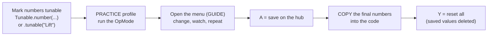

# Tuning while the robot runs

Tuning (PID gains, positions, servo angles, speeds) takes many small changes. Rebuilding and
reinstalling for each one takes 2 minutes. The tuning menu changes numbers **while the robot runs**,
from the gamepad.

## The workflow



Steps 5 and 6 matter: **the code is the record.** A value saved only on the hub is lost with a new
Control Hub, invisible to teammates, and easy to forget at an event (the INIT screen warns you).

## 1. Make numbers tunable

The easy way, on mechanisms:

```java
PositionMotor lift = PositionMotor.create(hardwareMap, "lift")
        .pid(0.004, 0, 0.0002, 0.05)
        .position("DOWN", 0).position("HIGH", 2400)
        .tunable("Lift");          // "Lift/kP".."Lift/kF", "Lift/DOWN", "Lift/HIGH"

PositionServo claw = PositionServo.create(hardwareMap, "claw")
        .position("OPEN", 0.2).position("CLOSED", 0.75)
        .tunable("Claw");          // "Claw/OPEN", "Claw/CLOSED"
```

Any other number:

```java
static final Tunable SLOW_SPEED = Tunable.number("Drive/slow", 0.35, 0.05).range(0.1, 1.0);
...
double speed = slowMode ? SLOW_SPEED.get() : 1.0;     // read it EVERY loop
```

A PID controller you made yourself: `PidTunables.of("Arm", kP, kI, kD, kF).applyTo(pid)` every loop.

## 2. Add the menu to the TeleOp

```java
TuningMenu tuning = new TuningMenu(gamepad1);
controls.bindPress(Pad.G1, Btn.GUIDE, tuning::toggle);
// loop:
tuning.update();
if (tuning.isOpen()) {
    tuning.addTelemetry(t);
    // and do NOT drive with gamepad1 while it is open
}
```

The starter kit's `MainTeleOp` already has it.

## 3. Use it

| Button | Does |
| --- | --- |
| GUIDE (or whatever you bound) | open / close |
| D-pad up / down | choose |
| D-pad right / left | +/- one step (hold a bumper: x10) |
| A | save all on the hub |
| X | the chosen one back to the code value |
| Y | ALL back to the code values, saved values deleted |

Changed values show the code value next to them: `Lift/kP = 0.0050  (code 0.004)`.

## Optional: FTC Dashboard

[FTC Dashboard](https://acmerobotics.github.io/ftc-dashboard/) shows graphs and lets you change
`public static` fields from a laptop browser. Your team used it in 2025-26. It is added in the
robot project (not this library): add its Maven repository and dependency to
`build.dependencies.gradle`, then put `@Config` on a class with `public static` fields. It works
alongside the tuning menu; use whichever is easier for the job (graphs: Dashboard; at the field
without a laptop: the menu).
