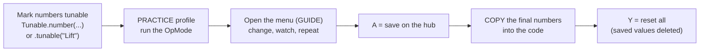

# Tuning while the robot runs

> **Work in progress:** this library and its docs are still changing. Something wrong or unclear? [Tell us](https://github.com/crossbotics/ftc-helper-lib/issues/new/choose).

**For:** students who adjust numbers on a running robot. **You need:** a robot whose mechanisms work,
and the PRACTICE [profile](profiles.md) (the menu stays closed in COMPETITION).

Tuning (PID gains, positions, servo angles, speeds) takes many small changes. Rebuilding and
reinstalling for each one takes 2 minutes. The tuning menu changes numbers **while the robot runs**,
from the gamepad.

## The workflow



To FIND a number the first time (servo ends, lift limits, flywheel gains, wheel size, shot table),
use the [finders](finders.md): they measure it and show the code line. This menu is for adjusting
numbers you already have.

Steps 5 and 6 matter: **the code is the record.** A value saved only on the hub is lost with a new
Control Hub, invisible to teammates, and easy to forget at an event (the INIT screen warns you). B in the
menu lists the changed values as lines to copy. A save cannot leave a half-written file: it writes a new
file and swaps it in, so a power cut keeps either the old values or the new ones.

With the [robot in five files](../modules/robot.md#tunablesjava) there is nothing to set up: the
parts' numbers and every number in your own sections (like `Tunables.Auto`) are in the menu already.
Always copy a good tuned value back into `Tunables.java`: the code is the record.

## 1. Make numbers tunable

The easy way, on mechanisms:

```java
PositionMotor lift = PositionMotor.create(hardwareMap, "lift")
        .pid(0.004, 0, 0.0002, 0.05)
        .position("DOWN", 0).position("HIGH", 2400)
        .tunable("Lift");          // "Lift/kP".."Lift/kF", "Lift/DOWN", "Lift/HIGH"

PositionServo claw = PositionServo.create(hardwareMap, "claw")
        .position("OPEN", 0.2).position("CLOSED", 0.75)
        .tunable("Claw");          // "Claw/OPEN", "Claw/CLOSED"
```

Any other number. `static final` makes one `Tunable` for the whole program, made once (the menu still
changes its value):

```java
// (menu name, value in the code, change per D-pad press), kept between 0.1 and 1.0
static final Tunable SLOW_SPEED = Tunable.number("Drive/slow", 0.35, 0.05).range(0.1, 1.0);
...
double speed = slowMode ? SLOW_SPEED.get() : 1.0;     // read it EVERY loop
```

A PID controller you made yourself: `PidTunables.of("Arm", kP, kI, kD, kF).applyTo(pid)` every loop.

## 2. Add the menu to the TeleOp

The menu uses gamepad 1's D-pad, A, X, Y and bumpers. So give the menu key its own small button
list, and pause the driver's gamepad-1 buttons (and sticks) while the menu is open:

```java
TuningMenu tuning = new TuningMenu(gamepad1);
ControllerBindings menuKey = new ControllerBindings().bindPress(Pad.G1, Btn.GUIDE, tuning::toggle);   // tuning::toggle = run toggle() on press
ControllerBindings driver = new ControllerBindings()...;     // gamepad 1 buttons
ControllerBindings operator = new ControllerBindings()...;   // gamepad 2 buttons (keep working)
boolean menuWasOpen = false;   // was the menu open last loop?
// loop:
menuKey.update(gamepad1, gamepad2);
operator.update(gamepad1, gamepad2);
tuning.update();               // the menu reads gamepad 1 (only while open)
if (tuning.isOpen()) {
    menuWasOpen = true;
    tuning.addTelemetry(t);                                   // and ignore gamepad 1's sticks
} else {
    if (menuWasOpen) driver.ignoreHeldButtons(gamepad1, gamepad2);   // a button held from the menu does not fire
    menuWasOpen = false;
    driver.update(gamepad1, gamepad2);
}
```

Otherwise pressing Y in the menu ("reset all") would ALSO do whatever Y does for the driver.

The starter kit's `MainTeleOp` already has it.

## 3. Use it

| Button | Does |
| --- | --- |
| GUIDE (or whatever you bound) | open / close (a Controls.java TeleOp, after START: hold GUIDE 1 s; a tap shows the button map) |
| D-pad up / down | choose |
| D-pad right / left | +/- one step (hold a bumper: x10) |
| A | save all on the hub |
| X | the chosen one back to the code value |
| Y | ALL back to the code values, saved values deleted |
| B | the changed values as lines to copy into `Tunables.java` (also in the robot log, tag `ftc-helper`); B again: the list |

Changed values show the code value next to them: `Lift/kP = 0.0050  (code 0.004)`.

**The battery.** The menu shows the battery's voltage, and warns below 12.5 V. Each change notes the
battery: the copy lines say `Lift: kF = 0.06   // tuned at 12.7 V`. Copy that note into
`Tunables.java` too. **Why:** numbers that set a power (a hold power, a drive gain) are right only for
about the battery they were tuned on: tuned on a low battery, they are too strong on a charged one.
Tune on a charged battery (12.5 V or more).

## Optional: FTC Dashboard (practice only)

> **Not at events (2026-27 rule R704.D):** the game manual bans "additional logging/streaming
> services, such as those hosted by third party plugins and tools such as FTC Dashboard, FTControl
> Panels, and others". Only the Driver Station app may stream telemetry. Use these tools at home and
> in practice only, and **take them out of the robot project before an event** (remove or comment out
> their Gradle lines, then build and install again). The library's own tuning menu works through the
> Driver Station, so it is allowed.

[FTC Dashboard](https://acmerobotics.github.io/ftc-dashboard/) shows graphs and lets you change
`public static` fields (settings that belong to the class, not to one object) from a laptop browser. Your team used it in 2025-26. It is added in the
robot project (not this library): add its Maven repository and dependency (where to download it,
and its name and version) to `build.dependencies.gradle`, then put `@Config` on a class with `public static` fields. It works
alongside the tuning menu; use whichever is easier for the job (graphs: Dashboard; at the field
without a laptop: the menu).
