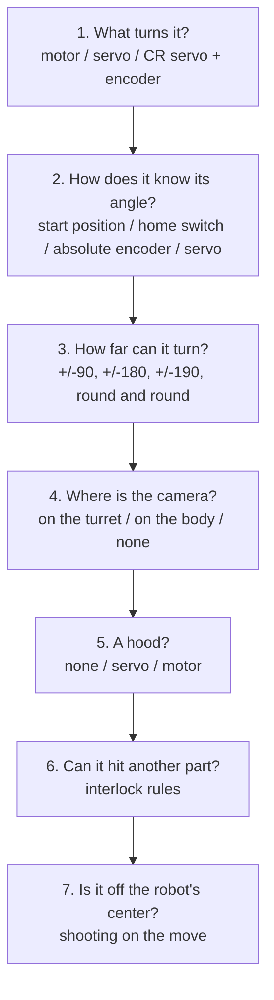

# Setting up a turret

> **Work in progress:** this library and its docs are still changing. Something wrong or unclear? [Tell us](https://github.com/crossbotics/ftc-helper-lib/issues/new/choose).

Teams build turrets in many ways. Answer the seven questions below about yours. Each answer gives
you the exact line for `Robot.java` and the lines for `Tunables.java`. A summary table,
four complete examples, how to find each number, what the INIT screen shows, and common mistakes follow.

Reference: [Turret in the robot module](../reference/parts/turret.md). The lesson that builds a shooter
with a turret: [Add a launcher](../add-to-robot/05-launcher.md). Signs: angles are in degrees,
**0 = straight forward, counterclockwise (to the left, seen from above) is +** ([conventions](../conventions.md)).



## 1. What turns it?

| What turns it | `Robot.java` | Notes |
| --- | --- | --- |
| A motor (its own encoder counts the angle) | `Turret.motor("turret", "gobilda-5203-117").gearRatio(5)` | `gearRatio` = motor turns per turret turn (gears or belt). The motor id is from the [parts catalog](parts-catalog.md). |
| A standard servo (goes to an angle by itself) | `Turret.servo("turret")` | No encoder, no PID, no homing. A goBILDA 2000 servo turns 270 degrees on the hub's normal signal, and 300 with `.fullRange()`. For a smaller turret range, gear it. |
| A continuous-rotation (CR) servo + an encoder on a motor port (for example REV Through Bore) | `Turret.crServo("turret").encoder("turret_enc", 8192)` | 8192 = the Through Bore's counts per turn. The port may also run another part's motor: the turret only reads its count, and never resets it. `gearRatio` = ENCODER turns per turret turn (1 = on the turret's axis). |
| A CR servo + an absolute encoder on an analog port (for example an Axon's feedback wire) | `Turret.crServo("turret").analogEncoder("turret_pos")` | It knows its angle at once, at INIT. |

Options for every kind: `.reversed()` flips it when positive power turns it clockwise. For a CR servo,
`.encoderReversed()` flips the encoder when it counts down while the turret turns counterclockwise.

**Tunables for a motor or CR servo turret** (the PID that turns it to an angle):

```java
public static class Turret {
    public static double kP = 0.02, kI = 0, kD = 0.001;          // the turning (tutorial 07 explains PID)
    public static double maxPower = 0.8, tolerance = 1.0;        // tolerance: "aimed" within this many degrees
    public static double slowZone = 10, slowZonePower = 0.25;    // slow down within 10 deg of a limit
}
```

**Tunables for a servo turret** (two measured points and the travel time):

```java
public static class Turret {
    public static double posA = 0.10, angleA = -90;   // servo position 0.10 points the turret at -90
    public static double posB = 0.90, angleB = 90;    // servo position 0.90 points it at +90
    public static double travelSec = 0.6;             // seconds from posA to posB (time it)
    public static double tolerance = 1.0;
}
```

## 2. How does it know its angle?

A motor's encoder counts from where it was at INIT, so the turret must learn where "0" is. Pick one way:

| How | `Robot.java` | `Tunables.Turret` | Homing at ▶ (start)? |
| --- | --- | --- | --- |
| **Start position** (no switch): you put it there by hand before INIT | nothing extra | `startAngle = 0` (the default: straight forward) | no |
| **Home switch**: a touch sensor or a magnetic switch | `.homeSwitch("turret_home")` | `homeAngle = 45` (needed), optional `homeDirection = 1`, `homingPower = 0.2`, `homingTimeout = 5` | yes, slowly |
| **Absolute encoder** (CR servo turret) | `.analogEncoder("turret_pos")` | `encoderOffset = 117` (its reading, 0 to 360, with the turret at 0) | no |
| **Servo** | `Turret.servo(...)` | `posA`, `angleA`, `posB`, `angleB`; optional `startAngle`. A servo cannot say where it is, so at ▶ the library sends it to `startAngle` (default: the middle of its range) | no |

**Start position.** Make a mark (or a small printed jig) that holds the turret at `startAngle`. Put it
there before every INIT. When it is somewhere else, every angle is off by the difference, and the
turret aims 20 degrees wide with no warning. The INIT screen says `Turret : startAngle 0 deg: put the turret
there by hand before INIT, or every angle is off`.

**Home switch.** Either kind works, and the library finds which one you have:

- a touch sensor (for example REV Touch Sensor) configured as **REV Touch Sensor**;
- a magnetic switch (for example REV Magnetic Limit Switch, with a magnet on the turret) configured as a
  **Digital Device**. It reads LOW near the magnet, and the library knows this.

Homing happens at **▶** (start on the Driver Hub), never in INIT. The library never moves anything before ▶, for safety.
The game rules also want the robot standing still once INIT is done (G304.H). At ▶, when the switch is not closed already, the turret turns slowly
(`homingPower`) toward it, and the Driver Station says `homing: looking for the switch`. A turret that
starts ON the switch is homed at once, with no turning and no "looking" line. It turns from `startAngle` toward
`homeAngle`, or the way `homeDirection` says (+1 = counterclockwise, -1 = clockwise).
When the switch closes, the turret is at `homeAngle`. Following the goal and "aimed" wait until then.
A broken switch must not wind up the wires. So when the turret does not find the switch within `homingTimeout` seconds, it stops, and the Driver Station says
`homing failed: switch not found`. After homing, the library sets the angle right again **every time
the turret passes the switch**. This fixes encoder drift (a slipping belt)
during the match. When the configuration has no such switch, the INIT screen says `NO home switch`, and the turret uses the
start angle.

**How to find `homeAngle`:** without the `homeSwitch` line, put the turret at `startAngle` (straight
forward). INIT, press ▶, and turn it with the stick until the switch clicks (or the magnetic switch's
light comes on). Read the angle on the Driver Station (`Turret : 43 deg`). That is `homeAngle`.
Then add the line.

**Absolute encoder.** To find `encoderOffset`, put the turret straight forward, INIT, and read the encoder's
degrees. You can also set `encoderOffset = 0` and read the turret's angle: that number is the offset. A geared
encoder (`gearRatio` more than 1) repeats every `360 / gearRatio` turret degrees. So the turret must start
within half of that of `startAngle`.

### From autonomous to TeleOp

TeleOp's INIT starts the encoder again, but the turret is wherever autonomous left it. So the library
remembers each turret's angle at the end of every program, until the robot app restarts and for at most
5 minutes. **TeleOp starts from that angle**, and does not home again. The INIT screen says
`Turret : -37 deg, carried from the last program (12 s ago ...)`. Autonomous never uses it, because the drive team
placed the robot by hand. This works for a TeleOp started again too (stopped and INIT again, no autonomous
between). **When someone turned the turret by hand between programs:** restart the robot app, or set
`public static boolean keepAngle = false;` in `Tunables.Turret`.

**Nothing carried over** (the robot app restarted, more than 5 minutes passed, or a program's turret never
finished homing): with no switch, the turret starts from `startAngle`, and TeleOp's INIT says so:
`no angle from a program before: turn it to startAngle 0 deg by hand and INIT again`. Do it. If you do not,
the angle on the Driver Station is off by however far someone turned the turret. In a test, it said 4 degrees
while the turret pointed at -12. A home switch avoids this, because it finds the real angle at ▶.

## 3. How far can it turn?

**Any range works.** Write your own `min` and `max` in degrees. The only rule is that `max` is more
than `min`. They do not have to match: `min = -30, max = 250` is fine, and so is a range of more than
one turn. The rows below are only examples.

| Example range | `Robot.java` | `Tunables.Turret` | What it does |
| --- | --- | --- | --- |
| A quarter turn each way | nothing extra | `min = -90, max = 90` | for a goal past a limit, it waits at the limit, and the Driver Station says `goal out of turret range` |
| Half a turn each way | nothing extra | `min = -180, max = 180` | every direction once. It never turns through the back to get there |
| A bit more than a turn | nothing extra | `min = -190, max = 190` | **the safe way round**: it has two ways to point at 175 (175 or -185). It picks the one closest to where it points that does not pass a limit |
| Round and round (a slip ring carries the wires) | `.continuous()` | no `min`/`max` | no limits, always the shortest way, never "out of range". The Driver Station shows -180 to 180 |

`min` and `max` are your wires' limits: never more than the turret can turn without pulling a cable.
Put a hard stop there too, because software is not a hard stop. A servo turret's range is between `angleA` and
`angleB` (or `min`/`max`, when they are narrower).

## 4. Where is the camera?

| Camera | `Robot.java` |
| --- | --- |
| On the turret (turns with it) | `.follows(camera)` |
| On the robot's body | `.follows(camera).cameraOnBody()` |
| None: aim from where the robot is ([odometry](../add-to-robot/09-odometry.md)) | `.followsOdometry()` with `Tunables.Aim.goalX, goalY` |

`follows` turns follow mode on at ▶ (operator BACK switches it). With odometry and the goal point,
the odometry takes over while the camera does not see the goal ([Aim](../reference/parts/aim.md)).
A camera beside the launcher needs `cameraOffset` (Tunables.Turret): the goal's bearing in the camera's picture when the launcher points
straight at the goal. Find it with the Aim Tuner ([finders](../tuning/README.md)).

## 5. A hood?

| Hood | `Robot.java` (in the launcher line) | Tunables |
| --- | --- | --- |
| None | nothing | - |
| A servo | `.hood(Hood.servo("hood"))` | `Tunables.Hood`: `posA`, `posB` (hard stops), optional `angleA`, `angleB`, `travelSec` |
| A motor | `.hood(Hood.motor("hood", "gobilda-5203-117"))` | `posA`, `posB` in ticks, ... |

The shot table's third column is the hood angle ([Hood](../reference/parts/hood.md)). The Hood Finder finds
its stops. The hood belongs to the launcher, so it works the same with or without a turret.

## 6. Can it hit another part?

When a lift, an arm or a climber is in the turret's path, write an **interlock rule** in `Robot.java`, with the
zones in `Tunables.java`. While the lift is up, the turret stays out of the back, and the other way
round. See [Two parts that must not collide](interlocks.md). The rule pairs the turret with the
part that really reaches it. The [v2bot example](../../examples/src/main/java/com/crossbotics/ftchelper/examples/v2bot/Robot.java)
uses `keepApart("TurretClaw", turret.zone(), wrist.zone())`, because its claw is in the turret's way only
while the wrist is low, at any lift height.

```java
keepApart("TurretLift", turret.zone(), lift.zoneAbove());          // Robot.java

public static class TurretLift {                                    // Tunables.java
    public static double turretFrom = 109, turretTo = 239;          // degrees: the turret's zone
    public static double liftAbove = 270;                           // counts: the lift's zone
}
```

## 7. Is it off the robot's center?

Shooting while driving leads the shot for the robot's speed. When the turret (or the camera) is not on
the robot's center, give the offsets in `Tunables.Aim` ([Aim: shooting on the move](../reference/parts/aim.md)).
A turret that follows the odometry assumes that it turns about the robot's center.

## Summary

**Required** means INIT stops without it. Every other number has a default. In PRACTICE, INIT's
`Library starting values` line names a number written `DEFAULT`. The robot log has every value, and the tuning menu shows each one. The defaults are safe for a first test, but they do not fit your robot. Write
`min` and `max` for your wires and hard stops (default -90 to 90). Write `encoderOffset` for an absolute
encoder (default 0, so the turret would think it starts straight forward).

| You have | `Robot.java` | `Tunables.Turret`: required | Write too (defaults) | Homing |
| --- | --- | --- | --- | --- |
| Motor, no switch | `Turret.motor(name, motorId).gearRatio(r)` | nothing | `min`, `max` (-90, 90), `startAngle` (0, or the middle when 0 is outside `min` to `max`) | none: start it at `startAngle` |
| Motor + touch or magnetic switch | `... .homeSwitch("turret_home")` | `homeAngle` | `min`, `max` (-90, 90) | at ▶ |
| Motor, slip ring | `... .continuous()` | nothing | `startAngle` (0) | none, or a switch |
| Servo | `Turret.servo(name)` | `posA`, `angleA`, `posB`, `angleB` | `travelSec` (0.6), `startAngle` (the middle of its range) | none: sent to `startAngle` (or its middle) at ▶ |
| CR servo + Through Bore | `Turret.crServo(name).encoder(port, 8192)` | nothing | `min`, `max` (-90, 90), `startAngle` (0) | none, or a switch |
| CR servo + absolute encoder | `Turret.crServo(name).analogEncoder(port)` | nothing | `min`, `max` (-90, 90), `encoderOffset` (0) | none |

## Four complete examples

**A. Team 8938's turret (motor, magnetic home switch, servo hood).** A 312 RPM goBILDA motor turns a
goBILDA Gear-Driven Turret bearing (2.75 motor turns per turret turn). A REV Magnetic Limit Switch marks
one angle. The hood is a servo. The [v2bot example](../../examples/src/main/java/com/crossbotics/ftchelper/examples/v2bot/Robot.java)
has the whole robot.

```java
// Robot.java
turret = add(Turret.motor("turret", "gobilda-5203-312").gearRatio(2.75).homeSwitch("turret_home").follows(camera));
launcher = add(Launcher.flywheel("launcher", "gobilda-5203-6000").feeder(Indexer.servo("indexer").part("gobilda-2000-speed"))
        .hood(Hood.servo("hood").part("gobilda-2000-torque")).speedFromDistance(camera).requireReady("turret aimed", () -> turret.isAimed()));

// Tunables.java
public static class Turret {
    public static double min = -190, max = 190, homeAngle = 0;   // switch closes facing forward: measure your own
    public static double kP = 0.02, kI = 0, kD = 0.001, maxPower = 0.8, tolerance = 1.5;
}
public static class Hood {
    public static double posA = 0.20, posB = 0.65, angleA = 0, angleB = 25, travelSec = 0.45;
}
```

Where the turret's numbers come from (turret v8.1GB): its range is -190 to +190, a bit more than one
turn. So it can point anywhere, and it picks the way round that stays inside the range. The design's checks
turn it +/-190 without pulling the wires. The switch (REV-31-1462) sits at -45 degrees on the bearing
housing, and its magnet at -45 degrees on the turret. So they line up when the turret points straight
forward: `homeAngle = 0`. Measure your own ([How to find `homeAngle`](#2-how-does-it-know-its-angle)).

**B. A servo turret, +/-90, no hood.** It is light and simple, with no encoder and no homing.

```java
// Robot.java
turret = add(Turret.servo("turret").follows(camera));
launcher = add(Launcher.flywheel("launcher", "gobilda-5203-6000").feeder(Indexer.servo("indexer").part("gobilda-2000-speed"))
        .speedFromDistance(camera).requireReady("turret aimed", () -> turret.isAimed()));

// Tunables.java
public static class Turret {
    public static double posA = 0.17, angleA = -90, posB = 0.83, angleB = 90, travelSec = 0.5;
}
```

**C. A slip-ring turret with an absolute encoder.** A CR servo turns it round and round. An encoder on
its axis says where it is at once.

```java
// Robot.java
turret = add(Turret.crServo("turret").analogEncoder("turret_pos").continuous().follows(camera));

// Tunables.java
public static class Turret {
    public static double encoderOffset = 117;                       // the reading with the turret forward
    public static double kP = 0.015, kI = 0, kD = 0, maxPower = 1.0, tolerance = 2;
}
```

**D. No turret: the whole robot turns.** The shooter is fixed. While the driver holds a button, the drive turns the robot toward the goal
([Aim](../reference/parts/aim.md)).

```java
// Robot.java: no turret line
launcher = add(Launcher.flywheel("launcher", "gobilda-5203-6000").feeder(Indexer.servo("indexer").part("gobilda-2000-speed"))
        .speedFromDistance(camera).requireReady("aimed", () -> aimMode().isOn() && aim().isAimed()));

// Controls.java
g1.rb.toggle(robot.aimMode()).says("aim at the goal");
```

## How to find each number

| Number | How |
| --- | --- |
| `gearRatio` | count the teeth: turret gear / motor gear (a 20T pinion on a 100T ring = 5) |
| `min`, `max` | turn the turret by hand to where the wires are tight, both ways. Take a few degrees less |
| `startAngle` | where your mark or jig holds it (0 = straight forward is the easiest) |
| `homeAngle` | turn it to the switch and read the angle ([above](#2-how-does-it-know-its-angle)) |
| `posA`, `posB`, `angleA`, `angleB` (servo) | the [Servo Finder](../tuning/README.md): two positions, and the angle at each (a phone angle app) |
| `travelSec` (servo) | time a move from posA to posB |
| `kP`, `kD`, `tolerance` | the tuning menu ([tuning](../tuning/16-live-tuning.md)). Copy the values back into `Tunables.java` |
| `cameraOffset` | the Aim Tuner ([finders](../tuning/README.md)) |
| `encoderOffset` | the reading with the turret straight forward |

## What the INIT screen shows

- `Turret : startAngle 0 deg: put the turret there by hand before INIT, or every angle is off` (autonomous)
- `Turret : no angle from a program before: turn it to startAngle 0 deg by hand and INIT again, or every
  angle is off` (a TeleOp with nothing carried over: the robot app restarted, more than 5 minutes, or
  `keepAngle = false`)
- `Turret : home switch at 0 deg: found when ▶ is pressed` and `Turret homing : when ▶ is pressed it turns clockwise slowly to find the switch`
- `Turret : -37 deg, carried from the last program (12 s ago; keepAngle = false to turn this off)`
- `Turret : absolute encoder: 31 deg (encoderOffset 117)`
- After ▶, while homing: `Turret : homing: looking for the switch`; then `Turret : 12 deg following: camera`.
- With interlock rules: `Interlock TurretLift: Turret between 109 and 239 deg / Lift above 270 counts`.

## Common mistakes

- **The turret turns the wrong way** (+ power turns it clockwise): add `.reversed()`. When a CR servo's
  encoder counts the wrong way, add `.encoderReversed()`. Check with the stick: right = clockwise.
- **Every angle is off by the same amount**: it was not at `startAngle` at INIT. Use a mark or a jig,
  or add a home switch.
- **Homing turns the wrong way and stops with "switch not found"**: set `homeDirection` (+1 or -1).
- **`homeAngle` outside `min`..`max`**: the switch must be inside the range that the turret may turn.
- **The angle drifts during a match**: a belt slips. A home switch fixes it at every pass.
- **A slip-ring turret with `min`/`max`**: `continuous()` ignores them. Remove them, so nobody is confused.
- **The turret is aimed, but the shots go wide by the same angle**: a camera beside the launcher needs
  `cameraOffset`.
- **TeleOp starts with the wrong angle after someone turned the turret by hand**: restart the robot app,
  or set `keepAngle = false`.

## In the simulator

`./gradlew :sim:fromRobot` writes every kind into the simulator robot file:

- a motor turret, with its home switch as `touch.turret_home = turret, at=..., width=...`;
- a slip-ring turret (`motor ... = free`);
- a servo turret (a `turret` shape on the servo);
- a CR servo turret. Its encoder is a `motor.... drivenBy=turret` line that the CR servo turns. An absolute encoder is `analog.turret_pos = ...`.

See the [simulator guide](../simulator/README.md).
