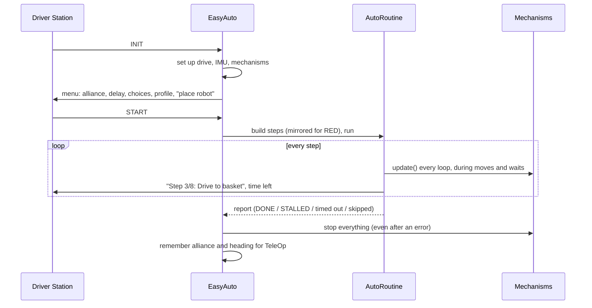

# Auto module

> **Work in progress:** this library and its docs are still changing. Something wrong or unclear? [Tell us](https://github.com/crossbotics/ftc-helper-lib/issues/new/choose).

Package: `com.crossbotics.ftchelper.auto`

Learn it hands-on: [16 Easy autonomous](../tutorials/16-easy-autos.md). Full guide: [Easy autonomous modes](../guides/easy-autos.md).

Write an autonomous (the 30 seconds when the robot drives itself) as a list of named steps. The
library runs the steps in order, keeps your mechanisms working, flips the route for the RED alliance,
and keeps time to park. Using the [robot in five files](robot.md#auto)? Its `Auto` class is built on
this one, so start there. Use this page when you write an autonomous without five files.

| Class | Use it to |
| --- | --- |
| [`EasyAuto`](#easyauto) | write a whole autonomous OpMode: fill in a few methods, list the steps |
| [`AutoRoutine`](#autoroutine) | hold the list of steps and run them |
| [`AutoStep`](#autostep) | write one step of your own (mechanisms give you ready-made ones) |
| [`AutoContext`](#autocontext) | wait inside a step while mechanisms keep working |



---

## EasyAuto

Extend it and fill in:

| Method | Required? | What you return / do |
| --- | --- | --- |
| `robotConfig()` | yes* | `new RobotSettings()`: the [`RobotConfig`](core.md#robotconfig) shared with TeleOp |
| `buildRoutine(r)` | yes | add the steps; runs AFTER INIT, so choices are known |
| `createSubsystems()` | no | your mechanisms (kept working during every step). Make new objects here: it runs again if the profile is changed in INIT. |
| `addChoices(menu)` | no | extra INIT choices: `menu.choice("Route", "Near", "Far")` |
| `addInitTelemetry(t)` | no | extra screen lines during INIT |
| `startPosition()` | no | where to place the robot, shown in INIT |
| `startHeadingDeg()` | no | which way the robot faces at the start, in degrees from "facing away from your driver" (default 0). Write it for BLUE: it is mirrored for RED, unless `mirrorForRed()` returns false. TeleOp's field-centric "forward" uses it. |
| `parkReserveSec()` | no | seconds kept for the steps after `thenPark()` |
| `maxStartDelaySec()` | no | longest start delay in the menu (default 10) |
| `mirrorForRed()` | no | true (default): routes written for BLUE are mirrored for RED. Return false on a ROTATED field |
| `alliancesOnOneWall()` | no | false (default): BLUE's drivers stand at the far wall (BIOBUZZ). Return true when both alliances' drivers stand at one wall (DECODE). The simulator's start spot uses it |

\* Or, without a `RobotConfig`: override `driveConfig()`, `autoDriveConfig()` and `createImu()`.

Inside your steps you can use `alliance()`, `choice(label)` and `autoDrive()`.

Add `preselectTeleOp = "Main TeleOp"` to the `@Autonomous` line so the Driver Station picks
your TeleOp after autonomous.

## AutoRoutine

| Step | What it does |
| --- | --- |
| `move(label, inches, direction, power)` | drive (0 forward, 90 right, 180 back, -90 left) |
| `turn(label, degrees, power)` | turn by (positive = left) |
| `turnTo(label, heading, power)` | turn to a heading (0 = start direction) |
| `moveWithTurn(label, inches, fieldDir, heading, power, turnPower)` | drive and turn together (mecanum) |
| `driveTo(label, pose, ready, x, y, heading, power, tolerance)` | drive to a field point with odometry (mecanum); the five-files `Steps.driveTo` fills in the pose for you ([odometry](odometry.md#driveto)) |
| `followPath(label, pathJob, timeoutSec[, events])` | follow a path another library drives, e.g. Pedro; `PathJob` is its small plug (start, busy, ready, distance left, cancel; optional: `totalIn()`, `partNow()`). `events`: a list of `PathEvent`s, each fired once when the robot gets to its place; the report lists those that did not fire (`STALLED, not fired: Spin up`). The five-files `Steps.follow` makes both for you ([pedro](pedro.md#do-things-along-the-path)) |
| `driveTo(label, pose, ready, x, y, heading, power, tolerance, events)` | `driveTo` with `PathEvent`s on the way: the "path" is the straight line from where the step starts |
| `rememberHeading(label)` / `returnToHeading(label, power)` | come back to a saved heading |
| `run(label, code)` | run code at once, continue (e.g. `claw::open`) |
| `waitFor(label, seconds)` | wait; mechanisms keep working |
| `waitUntil(label, condition, timeout)` | wait for something, with a time limit |
| `step(label, autoStep)` | a mechanism's step (`lift.goToStep("HIGH")`) or your own |
| `thenPark()` | the steps after this always get their time |

| Setup / running | What it does |
| --- | --- |
| `new AutoRoutine(this)` | for your OpMode (or `new AutoRoutine(isActive, idle, telemetry)` in tests) |
| `.drive(autoDrive)`, `.subsystems(group)`, `.telemetry(t)`, `.timer(timer)` | what it uses |
| `.mirrorFor(alliance)` | flip turns, headings and sideways moves for RED (null = no mirroring, e.g. a rotated field) |
| `.reserveForPark(seconds)` | main steps stop when this much time is left |
| `.beforeDriving(code)` | code to run when a driving step starts (each call adds one); the robot layer ends a path's hold with it |
| `runAll()` | run every step (after `waitForStart()`) |
| `getReport()` | what happened to each step |
| `size()` | number of steps |

On `AutoRoutine`, `waitFor("label", s)` only ADDS a wait step to the list. A wait that happens
right now (`ctx.waitFor(s)`) only exists inside a step, on the `ctx` the step gets. So you cannot
mix the two up. If a step throws an error, the drive stops before the error goes on.

Every move's result goes in the report: `"Drive to basket: STALLED"`, `"Lift up: timed out"`,
`"Wait for lift: cut short (time for park)"`, `"Score: skipped (time for park)"`. Read it after every
practice run.

## AutoStep

An **interface** (a promise that a class has certain methods) with one method,
`run(AutoContext ctx)`. Write your own as a lambda:

```java
// "ctx -> { ... }" is a lambda: code handed to the routine, run when this step's turn comes.
AutoStep shake = ctx -> {
    // 3 times, but quit at once if STOP is pressed or time is up (ctx.isActive() is false)
    for (int i = 0; i < 3 && ctx.isActive(); i++) {
        claw.goTo("OPEN");
        ctx.waitFor(0.15);   // wait 0.15 s; mechanisms keep working (never use sleep())
        claw.goTo("CLOSED");
        ctx.waitFor(0.15);
    }
};
routine.step("Shake loose", shake);
```

Three rules for your own step:

- Return when the step is done.
- In any loop that waits, call `ctx.loop()` (or use `ctx.waitFor` / `ctx.waitUntil`).
- Stop as soon as `ctx.isActive()` is false.

## AutoContext

| Method | What it does |
| --- | --- |
| `isActive()` | false when the OpMode stops or the main time is up |
| `loop()` | one loop: update mechanisms, telemetry, idle |
| `waitUntil(condition, timeout)` | returns true if the condition came true |
| `waitFor(seconds)` | wait, mechanisms keep working |
| `secondsLeft()` | seconds left in autonomous |
| `telemetry()` | add your own lines |
| `note(text)` | put a note on this step's report line instead of "done" (e.g. "timed out") |
