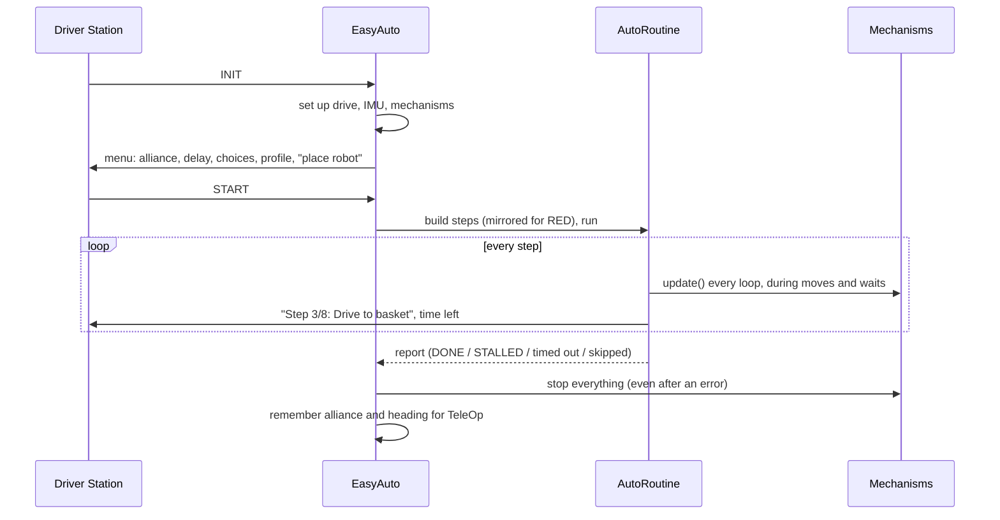

# Auto module

Package: `io.github.jasoncross.ftchelper.auto`

Learn it hands-on: [16 Easy autonomous](../tutorials/16-easy-autos.md). Full guide: [Easy autonomous modes](../guides/easy-autos.md).

Write an autonomous as a list of named steps.

| Class | Use it to |
| --- | --- |
| [`EasyAuto`](#easyauto) | a whole autonomous OpMode: fill in a few methods, list the steps |
| [`AutoRoutine`](#autoroutine) | the step list and the runner |
| [`AutoStep`](#autostep) | one step (an interface; mechanisms give you ready-made ones) |
| [`AutoContext`](#autocontext) | what a running step can use (waits that keep mechanisms working) |



---

## EasyAuto

Extend it and fill in:

| Method | Required? | What you return / do |
| --- | --- | --- |
| `driveConfig()` | yes | the drive settings (same as TeleOp) |
| `autoDriveConfig()` | yes | the autonomous tuning |
| `createImu()` | yes | the IMU for your hub mounting |
| `buildRoutine(r)` | yes | add the steps; runs AFTER INIT, so choices are known |
| `createSubsystems()` | no | your mechanisms (kept working during every step) |
| `addChoices(menu)` | no | extra INIT choices: `menu.choice("Route", "Near", "Far")` |
| `startPosition()` | no | where to place the robot, shown in INIT |
| `parkReserveSec()` | no | seconds kept for the steps after `thenPark()` |
| `maxStartDelaySec()` | no | longest start delay in the menu (default 10) |

Inside your steps you can use `alliance()`, `choice(label)` and `autoDrive()`.

Add `preselectTeleOp = "Main TeleOp"` to the `@Autonomous` line so the Driver Station picks
your TeleOp after autonomous.

## AutoRoutine

| Step | What it does |
| --- | --- |
| `move(label, inches, direction, power)` | drive (0 forward, 90 right, 180 back, -90 left) |
| `turn(label, degrees, power)` | turn by (positive = left) |
| `turnTo(label, heading, power)` | turn to a heading (0 = start direction) |
| `moveWithTurn(label, inches, fieldDir, heading, power, turnPower)` | drive and turn together (mecanum) |
| `rememberHeading(label)` / `returnToHeading(label, power)` | come back to a saved heading |
| `run(label, code)` | run code at once, continue (e.g. `claw::open`) |
| `waitFor(label, seconds)` | wait; mechanisms keep working |
| `waitUntil(label, condition, timeout)` | wait for something, with a time limit |
| `step(label, autoStep)` | a mechanism's step (`lift.goToStep("HIGH")`) or your own |
| `thenPark()` | the steps after this always get their time |

| Setup / running | What it does |
| --- | --- |
| `new AutoRoutine(this)` | for your OpMode (or `new AutoRoutine(isActive, idle, telemetry)` in tests) |
| `.drive(autoDrive)`, `.subsystems(group)`, `.telemetry(t)`, `.timer(timer)` | what it uses |
| `.mirrorFor(alliance)` | flip turns, headings and sideways moves for RED |
| `.reserveForPark(seconds)` | main steps stop when this much time is left |
| `runAll()` | run every step (after `waitForStart()`) |
| `getReport()` | what happened to each step |
| `size()` | number of steps |

Every move's result goes in the report: `"Drive to basket: STALLED"`, `"Lift up: timed out"`,
`"Score: skipped (time for park)"`. Read it after every practice run.

## AutoStep

An interface with one method, `run(AutoContext ctx)`. Write your own as a lambda:

```java
AutoStep shake = ctx -> {
    for (int i = 0; i < 3 && ctx.isActive(); i++) {
        claw.goTo("OPEN");
        ctx.waitFor(0.15);
        claw.goTo("CLOSED");
        ctx.waitFor(0.15);
    }
};
routine.step("Shake loose", shake);
```

Rules: return when done; inside any waiting loop call `ctx.loop()` (or use `ctx.waitFor` /
`ctx.waitUntil`); stop as soon as `ctx.isActive()` is false.

## AutoContext

| Method | What it does |
| --- | --- |
| `isActive()` | false when the OpMode stops or the main time is up |
| `loop()` | one loop: update mechanisms, telemetry, idle |
| `waitUntil(condition, timeout)` | returns true if the condition came true |
| `waitFor(seconds)` | wait, mechanisms keep working |
| `secondsLeft()` | seconds left in autonomous |
| `telemetry()` | add your own lines |
