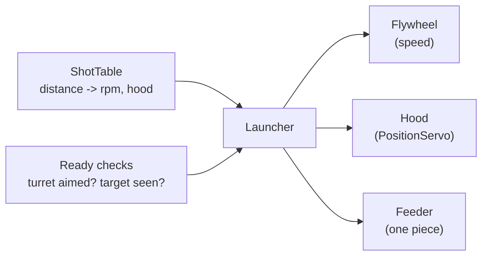
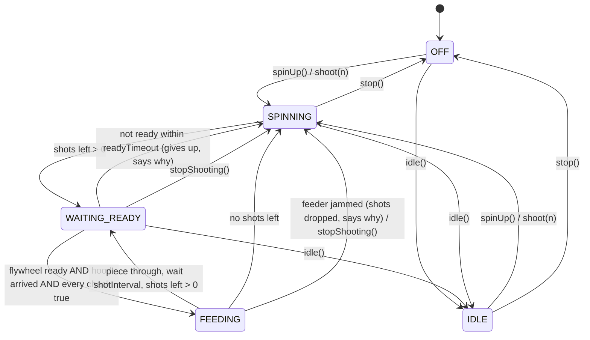
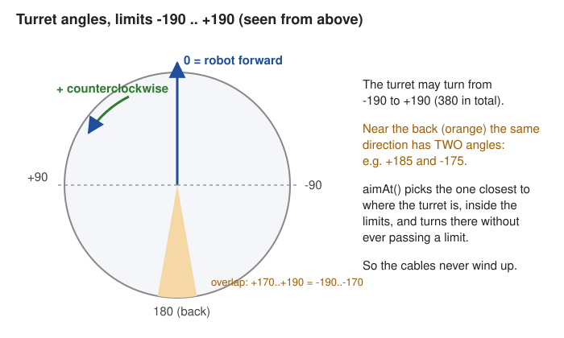

# Launcher module

> **Work in progress:** this library and its docs are still changing. Something wrong or unclear? [Tell us](https://github.com/crossbotics/ftc-helper-lib/issues/new/choose).

Package: `com.crossbotics.ftchelper.launcher`

Learn it hands-on: [17 Launcher](../tutorials/17-launcher.md), [18 Vision aiming](../tutorials/18-vision-aim.md).

Parts for a robot that shoots game pieces. A **flywheel** is a fast-spinning wheel that throws the
piece. A **hood** is a curved plate that a servo tilts to set the shot angle. A **feeder** pushes one
piece into the flywheel. A **turret** turns the shooter to aim. Each part works alone. The
`Launcher` joins them. The [robot in five files](../reference/parts/launcher.md) builds its `Launcher` on
these parts, so start there ([Add a launcher](../add-to-robot/05-launcher.md)). Use this
page to build a shooter by hand (tutorial 17). Speeds are in **RPM** (turns per minute).

| Class | Use it to |
| --- | --- |
| [`Flywheel`](#flywheel) | hold a speed in RPM, say "ready", notice shots |
| [`ShotTable`](#shottable) | look up the RPM and hood angle for a distance, from a few measured shots |
| [`Feeder`](#feeder) | push ONE piece into the flywheel (an interface) |
| [`MotorFeeder`](#motorfeeder) | run a roller or belt feeder |
| [`ServoFeeder`](#servofeeder) | run a kicker-arm feeder |
| [`Turret`](#turret) | aim in degrees, never past its limits, hold a field direction |
| [`Launcher`](#launcher) | spin up, wait until EVERYTHING is ready, feed, repeat |

A hood is any [`AngleDevice`](mechanism.md#angledevice): a [`PositionServo`](mechanism.md#positionservo)
with `degrees(...)`, the five-files [`Hood`](../reference/parts/hood.md) (servo or motor, a linkage table), or your own.



## How a shot happens



The two safety rules: **never feed into a slow flywheel**, and **never wait forever**.

---

## Flywheel

```java
Flywheel flywheel = Flywheel.create(hardwareMap, "flywheel")
        .countsPerRev(28)          // encoder counts per ONE flywheel turn
        .maxRpm(6000)              // the motor's top speed
        .startingGains()           // the hub's speed control (a start)
        .tolerance(75)             // ready within 75 rpm...
        .settleTime(0.15);         // ...for 0.15 s
```

| Method | What it does |
| --- | --- |
| `create(hardwareMap, name)` | coast (a flywheel must spin down freely), speed control on |
| `.reversed()` | spin the other way |
| `.follower(hardwareMap, name, reversed)` | a second motor on the same wheel (same speed command). **It needs its own encoder cable.** If its encoder reads nothing while the wheel spins, the flywheel switches it off and shows a warning. It gets the `pidf` gains whether you call `pidf` before or after it |
| `.countsPerRev(c)` | counts per FLYWHEEL turn. A bare motor at 1:1 = 28. With gears, multiply by the motor turns per wheel turn. A shaft encoder on this motor's port = its counts (REV Through Bore 8192) |
| `.pidf(p, i, d, f)` | the hub's speed gains (PID plus F, a push that grows with the speed; see [PID](control.md#pidcontroller)). No tuned gains yet? Use `startingGains()` (next row). Tune F first, with a charged battery |
| `.startingGains()` | for a wheel with no tuned gains yet. It sets `pidf` from this wheel's `maxRpm` and `countsPerRev` (set them first) with REV's formula: F = 32767 / top counts per second, P = F / 10, I = P / 10, D = 0 (a goBILDA 6000 RPM motor, 28 counts: 1.17, 0.117, 0, 11.70). Then the Flywheel Finder finds your gains |
| `Flywheel.startingPidf(topTicksPerSec)` | that formula: `{P, I, D, F}` (the Flywheel Finder and the robot `Launcher` use it too) |
| `.batteryCompensation(volts, nominalVolts)`, `.noBatteryCompensation()` | F follows the battery ([below](#battery-compensation)); off (the default) |
| `getBatteryVolts()`, `getFScale()`, `hasBatteryCompensation()` | the battery voltage F is scaled for (the highest reading of the last second; NaN if none); what F is multiplied by now (1 = as tuned) |
| `.tolerance(rpm)`, `.settleTime(s)` | when the wheel counts as "ready" |
| `.maxRpm(r)` | the highest speed allowed |
| `.shotDrop(rpm)` | a drop this big after "ready" counts as a shot |
| `setRpm(r)`, `stop()`, `update()` | use. `stop()` and speed 0 COAST, so a fast wheel never brakes hard |
| `isReady()`, `getRpm()`, `getTargetRpm()`, `getMaxRpm()`, `getShotCount()`, `getFault()` | read |
| `spinUpStep(rpm, timeout)` | autonomous step |

**Check your speed reading** before you trust it. The RPM on telemetry must match a tachometer (a
tool that measures spin speed) or a slow-motion video. Very high count rates (a fine encoder at high speed) can read wrong.

### Battery compensation

> **Battery compensation: OFF by default. Nobody has proven it on a real robot yet.** Testing teams: please
> try it and tell us what you see.
> The RPM control already makes up for a low battery by itself, but slowly (the I gain is small).
> Compensation makes that faster. It helps the first shot after spin-up and quick shots in a row. It cannot
> help when the battery is too low for the speed you ask: then the motor is already at full power.
> - **Turn it on:** in the robot in five files, write `public static boolean batteryCompensation = true;` in
>   `Tunables.Launcher` (with `kF` set). With the parts on this page, add `.batteryCompensation(...)` as below.
> - **Test it on your robot:** with a battery at about 11.5 V, fire 4 shots in a row. On the Driver Station,
>   compare the launcher's measured RPM with its target. Do it with compensation off, then on. If you see no
>   difference, leave it off. If the wheel overshoots after a battery swap, turn it off and tell us.


```java
Flywheel flywheel = Flywheel.create(hardwareMap, "flywheel").pidf(1.17, 0.117, 0, 11.70)
        .batteryCompensation(Hw.batteryReader(hardwareMap), 12.6);   // 12.6 V: from the Flywheel Finder
```

**Why.** The hub's speed control works in power. F means "this much power for each count per second of
speed". The Flywheel Finder sets F = 32767 / the top speed in counts per second (32767 = full power).
FIRST's motor PIDF tuning guide does the same. Power is a share of the battery's voltage. So the same power
on a weaker battery pushes less, and the wheel runs slower. The P and I gains notice the missing speed and
add power, but I builds up slowly. So with a low battery, the wheel spins up slowly and recovers slowly
after each shot. Shots fired before it recovers go short.

**What it does.** Every 0.25 s the flywheel reads the battery and sends F x (`nominalVolts` / volts). For
example, with gains tuned at 12.6 V, at 11.5 V F is x 1.10 (12.6 / 11.5). Then the wheel gets the same push
as when you tuned it. "volts" is the **highest reading of the last second** (`BATTERY_FILTER_SEC`). The
reason: while the drive or the flywheel pulls hard, the battery dips for a moment and comes back. A dip is
not a weaker battery. A higher F for a dip would push the wheel past its speed when the load ends. A battery
that is truly weaker reads low the whole second, and then the flywheel scales F. Some limits keep it safe:

- The scale stays between 0.8 and 1.3, so a bad reading cannot run the wheel away.
- The flywheel skips a reading outside 7 to 16 V, or NaN (no reading yet, or too old).
- It sends a new F only when F changes by more than 2%, because each send costs loop time.

P and I stay as tuned. `nominalVolts` is the battery voltage when you found the gains. The Flywheel Finder
shows it. Without it, the flywheel uses 12.8 V (`Flywheel.DEFAULT_NOMINAL_VOLTS`, a charged battery under
load). Below 11.5 V the Driver Station warns: `battery 11.2 V: low`. Debug mode shows `flywheel battery: 11.50 V (tuned at 12.6 V), F x1.10`.

**Where the volts come from.** `Hw.batteryReader(hardwareMap)` never waits. It answers with the latest
reading, and it asks the hubs again (at most every 0.25 s) on the library's helper thread. So the loop never
waits for the hubs ([non-blocking](../guides/non-blocking.md)). `() -> Hw.batteryVolts(hardwareMap)` works
too, but then each reading holds up the loop for a few milliseconds.
The robot in five files turns it on when `Tunables.Launcher` has `batteryCompensation = true` and a `kF` ([robot.md](../reference/parts/launcher.md#speed-trim-and-battery-compensation)).

## ShotTable

```java
ShotTable pollen = new ShotTable()
        .add(24, 2600, 6)        // distance in, rpm, hood degrees
        .add(48, 3100, 14)
        .add(72, 3700, 21);
ShotTable.Shot s = pollen.lookup(36);     // 2850 rpm, 10 deg (halfway between 24 and 48)
```

The table draws straight lines between your points, for the speed AND the hood. Outside your points, it
uses the nearest end, so it never guesses beyond what you tested. `add(distance, rpm)` (no hood angle) makes
a table that never moves the hood: `hasHood()` is true only once a point has a hood angle. The hood number
is in the hood's own scale: degrees, or a servo position if your hood works in positions.
`covers(distance)` says whether a distance is inside your points. When game pieces fly differently, make one
table per piece (BIOBUZZ: POLLEN is a 2.8 in ball, NECTAR a 3.6 in ball). Swap tables with `launcher.table(other)`.
To fill a table, follow [tutorial 17](../tutorials/17-launcher.md#4-fill-the-shot-table). In the robot in five
files, each `speedByDistance...` line in `Tunables.Launcher` is one table. Your code picks one by name with
`robot.launcher.useTable("nectar")` ([robot.md: Launcher](../reference/parts/launcher.md)). The
[Shot Tuner](finders.md) tunes one table at a time.

## Feeder

An interface (a list of methods a class promises to have): `feedOne()`, `isBusy()`, `update()`, `stop()`,
and optional `isJammed()` and `clearJam()`. The launcher decides WHEN to feed. The feeder only knows HOW.
For a new feeding mechanism next season, write a class with these methods, and the launcher works with it.
See [Extending](../guides/extending.md).

## MotorFeeder

```java
MotorFeeder feeder = MotorFeeder.create(hardwareMap, "feeder")
        .power(1.0).feedTime(0.25)        // run 0.25 s per piece
        // optional: stop when a sensor sees the piece leave. beam = a beam-break sensor
        // (a DigitalChannel); "!" = not: it reads false while something blocks the beam
        .stopWhen(() -> !beam.getState())
        .jamDetection(60, 0.2);           // optional (encoder cable)
```

A jam stops the launcher's remaining shots. The next `shoot(...)` clears the jam and tries again. The
feeder still detects a new jam. So the driver clears the piece, then presses shoot again.

## ServoFeeder

```java
ServoFeeder kicker = ServoFeeder.create(hardwareMap, "kicker")
        .positions(0.15, 0.60)            // rest, push
        .times(0.15, 0.15);               // push time, return time
```

`goToRest()` moves the arm to rest. Call it in INIT only if that is safe. `withServo(other, trim)` adds a
second servo that moves with the first, for two arms, one on each side. It goes to the same positions plus
`trim` (a raw servo position; `() -> 0` for none). Set its direction yourself: REVERSE when it faces the first.

## Turret

```java
Turret turret = Turret.create(hardwareMap, "turret")
        .countsPerDegree(1479 / 360.0)    // encoder counts per turret turn / 360. ".0": a
                                          // decimal result (1479 / 360 alone would drop it)
        .limits(-190, 190)                // degrees; it never turns past these (cables!)
        .homeSwitch(hardwareMap, "turret_home", 45)   // the switch closes at 45 degrees
        .pid(0.02, 0, 0.001, 0)           // kP, kI, kD, kF on the angle in degrees
        .tolerance(1.0);                  // within 1 degree = aimed
```



Angles: 0 = robot forward, **counterclockwise positive** (like the IMU). Positive power must turn the
turret counterclockwise. If it turns the other way, add `.reversed()`.

| Method | What it does |
| --- | --- |
| `.countsPerDegree(c)` | encoder counts per turret degree (motor counts x gear ratio / 360) |
| `.limits(min, max)` | the allowed range. It may be more than 360 in total (for example -190..190) |
| `.startAngle(deg)` | the angle at power-on, for a turret with no switch. It reads the encoder when you call it, so call it after `countsPerDegree` and `reversed`. A servo turret cannot say where it is, so this is where it counts from before its first command. Send it there when the OpMode starts (▶) with `aimAt(servoStartAngle())` |
| `servoStartAngle()` | a servo turret: `startAngle`, or the middle of its range when you gave none (0 with no limits). Other turrets: `getAngle()`. The stick and `aimBy` start from it before the first command |
| `.homeSwitch(hardwareMap, name, angle)` / `.homeSwitch(reader, angle)` | a switch that closes at a known angle |
| `.homingPower(p)`, `.pid(...)`, `.tolerance(deg)`, `.maxPower(p)`, `.slowZone(deg, power)` | tuning. Before homing, the turret limits manual power to the homing power |
| `.homingTimeout(s)` | homing stops with a fault when it does not find the switch in time (default 5 s) |
| `.maxTargetAgeMs(ms)` | the oldest camera picture `aimAtTarget` uses (default 150) |
| `.cameraOffset(deg)` | for a camera not centered on the launcher: where the target sits in the camera's view when the launcher points at it (left = +). The [Aim Tuner](finders.md#aimtuneropmode) finds it. |
| `aimAt(robotDeg)` | turn to a robot-relative angle, **the safe way round** |
| `aimField(fieldDeg, headingDeg)` | point at a field direction. Call it every loop while the robot turns |
| `aimBy(delta)` | turn by an amount |
| `aimAtTarget(target, cameraOnTurret)` | aim at a camera target. It uses fresh pictures only, each picture once, and holds when there is none |
| `manual(power)` | a stick; 0 holds where it is |
| `home(direction)` | turn slowly toward the switch until it closes. It ends at once when the switch is already closed, and gives a fault after the timeout |
| `addWarnings(t)` | only the warnings of `addTelemetry` (a fault, not homed, out of range), for code that writes its own line (the five files' [Turret](../reference/parts/turret.md) does) |
| `getAngle()`, `getTargetAngle()`, `isAimed()`, `isOutOfRange()`, `isHomed()`, `isHoming()`, `getFault()` | read. `isAimed()` is false for an out-of-range target. It only says whether the turret reached its LAST target. When the goal can get lost (a camera), also check that the camera sees the goal now. The robot in five files' [`Turret.isAimed()`](../reference/parts/turret.md) does |
| `getTolerance()`, `degreesOutOfRange(deg)` | the aimed tolerance; how far past the limits a direction is (0 = it can point there) |
| `aimStep(deg, timeout)` | autonomous step |
| `fence(lo, hi)`, `fence(lo, hi, upPower, downPower)`, `clearFence()`, `isHeld()` | an [interlock rule](../reference/parts/interlock.md) sets these every loop. A target past `lo`..`hi` goes the other way round, or waits at the edge. The caps (0 to 1) limit the power toward each side, so the turret brakes in time |

**The safe way round:** with limits -190..190, 170 and -190 are the same direction. The turret
picks the one inside the limits that is closest to where it is. It turns there without passing a limit,
so cables never wind up. For a direction outside the limits, the turret goes to the nearest limit, and
`isOutOfRange()` is true.

**Homing** means finding a known angle: the turret turns until a switch closes. With a switch, aiming
waits until the turret has seen the switch once (`home(direction)`). When homing does not find the switch
within `homingTimeout`, it stops, and `getFault()` says so. So a broken wire never spins the turret
forever. Without a switch, the turret trusts `startAngle` (default 0): turn the robot on with the turret
facing forward.

## Launcher

The five-files launcher (`robot.Launcher`) adds the speed from the distance and its Tunables (`distanceSmoothSec`,
`lockSpeedWhileFiring`, `ejectFeedSec`, `ejectRpm`): see [Launcher](../reference/parts/launcher.md#in-tunablesjava).

```java
Launcher launcher = new Launcher(flywheel, feeder)
        .hood(hood)
        .table(pollen)
        .requireReady("Turret", turret::isAimed)   // never feed before the turret is aimed
        .shotInterval(0.25)                        // at least 0.25 s between pieces
        .readyTimeout(3);                          // not ready in 3 s: give up, say why
```

| Method | What it does |
| --- | --- |
| `.hood(device)`, `.table(t)` | optional parts: a hood is any [`AngleDevice`](mechanism.md#angledevice) |
| `.hoodDeadband(a)` | the launcher sends the hood a new angle only when the table's angle changes by more than this (default 0.25). So a jittery distance does not keep the hood "moving" |
| `hoodOffset(a)`, `getHoodOffset()` | a hood trim: `setDistance` adds it to the table's hood angle |
| `.requireReady(name, check)` | another condition before each piece (aim, sensor, anything) |
| `.clearReadyChecks()` | removes every `requireReady` check. The Shot Tuner does this, because you aim by hand there |
| `.shotInterval(s)` | the least time between pieces |
| `.readyTimeout(s)` | gives up the remaining shots when the launcher is not ready for this long |
| `.idleRpm(r)` | the speed when not shooting. A low idle speed makes spin-up faster |
| `setRpm(r)` / `setDistance(d)` | sets the shot by hand / from the table. `setDistance` sets the hood too, when the table has hood angles |
| `speedScale(s)`, `getSpeedScale()` | the shot speed x `s` (1.03 = +3%), a live trim for a match. It does not change the idle speed. 1 = as set |
| `getShotRpm()` | the shot speed before `speedScale` (from `setRpm` or the table) |
| `getHood()`, `getTable()`, `hasTable()` | the hood (or null); the table (or null); whether you gave a table |
| `spinUp()`, `shoot(n)`, `stopShooting()` | commands |
| `idle()` | back to the idle speed |
| `stop()` | fully OFF, even the idle speed, until `spinUp()`, `shoot()` or `idle()` |
| `update()` | call it every loop. It updates the flywheel, feeder and hood for you |
| `isReady()`, `whyNotReady()` | for example "flywheel, Turret": your first debug clue |
| `getState()` (OFF, IDLE, SPINNING, WAITING_READY, FEEDING), `isShooting()`, `getShotsLeft()`, `getShotsFired()`, `getLastProblem()` | read. The last problem shows as a warning for `PROBLEM_SHOW_SEC` (5 s). A jam shows for as long as the feeder is jammed |
| `spinUpStep()`, `shootStep(n)` | autonomous steps |
| `.shotMode(mode)`, `getShotMode()` | how strict the launcher is before each piece. `ShotMode.CAREFUL` (default): every piece at speed. `QUICK`: the volley's first piece at speed, the next ones in a looser band or after a short wait. `SPRAY`: no wait for the speed band or the checks, but the wheel must turn at `SPRAY_MIN_SHARE` (half its speed) or more |
| `.quickBand(rpm)`, `getQuickBand()` | QUICK: the looser band (default 3 x the flywheel's tolerance) |
| `.quickMaxWait(s)`, `getQuickMaxWait()` | QUICK: the longest wait for the band (default 0.3 s) |
| `getShotInterval()` | the least time between pieces |
| `getShotStats()` | the [firing stats](#shotstats) |

A volley is a group of shots in a row. A piece asked for within `shotInterval` + 1 s of the last feed
belongs to the same volley. The robot in five files chooses the mode itself ([Firing](../reference/parts/launcher.md#firing-shot-modes-feed-stop-piece-path)).

### ShotStats

`launcher.getShotStats()` tells you what each fed piece did to the wheel, for tuning. It has `count()`, `last()`,
`volley()` (the pieces of this volley), `lastVolley()` and `ShotStats.summary(list)` ("drop avg 290 worst
340, recovery avg 0.20 worst 0.26 s"). Each `ShotStats.Shot` has `mode`, `rpmAtFeed`, `targetRpm`,
`dropRpm`, `recoverySec` (NaN while the wheel recovers, or when the next piece came first) and `gapSec` (the
time since the last piece of the volley; NaN for the first). The launcher's debug lines show them, in the PRACTICE profile only:

```
Shot 3        QUICK  fed at 2410/2450 rpm, drop 310, back in 0.21 s, 0.30 s after the last
Volley (4)    drop avg 290 worst 340, recovery avg 0.20 worst 0.26 s
```
