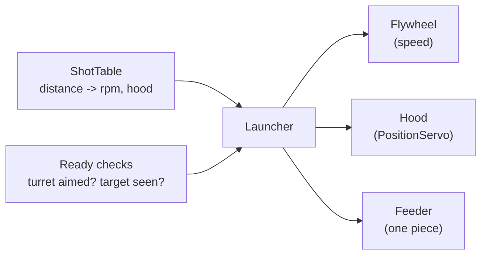
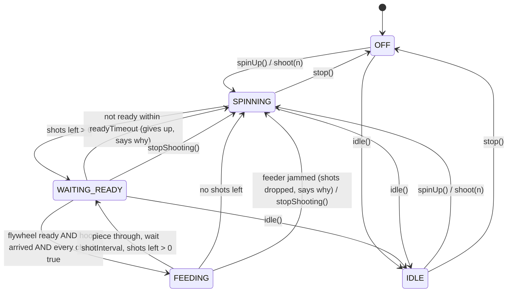
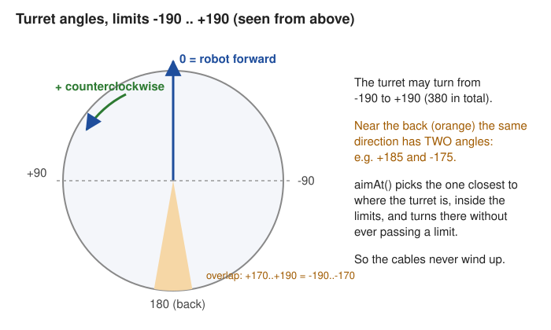

# Launcher module

> **Work in progress:** this library and its docs are still changing. Something wrong or unclear? [Tell us](https://github.com/crossbotics/ftc-helper-lib/issues).

Package: `com.crossbotics.ftchelper.launcher`

Learn it hands-on: [17 Launcher](../tutorials/17-launcher.md), [18 Vision aiming](../tutorials/18-vision-aim.md).

Parts for a robot that shoots game pieces: a **flywheel** (a fast-spinning wheel that throws the
piece), a **hood** (a curved plate a servo tilts to set the shot angle), a **feeder** (pushes one
piece into the flywheel) and a **turret** (turns the shooter to aim). Each part works alone; the
`Launcher` joins them. With the [robot in five files](robot.md#launcher), its `Launcher` is
built on these, so start there ([lesson 9](../tutorials/start/09-shooter-and-camera.md)). Use this
page to build a shooter by hand (tutorial 17). Speeds are in **RPM** (turns per minute).

| Class | Use it to |
| --- | --- |
| [`Flywheel`](#flywheel) | hold a speed in RPM, say "ready", notice shots |
| [`ShotTable`](#shottable) | look up the RPM and hood angle for a distance, from a few measured shots |
| [`Feeder`](#feeder) | push ONE piece into the flywheel (an interface) |
| [`MotorFeeder`](#motorfeeder) | run a roller or belt feeder |
| [`ServoFeeder`](#servofeeder) | run a kicker-arm feeder |
| [`Turret`](#turret) | aim in degrees, never past its limits, hold a field direction |
| [`Launcher`](#launcher) | spin up, wait until EVERYTHING is ready, feed, repeat |

A hood is a [`PositionServo`](mechanism.md#positionservo) with `degrees(...)`.



## How a shot happens



The two safety rules: **never feed into a slow flywheel**, and **never wait forever**.

---

## Flywheel

```java
Flywheel flywheel = Flywheel.create(hardwareMap, "flywheel")
        .countsPerRev(28)          // encoder counts per ONE flywheel turn
        .pidf(10, 3, 0, 12)        // the hub's speed control
        .tolerance(75)             // ready within 75 rpm...
        .settleTime(0.15);         // ...for 0.15 s
```

| Method | What it does |
| --- | --- |
| `create(hardwareMap, name)` | coast (a flywheel must spin down freely), speed control on |
| `.reversed()` | spin the other way |
| `.follower(hardwareMap, name, reversed)` | a second motor on the same wheel (same speed command). **It needs its own encoder cable.** If its encoder reads nothing while the wheel spins, it is switched off with a warning. It gets the `pidf` gains whether you call `pidf` before or after it |
| `.countsPerRev(c)` | counts per FLYWHEEL turn: bare motor 1:1 = 28; with gears multiply by motor turns per wheel turn; a shaft encoder on this motor's port = its counts (REV Through Bore 8192) |
| `.pidf(p, i, d, f)` | the hub's speed gains (PID plus F, a push that grows with the speed; see [PID](control.md#pidcontroller)). Start 10, 3, 0, 12; tune F first (with a charged battery) |
| `.tolerance(rpm)`, `.settleTime(s)` | when "ready" |
| `.maxRpm(r)` | highest speed allowed |
| `.shotDrop(rpm)` | a drop this big after ready = a shot was seen |
| `setRpm(r)`, `stop()`, `update()` | use. `stop()` and speed 0 COAST (no hard braking of a fast wheel) |
| `isReady()`, `getRpm()`, `getTargetRpm()`, `getMaxRpm()`, `getShotCount()`, `getFault()` | read |
| `spinUpStep(rpm, timeout)` | autonomous step |

**Check your speed reading** before trusting it: the RPM on telemetry must match a tachometer (a
tool that measures spin speed) or a slow-motion video. Very high count rates (a fine encoder at high speed) can read wrong.

## ShotTable

```java
ShotTable pollen = new ShotTable()
        .add(24, 2600, 6)        // distance in, rpm, hood degrees
        .add(48, 3100, 14)
        .add(72, 3700, 21);
ShotTable.Shot s = pollen.lookup(36);     // 2850 rpm, 10 deg (halfway between 24 and 48)
```

Straight lines between your points; outside them, the nearest end (it never guesses beyond what you
tested). `covers(distance)` says if you are inside. One table per game piece if they fly differently
(BIOBUZZ: POLLEN is a 2.8 in ball, NECTAR a 3.6 in ball); swap them with `launcher.table(other)`.
How to fill it: [tutorial 17](../tutorials/17-launcher.md#4-fill-the-shot-table). In the robot in five
files, each `speedByDistance...` line in `Tunables.Launcher` is one table, picked by name with
`robot.launcher.useTable("nectar")` ([robot.md: Launcher](robot.md#launcher)); the
[Shot Tuner](finders.md) tunes one at a time.

## Feeder

An interface: `feedOne()`, `isBusy()`, `update()`, `stop()`, and optional `isJammed()` and `clearJam()`.
The launcher decides WHEN; the feeder only knows HOW. Next season's new feeding mechanism? Write a
class with these methods and the launcher works with it. See [Extending](../guides/extending.md).

## MotorFeeder

```java
MotorFeeder feeder = MotorFeeder.create(hardwareMap, "feeder")
        .power(1.0).feedTime(0.25)        // run 0.25 s per piece
        // optional: stop when a sensor sees the piece leave. beam = a beam-break sensor
        // (a DigitalChannel); "!" = not: it reads false while something blocks the beam
        .stopWhen(() -> !beam.getState())
        .jamDetection(60, 0.2);           // optional (encoder cable)
```

A jam stops the launcher's remaining shots. The next `shoot(...)` clears it and tries again (a new
jam is detected again), so the driver just presses shoot after clearing the piece.

## ServoFeeder

```java
ServoFeeder kicker = ServoFeeder.create(hardwareMap, "kicker")
        .positions(0.15, 0.60)            // rest, push
        .times(0.15, 0.15);               // push time, return time
```

`goToRest()` moves it to rest (only call it in INIT if that is safe).

## Turret

```java
Turret turret = Turret.create(hardwareMap, "turret")
        .countsPerDegree(1479 / 360.0)    // encoder counts per turret turn / 360. ".0": a
                                          // decimal result (1479 / 360 alone would drop it)
        .limits(-190, 190)                // degrees; it never turns past these (cables!)
        .homeSwitch(hardwareMap, "turret_home", 45)   // the switch closes at 45 degrees
        .pid(0.02, 0, 0.001, 0)           // kP, kI, kD, kF on the angle in degrees
        .tolerance(1.0);                  // within 1 degree = aimed
```



Angles: 0 = robot forward, **counterclockwise positive** (like the IMU). Positive power must turn it
counterclockwise (else `.reversed()`).

| Method | What it does |
| --- | --- |
| `.countsPerDegree(c)` | encoder counts per turret degree (motor counts x gear ratio / 360) |
| `.limits(min, max)` | allowed range; may be more than 360 in total (e.g. -190..190) |
| `.startAngle(deg)` | the angle at power-on (no switch). It reads the encoder when called: call it after `countsPerDegree` and `reversed` |
| `.homeSwitch(hardwareMap, name, angle)` / `.homeSwitch(reader, angle)` | a switch that closes at a known angle |
| `.homingPower(p)`, `.pid(...)`, `.tolerance(deg)`, `.maxPower(p)`, `.slowZone(deg, power)` | tuning. Before homing, manual power is kept to the homing power |
| `.homingTimeout(s)` | homing stops with a fault if the switch is not found in time (default 5 s) |
| `.maxTargetAgeMs(ms)` | how old a camera picture may be for `aimAtTarget` (default 150) |
| `.cameraOffset(deg)` | where the target sits in the camera's view when the launcher points at it (left = +), for a camera not centered on the launcher. The [Aim Tuner](finders.md#aimtuneropmode) finds it. |
| `aimAt(robotDeg)` | turn to a robot-relative angle, **the safe way round** |
| `aimField(fieldDeg, headingDeg)` | point at a field direction; call every loop while the robot turns |
| `aimBy(delta)` | turn by an amount |
| `aimAtTarget(target, cameraOnTurret)` | aim at a camera target: fresh pictures only, each picture once; holds when there is none |
| `manual(power)` | a stick; 0 holds where it is |
| `home(direction)` | turn slowly toward the switch until it closes (at once if already on it; fault after the timeout) |
| `getAngle()`, `getTargetAngle()`, `isAimed()`, `isOutOfRange()`, `isHomed()`, `isHoming()`, `getFault()` | read. `isAimed()` is false for an out-of-range target, so it is safe as a launcher check |
| `aimStep(deg, timeout)` | autonomous step |

**The safe way round:** with limits -190..190, 170 and -190 are the same direction. The turret
picks the one inside the limits closest to where it is, and turns there without passing a limit,
so cables never wind up. A direction outside the limits goes to the nearest limit and
`isOutOfRange()` is true.

**Homing** means finding a known angle by turning until a switch closes. With a switch, aiming waits until the switch was seen once (`home(direction)`). If the
switch is not found within `homingTimeout`, homing stops and `getFault()` says so (a broken wire never
spins the turret forever). Without a switch, the turret trusts `startAngle` (default 0): turn the robot
on with the turret facing forward.

## Launcher

```java
Launcher launcher = new Launcher(flywheel, feeder)
        .hood(hood)
        .table(pollen)
        .requireReady("Turret", turret::isAimed)   // never feed before the turret is aimed
        .shotInterval(0.25)                        // at least 0.25 s between pieces
        .readyTimeout(3);                          // not ready in 3 s: give up, say why
```

| Method | What it does |
| --- | --- |
| `.hood(servo)`, `.table(t)` | optional parts |
| `.requireReady(name, check)` | another condition before each piece (aim, sensor, anything) |
| `.clearReadyChecks()` | removes every `requireReady` check (the Shot Tuner does this: you aim by hand there) |
| `.shotInterval(s)` | least time between pieces |
| `.readyTimeout(s)` | give up the remaining shots after this long not ready |
| `.idleRpm(r)` | speed when not shooting (a low idle makes spin-up faster) |
| `setRpm(r)` / `setDistance(d)` | the shot by hand / from the table (sets the hood too) |
| `getHood()`, `hasTable()` | the hood servo (or null); true if a table was given |
| `spinUp()`, `shoot(n)`, `stopShooting()` | commands |
| `idle()` | back to the idle speed |
| `stop()` | fully OFF, even the idle speed, until `spinUp()`, `shoot()` or `idle()` |
| `update()` | every loop (updates flywheel, feeder and hood for you) |
| `isReady()`, `whyNotReady()` | e.g. "flywheel, Turret": your first debug clue |
| `getState()` (OFF, IDLE, SPINNING, WAITING_READY, FEEDING), `isShooting()`, `getShotsLeft()`, `getShotsFired()`, `getLastProblem()` | read |
| `spinUpStep()`, `shootStep(n)` | autonomous steps |
