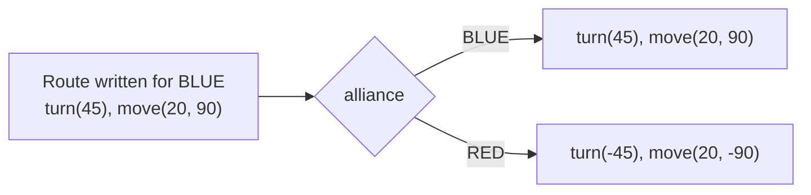

# Match module

Package: `io.github.jasoncross.ftchelper.match`

Learn it hands-on: [15 Telemetry, profiles and tuning](../tutorials/15-telemetry-profiles-tuning.md), [16 Easy autonomous](../tutorials/16-easy-autos.md).

Things about the MATCH, not the robot: red or blue, the clock, choices made in INIT, and what
autonomous tells TeleOp.

| Class | Use it to |
| --- | --- |
| [`Alliance`](#alliance) | red/blue, and mirror a route written for blue |
| [`MatchTimer`](#matchtimer) | count down a period and buzz at set times |
| [`InitMenu`](#initmenu) | choose alliance, delay, route... with the gamepad in INIT |
| [`MatchMemory`](#matchmemory) | pass the alliance (and pose) from autonomous to TeleOp |

---

## Alliance

`Alliance.BLUE` or `Alliance.RED`.

| Method | What it does | Example |
| --- | --- | --- |
| `mirror(blueValue)` | same for blue, negated for red | `RED.mirror(90)` = -90 |
| `pick(blue, red)` | one value per alliance | `alliance.pick(20, 24)` (tag ids) |
| `other()` | the other alliance | |
| `sign()` | +1 blue, -1 red | |

**Write routes for BLUE.** `AutoRoutine.mirrorFor(alliance)` flips every turn, heading and
sideways direction for RED. Check each season's field: if it is ROTATED (not mirrored), forward
and back flip as well, and you need your own rule for that (see [New season](../guides/new-season.md)).



## MatchTimer

```java
MatchTimer timer = MatchTimer.teleOp()            // 2:00   (autonomous(): 0:30)
        .rumbleAt(60, gamepad1, gamepad2)
        .rumbleAt(20, gamepad1, gamepad2);
waitForStart();
timer.start();
while (opModeIsActive()) {
    timer.update();
    t.line("Time", timer.format());               // "1:23"
}
```

| Method | What it does |
| --- | --- |
| `MatchTimer.autonomous()`, `MatchTimer.teleOp()`, `new MatchTimer(seconds)` | make one |
| `cueAt(secondsLeft, action)` | run code once at that time |
| `rumbleAt(secondsLeft, gamepads...)` | buzz the gamepads 3 times at that time |
| `start()` | start counting (right after `waitForStart()`) |
| `update()` | runs the cues; call every loop |
| `secondsLeft()`, `elapsedSec()`, `isOver()`, `isRunning()` | read |
| `format()` | "m:ss" like the field clock |

2026-27 BIOBUZZ cues worth adding: **1:00** (FLOWER ownership unlocks) and **0:20** (final 20 seconds).
The field clock is the official one; this timer starts with your OpMode and can be a second off.

## InitMenu

```java
InitMenu menu = new InitMenu(gamepad1)
        .alliance()                      // X = blue, B = red
        .delay(10)                       // start delay 0..10 s
        .choice("Route", "Near", "Far")
        .yesNo("Park", true)
        .profile();                      // practice / competition
while (opModeInInit()) {
    menu.update();
    menu.addTelemetry(t);
    t.update();
}
```

| Method | What it does |
| --- | --- |
| `alliance()` | adds the alliance line (starts at the one remembered from earlier, else BLUE) |
| `delay(maxSeconds)` | adds a start delay, 1 s steps |
| `choice(label, options...)` | adds a list; the first option is the default |
| `yesNo(label, startYes)` | adds a YES/NO line |
| `profile()` | adds PRACTICE/COMPETITION (saved when changed) |
| `update()`, `addTelemetry(t)` | every INIT loop |
| `getAlliance()`, `getDelaySec()`, `get(label)`, `isYes(label)` | read the choices |

Controls: D-pad up/down = choose a line, left/right = change it. X/B are alliance shortcuts.
`EasyAuto` builds this menu for you.

## MatchMemory

```java
MatchMemory.remember(Alliance.RED, pose);            // end of autonomous (EasyAuto does it)
Alliance a = MatchMemory.allianceOr(Alliance.BLUE);  // TeleOp INIT
```

Lets ONE TeleOp serve both alliances. The memory lasts until the app restarts and is ignored
after 5 minutes (`MAX_AGE_SEC`), so an old match never leaks into a new one. The pose goes to
`PoseStore` ([util](util.md#posestore)).
