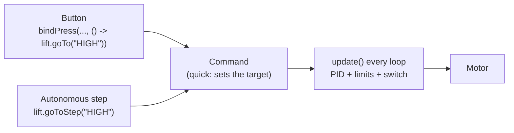
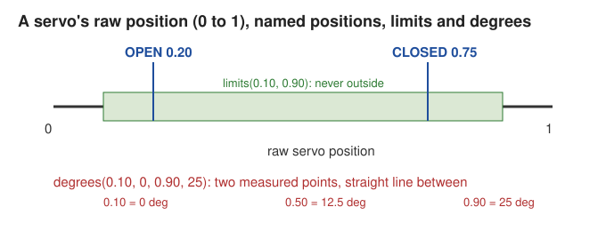

# Mechanism module

> **Work in progress:** this library and its docs are still changing. Something wrong or unclear? [Tell us](https://github.com/crossbotics/ftc-helper-lib/issues/new/choose).

Package: `com.crossbotics.ftchelper.mechanism`

Learn it hands-on: [14 Mechanisms](../tutorials/14-mechanisms.md). Example: [Drive + intake](../guides/example-drive-intake.md).

Ready-made helpers for the mechanisms that most robots have: four classes and one interface. Each one is a
[`Subsystem`](core.md#subsystem). One line connects it to a button, and one call gives an autonomous
step. The Lift, Arm, Claw and other parts of the [robot in five files](../reference/robot-java.md) use
them inside. So with five files, you make them yourself only for a special case. Use them in your own
mechanism class, or for a part that five files has no module for. Start with tutorial 14.

| Class | For | Hardware |
| --- | --- | --- |
| [`PositionMotor`](#positionmotor) | lifts, arms, slides, motor claws: go to named positions and hold | motor + encoder |
| [`SpinMotor`](#spinmotor) | intakes, rollers, conveyors: in / out / stop, jam back-out | motor |
| [`PositionServo`](#positionservo) | claws, wrists, hoods, gates: named positions or degrees | servo |
| [`SpinServo`](#spinservo) | small rollers and spinners | continuous-rotation servo |
| [`AngleDevice`](#angledevice) | anything that goes to an angle and says when it is there (a launcher's hood) | an interface |



**Two rules for all of them:**

1. Commands (`goTo`, `in`, `toggle`...) are quick, and you can safely call them from a button. Motor
   helpers act in `update()`, once per loop. So call `update()` every loop, or put them in a
   `Subsystems` group.
2. **Servo commands move the servo AT ONCE.** That is how servos work. With `.maxSpeed()`, the first
   move happens at once, and `update()` does the rest in small steps. Nothing may move before ▶ (start
   on the Driver Hub). So call a command in INIT only when that movement is allowed and safe.

**A typo in a position name** (`goTo("HGIH")`) does nothing and shows a warning on the Driver
Station. So a typo can never stop the OpMode in a match. `getWarning()` gives the warning.

---

## PositionMotor

Everything from tutorials 07, 08 and 12 in one helper:

- **PID** to reach a position and hold it ([PidController](control.md#pidcontroller)).
- **Soft limits:** the code never pushes past the safe range.
- A bottom switch with **homing**: when the switch is pressed, the helper sets the position to 0. This
  keeps the count right.
- A **slow zone** near the ends, so the mechanism does not slam.
- Named positions, steps between them, control by hand that holds where you let go, live tuning, and
  autonomous steps.

```java
PositionMotor lift = PositionMotor.create(hardwareMap, "lift")
        .limits(0, 2600)                          // safe range, encoder ticks
        .lowerSwitch(hardwareMap, "lift_bottom")  // touch sensor at the bottom: resets to 0
        .slowZone(250, 0.2)                       // last 250 ticks: power down to 0.2, no slamming
        .pid(0.004, 0, 0.0002, 0.05)              // kP, kI, kD, kF (0.05 holds it up)
        .position("DOWN", 0)                      // named heights, ticks: measure yours
        .position("LOW", 900)
        .position("HIGH", 2400)
        .tunable("Lift");                         // put the numbers in the tuning menu
```

Setup (chain them). **Positive power must move toward bigger positions:**

| Method | What it does |
| --- | --- |
| `PositionMotor.create(hardwareMap, name)` | gets the motor: brake, encoder zeroed, plain power |
| `new PositionMotor(name, motor)` | wraps a motor you already have |
| `.reversed()` | positive power the other way (call first) |
| `.units(ticksPerUnit, "deg")` | work in degrees or inches instead of ticks. Call it FIRST: after limits, positions, slowZone or tolerance, it stops with a clear error |
| `.limits(min, max)` | the safe range |
| `.lowerSwitch(hardwareMap, name)` / `.lowerSwitch(reader)` | bottom switch: it stops downward power and homes (sets position 0). Until it homes, only slow downward power works. When the name is not in the configuration, it shows a warning and runs without a switch |
| `.upperSwitch(reader)` | top switch |
| `.slowZone(distance, powerAtLimit)` | slow near the ends |
| `.maxPower(p)` | the most power it ever uses |
| `.pid(kP, kI, kD, kF)` | gains (on the error in UNITS) |
| `.tolerance(units)` | "there" when this close (default: about 20 ticks) |
| `.position(name, value)` | a named position |
| `.holdWhenReleased(bool)` | after control by hand, hold where the driver let go (default true) |
| `.stepTimeout(seconds)` | how long autonomous steps wait (default 3) |
| `.tunable(prefix)` | gains and positions in the [tuning menu](tuning.md); call LAST |

Commands and reading:

| Method | What it does |
| --- | --- |
| `goTo(name)` / `goTo(value)` | go there and hold |
| `stepUp()` / `stepDown()` | next named position up / down (by value) |
| `manual(power)` | call it every loop with a stick. A power other than 0 takes over; 0 = hold where it is |
| `hold()`, `stop()`, `zeroHere()` | hold here / no power / make here zero |
| `update()` | every loop |
| `isAtTarget()`, `isAt(name)`, `getPosition()`, `getTargetName()` | read (`getTargetName()` gives "hand", "hold", "none" or the name) |
| `isWaitingForHoming()` | whether the bottom switch has not been pressed yet |
| `goToStep(name)` | autonomous: go, and wait until it is there. When it is not there in time (for example, a jam), it holds where it is and stops pushing. The end report says "timed out" |
| `startStep(name)` | autonomous: start going, and go on to the next step at once (it moves during the next steps) |
| `getSafeMotor()`, `getPid()` | the layers inside |
| `fence(lo, hi)`, `fence(lo, hi, upPower, downPower)`, `isHeld()` | an [interlock rule](../reference/parts/interlock.md) sets these every loop. A target past `lo`..`hi` waits at its edge. The caps (0 to 1) limit the power toward each side, so the part brakes in time |

Telemetry: standard = target and position; debug = target value, power asked and sent, limits, homed.

**Per loop on the hub** (from its `SafeMotor`):

- One encoder read. `update()` reads it fresh, and the PID and telemetry reuse it for 3 ms. So a reading
  is at most 3 ms old.
- It sends a power only when the power changes, and again every 25 loops (every loop while past a soft
  limit). So a power you write straight to `getSafeMotor().getMotor()` lasts at most 25 loops.

The launcher's [`Turret`](launcher.md#turret) reads its encoder the same way (at most once per 3 ms). All
the details: [what runs every loop](../guides/every-loop.md#what-a-part-does-on-the-hub-per-loop).

## SpinMotor

```java
SpinMotor intake = SpinMotor.create(hardwareMap, "intake")
        .powers(1.0, -0.7)                 // in, out
        .jamDetection(80, 0.3, 0.4);       // < 80 ticks/s for 0.3 s = jam; back out 0.4 s
```

| Method | What it does |
| --- | --- |
| `create(hardwareMap, name)` | gets the motor: coast, plain power |
| `.reversed()`, `.powers(in, out)` | direction and powers |
| `.jamDetection(minSpeed, jamSec, unjamSec)` | while IN: on a jam (motor powered but barely turning), it backs out, then runs IN again. It needs the encoder cable |
| `.jamCurrent(amps)` | it also counts a jam when the motor draws too much current |
| `in()`, `out()`, `stop()` | **safe to call every loop** (in() does not interrupt a jam back-out) |
| `toggleIn()`, `toggleOut()` | for one button |
| `setPower(p)` | any power, for example from a trigger |
| `getState()` | STOPPED, IN, OUT, UNJAMMING, MANUAL |
| `getJamCount()`, `isRunning()` | read |
| `inStep()`, `outStep()`, `stopStep()`, `outForStep(seconds)` | autonomous steps |

A common pattern is "reverse wins, then on/off":

```java
// every loop; reverseHeld and intakeOn are your own true/false values (e.g. from buttons)
if (reverseHeld) intake.out();
else if (intakeOn) intake.in();
else intake.stop();
intake.update();   // only here does the motor actually get its power
```

**Per loop on the hub:** `update()` sends the power only when it changes, and again every 25 writes
(one write per `update()`). So a power you write straight to `getMotor()` lasts at most 25 loops. While it
runs IN with jam detection, it reads the speed every loop, as part of a bulk read. With
`.jamCurrent(...)`, it also reads the current. `getCurrent()` is a separate hub command each loop, outside
the bulk read. So add it only when the speed check is not enough.

## PositionServo

```java
PositionServo claw = PositionServo.create(hardwareMap, "claw")
        .position("OPEN", 0.20)           // raw servo positions, 0 to 1: find yours by testing
        .position("CLOSED", 0.75)
        .travelTime(0.3);                 // seconds for a full 0..1 move (measure it)

PositionServo hood = PositionServo.create(hardwareMap, "hood")
        .degrees(0.10, 0, 0.90, 25);      // two measured points: raw 0.10 = 0 deg, raw 0.90 = 25 deg
hood.setDegrees(18);                      // moves the servo at once (servos do)
```



| Method | What it does |
| --- | --- |
| `create(hardwareMap, name)` | gets the servo. It does NOT move it |
| `.reversed()` | 0 and 1 swap ends |
| `.fullRange()`, `.pulseRange(lowUs, highUs)` | the servo's whole turn: 0 to 1 sends 500-2500 us instead of the SDK's 600-2400 (a goBILDA 2000 servo turns 300 degrees, not 270). Set it before you measure positions and degrees ([full range](hardware.md#full-range)). When a servo cannot change its pulse, the Driver Station shows a warning |
| `isFullRange()` | whether `fullRange()`/`pulseRange` changed the pulse |
| `.limits(min, max)` | never past these raw positions (keeps it off the frame) |
| `.position(name, raw)` | a named raw position (0..1) |
| `.degrees(posA, degA, posB, degB)` | use degrees, from two measured points |
| `.travelTime(seconds)` | time for a full 0..1 move. A servo cannot report its position, so the helper uses this to guess "arrived". A shorter move waits its share. When you time a move between two positions: seconds / distance |
| `.maxSpeed(perSecond)` | move slowly (raw positions per second). After a pause in `update()` calls, it goes on slowly. It never jumps the rest of the way |
| `.withServo(other, trim)` | a second servo that moves with this one (the other side of a two-servo part). It goes to the same positions plus `trim` (a `DoubleSupplier`, raw position, read at each move). Set its direction yourself |
| `.tunable(prefix)` | positions in the tuning menu; call LAST |
| `goTo(name)`, `set(raw)`, `setDegrees(deg)` | move |
| `toggle(a, b)`, `next()`, `previous()` | for buttons |
| `isDone()` | whether it should have arrived (an estimate) |
| `getPosition()`, `getDegrees()`, `getTargetName()` | read |
| `getTargetDegrees()` | the angle it is going to (after its limits). It differs from `getDegrees()` only during a slow move |
| `goToStep(name)` | autonomous: move, and wait until it should have arrived |
| `update()` | every loop (needed for slow moves and "done") |

`PositionServo` is an [`AngleDevice`](#angledevice), so it can be a launcher's hood.

## AngleDevice

An interface for any part that goes to an angle. Its methods: `setDegrees(angle)` (start moving, never
wait), `getTargetDegrees()` (NaN before the first command), `isDone()`, and `update()`, `stop()`,
`addTelemetry(t)` like any [`Subsystem`](core.md#subsystem). A [launcher](launcher.md#launcher)'s hood is
an `AngleDevice`, so the launcher does not care what moves it. It can be a `PositionServo` with
`degrees(...)`, or the five-files [`Hood`](../reference/parts/hood.md) (a servo or a motor with an encoder,
a linkage table). It can also be your own class (a CR servo with an absolute encoder). "Angle" is the
part's own scale: degrees, or plain servo positions when you never measured angles.

```java
public class MyHood implements AngleDevice {
    public void setDegrees(double deg) { target = deg; }                // never wait here
    public double getTargetDegrees() { return target; }
    public boolean isDone() { return Math.abs(encoderDeg() - target) < 0.5; }
    public void update() { crServo.setPower(0.02 * (target - encoderDeg())); }
}
launcher.hood(new MyHood(...));
```

## SpinServo

For a servo in **continuous rotation** mode (set the port as "Continuous Rotation Servo" in the configuration).

```java
SpinServo roller = SpinServo.create(hardwareMap, "roller").power(0.8);
// hold X = spin forward at 0.8; let go = stop. roller::forward = "() -> roller.forward()"
controls.bindHold(Pad.G2, Btn.X, roller::forward).bindRelease(Pad.G2, Btn.X, roller::stop);
```

| Method | What it does |
| --- | --- |
| `.reversed()`, `.power(p)` | direction and power for forward/backward |
| `.angleSensor(hardwareMap, name, maxVolts)` | read the angle from an analog wire (for example, Axon servos) |
| `forward()`, `backward()`, `stop()`, `setPower(p)` | spin |
| `runFor(seconds, power)` | spin, then stop on its own |
| `isRunning()`, `getPower()`, `getAngleDeg()` | read |
| `runForStep(seconds, power)` | autonomous step |
| `update()` | every loop (needed for `runFor`) |
