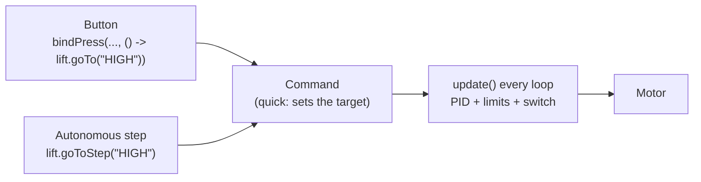

# Mechanism module

Package: `io.github.jasoncross.ftchelper.mechanism`

Learn it hands-on: [14 Mechanisms](../tutorials/14-mechanisms.md). Example: [Drive + intake](../guides/example-drive-intake.md).

Ready-made helpers for the four kinds of mechanism almost every robot has. Each one is a
[`Subsystem`](core.md#subsystem), connects to buttons with one line, and gives autonomous
steps with one call.

| Class | For | Hardware |
| --- | --- | --- |
| [`PositionMotor`](#positionmotor) | lifts, arms, slides, motor claws: go to named positions and hold | motor + encoder |
| [`SpinMotor`](#spinmotor) | intakes, rollers, conveyors: in / out / stop, jam back-out | motor |
| [`PositionServo`](#positionservo) | claws, wrists, hoods, gates: named positions or degrees | servo |
| [`SpinServo`](#spinservo) | small rollers and spinners | continuous-rotation servo |



**Two rules for all of them:**

1. Commands (`goTo`, `in`, `toggle`...) are quick and safe to call from a button. Motor helpers act
   in `update()`, once per loop: call `update()` every loop (or put them in a `Subsystems` group).
2. **Servo commands move the servo AT ONCE** (that is how servos work). So never call a command in
   INIT unless that movement is allowed and safe: nothing may move before START.

**A typo in a position name** (`goTo("HGIH")`) does nothing and shows a warning on the Driver
Station, so it can never stop the OpMode in a match. `getWarning()` returns it.

---

## PositionMotor

Everything from tutorials 07, 08 and 12 in one helper: PID, soft limits, a bottom switch with
homing, a slow zone, named positions, stepping, manual override with hold, tuning, steps.

```java
PositionMotor lift = PositionMotor.create(hardwareMap, "lift")
        .limits(0, 2600)                          // safe range, encoder ticks
        .lowerSwitch(hardwareMap, "lift_bottom")  // touch sensor at the bottom: resets to 0
        .slowZone(250, 0.2)                       // last 250 ticks: power down to 0.2, no slamming
        .pid(0.004, 0, 0.0002, 0.05)              // kP, kI, kD, kF (0.05 holds it up)
        .position("DOWN", 0)                      // named heights, ticks: measure yours
        .position("LOW", 900)
        .position("HIGH", 2400)
        .tunable("Lift");                         // put the numbers in the tuning menu
```

Setup (chain them; **positive power must move toward bigger positions**):

| Method | What it does |
| --- | --- |
| `PositionMotor.create(hardwareMap, name)` | gets the motor: brake, encoder zeroed, plain power |
| `new PositionMotor(name, motor)` | wraps a motor you already have |
| `.reversed()` | positive power the other way (call first) |
| `.units(ticksPerUnit, "deg")` | work in degrees/inches instead of ticks. Must come FIRST: calling it after limits/positions/tolerance stops with a clear error |
| `.limits(min, max)` | the safe range |
| `.lowerSwitch(hardwareMap, name)` / `.lowerSwitch(reader)` | bottom switch: stops downward power and homes (position 0). Until homed: only slow downward power. A name not in the configuration shows a warning (and runs without a switch) |
| `.upperSwitch(reader)` | top switch |
| `.slowZone(distance, powerAtLimit)` | slow near the ends |
| `.maxPower(p)` | most power ever |
| `.pid(kP, kI, kD, kF)` | gains (on the error in UNITS) |
| `.tolerance(units)` | "there" when this close (default: about 20 ticks) |
| `.position(name, value)` | a named position |
| `.holdWhenReleased(bool)` | after manual control, hold where it was let go (default true) |
| `.stepTimeout(seconds)` | how long autonomous steps wait (default 3) |
| `.tunable(prefix)` | gains and positions in the [tuning menu](tuning.md); call LAST |

Commands and reading:

| Method | What it does |
| --- | --- |
| `goTo(name)` / `goTo(value)` | go there and hold |
| `stepUp()` / `stepDown()` | next named position up / down (by value) |
| `manual(power)` | call every loop with a stick; non-zero takes over, 0 = hold where it is |
| `hold()`, `stop()`, `zeroHere()` | hold here / no power / make here zero |
| `update()` | every loop |
| `isAtTarget()`, `isAt(name)`, `getPosition()`, `getTargetName()` | read ("hand", "hold", "none" or the name) |
| `isWaitingForHoming()` | true until the bottom switch was pressed once |
| `goToStep(name)` | autonomous: go and wait until there |
| `startStep(name)` | autonomous: start going and continue at once (moves during the next steps) |
| `getSafeMotor()`, `getPid()` | the layers inside |

Telemetry: standard = target and position; debug = target value, power asked/sent, limits, homed.

## SpinMotor

```java
SpinMotor intake = SpinMotor.create(hardwareMap, "intake")
        .powers(1.0, -0.7)                 // in, out
        .jamDetection(80, 0.3, 0.4);       // < 80 ticks/s for 0.3 s = jam; back out 0.4 s
```

| Method | What it does |
| --- | --- |
| `create(hardwareMap, name)` | gets the motor: coast, plain power |
| `.reversed()`, `.powers(in, out)` | direction and powers |
| `.jamDetection(minSpeed, jamSec, unjamSec)` | while IN: a jam is backed out, then IN again (needs the encoder cable) |
| `.jamCurrent(amps)` | also a jam when the current is too high |
| `in()`, `out()`, `stop()` | **safe to call every loop** (in() does not interrupt a jam back-out) |
| `toggleIn()`, `toggleOut()` | for one button |
| `setPower(p)` | any power, e.g. from a trigger |
| `getState()` | STOPPED, IN, OUT, UNJAMMING, MANUAL |
| `getJamCount()`, `isRunning()` | read |
| `inStep()`, `outStep()`, `stopStep()`, `outForStep(seconds)` | autonomous steps |

A common pattern: "reverse wins, then on/off":

```java
// every loop; reverseHeld and intakeOn are your own true/false values (e.g. from buttons)
if (reverseHeld) intake.out();
else if (intakeOn) intake.in();
else intake.stop();
intake.update();   // only here does the motor actually get its power
```

## PositionServo

```java
PositionServo claw = PositionServo.create(hardwareMap, "claw")
        .position("OPEN", 0.20)           // raw servo positions, 0 to 1: find yours by testing
        .position("CLOSED", 0.75)
        .travelTime(0.3);                 // seconds for a full 0..1 move (measure it)

PositionServo hood = PositionServo.create(hardwareMap, "hood")
        .degrees(0.10, 0, 0.90, 25);      // two measured points: raw 0.10 = 0 deg, raw 0.90 = 25 deg
hood.setDegrees(18);                      // moves the servo at once (servos do)
```


| Method | What it does |
| --- | --- |
| `create(hardwareMap, name)` | gets the servo; does NOT move it |
| `.reversed()` | 0 and 1 swap ends |
| `.limits(min, max)` | never past these raw positions (keeps it off the frame) |
| `.position(name, raw)` | a named raw position (0..1) |
| `.degrees(posA, degA, posB, degB)` | use degrees, from two measured points |
| `.travelTime(seconds)` | time for a full 0..1 move: used to guess "arrived" (a servo cannot report its position) |
| `.maxSpeed(perSecond)` | move slowly (raw positions per second) |
| `.tunable(prefix)` | positions in the tuning menu; call LAST |
| `goTo(name)`, `set(raw)`, `setDegrees(deg)` | move |
| `toggle(a, b)`, `next()`, `previous()` | for buttons |
| `isDone()` | true when it should have arrived (estimate) |
| `getPosition()`, `getDegrees()`, `getTargetName()` | read |
| `goToStep(name)` | autonomous: move and wait until it should have arrived |
| `update()` | every loop (needed for slow moves and "done") |

## SpinServo

For a servo in **continuous rotation** mode (set the port as "Continuous Rotation Servo" in the configuration).

```java
SpinServo roller = SpinServo.create(hardwareMap, "roller").power(0.8);
// hold X = spin forward at 0.8; let go = stop. roller::forward = "() -> roller.forward()"
controls.bindHold(Pad.G2, Btn.X, roller::forward).bindRelease(Pad.G2, Btn.X, roller::stop);
```

| Method | What it does |
| --- | --- |
| `.reversed()`, `.power(p)` | direction and power for forward/backward |
| `.angleSensor(hardwareMap, name, maxVolts)` | read the angle from an analog wire (e.g. Axon servos) |
| `forward()`, `backward()`, `stop()`, `setPower(p)` | spin |
| `runFor(seconds, power)` | spin, then stop by itself |
| `isRunning()`, `getPower()`, `getAngleDeg()` | read |
| `runForStep(seconds, power)` | autonomous step |
| `update()` | every loop (needed for `runFor`) |
