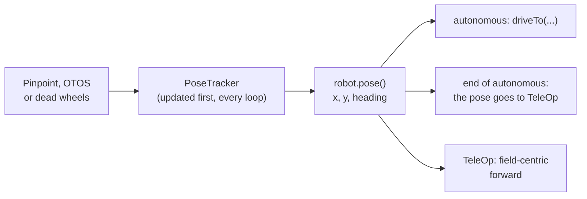
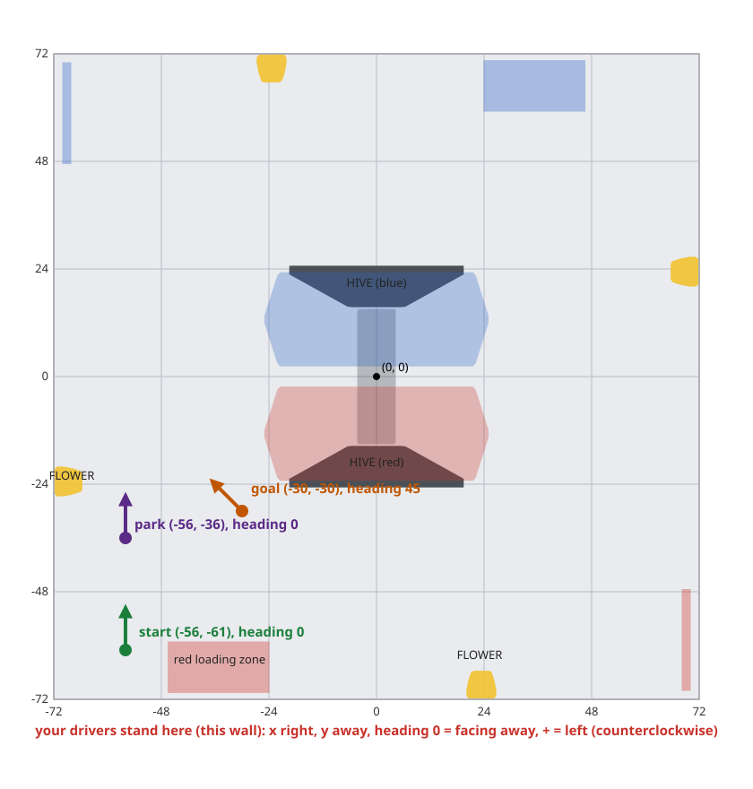

# Odometry module

> **Work in progress:** this library and its docs are still changing. Something wrong or unclear? [Tell us](https://github.com/crossbotics/ftc-helper-lib/issues).

Package: `com.crossbotics.ftchelper.odometry` (the `Robot.java` line, [`Odometry`](#robotjava-the-odometry-line),
is in `com.crossbotics.ftchelper.robot`).

Learn it hands-on: [Lesson 7: Odometry](../tutorials/start/07-odometry.md). Worked example:
[`examples/.../odometrybot`](../../examples/src/main/java/com/crossbotics/ftchelper/examples/odometrybot).
Quick answers with code to copy: [cookbook: odometry and driveTo](../cookbook.md#odometry-and-driveto).

**Odometry** tells the robot where it is on the field. Small unpowered wheels, called **pods**, roll
on the tiles and count how far the robot moved forward and sideways. Or an **optical sensor** under
the robot watches the floor go by, like a computer mouse. Add up every small move and you know where
the robot is, and which way it faces. That is its **pose**: x, y and heading.

**Why not just count the drive wheels?** Drive wheels slip: they spin when the robot is pushed, and
they skid when it speeds up. Pods carry no load and do not slip, so they measure what really happened.

**Why not AprilTags?** In BIOBUZZ the tags are on the HIVE cells, and the cells move. A tag tells you
where you are compared with the tag, not with the field. So this season, odometry (not tags) tells you
where you are ([vision](vision.md)).

| Class | Use it to |
| --- | --- |
| [`Odometry`](#robotjava-the-odometry-line) | the one line in `Robot.java`: which device, and where it sits |
| [`PoseTracker`](#posetracker) | read the pose every loop, set it, check the device (every kind is one) |
| [`PinpointOdometry`](#pinpointodometry) | a goBILDA Pinpoint odometry computer with two pods |
| [`OtosOdometry`](#otosodometry) | a SparkFun OTOS optical sensor |
| [`DeadWheelOdometry`](#deadwheelodometry) | three dead-wheel pods, or two and the IMU, on motor encoder ports |
| [`OdometryTunerOpMode`](#the-odometry-tuner) | checks and measures the odometry and shows the lines to copy |



---

## The frame

The **frame** is the set of directions the numbers use. It is the same as the autonomous start spot
(`s.start(note, x, y, heading)`, see [Auto](robot.md#auto)). Stand at your drivers' wall and look at
the field:

```text
                    far wall
     +-----------------------------------+
     |                 y +               |
     |                 ^                 |
     |                 |                 |
     |   x -  <--------+-------->  x +   |    (0, 0) = the middle of the field
     |                 |                 |
     |                 v                 |
     |                 y -               |
     +-----------------------------------+
           your drivers' wall (you)
```

- **x**: inches to the RIGHT of the field's centre line.
- **y**: inches AWAY from you (negative = your half).
- **heading**: degrees. 0 = facing away from you. **Counterclockwise is +**: 90 = facing left,
  -90 = facing right, 180 = facing you.
- The pose is the pose of the robot's **centre**: the point it turns around (on a mecanum robot,
  the middle of the four wheels).

The BIOBUZZ field in this frame, with lesson 7's start, goal and park points (drawn from the RED wall;
from the BLUE wall the numbers are the same, because the field is turned half a turn between the
alliances and `mirrorForRed()` is false):



The map is made by `tools/field_map.py` from the simulator's field file (`sim/fields/biobuzz-2026.json`).

Where is (0, 0)? Wherever the pose was last set. An `Auto` sets it from its start spot after START,
so with `s.start(note, x, y, heading)` it is the middle of the field. With `s.start(note, heading)`
(no spot) the robot starts at (0, 0), so x and y are measured from where it started.

**Why this frame?** It is the one the drivers see. "Go to x -30, y -30" means the same spot in every
autonomous, from every start.

---

## Robot.java: the odometry line

One line in `define()`, next to the drive:

```java
odometry(Odometry.pinpoint("pinpoint").offsetsMm(-84, -168));             // goBILDA Pinpoint, 4-bar pods
odometry(Odometry.otos("otos").mountIn(0, -3, 0));                        // SparkFun OTOS
odometry(Odometry.threeWheels("par_left", "par_right", "perp")
        .trackWidthIn(13.2).perpForwardIn(-6));                           // three dead wheels
odometry(Odometry.twoWheels("par", "perp").parallelLeftIn(5).perpForwardIn(-6));   // two + the IMU
```

It needs `import com.crossbotics.ftchelper.robot.Odometry;` at the top of `Robot.java`. The names
are the names in the robot configuration on the Driver Station. Use only one `odometry(...)` line.

With it you get:

- `robot.pose()`: where the robot is, every loop ([below](#robotpose)).
- `s.driveTo(...)` in autonomous: drive to a field point ([below](#driveto)).
- TeleOp starts where autonomous ended, and field-centric "forward" comes from the odometry
  ([below](#teleop-starts-where-autonomous-ended)).
- The simulator gets pretend odometry (`:sim:fromRobot` writes its lines, [below](#the-simulator)).

The **offsets** say where the pods (or the sensor) sit, measured from the robot's centre. Why they
matter: when the robot turns in place, a pod that is not at the centre rolls too. The library takes
that roll away, but only if it knows how far from the centre the pod is. The
[Odometry Tuner](#the-odometry-tuner) measures them for you.

### Pinpoint

```java
odometry(Odometry.pinpoint("pinpoint").offsetsMm(-84, -168));
```

A **goBILDA Pinpoint** is a small computer on an I2C port. Two pods plug into it: the **X pod**
measures forward and back, the **Y pod** measures sideways. It also has its own IMU (turn sensor).
It works out the pose itself, about 1500 times a second, and the library reads the answer once per loop.

| Setting | Means | Default |
| --- | --- | --- |
| `pinpoint(name)` | the Pinpoint's configuration name | |
| `offsetsMm(xPodLeftMm, yPodForwardMm)` | where the pods sit, mm (see the sketch) | 0, 0 |
| `podsSwingarm()` | goBILDA swingarm pods instead of 4-bar pods | 4-bar pods |
| `ticksPerMm(counts)` | other pods: encoder counts per mm of wheel travel | |
| `reversed("x")`, `reversed("y")`, `reversed("x", "y")` | a pod that counts the wrong way (the tuner says which). Names add up over several calls; `"X"` and `"x"` both work; a name that is not a pod stops INIT (`a Pinpoint's pods are "x" and "y"`) | none |

The two offsets (goBILDA's own meaning, from the SDK):

- **First number:** how far **LEFT** of the centre the **X pod** (the forward-measuring one) is.
  Right of the centre = negative.
- **Second number:** how far **FORWARD** of the centre the **Y pod** (the sideways-measuring one) is.
  Behind the centre = negative.

Seen from above, the lesson robot's `offsetsMm(-84, -168)`:

```text
                 FRONT
       +-----------------------+
       |                       |
       |           ^           |
       |           C           |   C = the robot's centre
       |           |<-84 mm->[X]   X pod (rolls forward/back): 84 mm RIGHT of C  -> -84
       |         168 mm        |
       |           |           |
       |          [Y]          |   Y pod (rolls sideways): 168 mm BEHIND C       -> -168
       +-----------------------+
                 BACK
```

Only the X pod's left/right distance matters, and only the Y pod's forward/back distance. (A pod
right at the centre line gives 0.) Swingarm pods: add `.podsSwingarm()`. Any other pod: `.ticksPerMm(...)`.

### OTOS

```java
odometry(Odometry.otos("otos").mountIn(0, -3, 0));
```

A **SparkFun OTOS** (Optical Tracking Odometry Sensor) is a small sensor on an I2C port that looks at
the floor, like a computer mouse, and has its own IMU. No pods. It must sit 10 to 12 mm above the tiles.

| Setting | Means | Default |
| --- | --- | --- |
| `otos(name)` | the OTOS's configuration name | |
| `mountIn(forwardIn, leftIn, headingDeg)` | where it sits: inches FORWARD of the centre (back = negative), inches LEFT (right = negative), and which way the sensor's **Y arrow** points, degrees counterclockwise from the robot's front | 0, 0, 0 |

**The heading in `mountIn`:** the OTOS's own axes are x = right and y = forward (as in the SDK's
sample), so its **Y arrow** is its forward axis. Heading 0 = the Y arrow points to the robot's front.
A sensor turned so its **X arrow** points forward has its Y arrow pointing left: that is **90**
(counterclockwise). Its Y arrow pointing right is -90. (From `OtosOdometry`: the offset goes to the
OTOS as `(-leftIn, forwardIn, headingDeg)`. Not yet checked on a robot: if a push forward shows up
as sideways in the `Pose` line, try the other sign.)

Measure `mountIn` with a tape: the tuner does not measure it for an OTOS. Its two scale numbers are in
[`Tunables.Odometry`](#tunablesodometry).

### Three dead wheels

```java
odometry(Odometry.threeWheels("par_left", "par_right", "perp").trackWidthIn(13.2).perpForwardIn(-6));
```

**Dead wheels** are pods with no computer: each pod's encoder plugs into a motor port's encoder
connector. Two pods measure forward (one left of the centre, one right) and one measures sideways. The
library works out the pose from their counts every loop. The names are the motor ports' configuration
names, in this order: left forward pod, right forward pod, sideways pod.

| Setting | Means | Default |
| --- | --- | --- |
| `trackWidthIn(inches)` | the distance between the left and right forward pods (required) | |
| `perpForwardIn(inches)` | how far FORWARD of the centre the sideways pod is (back = negative) | 0 |
| `podsSwingarm()`, `ticksPerMm(counts)` | the pods' encoder counts per mm | goBILDA 4-bar pods |
| `reversed(names...)` | the pods that count the wrong way, by port name | none |

Put the two forward pods the same distance either side of the centre: the library takes their
average as the forward move.

```text
                 FRONT
       +-----------------------+
       |                       |
       | [L]       C       [R] |   L and R roll forward/back; trackWidthIn = L to R
       |                       |
       |          [P]          |   P rolls sideways: perpForwardIn = -(C to P), behind = negative
       +-----------------------+
```

A pod's port can still drive a motor: the pod's encoder cable takes the place of that motor's
encoder, and the library only reads the count. (So a motor on that port loses its own encoder.)

### Two dead wheels and the IMU

```java
odometry(Odometry.twoWheels("par", "perp").parallelLeftIn(5).perpForwardIn(-6));
```

One forward pod, one sideways pod, and the Control Hub's IMU for the heading. It needs the IMU in the
drive line (`drive(...).imu(...)`); the odometry sets the IMU up and zeroes it at INIT.

| Setting | Means | Default |
| --- | --- | --- |
| `parallelLeftIn(inches)` | how far LEFT of the centre the forward pod is (right = negative) | 0 |
| `perpForwardIn(inches)` | how far FORWARD of the centre the sideways pod is (back = negative) | 0 |
| `podsSwingarm()`, `ticksPerMm(counts)`, `reversed(names...)` | as for three wheels | |

**Which kind?** A Pinpoint is the easiest: the pose is worked out on the device, 1500 times a second,
with one I2C read per loop. Three dead wheels need no extra computer but use three encoder ports. Two
wheels save a port but trust the IMU for turning. An OTOS has no wheels to mount, but its height
above the tiles matters and it needs its scale numbers measured.

### Your own pose source: Odometry.custom

```java
odometry(Odometry.custom(devices -> new MyPoseTracker(devices.get(MyDevice.class, "my_device"))));
```

For a pose from somewhere else (odometry fused with AprilTags, another library's localizer): your class
extends [`PoseTracker`](#posetracker) (`read()`, `write()`, `isReady()`, `status()`, `kind()`), and the library makes it at INIT from the robot's devices.
`robot.pose()`, `driveTo` and the hand-off to TeleOp use it like the built-in kinds. **It must use the
library's frame** ([above](#the-frame)); `PoseTracker`'s `read()` and `write()` work in the device
frame (X forward, Y left) and are turned for you. The simulator has no pretend device for it
(`:sim:fromRobot` writes only a comment), and the Odometry Tuner does not measure it.

Mistakes stop INIT with a message: a setting for another kind (`mountIn` on a Pinpoint), three wheels
with no `trackWidthIn`, two wheels with no IMU, a device name used twice, an empty name, a
`reversed(...)` name that is not a pod (`the pods are [par_left, par_right, perp]`), a `custom(...)`
that makes nothing (null).

---

## Tunables.Odometry

```java
public static class Odometry {
    public static boolean checked = false;
    public static double linearScalar = 1.0, angularScalar = 1.0;   // OTOS only
}
```

| Field | Means | Default |
| --- | --- | --- |
| `checked` | set it `true` by hand after the Odometry Tuner's Loop test passes. Until then, `driveTo` steps are skipped on a real robot | false |
| `linearScalar` | OTOS only: distance scale (the tuner's Forward test measures it; allowed 0.872 to 1.127) | 1.0 |
| `angularScalar` | OTOS only: turning scale ([measure it by hand](#otos-turn-scale-by-hand); 0.872 to 1.127) | 1.0 |

They are read once, at INIT, and are not in the tuning menu: change them in `Tunables.java` and rebuild.

**Why a switch you set by hand?** Like `Tunables.Drive.calibrated`: a pod counting the wrong way
makes `driveTo` drive the wrong way, at speed. Until a person has seen the Loop test pass, the
library will not drive to points. The simulator is the exception: there `driveTo` runs anyway.

---

## robot.pose()

```java
FieldPose p = robot.pose();   // x, y in inches; headingDeg
```

`robot.pose()` is where the robot is now, in [the frame](#the-frame): `p.x`, `p.y` and `p.headingDeg`.
It is a copy ([`FieldPose`](util.md#fieldpose)): changing it does not move the robot. It is `null`
when `Robot.java` has no `odometry(...)` line.

On the Driver Station every loop, the odometry adds a line by itself, labelled `Pose`:
`x -30.0, y -30.0 in, heading 45.0`, and a warning on top if the device is not ready. In
`Controls.java` you can show it your own way:

```java
show("Where", robot::pose);   // "(-30.0 in, -30.0 in, 45.0 deg)"
```

`robot.odometry()` is the running [`PoseTracker`](#posetracker) (null before INIT or with no
odometry line); `robot.odometrySpec()` is the line as written; `robot.odometryChecked()` reads
`Tunables.Odometry.checked`.

---

## PoseTracker

Every kind of odometry is a `PoseTracker`, so your code reads them all the same way.

| Method | What it does |
| --- | --- |
| `update()` | reads the device once and works out the new pose. The robot calls it for you, once per loop, first |
| `pose()` | this loop's pose (a copy) |
| `setPose(FieldPose)` | says "the robot is here now" (autonomous does this from its start spot; TeleOp from where autonomous ended). Set while the device is not ready yet (a Pinpoint still calibrating in TeleOp's INIT), the pose is kept and written to the device as soon as it is ready |
| `speedInPerSec()`, `turnDegPerSec()` | how fast it moves and turns, if the device says (Pinpoint, OTOS). **Always 0 for dead wheels**: do not use them for "has it stopped?" there (compare two poses a few loops apart instead) |
| `isReady()` | true when the device works and gives a pose |
| `status()` | words for the Driver Station (table below) |
| `kind()` | "Pinpoint", "OTOS", "three dead wheels" or "two dead wheels + IMU" |
| `name()`, `addTelemetry(t)` | the [Subsystem](core.md#subsystem) parts: the `Pose` line, and a warning when not ready |

`status()` and the warning:

| Kind | Status | Means |
| --- | --- | --- |
| Pinpoint | `ready` | working |
| Pinpoint | `calibrating (keep the robot still)` | its IMU is starting: do not move the robot |
| Pinpoint | `starting up` | just powered on |
| Pinpoint | `X pod not found: check its cable`, `Y pod not found: check its cable`, `no pods found: check both cables` | a pod is unplugged |
| Pinpoint | `IMU fault: power the robot off and on` | its IMU stopped working |
| Pinpoint | `bad reading (I2C cable?)` | a garbled answer: check the I2C cable |
| Pinpoint | `no answer` | no status at all |
| OTOS | `ready` / `not answering: check the I2C cable and the configuration` | checked at INIT, then again once a second |
| Dead wheels | `ready` | always (an encoder cannot say it is unplugged: the Odometry Tuner's counts show it) |

A device that is not ready does not stop the program: the warning tells the drive team. An
autonomous also reads the odometry in INIT and shows `Odometry: Pinpoint ready`, or a warning such as
`Odometry (Pinpoint): X pod not found: check its cable`, so a missing pod is seen before START.

**How the frames fit (for veterans).** Inside, `PoseTracker` works in one shared device frame: X
forward and Y left at heading 0 (the goBILDA Pinpoint's frame, and the dead-wheel math's). The library's
frame is turned a quarter turn from it: our x (right) = -Y, our y (away) = X, the heading is the same.
`PoseTracker` turns one into the other in `update()` and `setPose()`. The SparkFun OTOS's own axes are
different again: x = right, y = forward (as in the SDK's sample). `OtosOdometry` converts its position,
speed and mounting offset to the shared frame, so `mountIn(forward, left, heading)` stays forward and
left. Your code only sees the drivers' frame.

### PinpointOdometry

The robot layer makes it for you. Without the five files:

```java
GoBildaPinpointDriver pp = hardwareMap.get(GoBildaPinpointDriver.class, "pinpoint");
PoseTracker odo = new PinpointOdometry("pinpoint", pp, -84, -168,
        GoBildaPinpointDriver.GoBildaOdometryPods.goBILDA_4_BAR_POD, 0, false, false);
// every loop:
odo.update();
FieldPose p = odo.pose();
```

The arguments: name, device, X pod mm left, Y pod mm forward, pod type (or `null` to use the next
number), counts per mm (only when the pod type is `null`), X reversed, Y reversed. Making it zeroes
the Pinpoint and its IMU (`resetPosAndIMU()`): the robot must be still for about a quarter second (INIT is).
`device()` gives the SDK's `GoBildaPinpointDriver` for anything else.

### OtosOdometry

```java
SparkFunOTOS sensor = hardwareMap.get(SparkFunOTOS.class, "otos");
PoseTracker odo = new OtosOdometry("otos", sensor, 0, -3, 0, 1.0, 1.0);
```

The arguments: name, device, inches forward, inches left, its heading, linear scale, angular scale.
Making it sets inches and degrees, the mounting offset and the scales, calibrates its IMU and zeroes it
(the robot must be still). `device()` gives the SDK's `SparkFunOTOS`.

### DeadWheelOdometry

```java
PoseTracker odo = DeadWheelOdometry.threeWheels("odometry", left, right, perp,
        505.3, 13.2, -6, false, false, false);   // counts per inch, track width, perp forward, reversed x3
PoseTracker odo2 = DeadWheelOdometry.twoWheels("odometry", par, perp,
        () -> imuHeadingDeg(), 505.3, 5, -6, false, false);   // + the heading, counter-clockwise +
```

The pods are `DcMotorEx` ports (only `getCurrentPosition()` is read). 505.3 counts per inch is a
goBILDA 4-bar pod (19.894 counts per mm). The math each loop: with three wheels the turn is
(right - left) / track width and the forward move is their average; with two, the turn comes from the
IMU and the forward pod's roll during the turn is taken away. The sideways pod's roll during the turn
is taken away too. Then the move is turned into the field frame using the heading halfway through the
turn.

### Escape hatches (for veterans)

When the five files do not cover what you need:

| Use | What you get |
| --- | --- |
| `robot.odometry()` | the running `PoseTracker` (null before INIT, or with no odometry line) |
| `((PinpointOdometry) robot.odometry()).device()` | the SDK's `GoBildaPinpointDriver` (raw encoder counts, its own status, its loop rate) |
| `((OtosOdometry) robot.odometry()).device()` | the SDK's `SparkFunOTOS` |
| `Odometry.custom(devices -> ...)` | your own pose source in place of the built-in kinds ([above](#your-own-pose-source-odometrycustom)) |
| `AutoRoutine.driveTo(label, poseSupplier, readySupplier, x, y, heading, maxPower, toleranceIn)` | `driveTo` on any pose you supply, outside the five files; it stops with `NO_ODOMETRY` when `readySupplier` stays false for 0.2 s (leave it out, and the pose is always trusted) |

---

## What runs every loop

- **The odometry updates first,** before every other part and before the actions
  (`RobotDefinition.setup` adds it first). So every part, every action and every `driveTo` reads
  this loop's pose.
- **Pinpoint:** one I2C read per loop (`update()` on the driver reads position, speed and status in
  one go). The Pinpoint does its own math 1500 times a second, so the loop's speed does not change
  its accuracy.
- **OTOS:** two I2C reads per loop (position, then speed).
- **Dead wheels:** one encoder read per pod (part of the hub's bulk read), and the library's math.
- **Two dead wheels:** plus one IMU read per loop (the IMU is not part of a bulk read).
- **In INIT** nothing is updated (as for every part). **While paused** (BACK) it is not read either;
  a Pinpoint or OTOS keeps counting on its own, and dead wheels catch up on the next loop.

More: [What runs every loop](../guides/every-loop.md).

---

## driveTo

```java
s.start("Against our wall, in the left corner tile, facing the field", -56, -61, 0)
 .driveTo("To the goal", -30, -30, 45, 0.6)     // x, y, heading, max power
 .driveTo("Park", -56, -36, 0, 0.7, 2.0);       // last number: "close enough", inches (default 1)
```

`driveTo(label, xIn, yIn, headingDeg, maxPower)` drives to a point on the field and turns to a
heading at the same time. It is a [Steps](robot.md#auto) step (and an `AutoRoutine` and `AutoDrive`
method underneath). Mecanum only: it drives sideways. (On a tank drive, INIT stops with
`Steps: driveTo("...") needs a mecanum drive (it drives sideways)...`, so you find out before the
match, not in the middle of it: use `turnTo` and then `move`.)

How it drives, every loop:

1. Read the pose. Work out how far the point is, and turn that into "forward" and "right" for the robot.
2. **Far away:** speed like a `move`: up to `maxPower`, slowing down as it gets close.
3. **In the last 8 inches:** speed in proportion to the distance left (0.04 power per inch, at least
   0.12), so it settles on the point instead of circling it.
4. **The heading** is corrected all the way with the drive's turn numbers (`turnKp`, `turnKd` in
   `Tunables.Drive`). While the heading is off, the turn power is at least `AutoDriveConfig.turnMinPower`
   if that is set (more than 0), else 0.08, so a weak turn cannot stop just short. (`Tunables.Drive`
   has no `turnMinPower` yet, so a five-file robot uses 0.08.)
5. **Done** when it is within the **tolerance** ("close enough": 1 inch unless you give one) and
   within 2 degrees of the heading (or the drive's `turnToleranceDeg`, if that is bigger), for 3 loops
   in a row (so passing by does not count).

**If the odometry stops working** during a `driveTo` (a Pinpoint fault such as a pod unplugged, or an
OTOS that stops answering: `isReady()` false): a short glitch is fine, the robot holds still and waits
up to 0.2 s. If it is still not ready, the step ends and the report word is `NO_ODOMETRY`. Why:
driving on a frozen pose, it would never arrive and would push on until the time ran out. The OTOS's
connection is checked again once a second.

It also ends early: `STALLED` if it is stuck (farther than 8 inches from the point, the same rule as a
`move`: less than 0.25 in closer in 0.4 s; in the last 8 inches, where it is slow on purpose, less than
0.1 in closer in 2 s), `TIMED_OUT` after 10 s, `STOPPED` on STOP or park time. The report shows the word.

**After any of these, the autonomous goes on with its next steps**, from wherever the robot is. So put
a mechanism action that needs the right place right after the `driveTo` that gets it there, and check
the report after practice runs: a `driveTo` that did not say `done` means the next steps started from
the wrong place. (In your own `step(...)` you can check `robot.pose()` before an action.)

**Why `driveTo` and not `move`?** A `move` counts the drive wheels: a bump, a slip or a push and every
later step is off. `driveTo` checks the real pose every loop and keeps correcting, so it ends at the
field point, wherever the bump left it. And each point is a place on the field, so changing one step
does not shift the steps after it.

**Its rules:**

- It needs an `odometry(...)` line in `Robot.java`. Without one, INIT stops:
  `Steps: driveTo("To the goal") needs odometry: add an odometry(...) line to Robot.java (docs/modules/odometry.md)`.
- On a real robot it needs `Tunables.Odometry.checked = true`. Until then the step does nothing, and
  the report says `To the goal: skipped: Tunables.Odometry.checked is false (run the Odometry Tuner first)`.
  In the simulator it runs anyway.
- Like every step, it needs a tuned drive (`Tunables.Drive.calibrated = true`).
- **RED:** written for BLUE, like the start spot. With `mirrorForRed()` true (the default), RED uses
  x and the heading flipped (x -30 becomes x 30, heading 45 becomes -45); y stays. With
  `mirrorForRed()` false (BIOBUZZ: the field is turned half a turn), RED uses the same numbers, seen
  from the red wall.
- Use the start spot (`s.start(note, x, y, heading)`) with it: the pose starts there. Without a spot
  the pose starts at (0, 0) where the robot stands, and the points are measured from there.

**`turnTo` and `driveTo` use different headings.** `turn` and `turnTo` use the Control Hub's IMU, with
0 = the way the robot faced at the start. `driveTo` uses the field heading from the odometry, with
0 = facing away from your wall. They agree only when the start heading is 0. With
`s.start(note, x, y, 90)`, `turnTo(..., 0, ...)` turns back to the start direction, which is field
heading 90, while `driveTo(..., 0, ...)` faces away from your wall. **With odometry, give headings in
`driveTo`** (field numbers, like the points); if you also use `turnTo`, remember its 0 is the start.

Every step: [the autonomous builder](../guides/autonomous-builder.md#drive-to-a-field-point-driveto).

---

## TeleOp starts where autonomous ended

1. **Autonomous START:** the first step ("Start") sets the pose from the start spot (mirrored for RED
   like the routes).
2. **Autonomous end** (done, STOP or an error, after START): the whole pose (`robot.pose()`) goes to
   [`MatchMemory`](match.md#matchmemory) / [`PoseStore`](util.md#posestore).
3. **TeleOp INIT** (`Controls.java`): if autonomous left a pose in the last 5 minutes, the odometry
   starts there. Otherwise it starts at (0, 0, 0) where the robot stands.
4. **Field-centric "forward"** comes from the odometry's heading, not the IMU's. Why: it carries on
   from autonomous with nothing added, and the Pinpoint's and OTOS's IMUs are made for it.
   Holding BACK (field-centric on) makes "forward" the way the robot faces now: it sets the odometry's
   heading to 0 and keeps x and y.

---

## The simulator

The simulator has a pretend Pinpoint, OTOS and dead wheels. They measure the robot's true motion, so
`robot.pose()`, `driveTo` and the Odometry Tuner work there. `./gradlew :sim:fromRobot` writes the
lines from `Robot.java` (they end with `# from Robot.java`). The noise lines are yours: add them to
see why `driveTo` keeps correcting.

| Robot-file line | Default | Means |
| --- | --- | --- |
| `odometry = pinpoint NAME` (or `otos NAME`, `threeWheels L, R, P`, `twoWheels PAR, PERP`) | none | the kind and the configuration name(s) |
| `odometry.offsetsMm = X, Y` | 0, 0 | Pinpoint: where the pods sit (as `offsetsMm`); they set the pretend pods' raw counts, which the tuner's Spin test reads |
| `odometry.mountIn = F, L, H` | | OTOS: as `mountIn`. The pretend OTOS already reports the centre's pose, so it does not change the simulation |
| `odometry.trackWidthIn` | 12 | three wheels: left to right pod |
| `odometry.parallelLeftIn` | 0 | two wheels: the forward pod, inches left |
| `odometry.perpForwardIn` | 0 | dead wheels: the sideways pod, inches forward |
| `odometry.ticksPerIn` | 505.3 (4-bar pods) | dead wheels: pod counts per inch |
| `odometry.reversed = names` | none | these pods count backward (as wired; the code's `reversed(...)` turns them back): dead-wheel port names, or `x`/`y` for a Pinpoint's pods |
| `odometry.scaleError = 0.01` | 0 | noise: it measures 1% too far (wheel slip, a wrong pod size) |
| `odometry.driftDegPerMin = 0.5` | 0 | noise: the heading creeps this much per minute |

A Pinpoint or OTOS in the robot configuration XML becomes the odometry line too:
`./gradlew :sim:fromConfig` writes `odometry = pinpoint NAME` (and `odometry.offsetsMm = 0, 0` with a
TODO), and `./gradlew :sim:newRobot` writes the `odometry(...)` line in `Robot.java` and a
`Tunables.Odometry` section with `checked = false`. Only the first one found is used. An `Odometry.custom(...)`
line has no pretend device: `:sim:fromRobot` writes only a comment for it. Details:
[simulator guide](../guides/simulator.md#every-setting).

---

## The Odometry Tuner

`OdometryTunerOpMode` (package `com.crossbotics.ftchelper.finders`) checks and measures the odometry
of the robot in five files. It needs your robot, in a small file next to `Robot.java`:

```java
package org.firstinspires.ftc.teamcode;

import com.qualcomm.robotcore.eventloop.opmode.TeleOp;
import com.crossbotics.ftchelper.finders.OdometryTunerOpMode;
import com.crossbotics.ftchelper.robot.RobotDefinition;

@TeleOp(name = "Odometry Tuner", group = "Finders")
public class OdometryTuner extends OdometryTunerOpMode {
    @Override
    protected RobotDefinition robot() {
        return new Robot();   // your Robot.java, with its odometry(...) line
    }
}
```

The sticks drive slowly (30%) in every test. D-pad up/down chooses a test, **A** starts it, **B**
ends it. GUIDE (or hold START 1 s) shows help. Each test starts the pose at (0, 0, 0).

| Test | You do | It finds |
| --- | --- | --- |
| 1 Forward 48 in | push or drive the robot 48 in straight forward along a tape, B | the forward pod's direction; how far off the distance is (sideways drift too). OTOS: `Tunables.Odometry: linearScalar = ...` (multiply it with the one in use). Pods more than 2% off: check the pod type (Pinpoint) or `ticksPerMm(...)` (dead wheels), and the tape. More than 10% off: "was it really 48 in?" (a mistake in the test, not the pods: nothing to copy) |
| 2 Left 24 in | push or drive it 24 in straight to its LEFT, B | the sideways pod's direction (a tank robot: push it) |
| 3 Spin 3+ turns | turn it in place at least 3 times (right stick), B | only the numbers to change: `Robot.java: in the odometry(...) line, .offsetsMm(-84.2, -167.5)`, or `.trackWidthIn(..).perpForwardIn(..)` (three wheels), `.parallelLeftIn(..).perpForwardIn(..)` (two); `.reversed(...)` and the pod type stay as written. OTOS: no offsets ([turn scale by hand](#otos-turn-scale-by-hand)) |
| 4 Loop and back | start on a tape mark, drive anywhere, come back onto the mark facing the same way, B | within 1 in and 2 degrees: `Tunables.Odometry: checked = true` |

A pod that counts the wrong way: the Forward or Left test says so and which name to put in (or take
out of) `.reversed(...)`. The Spin test measures the turn from the odometry's own heading on a
Pinpoint, and from the Control Hub's IMU for dead wheels and the OTOS. So dead wheels and the OTOS need
the IMU in the drive line (`drive(...).imu(...)`): without it the tuner stops at INIT with
`the Odometry Tuner's Spin test needs the IMU: add .imu(...) to drive(...)`. Copy the lines (also saved in `finder-results.txt` at STOP), rebuild, run
Loop. The full walk-through: [lesson 7](../tutorials/start/07-odometry.md#5-the-odometry-tuner) and the
[finders guide](../guides/finders.md#odometry-tuner-directions-offsets-and-a-loop-check).

### OTOS turn scale by hand

The tuner does not measure an OTOS's `angularScalar`. Do it by hand:

1. Put the robot on a tape mark, square to a tile seam. Run the tuner (or any TeleOp that shows the pose).
2. Start the Spin test (it zeroes the pose). Turn the robot LEFT (counterclockwise) exactly 10 whole
   turns, slowly, and stop square to the seam again.
3. Read the heading `h` (it should be 0).
4. New `angularScalar` = old × 3600 / (3600 + h). Example: `h` = 18 means it counted 3618 degrees, so
   1.0 × 3600 / 3618 = 0.995.

Why 10 turns: a 1% error is only 3.6 degrees after one turn, too small to read; after 10 it is 36.

---

## Questions for veterans

What the code shows, and what is **not yet checked on a robot**:

- **Do `getEncoderX()`/`getEncoderY()` include the Pinpoint's direction setting?** The tuner's Spin
  test assumes they do **not**: it reads the raw counts and flips a pod in `.reversed(...)` itself.
  Not yet checked on a robot. If the raw counts are already flipped, a reversed pod's offset from the
  Spin test would come out with the wrong sign (the Loop test would then fail).
- **Does `setPosition` stick while the Pinpoint is calibrating?** The library does not depend on it:
  a pose set while the device is not ready is kept and written once `isReady()` is true
  ([`setPose`](#posetracker)). Whether the device would have kept it is not yet checked on a robot.
- **Is a pod unplugged in the middle of a match flagged?** The Pinpoint has fault statuses
  (`X pod not found`, `Y pod not found`, `no pods found`, `IMU fault`, `bad reading`); the library shows
  them as a warning and ends a `driveTo` with `NO_ODOMETRY` after 0.2 s of not ready. Whether the
  Pinpoint reports a pod pulled out while it runs (and not only at power-up) is not yet checked on a
  robot. Dead wheels cannot tell at all: an unplugged encoder just stops counting.
- **Why the field heading for TeleOp's field-centric, not the IMU?** It carries on from autonomous
  with nothing added ([above](#teleop-starts-where-autonomous-ended)).

---

## If something goes wrong

| What you see | Why, and what to do |
| --- | --- |
| `Pinpoint: X pod not found` (or Y, or both) | the pod's cable is out of the Pinpoint, or in the other port |
| `Pinpoint: calibrating (keep the robot still)` stays | the robot moved during INIT: hold it still, or INIT again |
| `OTOS: not answering` | the I2C cable, or the configuration name or type |
| The pose goes up when it should go down | a pod is reversed: run the tuner's Forward and Left tests |
| The pose drifts when the robot only turns in place | the offsets are wrong: run the Spin test |
| x and y look swapped | the pods are in the wrong ports (Pinpoint: X = forward pod), or the OTOS's `mountIn` heading is wrong |
| `skipped: Tunables.Odometry.checked is false` | run the tuner's Loop test, then set `checked = true` |
| `driveTo` goes to the mirror spot on RED | `mirrorForRed()`: false on a turned field (BIOBUZZ) |
| `driveTo` ends with `NO_ODOMETRY` | the odometry was not ready for more than 0.2 s during the drive: read its warning (a pod cable, the I2C cable). The next steps still ran |
| INIT stops: `odometry .reversed("...")` | a name that is not a pod: a Pinpoint's are `"x"` and `"y"`, dead wheels' are their port names |
| The tuner stops at INIT: `needs the IMU` | dead wheels or an OTOS: add `.imu(...)` to `drive(...)` |
| `turnTo(0)` and `driveTo(..., 0, ...)` face different ways | `turnTo` uses the IMU with 0 = the start direction; `driveTo` uses the field heading ([driveTo](#driveto)) |
| `driveTo` circles the point, or stops short | `Tunables.Drive.turnKp`/`turnKd` (the heading), `moveMinPower`; or a tolerance under 1 in that it cannot reach |
| TeleOp's field-centric is wrong after autonomous | the start spot's heading in `s.start(...)` is wrong |
| `robot.pose()` is null | `Robot.java` has no `odometry(...)` line |
