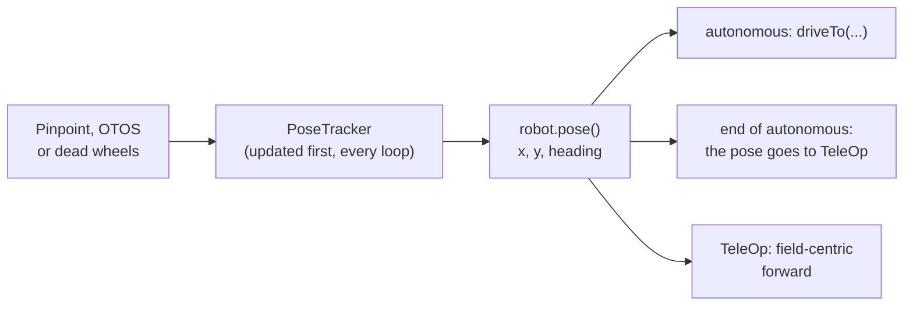
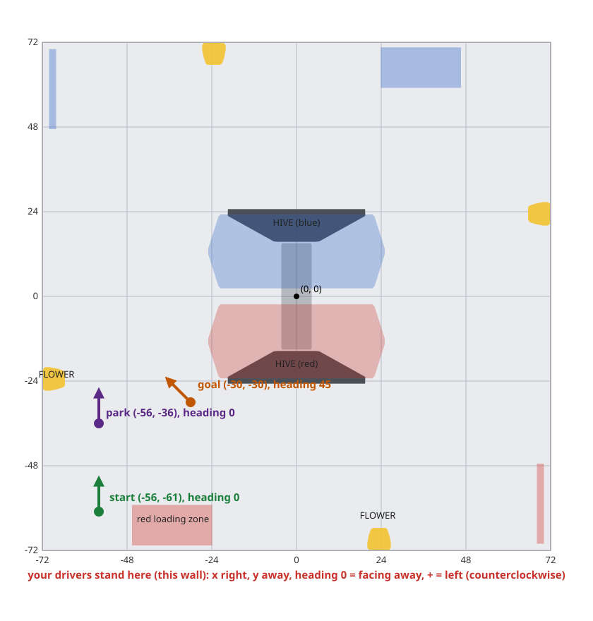

# Odometry module

> **Work in progress:** this library and its docs are still changing. Something wrong or unclear? [Tell us](https://github.com/crossbotics/ftc-helper-lib/issues/new/choose).

Package: `com.crossbotics.ftchelper.odometry` (the `Robot.java` line, [`Odometry`](#robotjava-the-odometry-line),
is in `com.crossbotics.ftchelper.robot`).

Learn it hands-on: [Add odometry](../add-to-robot/09-odometry.md). Worked example:
[`examples/.../odometrybot`](../../examples/src/main/java/com/crossbotics/ftchelper/examples/odometrybot).
Quick answers with code to copy: [cookbook: odometry and driveTo](../cookbook/11-odometry.md).

**Odometry** tells the robot where it is on the field. Small unpowered wheels, called **pods**, roll
on the tiles. They count how far the robot moved forward and sideways. An **optical sensor** under the
robot does the same job: it watches the floor go by, like a computer mouse. The library adds up every
small move. The result is where the robot is and which way it faces: its **pose** (x, y and heading).

**Drive wheels are not enough:** they slip. They spin when another robot pushes yours, and they skid
when the robot speeds up. Pods carry no load and do not slip, so they measure what happened.

**AprilTags are not enough in BIOBUZZ:** the tags are on the HIVE cells, and the cells move. A tag
gives your place compared with the tag, and the tag is not at a fixed place on the field. So this
season, odometry tells you where you are ([vision](vision.md)).

| Class | Use it to |
| --- | --- |
| [`Odometry`](#robotjava-the-odometry-line) | the one line in `Robot.java`: which device, and where it sits |
| [`PoseTracker`](#posetracker) | read the pose every loop, set it, check the device (every kind is one) |
| [`PinpointOdometry`](#pinpointodometry) | a goBILDA Pinpoint odometry computer with two pods |
| [`OtosOdometry`](#otosodometry) | a SparkFun OTOS optical sensor |
| [`DeadWheelOdometry`](#deadwheelodometry) | three dead-wheel pods, or two and the IMU, on motor encoder ports |
| [`OdometryTunerOpMode`](#the-odometry-tuner) | checks and measures the odometry and shows the lines to copy |



---

## The frame

The **frame** is the set of directions that the pose numbers use. The autonomous start spot uses the
same frame (`s.start(note, x, y, heading)`, see [Auto](../reference/steps.md#auto)). Stand at your
drivers' wall and look at the field:

```text
                    far wall
     +-----------------------------------+
     |                 y +               |
     |                 ^                 |
     |                 |                 |
     |   x -  <--------+-------->  x +   |    (0, 0) = the middle of the field
     |                 |                 |
     |                 v                 |
     |                 y -               |
     +-----------------------------------+
           your drivers' wall (you)
```

- **x**: inches to the RIGHT of the field's center line.
- **y**: inches AWAY from you (negative = your half).
- **heading**: degrees. 0 = facing away from you. **Counterclockwise is +**: 90 = facing left,
  -90 = facing right, 180 = facing you.
- The pose is the pose of the robot's **center**: the point it turns around (on a mecanum robot,
  the middle of the four wheels).

The map shows the BIOBUZZ field in this frame, with the example's start, goal and park points. It is drawn
from the RED wall. From the BLUE wall the numbers are the same: the field is turned half a turn between
the alliances, and `mirrorForRed()` is false.



`tools/field_map.py` makes the map from the simulator's field file (`sim/fields/biobuzz-2026.json`).

**Where (0, 0) is:** wherever the pose was last set. An `Auto` sets the pose from its start spot after ▶
(start on the Driver Hub). So with `s.start(note, x, y, heading)`, (0, 0) is the middle of the field.
With `s.start(note, heading)` (no spot), the robot starts at (0, 0), and x and y count from where it
started.

**The reason for this frame:** the drivers see the field this way. "Go to x -30, y -30" means the same
spot in every autonomous, from every start.

---

## Robot.java: the odometry line

One line in `define()`, next to the drive:

```java
odometry(Odometry.pinpoint("pinpoint").offsetsMm(-84, -168));             // goBILDA Pinpoint, 4-bar pods
odometry(Odometry.otos("otos").mountIn(0, -3, 0));                        // SparkFun OTOS
odometry(Odometry.threeWheels("par_left", "par_right", "perp")
        .trackWidthIn(13.2).perpForwardIn(-6));                           // three dead wheels
odometry(Odometry.twoWheels("par", "perp").parallelLeftIn(5).perpForwardIn(-6));   // two + the IMU
```

Put `import com.crossbotics.ftchelper.robot.Odometry;` at the top of `Robot.java`. The names are the
names in the robot configuration on the Driver Station. Use only one `odometry(...)` line.

The line gives you:

- `robot.pose()`: where the robot is, every loop ([below](#robotpose)).
- `s.driveTo(...)` in autonomous: drive to a field point ([below](#driveto)).
- TeleOp starts where autonomous ended, and field-centric "forward" comes from the odometry
  ([below](#teleop-starts-where-autonomous-ended)).
- The simulator gets pretend odometry (`:sim:fromRobot` writes its lines, [below](#the-simulator)).

The **offsets** say where the pods (or the sensor) sit, measured from the robot's center. When the
robot turns in place, a pod that is not at the center rolls too. The library takes that roll away, but
only when it knows how far the pod is from the center. The [Odometry Tuner](#the-odometry-tuner)
measures the offsets for you.

### Pinpoint

```java
odometry(Odometry.pinpoint("pinpoint").offsetsMm(-84, -168));
```

A **goBILDA Pinpoint** is a small computer on an I2C port. Two pods plug into it. The **X pod**
measures forward and back, and the **Y pod** measures sideways. The Pinpoint also has its own IMU (a turn
sensor). It works out the pose itself, about 1500 times a second. The library reads the answer once per
loop.

| Setting | Means | Default |
| --- | --- | --- |
| `pinpoint(name)` | the Pinpoint's configuration name | - |
| `offsetsMm(xPodLeftMm, yPodForwardMm)` | where the pods sit, mm (see the sketch) | 0, 0 |
| `robotSizeMm(lengthMm, widthMm)` | the frame's size, front to back and side to side (bumpers off). The middle of it is the robot's center. Needed by `podsFromEdgesMm` | - |
| `podsFromEdgesMm(forwardPodFromLeftMm, sidewaysPodFromFrontMm)` | the same as `offsetsMm`, measured from the edges: the X pod's wheel from the LEFT edge, the Y pod's wheel from the FRONT edge. The last of the two you write wins | - |
| `podsSwingarm()` | goBILDA swingarm pods instead of 4-bar pods | 4-bar pods |
| `ticksPerMm(counts)` | other pods: encoder counts per mm of wheel travel | - |
| `reversed("x")`, `reversed("y")`, `reversed("x", "y")` | a pod that counts the wrong way (the tuner says which). Names add up over several calls. `"X"` and `"x"` both work. A name that is not a pod stops INIT (`a Pinpoint's pods are "x" and "y"`) | none |

The two offsets (goBILDA's own meaning, from the SDK):

- **First number:** how far **LEFT** of the center the **X pod** (the forward-measuring one) is.
  Right of the center = negative.
- **Second number:** how far **FORWARD** of the center the **Y pod** (the sideways-measuring one) is.
  Behind the center = negative.

Seen from above, the example robot's `offsetsMm(-84, -168)`:

```text
                 FRONT
       +-----------------------+
       |                       |
       |           ^           |
       |           C           |   C = the robot's center
       |           |<-84 mm->[X]   X pod (rolls forward/back): 84 mm RIGHT of C  -> -84
       |         168 mm        |
       |           |           |
       |          [Y]          |   Y pod (rolls sideways): 168 mm BEHIND C       -> -168
       +-----------------------+
                 BACK
```

**Measure from the edges, not the center.** The center is hard to find on a real robot. Measure from the
frame's edges with a tape, and let the library do the math:

```java
odometry(Odometry.pinpoint("pinpoint").robotSizeMm(430, 400).podsFromEdgesMm(284, 383));
```

The robot is 430 mm long and 400 mm wide, so the center is 200 mm from the left edge and 215 mm from the
front. The X pod's wheel is 284 mm from the left edge: 84 mm right of the center (-84). The Y pod's wheel is
383 mm from the front edge: 168 mm behind the center (-168). The result is `offsetsMm(-84, -168)`. The
[Odometry Tuner](#the-odometry-tuner) then measures the exact offsets. It tells you to write
`.offsetsMm(...)` in place of `.podsFromEdgesMm(...)`.

Only the X pod's left/right distance matters, and only the Y pod's forward/back distance. A pod on the
center line gives 0. For swingarm pods, add `.podsSwingarm()`. For any other pod, add `.ticksPerMm(...)`.

### OTOS

```java
odometry(Odometry.otos("otos").mountIn(0, -3, 0));
```

A **SparkFun OTOS** (Optical Tracking Odometry Sensor) is a small sensor on an I2C port. It looks at
the floor like a computer mouse, and it has its own IMU. It needs no pods. It must sit 10 to 12 mm above
the tiles.

| Setting | Means | Default |
| --- | --- | --- |
| `otos(name)` | the OTOS's configuration name | - |
| `robotSizeMm(lengthMm, widthMm)` | the frame's size (bumpers off). Needed by `mountFromEdgesMm` | - |
| `mountFromEdgesMm(fromFrontMm, fromLeftMm, headingDeg)` | the same as `mountIn`, measured from the edges: the sensor's middle from the FRONT edge and from the LEFT edge, mm, and the heading | - |
| `mountIn(forwardIn, leftIn, headingDeg)` | where it sits: inches FORWARD of the center (back = negative), inches LEFT (right = negative), and which way the sensor's **Y arrow** points, degrees counterclockwise from the robot's front | 0, 0, 0 |

**The heading in `mountIn`:** the OTOS's own axes are x = right and y = forward (as in the SDK's
sample). So its **Y arrow** is its forward axis. Heading 0 means the Y arrow points to the robot's front.
Turn the sensor so its **X arrow** points forward, and its Y arrow points left: that is **90**
(counterclockwise). A Y arrow that points right is -90. `OtosOdometry` sends the offset to the OTOS as
`(-leftIn, forwardIn, headingDeg)`. Nobody has checked this on a robot yet. If a push forward shows up
as sideways in the `Pose` line, try the other sign.

The tuner does not measure where an OTOS sits. Measure it from the robot's edges with a tape, and write
`robotSizeMm(...).mountFromEdgesMm(...)`: for example `robotSizeMm(430, 400).mountFromEdgesMm(126, 200, 0)` is
`mountIn(3.5, 0, 0)`. The OTOS's two scale numbers
are in [`Tunables.Odometry`](#tunablesodometry).

### Three dead wheels

```java
odometry(Odometry.threeWheels("par_left", "par_right", "perp").trackWidthIn(13.2).perpForwardIn(-6));
```

**Dead wheels** are pods with no computer: each pod's encoder plugs into a motor port's encoder
connector. Two pods measure forward (one left of the center, one right), and one measures sideways. The
library works out the pose from their counts every loop. The names are the motor ports' configuration
names, in this order: left forward pod, right forward pod, sideways pod.

| Setting | Means | Default |
| --- | --- | --- |
| `trackWidthIn(inches)` | the distance between the left and right forward pods (required) | - |
| `perpForwardIn(inches)` | how far FORWARD of the center the sideways pod is (back = negative) | 0 |
| `podsSwingarm()`, `ticksPerMm(counts)` | the pods' encoder counts per mm | goBILDA 4-bar pods |
| `reversed(names...)` | the pods that count the wrong way, by port name | none |

The library takes the two forward pods' average as the forward move. So put them the same distance
from the center, one on each side.

```text
                 FRONT
       +-----------------------+
       |                       |
       | [L]       C       [R] |   L and R roll forward/back; trackWidthIn = L to R
       |                       |
       |          [P]          |   P rolls sideways: perpForwardIn = -(C to P), behind = negative
       +-----------------------+
```

A pod's port can still drive a motor. The pod's encoder cable takes the place of that motor's encoder,
and the library only reads the count. So a motor on that port loses its own encoder.

### Two dead wheels and the IMU

```java
odometry(Odometry.twoWheels("par", "perp").parallelLeftIn(5).perpForwardIn(-6));
```

This kind uses one forward pod, one sideways pod, and the Control Hub's IMU for the heading. It needs
the IMU in the drive line (`drive(...).imu(...)`). The odometry sets the IMU up and zeroes it at INIT.

| Setting | Means | Default |
| --- | --- | --- |
| `parallelLeftIn(inches)` | how far LEFT of the center the forward pod is (right = negative) | 0 |
| `perpForwardIn(inches)` | how far FORWARD of the center the sideways pod is (back = negative) | 0 |
| `podsSwingarm()`, `ticksPerMm(counts)`, `reversed(names...)` | as for three wheels | - |

**To choose a kind:** a Pinpoint is the easiest. The device works out the pose 1500 times a second,
and the library reads it once per loop over I2C. Three dead wheels need no extra computer, but they use
three encoder ports. Two wheels save a port, but they trust the IMU for turning. An OTOS has no wheels
to mount. But its height above the tiles matters, and you must measure its scale numbers.

### Your own pose source: Odometry.custom

```java
odometry(Odometry.custom(devices -> new MyPoseTracker(devices.get(MyDevice.class, "my_device"))));
```

Use this for a pose from somewhere else, like odometry fused with AprilTags, or another library's
localizer (the code that works out the pose). Your class extends [`PoseTracker`](#posetracker)
(`read()`, `write()`, `isReady()`, `status()`, `kind()`). The library makes it at INIT from the robot's
devices. `robot.pose()`, `driveTo` and the hand-off to TeleOp use it like the built-in kinds. **It must
use the library's frame** ([above](#the-frame)). `PoseTracker`'s `read()` and `write()` work in the
device frame (X forward, Y left), and the library turns them for you. The simulator has no pretend
device for it (`:sim:fromRobot` writes only a comment), and the Odometry Tuner does not measure it.

These mistakes stop INIT with a message: a setting for another kind (`mountIn` on a Pinpoint), three
wheels with no `trackWidthIn`, two wheels with no IMU, a device name used twice, an empty name, a
`reversed(...)` name that is not a pod (`the pods are [par_left, par_right, perp]`), and a `custom(...)`
that makes nothing (null).

---

## Tunables.Odometry

```java
public static class Odometry {
    public static boolean checked = false;
    public static double linearScalar = 1.0, angularScalar = 1.0;   // OTOS only
}
```

| Field | Means | Default |
| --- | --- | --- |
| `checked` | set it `true` by hand after the Odometry Tuner's Loop test passes. Until then, a real robot skips `driveTo` steps | false |
| `linearScalar` | OTOS only: distance scale (the tuner's Forward test measures it; allowed 0.872 to 1.127) | 1.0 |
| `angularScalar` | OTOS only: turning scale ([measure it by hand](#otos-turn-scale-by-hand); 0.872 to 1.127) | 1.0 |

The odometry reads them once, at INIT. They are not in the tuning menu: change them in `Tunables.java`
and rebuild.

**The reason for a switch you set by hand** is the same as for `Tunables.Drive.calibrated`. A pod that
counts the wrong way makes `driveTo` drive the wrong way, at speed. So the library does not drive to
points until a person has seen the Loop test pass. The simulator is the exception: there `driveTo` runs
anyway.

---

## robot.pose()

```java
FieldPose p = robot.pose();   // x, y in inches; headingDeg
```

`robot.pose()` gives where the robot is now, in [the frame](#the-frame): `p.x`, `p.y` and
`p.headingDeg`. It is a copy ([`FieldPose`](util.md#fieldpose)): a change to it does not move the robot.
It is `null` when `Robot.java` has no `odometry(...)` line.

Every loop, the odometry adds a line labeled `Pose` to the Driver Station by itself:
`x -30.0, y -30.0 in, heading 45.0`. When the device is not ready, a warning goes above it. To show the
pose your own way, add a line to `Controls.java`:

```java
show("Where", robot::pose);   // "(-30.0 in, -30.0 in, 45.0 deg)"
```

`robot.odometry()` gives the running [`PoseTracker`](#posetracker) (null before INIT, or with no
odometry line). `robot.odometrySpec()` gives the line as written. `robot.odometryChecked()` reads
`Tunables.Odometry.checked`.

---

## Camera fix (alpha)

> **ALPHA. NOT TESTED ON A ROBOT. OFF BY DEFAULT. NOT FOR BIOBUZZ.**
> BIOBUZZ's only field tags are under the CELLs, facing down, and each HIVE tips 30 degrees as it fills.
> The tags move during the match. So a position worked out from them is wrong whenever a HIVE tips.
> Aiming with those tags works: aiming needs the direction, and not the robot's place. The camera fix is
> for a season with fixed wall tags. Try it only to help test it, and tell us what you see.

`cameraFix(camera)` in `Robot.java` (`CameraPoseFix`, `CameraFixCheckOpMode`) corrects the odometry's x
and y. It uses the field position that a Limelight 3A works out from the AprilTags (MegaTag2). It uses
last season's lessons. Last season's version never worked for three reasons: the odometry itself lost
distance, the heading never reached the camera, and the field directions were guesses
([From last season](../from-last-season.md)).

- **The odometry must be right on its own first:** a 48 in move reads 48 in (the Drive Tuner, the Odometry
  Tuner). The camera only corrects small drift.
- **The fix smooths only the camera's correction** (`blend`, a fifth of the difference per picture). It
  never smooths the wheel moves.
- **The fix compares each picture with where the robot was when the camera took it**, and not with where
  the robot is now.
- **The fix refuses:** an old picture (`maxAgeMs`), a repeated one, fewer than `minTags` tags, the robot
  moving or turning fast, a jump bigger than `maxJumpIn`, a pose that was never set, and a mirrored RED
  field.
- **The heading goes to the Limelight** every loop (`updateRobotOrientation`, in the background), turned
  into its field frame.
- **A debug line says what happened** to each picture: `Camera fix (ALPHA): used +1.2, -0.4 in (4 tags, 1.3 in off)`
  or `refused: moving`. INIT says `Camera fix: ALPHA, NOT TESTED ON A ROBOT, off (Tunables.CameraFix.enabled = false). Not for BIOBUZZ: its tags move with the HIVE`.

```java
camera = add(Camera.limelight("limelight").goal("BLUE SCORING", "RED SCORING"));
odometry(Odometry.pinpoint("pinpoint").offsetsMm(-84, -168));
cameraFix(camera);                                       // Robot.java (alpha)

public static class CameraFix {                          // Tunables.java
    public static boolean enabled = false;               // true to try it
    public static double turnDegBlue = 0, turnDegRed = 0; // the Camera Fix Check finds them
}
```

**The field directions** are the turn from the Limelight's field frame to ours, a multiple of 90
degrees. A test finds them: the **Camera Fix Check**. It is not in Tune and check (the camera fix is
alpha, and not for BIOBUZZ), so run it from a file of your own.

**Where:** a new file in TeamCode, next to Robot.java.

```java title="CameraFixCheck.java"
@TeleOp(name = "Camera Fix Check", group = "Finders")
public class CameraFixCheck extends CameraFixCheckOpMode {
    @Override protected RobotDefinition robot() { return new Robot(); }
}
```

Put the robot on the field facing away from your drivers' wall, with tags in view. The test shows the
Limelight's own pose, the turn that fits, and the robot's place with that turn. Check the place with a
tape measure. X saves the turn for BLUE, and B saves it for RED. The Limelight's pipeline (a set of
camera settings saved on the Limelight) needs Full 3D and the right tag size
([Limelight lighting pipelines](../guides/limelight-lighting.md)).

| `Tunables.CameraFix` | What it does | Default |
| --- | --- | --- |
| `enabled` | on or off | false |
| `turnDegBlue`, `turnDegRed` | the turn from the Limelight's field frame to ours (Camera Fix Check) | 0 |
| `maxAgeMs` | the fix skips a picture older than this | 100 |
| `maxSpeedInPerSec`, `maxTurnDegPerSec` | the fix skips pictures while the robot moves or turns faster | 20, 30 |
| `maxJumpIn` | the fix refuses a bigger difference | 12 |
| `blend` | how much of the difference the fix applies, per picture | 0.2 |
| `minTags` | the fix skips a picture with fewer tags | 2 |

## PoseTracker

Every kind of odometry is a `PoseTracker`, so your code reads them all the same way.

| Method | What it does |
| --- | --- |
| `update()` | reads the device once and works out the new pose. The robot calls it for you, first, once per loop |
| `pose()` | this loop's pose (a copy) |
| `setPose(FieldPose)` | says "the robot is here now". Autonomous does this from its start spot, and TeleOp from where autonomous ended. When the device is not ready yet (a Pinpoint still calibrating in TeleOp's INIT), the tracker keeps the pose and writes it to the device as soon as the device is ready |
| `isPoseSet()` | whether `setPose` was called. Until then the pose is only "(0, 0) where it was turned on", and not a place on the field. So [aiming by odometry](../reference/parts/aim.md) stays off |
| `unsetPose()` | says "the pose is not known any more". `isPoseSet()` becomes false (the numbers stay), so aiming by odometry stays off until the pose is set again. TeleOp does this when the driver switches the alliance on a field that is not mirrored ([buttons guide](../controls/04-move-library-buttons.md#switching-the-alliance-in-teleop)) |
| `setHeading(deg)` | the way the robot faces now becomes this heading, and x and y stay (TeleOp's "forward = away from you now"). It does not count as setting the pose |
| `speedInPerSec()`, `turnDegPerSec()` | how fast it moves (in/s) and turns (deg/s, counterclockwise +). A Pinpoint or OTOS gives it. For dead wheels, the library works it out from how far the robot moved between loops. It smooths it over about 0.06 s, so it is a little behind |
| `velocityX()`, `velocityY()` | which way it moves over the field, in/s: toward +x (right, seen from your drivers' wall) and +y (away), whichever way the robot faces. A Pinpoint and an OTOS give it over the field directly. Dead wheels work as above. [Shooting on the move](../reference/parts/aim.md) uses it |
| `useClock(nanos)` | tests: a pretend clock for the dead-wheel speed |
| `isReady()` | whether the device works and gives a pose |
| `status()` | words for the Driver Station (table below) |
| `kind()` | "Pinpoint", "OTOS", "three dead wheels" or "two dead wheels + IMU" |
| `name()`, `addTelemetry(t)` | the [Subsystem](core.md#subsystem) parts: the `Pose` line, and a warning when the device is not ready |

`status()` and the warning:

| Kind | Status | Means |
| --- | --- | --- |
| Pinpoint | `ready` | working |
| Pinpoint | `calibrating (keep the robot still)` | its IMU is starting: do not move the robot |
| Pinpoint | `starting up` | it has only now powered on |
| Pinpoint | `X pod not found: check its cable`, `Y pod not found: check its cable`, `no pods found: check both cables` | a pod is unplugged |
| Pinpoint | `IMU fault: power the robot off and on` | its IMU stopped working |
| Pinpoint | `bad reading (I2C cable?)` | a garbled answer: check the I2C cable |
| Pinpoint | `no answer` | no status at all |
| OTOS | `ready` / `not answering: check the I2C cable and the configuration` | checked at INIT, then again once a second |
| Dead wheels | `ready` | always. An encoder cannot say that it is unplugged: the Odometry Tuner's counts show it |

A device that is not ready does not stop the program: the warning tells the drive team. An autonomous
also reads the odometry in INIT. It shows `Odometry: Pinpoint ready`, or a warning such as
`Odometry (Pinpoint): X pod not found: check its cable`. So the drive team sees a missing pod before ▶.

**How the frames fit (for veterans).** Inside, `PoseTracker` works in one shared device frame: X forward
and Y left at heading 0. The goBILDA Pinpoint and the dead-wheel math use this frame. The library's
frame is a quarter turn from it: our x (right) = -Y, our y (away) = X, and the heading is the same.
`PoseTracker` turns one into the other in `update()` and `setPose()`. The SparkFun OTOS's own axes are
different again: x = right, y = forward (as in the SDK's sample). `OtosOdometry` converts its position,
speed and mounting offset to the shared frame. So `mountIn(forward, left, heading)` stays forward and
left. Your code only sees the drivers' frame.

### PinpointOdometry

The robot layer makes it for you. To make it without the five files:

```java
GoBildaPinpointDriver pp = hardwareMap.get(GoBildaPinpointDriver.class, "pinpoint");
PoseTracker odo = new PinpointOdometry("pinpoint", pp, -84, -168,
        GoBildaPinpointDriver.GoBildaOdometryPods.goBILDA_4_BAR_POD, 0, false, false);
// every loop:
odo.update();
FieldPose p = odo.pose();
```

The arguments: name, device, X pod mm left, Y pod mm forward, pod type (or `null` to use the next
number), counts per mm (only when the pod type is `null`), X reversed, Y reversed. The constructor zeroes
the Pinpoint and its IMU (`resetPosAndIMU()`). So the robot must stay still for about a quarter second,
as it does in INIT. For anything else, `device()` gives the SDK's `GoBildaPinpointDriver`.

### OtosOdometry

```java
SparkFunOTOS sensor = hardwareMap.get(SparkFunOTOS.class, "otos");
PoseTracker odo = new OtosOdometry("otos", sensor, 0, -3, 0, 1.0, 1.0);
```

The arguments: name, device, inches forward, inches left, its heading, linear scale, angular scale.
The constructor sets inches and degrees, the mounting offset and the scales. It also calibrates the
OTOS's IMU and zeroes it, so the robot must stay still. `device()` gives the SDK's `SparkFunOTOS`.

### DeadWheelOdometry

```java
PoseTracker odo = DeadWheelOdometry.threeWheels("odometry", left, right, perp,
        505.3, 13.2, -6, false, false, false);   // counts per inch, track width, perp forward, reversed x3
PoseTracker odo2 = DeadWheelOdometry.twoWheels("odometry", par, perp,
        () -> imuHeadingDeg(), 505.3, 5, -6, false, false);   // + the heading, counter-clockwise +
```

The pods are `DcMotorEx` ports, and the library reads only `getCurrentPosition()`. 505.3 counts per inch
is a goBILDA 4-bar pod (19.894 counts per mm). The math each loop:

- With three wheels, the turn is (right - left) / track width, and the forward move is their average.
- With two wheels, the turn comes from the IMU, and the library takes away the forward pod's roll during
  the turn.
- The library also takes away the sideways pod's roll during the turn.
- Then it turns the move into the field frame, with the heading halfway through the turn.

### Escape hatches (for veterans)

When the five files do not cover what you need:

| Use | What you get |
| --- | --- |
| `robot.odometry()` | the running `PoseTracker` (null before INIT, or with no odometry line) |
| `((PinpointOdometry) robot.odometry()).device()` | the SDK's `GoBildaPinpointDriver` (raw encoder counts, its own status, its loop rate) |
| `((OtosOdometry) robot.odometry()).device()` | the SDK's `SparkFunOTOS` |
| `Odometry.custom(devices -> ...)` | your own pose source in place of the built-in kinds ([above](#your-own-pose-source-odometrycustom)) |
| `AutoRoutine.driveTo(label, poseSupplier, readySupplier, x, y, heading, maxPower, toleranceIn)` | `driveTo` on any pose you supply, outside the five files. It stops with `NO_ODOMETRY` when `readySupplier` stays false for 0.2 s. Leave `readySupplier` out, and it always trusts the pose |

---

## What runs every loop

- **The odometry updates first,** before every other part and before the actions
  (`RobotDefinition.setup` adds it first). So every part, every action and every `driveTo` reads
  this loop's pose.
- **Pinpoint:** one I2C read per loop. `update()` on the driver reads position, speed and status in
  one go. The Pinpoint does its own math 1500 times a second, so the loop's speed does not change
  its accuracy.
- **OTOS:** two I2C reads per loop (position, then speed).
- **Dead wheels:** one encoder read per pod (part of the hub's bulk read), and the library's math.
- **Two dead wheels:** one IMU read per loop on top of that. The IMU is not part of a bulk read.
- **In INIT** the odometry does not update (the same as every part). **While paused** (BACK), the library
  does not read it either. A Pinpoint or OTOS keeps counting on its own, and dead wheels catch up on the
  next loop.

More: [What runs every loop](../guides/every-loop.md).

---

## driveTo

```java
s.start("Against our wall, in the left corner tile, facing the field", -56, -61, 0)
 .driveTo("To the goal", -30, -30, 45, 0.6)     // x, y, heading, max power
 .driveTo("Park", -56, -36, 0, 0.7, 2.0);       // last number: "close enough", inches (default 1)
```

`driveTo(label, xIn, yIn, headingDeg, maxPower)` drives to a point on the field and turns to a
heading at the same time. It is a [Steps](../reference/steps.md#auto) step (and an `AutoRoutine` and
`AutoDrive` method underneath). It works only on mecanum, because it drives sideways. On a tank drive,
INIT stops with `Steps: driveTo("...") needs a mecanum drive (it drives sideways)...`. So you find out
before the match, and not in the middle of it. On a tank drive, use `turnTo` and then `move`.

How it drives, every loop:

1. It reads the pose. It works out how far the point is, and turns that into "forward" and "right" for
   the robot.
2. **Far away:** it sets the speed like a `move`: up to `maxPower`, slower as it gets close, but never
   less than `Tunables.Drive.moveMinPower`.
3. **In the last 8 inches:** it sets the speed in proportion to the distance left (0.04 power per inch,
   at least 0.12; `AutoDriveConfig.driveToNearIn`, `driveToKp` and `driveToMinPower`). So it settles on the point and does not circle it.
4. **The heading:** it corrects the heading all the way with the drive's turn numbers (`turnKp`,
   `turnKd` in `Tunables.Drive`). While the heading is off, the turn power is at least
   `AutoDriveConfig.turnMinPower` when that is set (more than 0), or else 0.08. So a weak turn cannot stop
   a bit short (`Tunables.Drive.turnMinPower`; the Move Tuner finds it).
5. **Done:** it is within the **tolerance** ("close enough": 1 inch unless you give one), and within 2
   degrees of the heading (or the drive's `turnToleranceDeg`, if that is bigger). This must be true for
   3 loops in a row, so passing by does not count.

**If the odometry stops working** during a `driveTo`, `isReady()` becomes false. A Pinpoint fault (like
an unplugged pod) or an OTOS that stops answering does this. A short glitch does no harm: the robot holds
still and waits up to 0.2 s. If the odometry is still not ready, the step ends with the report word
`NO_ODOMETRY`. On a frozen pose, the robot would never arrive, and it would push on until the time ran
out. The library checks the OTOS's connection again once a second.

It also ends early:

- `STALLED` when it is stuck. Farther than 8 inches from the point, the rule is the same as a `move`:
  less than 0.25 in closer in 0.4 s. In the last 8 inches, where it is slow on purpose, the rule is less
  than 0.1 in closer in 2 s.
- `TIMED_OUT` after 10 s.
- `STOPPED` on STOP or park time.

The report shows the word.

**After any of these, the autonomous goes on with its next steps**, from wherever the robot is. So put
a mechanism action that needs the right place right after the `driveTo` that gets it there. Check the
report after practice runs. A `driveTo` that did not say `done` means the next steps started from the
wrong place. In your own `step(...)`, you can check `robot.pose()` before an action.

**`driveTo` is better than `move` with odometry.** A `move` counts the drive wheels. After a bump, a slip
or a push, every later step is off. `driveTo` checks the real pose every loop and keeps correcting. So it
ends at the field point, wherever the bump left the robot. And each point is a place on the field, so a
change to one step does not shift the steps after it.

**Its rules:**

- It needs an `odometry(...)` line in `Robot.java`. Without one, INIT stops:
  `Steps: driveTo("To the goal") needs odometry: add an odometry(...) line to Robot.java (docs/modules/odometry.md)`.
- On a real robot it needs `Tunables.Odometry.checked = true`. Until then the step does nothing, and
  the report says `To the goal: skipped: Tunables.Odometry.checked is false (run the Odometry Tuner first)`.
  In the simulator it runs anyway.
- Like every step, it needs a tuned drive (`Tunables.Drive.calibrated = true`).
- **RED:** you write the numbers for BLUE, like the start spot. With `mirrorForRed()` true (the default),
  RED flips x and the heading (x -30 becomes x 30, heading 45 becomes -45), and y stays. With
  `mirrorForRed()` false (BIOBUZZ: the field is turned half a turn), RED uses the same numbers, seen
  from the red wall.
- Use the start spot (`s.start(note, x, y, heading)`) with it: the pose starts there. Without a spot,
  the pose starts at (0, 0) where the robot stands, and the points count from there.

**`turnTo` and `driveTo` use different headings.** `turn` and `turnTo` use the Control Hub's IMU, with
0 = the way the robot faced at the start. `driveTo` uses the field heading from the odometry, with
0 = facing away from your wall. They agree only when the start heading is 0. Take
`s.start(note, x, y, 90)`: `turnTo(..., 0, ...)` turns back to the start direction, which is field
heading 90. But `driveTo(..., 0, ...)` faces away from your wall. **With odometry, give headings in
`driveTo`** (field numbers, like the points). If you also use `turnTo`, remember that its 0 is the start.

Every step: [driveTo](../building-autos/04-drive-to-points.md#drive-to-a-point-driveto).

---

## Keep-out boxes and routes

`driveTo` drives one straight line. That works when you know where the line starts. But
`parkWithSeconds` can stop the robot at any place in the middle of a step. Then you do not know where the
line starts, and the line can go through a field element. A **route** goes around such places. The robot
works out the route when it sets off, from where it is at that moment.

**1. List the boxes in `Robot.java`.** Each box is two opposite corners, in `driveTo`'s numbers, written
for BLUE. The library knows no game, so you choose the numbers.

```java
odometry(Odometry.pinpoint("pinpoint").offsetsMm(-84, -168));
fieldMap(FieldMap.margin(13)
        .keepOut("HIVE frame, near", -19.5, -24.8, 19.5, -15.4)
        .keepOut("HIVE frame, far", -19.5, 15.4, 19.5, 24.8));
```

**The margin** is how far the robot's center stays from every box. Make it half the robot's corner to
corner size, plus some for odometry drift (the error that grows as the robot drives). For an 18 x 18 in
robot, that is 13 in. A bigger margin is safer, but it closes small gaps between boxes. With a margin of
13, the 30.8 in gap between these two frames leaves a path 4.8 in wide for the robot's center. A route's
corners also stay inside the walls by the margin. A path less than 2.5 in wide needs a `.safePoint(x, y)`
at each end. The boxes' corners do not fit in it, so without the safe points the route says `no route`.

**2. Use it in an autonomous.** `routeTo` takes the same numbers as `driveTo`.

```java
s.start("Against our wall, in the left corner tile, facing the field", -56, -61, 0)
 .driveTo("To the goal", -30, -30, 45, 0.6)
 .parkWithSeconds(6)
 .routeTo("Park", -56, -36, 0, 0.8);
```

**3. Or use it in TeleOp.** In `Controls.java`, `route(...)` makes a job. A button or a time starts it.

```java
Runnable park = route("Park", -56, -36, 0, 0.8);
g1.dpadLeft.tap(park).says("drive to the park spot (a drive stick stops it)");
atSecondsLeft(10, park);
```

**How the robot finds the route.** It tries the straight line first. If the line crosses a box (with
the margin added), the robot goes around the boxes' corners by the shortest way of straight lines. It
slows down at each corner, but it does not stop there. It goes on up to 2 in early, or after it slid past
the corner by up to 8 in. (In the simulator, at power 0.7, the robot slid about 6 in past a corner.) It does this only if the line from where it is to the next point
misses every margin. If not, it drives back to the point first. So list what stands near the corners too.
To make routes go your way, add `.safePoint(x, y)`: a place a route may pass through, at least 0.5 in
outside every margin. A robot that stands inside a margin first goes out by the nearest side.

**A spot right next to a box** (a place to score, inside the margin) is allowed. The robot first goes to a point
outside the margin, then straight in. Only that last line is inside the margin, so check it on the robot.
A spot on the box itself stops INIT. So does a spot with no way in from outside.

**A spot near a wall:** the library does not know your robot's size. When a spot is closer to a wall than
half your robot, the robot presses against the wall, and the route ends `STALLED`.

**In TeleOp, the driver always wins:**

- **Any drive stick stops the route at once**, and the sticks drive from that loop on. The Driver Station
  says `Park: stopped: a drive stick moved`.
- **A route that `atSecondsLeft(...)` starts does not take the robot from a driver who is driving.** If a
  stick is pushed at that time, the gamepad buzzes, and the Driver Station says `Park: waiting: let go of the
  drive sticks to start it`. The route starts on the first loop after the driver lets go of the sticks.
  After 5 s it gives up: `Park: not started: the driver kept driving`. It waits no longer because a driver
  who parked by hand and lets go at the last moment must not see the robot drive off. Pause and the tuning
  menu make it wait the same way. If the match ends first, it does not start:
  `Park: not started: the match is over`.
- Pause and the tuning menu stop it too. It does not set off again by itself.
- It never waits: the rest of the robot keeps running. The robot refuses "Set pose here" while a route
  drives.
- `Park: there` says it arrived. It also ends on `STALLED`, `TIMED_OUT` (10 s on one line of the route)
  or `NO_ODOMETRY`, the same words as `driveTo`.
- The sticks' slow button and reverse drive do nothing to a route. Whole-robot aim does not turn the
  robot during a route.

**When it does not set off:**

| Where | The words | Why |
| --- | --- | --- |
| INIT stops | `needs a map`, `needs odometry`, `needs a mecanum drive` | a line is missing in `Robot.java` |
| INIT stops | `... is on "HIVE frame, near"` | the spot you gave is on a box: move it |
| INIT stops | `... and a robot cannot drive in from outside` | other boxes close every way to that spot: move it, or use a smaller margin |
| Report, or Driver Station | `no route` | boxes close every way. The robot stays where it is |
| Report, or Driver Station | `no pose` / `the pose is not set` | nothing set the pose ([set pose here](#tunablesodometry), or a start spot with x and y) |
| Report, or Driver Station | `Tunables.Odometry.checked is false` | run the [Odometry Tuner](#the-odometry-tuner) first (in the simulator it runs anyway) |
| Driver Station | `Tunables.Drive.calibrated is false` | run the Drive Tuner first (in the simulator it runs anyway) |
| Driver Station | `the driver kept driving` | a time started it, and a drive stick stayed pushed for 5 s |

When `Controls.java` has a `route(...)`, the INIT screen warns about the two tuners' words. So you find
out before the match. These two switches are true/false lines in `Tunables.java`. The tuning menu does not
show them: change them in the file.

**Its limits.** It uses only the odometry's numbers, and it cannot see. **Another robot is not on the
map**, and a wrong pose gives a wrong route. If the robot hits something, the stuck check ends the route
(`STALLED`), and the robot does not reach the spot. Make the first test slow, and stand by to stop it.

**RED:** you write the numbers for BLUE, like `driveTo`. With `mirrorForRed` true, RED drives the mirror
image of the route (x and the heading flip). With it false (BIOBUZZ), RED uses the same numbers from the
red wall.

More: [`FieldMap` and `RouteDriver`](drive.md#fieldmap), the [cookbook](../cookbook/11-odometry.md#how-do-i-get-around-field-elements-on-the-way-to-a-spot).

---

## TeleOp starts where autonomous ended

1. **Autonomous, at ▶:** the first step ("Start") sets the pose from the start spot (mirrored for RED
   like the routes).
2. **Autonomous end** (done, STOP or an error, after ▶): the library saves the whole pose
   (`robot.pose()`) in [`MatchMemory`](match.md#matchmemory) / [`PoseStore`](util.md#posestore).
3. **TeleOp INIT** (`Controls.java`): if autonomous left a pose in the last 5 minutes, the odometry
   starts there. Otherwise it starts at (0, 0, 0) where the robot stands.
4. **Field-centric "forward"** comes from the odometry's heading. The odometry's heading carries on from
   autonomous with nothing added, and the Pinpoint's and OTOS's IMUs are made for this job.
   With field-centric on, holding BACK for 1 s makes "forward" the way the robot faces now. The press of
   BACK also pauses the robot at once, and the robot stays paused after the reset: tap BACK to go on. The
   reset changes only the driver's "forward". The pose does not change, so aiming at a field point stays right.

---

## The simulator

The simulator has a pretend Pinpoint, OTOS and dead wheels. They measure the robot's true motion, so
`robot.pose()`, `driveTo` and the Odometry Tuner work there. `./gradlew :sim:fromRobot` writes the
lines from `Robot.java` (they end with `# from Robot.java`). You add the noise lines yourself. They show
why `driveTo` keeps correcting.

| Robot-file line | Default | Means |
| --- | --- | --- |
| `odometry = pinpoint NAME` (or `otos NAME`, `threeWheels L, R, P`, `twoWheels PAR, PERP`) | none | the kind and the configuration name(s) |
| `odometry.offsetsMm = X, Y` | 0, 0 | Pinpoint: where the pods sit (as `offsetsMm`). They set the pretend pods' raw counts, which the tuner's Spin test reads |
| `odometry.mountIn = F, L, H` | - | OTOS: as `mountIn`. The pretend OTOS already reports the center's pose, so it does not change the simulation |
| `odometry.trackWidthIn` | 12 | three wheels: left to right pod |
| `odometry.parallelLeftIn` | 0 | two wheels: the forward pod, inches left |
| `odometry.perpForwardIn` | 0 | dead wheels: the sideways pod, inches forward |
| `odometry.ticksPerIn` | 505.3 (4-bar pods) | dead wheels: pod counts per inch |
| `odometry.reversed = names` | none | these pods count backward, as wired (the code's `reversed(...)` turns them back): dead-wheel port names, or `x`/`y` for a Pinpoint's pods |
| `odometry.scaleError = 0.01` | 0 | noise: it measures 1% too far (wheel slip, a wrong pod size) |
| `odometry.driftDegPerMin = 0.5` | 0 | noise: the heading creeps this much per minute |

The tools also turn a Pinpoint or OTOS in the robot configuration XML into an odometry line.
`./gradlew :sim:fromConfig` writes `odometry = pinpoint NAME` (and `odometry.offsetsMm = 0, 0` with a
TODO). `./gradlew :sim:newRobot` writes the `odometry(...)` line in `Robot.java` and a
`Tunables.Odometry` section with `checked = false`. They use only the first one they find. An
`Odometry.custom(...)` line has no pretend device: `:sim:fromRobot` writes only a comment for it.
Details: [simulator guide](../reference/robot-file.md#every-setting).

---

## The Odometry Tuner

`OdometryTunerOpMode` (package `com.crossbotics.ftchelper.finders`) checks and measures the odometry
of the robot in five files. Give it your robot in a small file next to `Robot.java`:

```java
package org.firstinspires.ftc.teamcode;

import com.qualcomm.robotcore.eventloop.opmode.TeleOp;
import com.crossbotics.ftchelper.finders.OdometryTunerOpMode;
import com.crossbotics.ftchelper.robot.RobotDefinition;

@TeleOp(name = "Odometry Tuner", group = "Finders")
public class OdometryTuner extends OdometryTunerOpMode {
    @Override
    protected RobotDefinition robot() {
        return new Robot();   // your Robot.java, with its odometry(...) line
    }
}
```

The sticks drive slowly (30%) in every test. D-pad up/down chooses a test, **A** starts it, and **B**
ends it. GUIDE shows help (or hold the gamepad's START button for 1 s). Each test starts the pose at
(0, 0, 0).

| Test | You do | It finds |
| --- | --- | --- |
| 1 Forward 48 in | push or drive the robot 48 in straight forward along a tape, B | the forward pod's direction, and how far off the distance is (sideways drift too). OTOS: `Tunables.Odometry: linearScalar = ...` (multiply it with the one in use). Pods more than 2% off: check the pod type (Pinpoint) or `ticksPerMm(...)` (dead wheels), and the tape. More than 10% off: "was it really 48 in?" The mistake is in the test, and not in the pods, so there is nothing to copy |
| 2 Left 24 in | push or drive it 24 in straight to its LEFT, B | the sideways pod's direction (a tank robot: push it) |
| 3 Spin 3+ turns | turn it in place at least 3 times (right stick), B | only the numbers to change: `Robot.java: in the odometry(...) line, .offsetsMm(-84.2, -167.5)`, or `.trackWidthIn(..).perpForwardIn(..)` (three wheels), or `.parallelLeftIn(..).perpForwardIn(..)` (two). `.reversed(...)` and the pod type stay as written. OTOS: no offsets ([turn scale by hand](#otos-turn-scale-by-hand)) |
| 4 Loop and back | start on a tape mark, drive anywhere, come back onto the mark facing the same way, B | within 1 in and 2 degrees: `Tunables.Odometry: checked = true` |

When a pod counts the wrong way, the Forward or Left test says so. It also says which name to put in
(or take out of) `.reversed(...)`. On a Pinpoint, the Spin test measures the turn from the odometry's
own heading. For dead wheels and the OTOS, it uses the Control Hub's IMU. So dead wheels and the OTOS
need the IMU in the drive line (`drive(...).imu(...)`). Without it, the tuner stops at INIT with
`the Odometry Tuner's Spin test needs the IMU: add .imu(...) to drive(...)`. Copy the lines (the tuner
also saves them in `finder-results.txt` at STOP), rebuild, and run Loop. The full walk-through:
[Odometry Tuner](../tuning/09-odometry-tuner.md).

### OTOS turn scale by hand

The tuner does not measure an OTOS's `angularScalar`, so measure it by hand:

1. Put the robot on a tape mark, square to a tile seam. Run the tuner (or any TeleOp that shows the pose).
2. Start the Spin test (it zeroes the pose). Turn the robot LEFT (counterclockwise) exactly 10 whole
   turns, slowly, and stop square to the seam again.
3. Read the heading `h` (it should be 0).
4. New `angularScalar` = old × 3600 / (3600 + h). For example, `h` = 18 means it counted 3618 degrees,
   so 1.0 × 3600 / 3618 = 0.995.

Use 10 turns because a 1% error is only 3.6 degrees after one turn: too small to read. After 10 turns
it is 36 degrees.

---

## Questions for veterans

What the code shows, and what is **not yet checked on a robot**:

- **Whether `getEncoderX()`/`getEncoderY()` include the Pinpoint's direction setting:** the tuner's
  Spin test assumes they do **not**. It reads the raw counts and flips a pod in `.reversed(...)` itself.
  Nobody has checked this on a robot yet. If the raw counts are already flipped, the Spin test gives a
  reversed pod's offset the wrong sign, and the Loop test then fails.
- **Whether `setPosition` sticks while the Pinpoint is calibrating:** the library does not depend on it.
  The tracker keeps a pose set while the device is not ready, and writes it once `isReady()` is true
  ([`setPose`](#posetracker)). Nobody has checked on a robot whether the device would have kept it.
- **Whether a pod unplugged in the middle of a match shows up:** the Pinpoint has fault statuses
  (`X pod not found`, `Y pod not found`, `no pods found`, `IMU fault`, `bad reading`). The library shows
  them as a warning, and ends a `driveTo` with `NO_ODOMETRY` after 0.2 s of not ready. Nobody has checked
  on a robot whether the Pinpoint reports a pod pulled out while it runs (and not only at power-up). Dead
  wheels cannot tell at all: an unplugged encoder stops counting.
- **The field heading for TeleOp's field-centric, and not the IMU:** the field heading carries on from
  autonomous with nothing added ([above](#teleop-starts-where-autonomous-ended)).

---

## If something goes wrong

| What you see | Why, and what to do |
| --- | --- |
| `Pinpoint: X pod not found` (or Y, or both) | the pod's cable is out of the Pinpoint, or in the other port |
| `Pinpoint: calibrating (keep the robot still)` stays | the robot moved during INIT: hold it still, or INIT again |
| `OTOS: not answering` | the I2C cable, or the configuration name or type |
| The pose goes up when it should go down | a pod counts the wrong way: run the tuner's Forward and Left tests |
| The pose drifts when the robot only turns in place | the offsets are wrong: run the Spin test |
| x and y look swapped | the pods are in the wrong ports (Pinpoint: X = forward pod), or the OTOS's `mountIn` heading is wrong |
| `skipped: Tunables.Odometry.checked is false` | run the tuner's Loop test, then set `checked = true` |
| `driveTo` goes to the mirror spot on RED | `mirrorForRed()`: false on a turned field (BIOBUZZ) |
| `driveTo` ends with `NO_ODOMETRY` | the odometry was not ready for more than 0.2 s during the drive: read its warning (a pod cable, the I2C cable). The next steps still ran |
| INIT stops: `odometry .reversed("...")` | a name that is not a pod: a Pinpoint's are `"x"` and `"y"`, dead wheels' are their port names |
| The tuner stops at INIT: `needs the IMU` | dead wheels or an OTOS: add `.imu(...)` to `drive(...)` |
| `turnTo(0)` and `driveTo(..., 0, ...)` face different ways | `turnTo` uses the IMU with 0 = the start direction; `driveTo` uses the field heading ([driveTo](#driveto)) |
| `driveTo` circles the point, or stops short | `Tunables.Drive.turnKp`/`turnKd` (the heading), `moveMinPower`; or a tolerance under 1 in that it cannot reach |
| TeleOp's field-centric is wrong after autonomous | the start spot's heading in `s.start(...)` is wrong |
| `robot.pose()` is null | `Robot.java` has no `odometry(...)` line |
