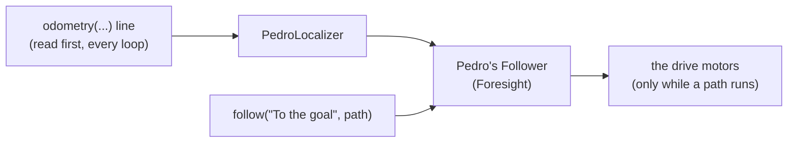

# Pedro module (Pedro Pathing)

> **Work in progress:** this library and its docs are still changing. Something wrong or unclear? [Tell us](https://github.com/crossbotics/ftc-helper-lib/issues).

Package: `com.crossbotics.ftchelper.pedro`, in the **`pedro`** folder (an optional add-on: the core
library never needs it). The step that uses it, `follow(...)`, is in `Steps`.

New to path following? Start with [Lesson 9: Paths with Pedro Pathing](../tutorials/start/09-paths-with-pedro.md).
Worked example: [`examples/.../pedrobot`](../../examples/src/main/java/com/crossbotics/ftchelper/examples/pedrobot).
Read [the odometry module](odometry.md) first: Pedro needs a working, checked odometry.

**Pedro Pathing** ([pedropathing.com](https://pedropathing.com)) is a path follower. You give it a
path (a line or a smooth curve), and it drives the robot along it fast, correcting all the way, and
brakes at the end. `driveTo` goes to one point. Pedro follows a whole path, curves included.

> **Mecanum drives only.** Pedro corrects the robot's position by sliding it sideways, so it needs
> wheels that can strafe. Pedro 3.0.2 has two drivetrains, Mecanum and Swerve, and no tank (two-side)
> drive. With a tank `drive(...)` line, `Pedro.follower(...)` stops INIT with a clear message. A tank
> robot uses odometry with `turnTo` and `move` instead ([autonomous builder](../guides/autonomous-builder.md)).
> Swerve: build Pedro's `Swerve` drivetrain yourself through the
> [escape hatch](#escape-hatches) (not tested; the library has no swerve `drive(...)` line).

**When to use which:**

| You want | Use |
| --- | --- |
| go to a point, simple and easy to read | `driveTo` (no add-on, no extra tuning) |
| a curved path, or more speed with smooth braking | Pedro (`follow`), after Pedro's own tuning |

Both use the same field numbers and the same odometry, so you can mix them in one autonomous.

| Class | Use it to |
| --- | --- |
| [`Pedro`](#robotjava-the-follower-line) | the one line in `Robot.java`: `follower(Pedro.follower(...))` |
| [`PedroPath`](#pedropath-paths-in-our-field-numbers) | make a line or a curve in our field numbers |
| [`PedroTuning`](#tuning-pedro) | run Pedro's own tuners on your robot's drive and odometry lines |
| [`PedroFollower`](#what-runs-every-loop) | Pedro's Follower as a part of the robot (made for you) |
| [`PedroLocalizer`](#what-runs-every-loop) | gives Pedro the pose from your `odometry(...)` line (made for you) |
| [`PedroFrame`](#the-frame) | turns poses between our numbers and Pedro's |



---

## Add it to your robot project

Do this once, after the library itself works ([Add the library](../01-add-to-project.md)).

**1. `settings.gradle`** (the project folder, not TeamCode). Under the library's two lines, add:

```groovy
include ':ftc-helper-lib-pedro'
project(':ftc-helper-lib-pedro').projectDir = new File(rootDir, 'ftc-helper-lib/pedro')
```

**2. `TeamCode/build.gradle`**, in `dependencies { ... }`, under the library's line:

```groovy
implementation project(':ftc-helper-lib-pedro')
```

**3. Sync** (**File > Sync Project with Gradle Files**).

**Why:** Pedro is a separate library (from Maven Central). The `pedro` folder brings Pedro in
(version 3.0.2, the version this module is tested with) and connects it to your robot files.
Teams that do not use Pedro do not get it.

---

## Robot.java: the follower line

One line, after the `odometry(...)` line:

```java
odometry(Odometry.pinpoint("pinpoint").offsetsMm(-84, -168));
follower(Pedro.follower(PedroConstants.foresight));
```

- The **drive motors** come from your `drive(...)` line: the names, and which ones are reversed.
  Pedro needs a **mecanum** drive.
- The **pose** comes from your `odometry(...)` line. Pedro does not read the Pinpoint itself, so you
  set up and tune the odometry once, with the library's Odometry Tuner.
- **`PedroConstants.foresight`** holds Pedro's own numbers: how fast the robot goes, how it brakes,
  how hard it corrects. They come from [Pedro's Foresight tuner](#tuning-pedro). Copy
  [`PedroConstants.java`](../../examples/src/main/java/com/crossbotics/ftchelper/examples/pedrobot/PedroConstants.java)
  from the example into your TeamCode to start. Its numbers are Pedro's Quickstart samples, **not
  yours**: run the tuner before you trust a path.

Pedro reads `PedroConstants` at INIT. They are not in the library's tuning menu. Change them in the
file and send the code again.

---

## follow: the autonomous step

```java
s.start("Against our wall, left corner tile, facing the field", -56, -61, 0)
 .follow("To the goal", PedroPath.line(-56, -61, -30, -30).turnTo(0, 45))
 .follow("Park", PedroPath.curve(-30, -30, -50, -24, -56, -36).keepHeading(0));
```

`follow(label, path)` starts the path and waits until Pedro is at the end. Then the next step runs.
`follow(label, path, seconds)` sets your own time limit (the default is 10 s).

**What the report says:**

| Report | Meaning | What to do |
| --- | --- | --- |
| `To the goal: done` | Pedro reached the end | nothing |
| `timed out` | still going after the time limit | a longer limit, or check the path for walls |
| `STALLED` | the distance left did not go down for 1.5 s (stuck on something) | check the path; the robot stops and the next step runs |
| `NO_ODOMETRY` | the odometry did not answer (at the start, or for 0.2 s on the way) | check the Pinpoint cable; the robot stops |
| `skipped: Tunables.Odometry.checked is false` | the odometry was never checked | run the Odometry Tuner, then set `checked = true` |
| `cut short` | park time or STOP came first | normal at the end of the match |

**After a problem the next steps still run**, as with `driveTo`. If the next step needs the robot at
the end of the path, guard it with a `waitUntil` or plan a safe next step.

**Skipped until checked:** like `driveTo`, `follow` does nothing on a real robot until
`Tunables.Odometry.checked = true`. **Why:** an odometry with a wrong offset or a reversed pod can
send the robot the wrong way at full speed. The simulator does not need it.

---

## PedroPath: paths in our field numbers

The numbers are the same as for `driveTo` and the start spot: seen from your drivers' wall, **x**
inches right of the centre line, **y** inches away from the centre toward the far wall, **heading**
in degrees, 0 = facing away, counterclockwise + ([the frame](odometry.md#the-frame)).

**Make a path:**

| Code | The path |
| --- | --- |
| `PedroPath.line(x1, y1, x2, y2)` | a straight line |
| `PedroPath.line(fromPose, toPose)` | a straight line, turning from the first heading to the second |
| `PedroPath.curve(x1, y1,  cx, cy,  x2, y2)` | a smooth curve from (x1, y1) to (x2, y2). The control point (cx, cy) pulls the curve toward it; the robot does not drive through it. More control points: put more pairs in the middle |

**Then choose the heading** (one of these; the default is `facePath()`):

| Code | The robot |
| --- | --- |
| `.turnTo(startDeg, endDeg)` | turns evenly from one heading to the other on the way |
| `.keepHeading(deg)` | keeps one heading the whole way (it slides sideways as needed) |
| `.facePath()` | faces along the path, front first |
| `.facePathBackwards()` | faces along the path, back first |
| `.facePoint(x, y)` | keeps facing a field point, e.g. the goal |

**More options** (add them after the heading):

| Code | What it does |
| --- | --- |
| `.then(otherPath)` | adds another part: the robot drives on with **no stop** between the parts. Start the next part where this one ends, at the same heading (or it turns fast at the join). If `otherPath` has `.holdEnd()`, the whole path holds |
| `.maxSpeed(0.5)` | at most half of the robot's top speed on this part (Pedro's `maxPathSpeed`), e.g. near a field element. The limit starts where the part starts, so the robot brakes inside the part: give it room |
| `.holdEnd()`, `.holdEnd(seconds)` | keeps holding the end point after the robot gets there, at most 5 s or your time ([hold](#hold-the-end-point)) |

The heading and `maxSpeed` settings work on the **last part added so far**. `holdEnd()` works on the
whole path. So write each part's settings right after that part:

```java
static final PedroPath TO_GOAL = PedroPath.line(-56, -61, -48, -50).keepHeading(0)   // part 1
        .then(PedroPath.curve(-48, -50, -44, -36, -30, -30)).turnTo(0, 45)        // part 2
        .maxSpeed(0.6)                                                            // part 2 only
        .holdEnd();                                                               // the whole path
```

Without `then`, each `follow` brakes to a stop at its end: two `follow` steps in a row stop between them.

### Hold the end point

With `.holdEnd()`, the `follow` step still ends when the robot gets to the end, so the next steps run.
But Pedro keeps the robot on that point: if a robot bumps it, Pedro pushes back. The hold ends at:

- the next `follow` (the new path takes over),
- the next driving step (`driveTo`, `move`, `turn`, `turnTo`): it ends the hold first, so the two
  never drive the wheels at once,
- the end of the autonomous,
- its time limit: 5 s, or your own with `.holdEnd(seconds)`. **Why:** a robot wedged against
  something must not push for the rest of autonomous. The Driver Station then shows
  `Path: the hold ended after 5 s (its limit)`.

`run`, `waitSeconds`, `waitUntil` and `alongside` do **not** end the hold: they do not drive the wheels.
Your own `step(...)` or an action that drives the wheels does not end it either: call
`robot.follower().cancel()` first.

**A PedroPath never changes.** Every method (`then`, `turnTo`, `holdEnd`...) gives back a new path. So
`TO_GOAL.then(...)` makes a longer path and leaves `TO_GOAL` as it was. `then` also checks that the
next part starts where the path ends (within 0.5 in), and stops INIT if not.

Use it for a step that needs the robot still, for example `waitSeconds` while it scores. The Driver
Station shows `Path: holding the end (0.4 in off)`: how far the robot is from the point.

**Mirroring:** with `mirrorForRed()` on, the path is mirrored for RED (x and headings flip), like
every other step. Write it once.

**Tip:** make each path once, as a `static final` field (see the example). It is the same every match.

**Pedro's own paths:** `follow` also takes a Pedro `Path` (for example with Pedro's other path modifiers).
Pedro's paths use **Pedro's** numbers, not ours ([the frame](#the-frame)), and they are **never
mirrored**.

---

## The frame

Pedro uses the same x and y as we do. Only the heading is different: Pedro measures it in radians from
the +x direction (right), and we measure it in degrees from "away". So:

**Pedro heading = our heading + 90 degrees.** `PedroFrame.toPedro(...)` and `PedroFrame.fromPedro(...)`
do it for you. `PedroPath` uses it, so you only need it for Pedro's own paths.

---

## Tuning Pedro

Tune in this order. Each step needs the one before it.

1. **The drive:** motor directions and the drive check (lesson 2).
2. **The odometry:** the library's Odometry Tuner, then `Tunables.Odometry.checked = true`
   ([odometry](odometry.md#the-odometry-tuner)).
3. **Pedro's Foresight tuner**, which fills `PedroConstants`. Set it up once:
   - In `build.dependencies.gradle`, add Pedro's tuning library and where it comes from:

     ```groovy
     repositories {
         maven { url 'https://repo.dairy.foundation/releases/' }
     }
     dependencies {
         implementation 'com.pedropathing:tuning:1.0.1'
     }
     ```

   - Copy the `pedro/procedures` folder and `pedro/Tuning.java` from
     [Pedro's Quickstart](https://github.com/Pedro-Pathing/Quickstart) into your TeamCode. Its
     `Tuning.java` is empty (`// Tuners go here`). Add this method to it, with the imports at the top:

     ```java
     import com.crossbotics.ftchelper.pedro.PedroTuning;
     import com.pedropathing.tuning.autotune.Procedure;
     import com.pedropathing.tuning.autotune.Tuner;
     import org.firstinspires.ftc.teamcode.Robot;
     import org.firstinspires.ftc.teamcode.pedro.procedures.ForesightTuner;

     public class Tuning {
         @Tuner
         public static Procedure foresightTuner() {
             return new ForesightTuner(PedroTuning.localizer(Robot::new), PedroTuning.drivetrain(Robot::new));
         }
     }
     ```

     (Change the `Robot` and `ForesightTuner` imports if your files are in other packages.)
   - Run it as [Pedro's tuning page](https://pedropathing.com/docs/pathing/tuning/foresight) says
     (the robot's web page, "Foresight Procedure"). Copy the "Java" output into `PedroConstants`.
     **Copy the numbers back into `PedroConstants.java` every time**: the tuner does not change your code.
4. **Test before you trust it** (optional, but a good idea): run Pedro's "Tests" procedure (Line and Curve tests; add it to
   `Tuning.java` the same way, from Pedro's [testing page](https://pedropathing.com/docs/pathing/tuning/test)),
   then one `follow` step at low power (the PRACTICE profile).

**Versions:** use `tuning:1.0.1`, the version Pedro's Quickstart uses (its `procedures` files match
it). The tuning library asks for an older Pedro (3.0.x); this module asks for 3.0.2. Gradle uses the
newer one, 3.0.2. That is correct: do not change it back. The `repo.dairy.foundation` line is needed:
the tuning library gets one of its parts (Sloth) from there. (Checked 2026-10-21.)

**The tuner drives at full power.** It uses Pedro's own drivetrain, without the library's power
limit (`practiceMaxPower`). Give it room, and keep a hand on STOP.

**Skip Pedro's localization tuners.** Your `odometry(...)` line is already tuned by step 2, and
`PedroTuning.localizer` uses it.

---

## When is a path "done"?

Pedro decides. By default it is done within **2.5 in** of the end (`translationalDeviationTolerance`)
and **11.25 degrees** of heading (`headingDeviationTolerance`). That is looser than `driveTo` (1 in,
2 degrees). To make it tighter, set them in `PedroConstants`. **The heading is in radians**, like
everything in Pedro:

```java
c.translationalDeviationTolerance.set(1.0);                  // inches
c.headingDeviationTolerance.set(Math.toRadians(5));          // 5 degrees
```

---

## What runs every loop

1. The odometry reads the device (first of all parts).
2. `PedroLocalizer` copies that pose for Pedro and works out the speed from the change since the last
   loop (Pedro brakes using the speed).
3. **Only while a path runs or holds its end:** Pedro's Follower works out the wheel powers and sets them.

When no path runs or holds, Pedro sets nothing. So it never fights TeleOp driving or a `driveTo` step.

**The power limit:** no wheel gets more than the drive's limit (`Tunables.Drive.maxPower`, or
`practiceMaxPower` in the PRACTICE profile), as with every other drive in the library.

**Brake or coast:** Pedro lets the wheels coast while it drives a path (it brakes with power, on
purpose). After the path, the robot's own setting (brake) comes back.

**The drive motors' run mode:** autonomous runs the drive motors at a set speed (`RUN_USING_ENCODER`).
Pedro expects plain power. So during a path the motors are switched to `RUN_WITHOUT_ENCODER`, and
put back after it.

**At the end of a path** the wheels stop, unless the path asks to [hold the end](#hold-the-end-point).

**Telemetry:** `Path: 18 in to go` while a path runs; `Path: holding the end (0.4 in off)` while it holds.

---

## Escape hatches

| You want | Use |
| --- | --- |
| Pedro's own Follower (its debug data, its settings) | `Pedro.of(robot)` |
| another drivetrain (e.g. Pedro's `Swerve`) or algorithm | `follower(Pedro.follower((hardwareMap, localizer) -> new Follower(localizer, yourDrivetrain, yourAlgorithm)))`. Make the Follower with the `localizer` you are given. Not for tank: Pedro has no tank drivetrain |
| Pedro's Mecanum settings from your drive line | `Pedro.mecanumConfig(robot.drive())` |
| the pose for Pedro in a tool with no robot loop | `PedroTuning.localizer(Robot::new)` |

**Pedro commands you start yourself** (`Pedro.of(robot).hold(...)`, `manual(...)`) do not run: Pedro's
Follower is updated only during a `follow` step and its hold. Use `.holdEnd()` for a hold.

---

## The simulator

Pedro runs in the simulator like the rest of the robot: `follow` steps drive the simulated robot. The
simulator uses the numbers in `PedroConstants`, so the paths there show what Pedro does with those
numbers, not exactly what your robot will do. Tune on the real robot.

---

## If something goes wrong

| Problem | Cause | Fix |
| --- | --- | --- |
| INIT stops: "follower(...) needs an odometry(...) line too" | no odometry line | add `odometry(...)` |
| INIT stops: "Pedro.follower needs a mecanum drive(...) line" | a tank drive | Pedro needs mecanum; use `turnTo` and `move` |
| INIT stops: "follow(...) needs a path follower" | a `follow` step but no follower line | add `follower(Pedro.follower(...))` |
| every `follow` is `skipped` | `Tunables.Odometry.checked` is false | run the Odometry Tuner, then set it true |
| the robot drives the wrong way | a reversed drive motor, or the odometry's x/y swapped | run the drive check and the Odometry Tuner again |
| it overshoots and comes back | `PedroConstants` not tuned (the sample numbers) | run Pedro's Foresight tuner |
| it stops a little short | Pedro's "done" distance is 2.5 in | [tighten it](#when-is-a-path-done) |
| it is slow in practice | the PRACTICE profile uses `practiceMaxPower` (0.6) | normal; COMPETITION uses `maxPower` |
| Pedro's tuner does not compile | the tuning library or its repository is missing | step 3 of [Tuning Pedro](#tuning-pedro) |

**Known Pedro bug (fixed in 3.0.2, checked 2026-10-21 with the issue's own test):** in Pedro 3.0.1, a path with "hold the end" off stayed "busy"
forever ([Pedro issue #191](https://github.com/Pedro-Pathing/PedroPathing/issues/191)). This module
checks Pedro's mode, not its busy flag, so it works with both versions.
