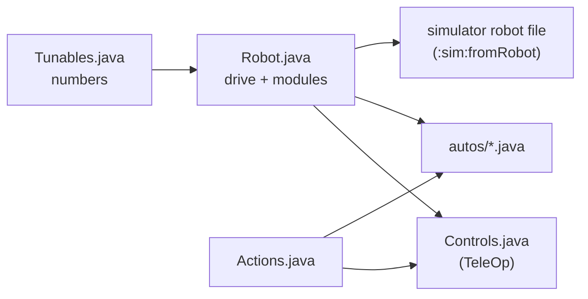

# Robot module (the robot in five files)

> **Work in progress:** this library and its docs are still changing. Something wrong or unclear? [Tell us](https://github.com/crossbotics/ftc-helper-lib/issues).

Package: `com.crossbotics.ftchelper.robot`

Learn it hands-on: [Lesson 1: The robot in five files](../tutorials/start/01-robot-in-five-files.md). Worked
examples: [`examples/.../gobildabot`](../../examples/src/main/java/com/crossbotics/ftchelper/examples/gobildabot)
(goBILDA's starter bot), [`flywheelbot`](../../examples/src/main/java/com/crossbotics/ftchelper/examples/flywheelbot)
and [`turretbot`](../../examples/src/main/java/com/crossbotics/ftchelper/examples/turretbot).
Quick answers with code to copy: the [cookbook](../cookbook.md) (driving, buttons, mechanisms, actions, autonomous).

A team's whole robot program in five files a student can read in one sitting. This is the
recommended way to use the library, and the one the main-track lessons teach: start with lesson 1
(above), or the [Quick start](../quick-start.md) for a driving robot in 30 minutes. Each mechanism
is a **module**: one line in `Robot.java` that brings its own numbers, buttons and autonomous steps.
Each file answers one question, so you always know where to look:

| File | Answers | Changes when |
| --- | --- | --- |
| `Robot.java` ([`RobotDefinition`](#robotdefinition)) | What is on the robot, and its name in the configuration? | a part is added, moved or renamed |
| `Tunables.java` | What are the numbers? | tuning (speeds, positions, PID, auto distances) |
| `Controls.java` ([`ControlMap`](#controlmap)) | Which button does what? (it is also the TeleOp) | the drivers change their minds |
| `Actions.java` ([`Action`](#action)) | Which steps use several parts together? | a new combo move |
| `autos/` ([`Auto`](#auto)) | What does the robot do on its own? | new or changed autonomous programs |

A new robot: `./gradlew :sim:newRobot -Pconfig=... -PteamCode=...` writes the five files from the
robot configuration ([below](#making-the-files)). A mechanism added later is one line in `Robot.java`:
its numbers, its standard buttons and its simulator lines come with it.



| Class | Use it to |
| --- | --- |
| [`RobotDefinition`](#robotdefinition) | describe the robot in `Robot.java`: `drive(...)` and one `add(...)` per mechanism |
| [`Drive`](#drive) | the drivetrain: mecanum or tank, motor names, motor, wheel, IMU |
| [`Odometry`](#odometry) | where the robot is on the field: a goBILDA Pinpoint, a SparkFun OTOS, or dead wheels |
| [`Intake`](#intake) | a roller on a motor and/or CR servos: in, out, on at the start |
| [`Lift`](#lift) | a slide on a motor with named heights and a bottom switch |
| [`Arm`](#arm) | an arm on a motor with named angles in degrees |
| [`Claw`](#claw) | a claw servo: open, closed |
| [`Wrist`](#wrist) | a wrist servo with named positions |
| [`Positioner`](#positioner) | any servo with named positions (deploy, fold, gate) |
| [`Turret`](#turret) | a turret inside its limits, by hand or following the camera's goal |
| [`Launcher`](#launcher) | a flywheel and its [`Indexer`](#indexer): spin up, fire, speed from distance |
| [`Indexer`](#indexer) | feeds one piece at a time (servo, CR servo or motor) |
| [`Camera`](#camera) | a Limelight or webcam; the alliance's goal |
| [`Pieces`](#pieces-and-piecesensor), [`PieceSensor`](#pieces-and-piecesensor) | which game piece is at a spot (colour sensor, distance sensor, second webcam); how many the robot holds and which fires next |
| [`Lights`](#lights), [`LightColor`](#lights) | a colored light for the drivers (goBILDA RGB Indicator Light or REV Blinkin): which color when |
| [`Action`](#action) | steps across several parts that never block (never make the loop wait) |
| [`Mode`](#modes) | a rule a module follows every loop while the mode is on |
| [`ControlMap`](#controlmap), [`Pad`](#controlmap) | `Controls.java`: the TeleOp and the button map |
| [`Auto`](#auto), [`Steps`](#auto) | one autonomous as a list of steps |
| [`Toggleable`](#controlmap) | anything one button switches on and off |
| [`Motors`](#motors) | look up the encoder counts and speed of common motors, by catalog id (a part's name in the [parts catalog](../guides/parts-catalog.md), e.g. `"gobilda-5203-312"`) |
| [`Shape`](#shapes-and-parts), [`Parts`](#shapes-and-parts) | how each part looks and where it sits, for the simulator; wheels, rollers and servos by catalog id |
| [`Module`](#module), [`MotorPositions`](#lift), [`ServoPositions`](#claw), [`Devices`](#module) | what the modules share (you rarely use these by name) |

---

## RobotDefinition

```java
public class Robot extends RobotDefinition {
    public Intake intake;
    public Lift lift;
    public Claw claw;

    @Override protected void define() {
        drive(Drive.mecanum("front_left", "front_right", "back_left", "back_right")
                .motor("gobilda-5203-312").wheelMm(96)
                .imu("imu", LogoFacingDirection.UP, UsbFacingDirection.FORWARD));
        intake = add(Intake.motor("intake"));
        lift = add(Lift.slide("lift").bottomSwitch("lift_bottom"));
        claw = add(Claw.servo("claw"));
        atStart(() -> Actions.deployIntake(this));   // optional: an action right after START
    }
}
```

`define()` only describes the robot. It runs in INIT, and also without a robot (to write the
simulator file). The OpMode classes make the hardware ([`setup`](#robotdefinition)) and update every
part each loop. Nothing moves in INIT.

| In `define()` | |
| --- | --- |
| `drive(Drive d)` | the drivetrain (required) |
| `odometry(Odometry o)` | optional: what tells the robot where it is on the field ([Odometry](#odometry)) |
| `follower(PathFollower.Maker m)` | optional: a path follower, e.g. `follower(Pedro.follower(...))` ([PathFollower](#pathfollower)); needs an `odometry(...)` line |
| `T add(T module)` | a mechanism; hands it back, so you can keep it in a field (`lift = add(...)`) |
| `atStart(Supplier<Action>)` | an action that runs once right after START, in autonomous and TeleOp |
| `tunables(Class)` | the Tunables class if it is not `Tunables` in the same folder |
| `chassisMm(l, w, h)`, `heightMm(h)`, `fixed(Shape...)` | for the simulator: the chassis box, the whole robot's height, parts the code does not move ([Shapes](#shapes-and-parts)) |

| For your code | |
| --- | --- |
| `run(Action)`, `cancel(Action)`, `cancelAll()` | start or stop actions |
| `alliance()` | this match's alliance (from autonomous's menu; TeleOp remembers it) |
| `notes()` | INIT notes: missing Tunables sections or fields (the library's defaults are used) |
| `modules()`, `drive()`, `all()` | the parts, the drivetrain, the update group |
| `pose()` | where the robot is now, from the odometry: a [`FieldPose`](util.md#fieldpose) (x in right, y in away from your wall, heading 0 = away, counterclockwise +); a copy; null with no odometry line |
| `odometry()`, `odometrySpec()`, `odometryChecked()` | the running [`PoseTracker`](odometry.md#posetracker) (null before `setup`), the odometry line as written, and `Tunables.Odometry.checked` |
| `follower()`, `hasFollower()`, `makeOdometry(hardwareMap)` | the running path follower (null before `setup`), whether there is a follower line, and the odometry alone for a tool (Pedro's tuners) |
| `robotConfig()` | the drive settings for `EasyTeleOp`/`EasyAuto` |
| `simLines()` | the simulator robot file's lines from the code |
| `setup(hardwareMap)` | makes every module's hardware (the OpMode classes call it in INIT) |
| `tunablesClass()` | the Tunables class found (null if none) |
| `static changedTunables()` | values tuned on the robot that differ from Tunables.java, as lines to copy back |
| `static sectionName(device)` | the Tunables section a device reads: "intake_deploy" -> `IntakeDeploy` |

Checked at INIT: a device name used twice, two parts reading the same Tunables section, an indexer
added twice. Each stops with the name.

### Tunables.java

```java
public class Tunables {
    public static class Drive { public static double maxPower = 1.0, practiceMaxPower = 0.6, slowSpeed = 0.3; ... }
    public static class Lift {
        public static double min = 0, max = 2600;            // the safe range (not tunable live)
        public static double kP = 0.004, kI = 0, kD = 0.0002, kF = 0.05;
        public static double down = 0, low = 900, high = 2400;   // named heights: any names
    }
    public static class Claw { public static double open = 0.20, closed = 0.75; }
}
```

- **One section per part**, named after its configuration name in CamelCase: `intake_deploy` reads
  `IntakeDeploy`. Pick another with `.tunables("Name")` on the module.
- **Sections for your own code** (no part reads them, like `Tunables.Auto` with the autonomous's
  distances): every `public static` number that is not `final` is in the tuning menu too
  ("Auto/parkInches"). The menu's value is written into the field, so your code reads
  `Tunables.Auto.parkInches` as usual. Tune it in the TeleOp, save it (A), run the autonomous: it
  uses the saved value from its INIT, with no rebuild. **Then copy the good value into
  `Tunables.java`** (INIT lists it): a value saved only on the hub is lost with a new Control Hub.
  True/false settings and tables stay as written.
- **The code is the record.** The numbers you tune most become [`Tunable`](tuning.md)s ("Lift/kP"):
  the tuning menu (PRACTICE profile, after START hold GUIDE 1 s) changes them and saves them on the Control Hub. INIT then
  shows "Tuned on this robot (copy into Tunables.java)" with the lines to copy back.
- **Missing numbers are not errors**, with one exception: the library's default is used and INIT
  says which. **The exception: a Lift or Arm must write `min` and `max`** (a safety limit never comes
  from a library default), and `max` must be more than `min`. Otherwise INIT stops:
  `Tunables.Lift has no max: write max (the top of the safe range, in counts: Motor Finder, B). A safety limit never comes from a library default.`
  (no section at all: `Tunables.java has no Lift section: ...`; an Arm's are in `deg`; `min` points
  to Motor Finder X). With `max` not above `min`: `Tunables.Lift: max (...) must be more than min (...)`.
  `min` and `max` must be `public static` numbers (`public static double max = 2900;`); not `public`, or
  not a number, and INIT stops with `Tunables.Lift.max must be a public static number (like "public static double max = 1000;"): ...`.
- **A name that looks like a setting stops INIT.** Every number that is not a known setting is a
  named position. So these field names stop INIT:
  - **Always:** a known setting with other capitals or an `_` added: `Max`, `MAX` or `MIN` for
    `max`/`min`, `kp`, `KP` or `k_P` for `kP`. (All capitals is a common habit: it stops too.)
  - **Only when that setting itself is not written:** for names of 5 letters or more, up to two
    letters off (`maxPowr` or `maxPwr` for `maxPower`). So `slowZone2` next to a written `slowZone`
    is a position, but `slowZon` with no `slowZone` stops INIT.

  The message: `Tunables.Lift.Max looks like "max" (capitals and spelling count). Fix the name in Tunables.java; a position must not look like a setting.`
  Before, it quietly became a position called `Max`, and `max` stayed the library default. The same
  check runs for Claw, Wrist and Positioner (their setting: `travelSec`).
- **Safety:** a tuned position stays inside `min`..`max`; limits are read once and cannot be tuned.
- `public static` fields: FTC Dashboard can show them too.
- The menu's names ("Lift/kP") are shared by the whole robot app: keep one Robot class per app.

| | In the tuning menu, used at once | In the tuning menu, used from the next INIT | Code only (read at INIT) |
| --- | --- | --- | --- |
| Drive | | every number | `calibrated` |
| Intake | `inPower`, `outPower` | | |
| Lift, Arm | `kP`, `kI`, `kD`, `kF`, every named position | | `min`, `max`, `maxPower`, `slowZone`, `slowZonePower`, `tolerance` |
| Claw, Wrist, Positioner | every named position | | `travelSec` |
| Turret | `kP`, `kI`, `kD` | | `min`, `max`, `maxPower`, `tolerance`, `slowZone`, `slowZonePower`, `cameraOffset` |
| Launcher | `speedRpm`, `stepRpm` | | `readyBandRpm`, `idleRpm`, `shotIntervalSec`, `speedByDistance`, `kP`..`kF` |
| Indexer | every number | | |
| Camera | | | `pipeline`, `autoLighting`, `lightingSettleMs`, `lightingPictures`, `lightingMinPictures`, `lightingAfterStartMs`; webcam `exposureMs`, `gain` |
| Odometry | | | `checked`, `linearScalar`, `angularScalar` (OTOS) |
| Your own sections (`Auto`...) | every number (a TeleOp reads the field each time) | an autonomous reads them when it builds its steps (INIT) | `final` numbers, true/false, tables |

---

## Drive

```java
drive(Drive.mecanum("front_left", "front_right", "back_left", "back_right")
        .motor("gobilda-5203-312").wheelMm(96).imu("imu", LogoFacingDirection.UP, UsbFacingDirection.FORWARD));
drive(Drive.tank("left_drive", "right_drive").reversed("right_drive"));
```

| Method | |
| --- | --- |
| `mecanum(fl, fr, bl, br)`, `tank(left, right)`, `tank(fl, fr, bl, br)` | the type and motor names |
| `motor(id)` | the drive motor's [catalog id](#motors) (default `gobilda-5203-312`; the other parts use `part(id)`) |
| `wheelMm(mm)`, `gearRatio(r)` | wheel diameter (default 96), motor turns per wheel turn |
| `wheel(id)` | the wheel by its [catalog id](#shapes-and-parts), e.g. `"gobilda-hogback-96"`: its diameter comes from the catalog |
| `wheelsAtMm(track, wheelBase)` | for the simulator: wheel centres side to side and front to back, mm |
| `reversed(names...)` | exactly these motors run reversed (default: the left side) |
| `imu(name, logo, usb)`, `noImu()` | the IMU and how the hub is mounted (default "imu", UP, FORWARD) |

`Tunables.Drive`: `maxPower`, `practiceMaxPower` (PRACTICE profile), `slowSpeed` (the slow trigger),
`strafeCorrection`, `turnKp`, `turnKd`, `moveMinPower`, and `calibrated` (autonomous refuses to run
until it is `true`: tune with the Drive Tuner first, [lesson 6](../tutorials/start/06-first-autonomous.md)).
The Drive Tuner and the Shot Tuner take the whole robot: `@Override protected RobotDefinition robot() { return new Robot(); }`;
every finder shows `Tunables.` lines to copy ([finders](finders.md)).

---

## Odometry

```java
odometry(Odometry.pinpoint("pinpoint").offsetsMm(-84, -168));   // in define(), after drive(...)
```

| Method | |
| --- | --- |
| `pinpoint(name)` | a goBILDA Pinpoint: `offsetsMm(xPodLeft, yPodForward)`, `podsSwingarm()`, `ticksPerMm(n)`, `reversed("x", "y")` |
| `otos(name)` | a SparkFun OTOS: `mountIn(forward, left, headingDeg)` |
| `threeWheels(left, right, perp)` | three dead wheels on encoder ports: `trackWidthIn(in)` (required), `perpForwardIn(in)` |
| `twoWheels(parallel, perp)` | two dead wheels and the drive's IMU: `parallelLeftIn(in)`, `perpForwardIn(in)` |

`Tunables.Odometry`: `checked` (set true after the Odometry Tuner; until then `driveTo` steps are
skipped on a real robot), and for an OTOS `linearScalar` and `angularScalar`. With it: `robot.pose()`
every loop, `driveTo` steps in [autonomous](#auto), and TeleOp starting where autonomous ended. The
odometry is updated first each loop, before every part. Everything, with sketches of the offsets:
[odometry module](odometry.md); hands-on: [lesson 7](../tutorials/start/07-odometry.md).

---

## PathFollower

The small plug a path-following add-on fills in, so the core library never needs that other library.
The [pedro module](pedro.md) is one: `follower(Pedro.follower(PedroConstants.foresight))` in `define()`,
then `follow(label, path)` steps in autonomous.

| Method | What it does |
| --- | --- |
| `follow(path, mirrorX)` | starts a path (mirrored for RED when routes are mirrored) |
| `isBusy()`, `cancel()`, `remainingIn()` | still going; stop now; inches left (for the "stuck" check) |
| `isReady()` | false while its pose source is not ready (the step then ends `NO_ODOMETRY`) |
| `check(path)` | at INIT: throws if it cannot follow this kind of path |
| `totalIn()`, `partNow()`, `parts(path)` | optional (they have defaults): the path's length, the part it drives now (from 1), how many parts a path has. [`PathAt`](#pathat) uses them; without them it takes the distance left at the start as the length, and `PathAt.part(n)` fires at the end |

It is updated every loop right after the odometry, and drives the wheels only while a path runs.
`remainingIn()` is for the WHOLE path (all its parts), so `PathAt.inchesLeft` and `fraction` are right.

### PathAt

Things to start ALONG a `follow` (or `driveTo`) step while the robot keeps driving. Each fires once.
Full page: [pedro module, Do things along the path](pedro.md#do-things-along-the-path).

| Method | Fires |
| --- | --- |
| `PathAt.inchesDone(in, label, command)` | after `in` inches of the path |
| `PathAt.inchesLeft(in, label, command)` | when `in` inches are left |
| `PathAt.fraction(f, label, command)` | when that much of the WHOLE path is done (0.5 = halfway, all parts counted) |
| `PathAt.part(n, label, command)` | where part `n` of a `then` path starts (INIT stops if the path has fewer parts) |
| `PathAt.near(x, y, withinIn, label, command)` | when the robot is within `withinIn` of a field point (mirrored for RED) |

For example `PathAt.inchesLeft(12, "Spin up", robot.launcher::spinUp)` (your own part names). Each also
takes an [Action](#action) from your `Actions.java` instead of a label and a command:
`PathAt.inchesLeft(12, Actions.scoreHigh(robot))`, or any action you wrote.

## Intake

```java
intake = add(Intake.motor("intake"));
intake = add(Intake.motor("intake").onAtStart());
intake = add(Intake.crServos("left_intake", "right_intake").reversed("right_intake"));
intake = add(Intake.motor("intake").withCrServos("left_wheel", "right_wheel").reversed("right_wheel"));
```

| Method | |
| --- | --- |
| `in()`, `out()`, `stop()`, `toggle()` | run in / out until stopped; on/off |
| `reverse()`, `endReverse()` | push out while a button is held, then back to what it was doing |
| `isRunning()`, `isPushingOut()` | running at all; pushing out now |
| `onAtStart()` | runs in from START until stopped |
| `holds(n)` | for the simulator: how many pieces it carries (default: a guess of 3) |
| `stopsWhen(condition)`, `isHeldBack()` | never runs IN while the condition is true (pushing out still works), e.g. `stopsWhen(() -> pieces.isFull())` ([Pieces](#pieces-and-piecesensor)) |

`Tunables.Intake`: `inPower` (1.0), `outPower` (0.7). Buttons: hold operator RT in, LT out; with
`onAtStart()`: RT switches it on/off, hold LT pushes out.

---

## Lift

[`MotorPositions`](#lift) is what Lift and Arm share: `goTo(name)` (capitals do not matter; a typo
shows a warning and does nothing), `stepUp()`, `stepDown()`, `manual(power)` (0 holds where it was
let go), `hold()`, `stop()`, `isAtTarget()`, `isAt(name)`, `position()`, `positions()`, `part()`
(the [`PositionMotor`](mechanism.md#positionmotor) inside), and `.reversed()` when positive power moves
it down. Every number but `min` and `max` has a default, so a part works before it is tuned; `min`
and `max` must be in `Tunables.java` (from the [Motor Finder](../guides/finders.md)), or INIT stops.

```java
lift = add(Lift.slide("lift").bottomSwitch("lift_bottom"));
```

`Tunables.Lift` (encoder counts): `min`, `max`, `kP`, `kI`, `kD`, `kF` (the steady push that holds it
up), `maxPower`, `slowZone`, `slowZonePower`, `tolerance`; every other number is a named height.
Buttons (operator): A lowest, Y highest (2 or more heights), X second (3 or more), D-pad up/down next height, left stick by hand.
With a bottom switch, the lift only goes down (slowly) until the switch has been pressed once, and the
switch sets 0. **Without one, 0 is wherever the lift is at INIT** (the encoder starts from there):
press INIT with the lift all the way down, also for TeleOp after an autonomous that left it up, or
`max` will be too high by that much. INIT reminds you.

## Arm

```java
arm = add(Arm.motor("arm", "gobilda-5203-117").gearRatio(2));
```

The same as Lift, in degrees (`gearRatio`: motor turns per arm turn; `bottomSwitch(name)` like the
lift's). 0 degrees is where the arm is
when the program starts. Button: operator right stick Y by hand.

---

## Claw

[`ServoPositions`](#claw) is what Claw, Wrist and Positioner share: `goTo(name)`, `isDone()` (it should
have arrived: a guess from `travelSec`), `isAt(name)`, `positions()`, `part()` (the
[`PositionServo`](mechanism.md#positionservo) inside), `reversed()`. In Tunables every number is a
named position (0 to 1) except `travelSec`. A servo does not move until the first command after START.

```java
claw = add(Claw.servo("claw"));       // Tunables.Claw: open, closed (both needed)
```

`open()`, `close()`, `toggle()`, `isClosed()`. Button: operator B opens/closes.

## Wrist

```java
wrist = add(Wrist.servo("wrist"));    // Tunables.Wrist: any positions, e.g. down, level, up
```

`next()`, `previous()` (by value). Buttons: operator D-pad left/right.

## Positioner

```java
intakeDeploy = add(Positioner.servo("intake_deploy"));   // Tunables.IntakeDeploy: stowed, deployed
```

`goTo(name)`, `next()`. No suggested buttons: use it from Controls.java or an action. For the simulator,
it swings an arm shape: `.looks(Shape.arm()...angle("stowed", 90).angle("deployed", 20))`, and can push a
passive part over (`Shape.dropsWhen`, [Shapes](#shapes-and-parts)).

---

## Turret

```java
turret = add(Turret.motor("turret", "gobilda-5203-117").gearRatio(5).follows(camera));
```

| Method | |
| --- | --- |
| `followMode()` | the [mode](#modes) that follows the goal (on from START with `follows` or `followsOdometry`) |
| `follows(camera)` | follows the camera's goal; with odometry and `Tunables.Aim.goalX, goalY` the odometry takes over while the camera does not see it ([Aim](#aim)) |
| `followsOdometry()` | follows the goal with no camera: from the odometry and `Tunables.Aim`'s goal point |
| `aimAt(deg)` | turn to an angle (stops following) |
| `manual(power)` | by hand; following pauses while the stick moves |
| `isAimed()`, `isOutOfRange()`, `angle()`, `part()` | |
| `aimErrorDeg()`, `aimSource()` | degrees from the goal now (NaN = unknown); where the goal came from (CAMERA, ODOMETRY, NONE) |
| `cameraOnBody()` | the camera is on the robot, not on the turret |

`Tunables.Turret`: `min`, `max` (degrees, counterclockwise +, 0 = forward: it never turns past them; a
goal outside waits at the limit and the Driver Station says "goal out of turret range"), `kP`, `kI`,
`kD`, `maxPower`, `tolerance`, `slowZone`, `slowZonePower`, `cameraOffset`. Buttons: operator right
stick X by hand, BACK following on/off. The Driver Station shows `turret: 12 deg following: camera`
(or `odometry`, or `no goal`: it holds where it points).

---

## Launcher

```java
launcher = add(Launcher.flywheel("launcher", "gobilda-5203-6000").feeder(Indexer.servo("indexer")));
launcher = add(Launcher.flywheel("launcher", "gobilda-5203-6000").feeder(Indexer.servo("indexer"))
        .speedFromDistance(camera).requireReady("turret aimed", () -> turret.isAimed()));
```

| Method | |
| --- | --- |
| `spinUp()`, `idle()`, `toggle()` | to the shot speed; back to `idleRpm` |
| `fire()`, `fire(n)` | spins up if needed, feeds as soon as it is at speed (gives up after 3 s, saying why) |
| `fireWhileHeld()`, `ceaseFire()` | for a held button: one shot, then the next as soon as it is fed; on release no more (a tap still fires its one shot) |
| `adjust(steps)` | speed +/- steps x `stepRpm` (not saved) |
| `speedMode()` | the [mode](#modes) that sets the speed from the distance to the goal |
| `speedFromDistance(camera)` | speed from the camera's distance; with odometry and `Tunables.Aim.goalX, goalY`, from the odometry's while the camera does not see the goal ([Aim](#aim)) |
| `speedFromOdometry()` | speed from the odometry's distance only (no camera) |
| `useTable(name)`, `nextTable()` | the shot table to use ("pollen" for `speedByDistancePollen`, case does not matter); the next one. A name with no table warns and keeps the one in use |
| `tableFrom(() -> name)` | let code (a game-piece sensor) choose: each time its answer changes to a table's name, that table is used; null, "NONE" and "UNKNOWN" change nothing |
| `tableFor(table, kinds...)` | which table some game-piece kinds use, e.g. `.tableFor("nectar", "RED_NECTAR", "BLUE_NECTAR")`; a kind named like a table ("POLLEN") needs no line |
| `startTable(name)` | the table at the start (default: `speedByDistance` if there is one, else the first by name) |
| `tableName()`, `tableNames()`, `tableField(name)`, `distanceIn()`, `distanceSource()` | |
| `isReady()`, `isShooting()`, `targetRpm()`, `part()` | |
| `requireReady(what, check)` | another check before each feed (e.g. the turret is aimed) |
| `spinAtStart()` | spins up at START (autonomous and TeleOp), ready for the first shot |
| `shotAngle(deg)` | for the simulator: which way a piece leaves, degrees up from the wheel shape's forward (the robot's forward for a wheel mounted level; 135 = up and out of the back) |

`Tunables.Launcher`: `speedRpm`, `stepRpm`, `readyBandRpm`, `idleRpm`, `shotIntervalSec`,
`speedByDistance` (`{{inches, rpm}, ...}`, blended between rows; with no goal in view the last speed
stays), or one table per game piece: `speedByDistancePollen`, `speedByDistanceNectar` (any names after
`speedByDistance`), and `kP`, `kI`, `kD`, `kF` (the hub's speed control; only used when `kF` is there: the
[Flywheel Finder](../guides/finders.md) finds them). Buttons (operator): LB spin up/down, RB fire one (hold: keep firing, `fireWhileHeld()` / `ceaseFire()` on release),
D-pad up/down speed (when free and no speed-from-distance), D-pad right the next shot table (two or more).

```java
public static double[][] speedByDistancePollen = {{24, 2200}, {48, 2550}, {72, 2900}};   // Tunables.Launcher
public static double[][] speedByDistanceNectar = {{24, 2400}, {48, 2800}, {72, 3200}};
// a button: g2.x.press(() -> robot.launcher.useTable("nectar"));   an action: .then(() -> r.launcher.useTable("nectar"))
```

The Driver Station shows `Shot table: POLLEN, 48 in (camera)` (`odometry`, or `last seen` while no
goal is seen); with one table, `Shot distance: 48 in (camera)`.

## Indexer

`Indexer.servo(name)` (Tunables: `rest`, `push`, `pushSec`, `returnSec`), `Indexer.crServo(name)` and
`Indexer.motor(name)` (`power`, `feedSec` per piece), `.reversed()`. Usually given to a launcher with
`.feeder(...)`; added on its own its button is operator RB (feed one). A servo indexer goes to `rest`
at START. Commands: `feedOne()`, `isBusy()`, `isJammed()`, `clearJam()`. `onFeed(runnable)` runs
your code each time a feed really starts (a [Pieces](#pieces-and-piecesensor) counter uses it to count
one piece out).

---

## Camera

```java
camera = add(Camera.limelight("limelight").goal("BLUE SCORING", "RED SCORING"));
camera = add(Camera.webcam("Webcam 1"));
```

`goal()` (the alliance's goal, or null), `target(name)`, `target(id)`, `source()` (the
[`TargetSource`](vision.md) inside). Tunables (Limelight): `pipeline`. It starts in INIT.

Venue lighting ([vision.md](vision.md#venue-lighting)): the camera tries a few settings in INIT and
keeps the one that sees the most AprilTags.

```java
camera = add(Camera.limelight("limelight").autoPipelines(0, 1, 2).goal("BLUE SCORING", "RED SCORING"));
camera = add(Camera.webcam("Webcam 1").autoExposure());          // auto, 3, 6, 12 ms; or autoExposure(6, 3, 12)
```

At INIT the Driver Station shows `limelight lighting: pipeline 2 (9 of 10 pictures saw tags)` (a
warning while no tag is seen), and the two lines that skip the test at this venue next time:

```java
public static double pipeline = 2;
public static boolean autoLighting = false;
```

Put them in `Tunables.Limelight` (change the `pipeline` line; add `autoLighting` if it is not there).
A webcam shows `public static double exposureMs = 6;` instead: a new line in its section.
`lighting()` gives the test itself. At START the test stops and keeps the best setting so far, so
have a tag in view at INIT. A camera missing from the robot configuration is a warning at INIT, not
a stop: the OpMode runs and the camera sees nothing.

Its optional Tunables (leave them out for the defaults):

| Number | Default | What it does |
| --- | --- | --- |
| `autoLighting` | true | false = skip the test: use `pipeline` (Limelight) or `exposureMs` and `gain` (webcam) |
| `lightingSettleMs` | 300 | wait after a switch before counting pictures (ms) |
| `lightingPictures` | 10 | pictures counted per setting |
| `lightingMinPictures` | 3 | pictures with tags a setting needs to count as good |
| `lightingAfterStartMs` | 0 | after START, how long to keep trying (ms); 0 = stop at START with the best so far. No targets while it tries |
| `exposureMs` (webcam) | -1 | a fixed manual exposure (ms) when the test is off; -1 = the camera's own |
| `gain` (webcam) | -1 | the gain for manual exposures; -1 = the camera's highest |

These are read once, in INIT. Changed one with the tuning menu? Copy the value back into
`Tunables.java`, or the robot uses the old one at the next INIT.

## Aim

Where the goal is, for everything that aims: `robot.aim()`. **The camera first; the odometry as a
backup.** While the camera sees the goal (a picture newer than 150 ms), that is used. When it does not,
and the robot has an [`odometry(...)`](#odometry) line and `Tunables.Aim.goalX, goalY`, the goal's
direction and distance come from where the robot is. A following turret, a launcher's speed from
distance, whole-robot aim and the aim buzz all use it.

```java
public static class Aim {                                   // Tunables.java (every line optional)
    public static double goalX = -58, goalY = 55;           // the goal on the field, inches (odometry backup)
    public static boolean mirrorForRed = false;             // BIOBUZZ: the field is turned, not mirrored
    public static double turnKp = 0.02, turnKd = 0.002, maxTurnPower = 0.5, minTurnPower = 0, toleranceDeg = 2;
    public static double cameraOffset = 0, rumbleDeg = 4;
}
```

The goal point uses `driveTo`'s numbers: seen from your drivers' wall, x inches right of the field's
centre line, y from the centre toward the far wall, written for BLUE. `mirrorForRed` (default true,
like autonomous): RED mirrors x; false for a field turned half a turn (the same numbers from the red
wall). Put the point where the camera measures to (the goal's tags), so one shot table fits both
distances. The odometry is only as good as its pose: autonomous's start spot, carried into TeleOp.

**Whole-robot aim** (no turret): one line in `Controls.java`. While it is on, the robot turns to face
the goal and the driver keeps forward and sideways; moving the turn stick still turns it by hand. Off
at START. `turnKp`, `turnKd`, `maxTurnPower`, `minTurnPower` (the least power that turns the robot),
`toleranceDeg` and `cameraOffset` are its numbers. The Driver Station shows `Aim: camera, 1.5 deg off  AIMED`.

```java
g1.rb.toggle(robot.aimMode()).says("aim the robot at the goal on/off").rumble();   // Controls.java
```

**The aim buzz**: `g2.rumbleWhenAimed();` buzzes that gamepad while the aim is within `rumbleDeg`, the
closer the stronger and longer (an [AimRumble](gamepad.md)). It follows a turret that is following, or
whole-robot aim; nothing while neither aims, or while paused.

| Method | |
| --- | --- |
| `goal()`, `source()` | the goal now (null if neither), and CAMERA, ODOMETRY or NONE |
| `fromOdometry()` | the goal from the odometry alone (a [TargetObservation](vision.md) with id `ODOMETRY`), or null |
| `hasGoalPoint()` | `Tunables.Aim` has `goalX` and `goalY` |
| `mode()` (= `robot.aimMode()`) | whole-robot aim |
| `errorDeg()`, `isAimed()`, `rumbleDeg()` | degrees off now (NaN = unknown); aimed (whole robot within `toleranceDeg`, or the following turret's `isAimed()`) |

---

## Pieces and PieceSensor

Which game piece is at a spot, how many the robot holds, and which one fires next.

```java
public Pieces pieces;                                             // at the top of Robot.java
pieces = add(Pieces.kinds("POLLEN", "RED_NECTAR", "BLUE_NECTAR")  // your kinds: also Tunables names
        .comingIn(PieceSensor.color("intake_color"))              // sees each piece come in
        .readyToFire(PieceSensor.color("ready_color"))            // optional: the next to fire
        .max(4)                                                   // BIOBUZZ G407: at most 4
        .startsWith(4, "POLLEN"));                                // the preload
intake = add(Intake.motor("intake").stopsWhen(() -> pieces.isFull()));   // no 5th piece
```

**How it counts.** Each new piece the intake sensor sees counts one IN, with its kind. Each feed of
an [`Indexer`](#indexer) (alone or in a launcher) counts one OUT, the oldest first (the robot fires in
the order the pieces came in). The ready sensor, if there is one, has the last word on the next
piece: it corrects the kind, and a piece it sees that was never counted is added.

| Method | |
| --- | --- |
| `count()`, `count(kind)` | how many it holds; of one kind |
| `next()` | the next to fire: a kind, `Pieces.UNKNOWN`, or `Pieces.NONE` (empty) |
| `nextIs(kind)`, `isFull()`, `isEmpty()` | true/false |
| `held()` | the list, next to fire first |
| `atIntake()`, `atReady()` | what each sensor sees now |
| `added(kind)`, `removed()`, `clear()`, `set(kinds...)` | change the count by hand (a claw, a button) |
| `nextKind()` | `next` as a `Supplier<String>`: for a part that asks every loop |
| `whenFull()`, `whenEmpty()`, `whenNextIs(kind)` | conditions (`BooleanSupplier`) for LEDs, `rumbleWhen`, `stopsWhen`, an action's wait |

**Hooks for other parts.** A shot table per kind, chosen by the next piece:

```java
launcher = add(Launcher.flywheel("launcher", "gobilda-5203-6000").feeder(Indexer.servo("indexer"))
        .speedFromDistance(camera)
        .tableFrom(pieces.nextKind())                          // the next piece picks the table...
        .tableFor("nectar", "RED_NECTAR", "BLUE_NECTAR"));     // ...both NECTAR colours use "nectar"
```

"POLLEN" uses the `pollen` table by its name; "NONE" and "UNKNOWN" keep the table in use, and a driver's
button still works until the next piece changes. LEDs: `robot.pieces.whenNextIs("POLLEN")` lights yellow, `whenFull()` lights "full".
No feed with nothing in: `Launcher...requireReady("a piece to fire", () -> !pieces.isEmpty())`.

**The sensors** (`PieceSensor`, one spot each; also alone: `add(PieceSensor.color("x").kinds("POLLEN"))`):

| Sensor | Part (checked 2026-10-21) | Tells apart | Cannot |
| --- | --- | --- | --- |
| `PieceSensor.color(name)` | REV Color Sensor V3, REV-31-1557 ($20.75): colour + distance 1-10 cm (Broadcom APDS-9151) | every colour: yellow POLLEN, red and blue NECTAR | see a piece more than ~5 cm away; mount it 1-2 cm from the piece |
| `PieceSensor.distance(name)` | REV 2m Distance Sensor, REV-31-1505 ($31.50): 5-200 cm, 1 mm resolution, 25° cone (VL53L0X) | sizes: a 3.6 in NECTAR is 20 mm bigger than a 2.8 in POLLEN | colours (red from blue NECTAR); read closer than 5 cm |
| `PieceSensor.camera(webcamName)` | a second UVC webcam, SDK `PredominantColorProcessor` | colours, from farther away | distance: "is one there" means "the box is colourful" (`minSaturation`); a grey background helps |

BIOBUZZ numbers (game manual TU01, section 9.8): POLLEN about 2.8 in (7.1 cm) yellow balls (AndyMark
am-5851_yellow), NECTAR about 3.6 in (9.1 cm) red or blue balls (am-5852_red, am-5852_blue); "not
perfectly spherical and may vary in size". G407: a robot may not CONTROL more than 4 at a time. G408:
never control the OPPONENT's NECTAR, so a team that picks up NECTAR needs colour, not only size.

**Tunables** (one section per sensor, named after its device: `intake_color` reads `Tunables.IntakeColor`):

```java
public static class IntakeColor {
    public static double POLLEN = 75, RED_NECTAR = 8, BLUE_NECTAR = 215;   // hues (degrees), from the Piece Tuner
    public static double nearMm = 40;                                      // a piece is there below this
}
```

| Number | Default | What it does |
| --- | --- | --- |
| one per kind (`POLLEN`) | none: that kind reads `UNKNOWN` until tuned (INIT says so) | colour sensor and camera: the kind's hue, 0-360 degrees; distance sensor: the mm it reads with that piece |
| `nearMm` | 40 (colour), 100 (distance) | a piece is there when the distance is below this |
| `hueTolerance` / `sizeToleranceMm` | 30 deg / 8 mm | how far from a kind's number still counts as that kind |
| `minSaturation` | 0.35 (camera), 0 (colour) | how colourful (0-1) it must be; a camera's "is a piece there" |
| `steadyMs` | 30 | a reading must stay this long before it counts (no flicker counts) |
| `gain` | the sensor's own | colour sensor only, optional: its gain |

Find them with the **Piece Tuner** ([`PieceTunerOpMode`](finders.md#piecetuneropmode)): it shows each
sensor's readings and writes the lines to copy into `Tunables.java`. Changed one with the tuning
menu? Copy it back into `Tunables.java`, or the robot uses the old one at the next INIT.

**A second webcam** with an AprilTag webcam: each camera gets its own VisionPortal; the colour camera
uses 320x240 pictures and no live view (the Driver Station can show one portal unless the code splits
the view with `VisionPortal.makeMultiPortalView`). Two webcams share the Control Hub's USB: plug them
into different USB ports (one is USB 3.0), or use a Limelight for the AprilTags. A camera that is
missing or fails to start warns and sees nothing; the OpMode goes on.

**Where to put the sensors.** The intake sensor where each piece passes once and is already held (past
the rollers), so a piece that bounces out is not counted, and the intake does not stop with a piece
half in. Pieces that touch each other pass as ONE piece unless they are different kinds: leave a gap
(a spacer, or a short indexer step). The ready sensor where the next piece waits; after each feed it
is trusted again once it has seen the slot empty.

Not done yet: the count does not carry over from the autonomous into the TeleOp (the TeleOp starts
with `startsWith(...)`; a ready sensor corrects an empty count). The simulator ([robot file](../guides/simulator.md#game-pieces):
`color.NAME = at=ready`, `distance.NAME = at=intake, acrossMm=150`) simulates colour and distance
sensors, not the camera.

---

## Lights

A colored light the drivers can see: green when the robot is ready to fire, red blinking when it is
jammed, a white flash for each piece fired, yellow in the last 20 seconds. **Why:** the drivers watch the robot,
not the Driver Station.

```java
lights = add(Lights.gobilda("light"));      // Robot.java: a goBILDA RGB Indicator Light ("Servo" in the configuration)
lights = add(Lights.blinkin("blinkin"));    // or a REV Blinkin LED Driver and its LED strip ("REV Blinkin LED Driver")
```

Which color when goes in `Controls.java`, inside `buttons(...)`: one line per rule. `Controls.java`
needs `import com.crossbotics.ftchelper.robot.LightColor;` at the top for the color names.

```java
robot.lights.show(LightColor.YELLOW).blinking().inLastSeconds(20);     // the most important first
robot.lights.show(LightColor.GREEN).when(robot.launcher::isReady);     // ready to fire
robot.lights.show(LightColor.BLUE).when(() -> robot.turret.followMode().isOn());   // a turret robot
robot.lights.show(LightColor.BLUE).when(() -> robot.aimMode().isOn()); // or: whole-robot aim on (no turret)
robot.lights.otherwise(LightColor.OFF);                                 // when no rule is true
robot.lights.show(LightColor.WHITE).whenCountGoesUp(() -> robot.launcher.part().getShotsFired());   // a 0.5 s flash per piece fired
```

| Method | |
| --- | --- |
| `show(color).when(test)` | that color while `test` is true |
| `show(color).blinking().when(test)` | blinks 2 times a second; `blinking(1)`: once a second (any number above 0, at most 5) |
| `show(color).whenStarts(test)` | a 0.5 s flash each time `test` turns from false to true (`.forSeconds(1)` first: longer) |
| `show(color).whenCountGoesUp(count)` | a 0.5 s flash each time the number goes up: `() -> robot.launcher.part().getShotsFired()` flashes once per piece fired (`fire(3)`: three flashes; `whenStarts(robot.launcher::isShooting)` would flash once for all three) |
| `show(color).inLastSeconds(20)` | in the last 20 s of TeleOp's 2:00, counted from START |
| `otherwise(color)` | when no rule is true (default `OFF`) |
| `flash(color)`, `flash(color, seconds)` | flash now, over every rule: from a button or an action step |
| `color()`, `showing()`, `isFlashing()`, `clearRules()` | the color the rules pick; what is lit this instant (OFF in a blink's dark half) |

- **The first true rule wins**, in the order written. A flash beats every rule while it lasts.
- **Any true/false works:** `robot.intake::isRunning`, a mode (`() -> robot.turret.followMode().isOn()`),
  or your own (`() -> robot.lift.position() > 1000`). A rule that fails counts as false and the Driver
  Station warns.
- It works from INIT (the drivers see it light up), goes dark at STOP, and is never "claimed" by an action.
- **At most one change every 0.1 s** (`Lights.MIN_CHANGE_SEC`): a rule that turns on and off every loop,
  or flash after flash, still switches the light at most 5 times on and off a second (R202 J below). A
  change asked for sooner waits a loop or two; a flash shorter than 0.1 s may not show.
- **Colors** (`LightColor`): `RED`, `ORANGE`, `YELLOW`, `GREEN`, `BLUE`, `PURPLE`, `WHITE`, `OFF`. Each
  light turns them into its own signal:

| LightColor | goBILDA position | Blinkin pattern |
| --- | --- | --- |
| RED | 0.280 | RED |
| ORANGE | 0.333 | ORANGE |
| YELLOW | 0.388 | YELLOW |
| GREEN | 0.500 | GREEN |
| BLUE | 0.611 | BLUE |
| PURPLE | 0.700 | VIOLET |
| WHITE | 1.0 | WHITE |
| OFF | 0.0 | BLACK |

The goBILDA numbers are from the seller's chart (3118-0808-0002, Product Insight #4, checked 2026-10-21):
off below 1100 microseconds, red to violet up to 1900, white above, with the hub's normal servo signal
(0 = 600, 1 = 2400 microseconds). RED and PURPLE sit a little inside that window (the chart's 0.277 and
0.722 are right on its edges). The Blinkin (REV-11-1105) uses the SDK's `RevBlinkinLedDriver`; with no
signal it shows its own rainbow "color waves".

**Game rules (2026-27 manual):** lights that flash faster than about 5 times a second (R202 J) or very
bright lights (R202 F) can be switched off by the referees, so `blinking` stops at 5 and the light never
changes faster than every 0.1 s. Your alliance color goes on the ROBOT SIGNS (R402); our advice: show it
on the signs, not with a light, so referees are not confused. Do not shine lights onto the field
(G302 example). In the simulator, the light is a dot on the robot and on the 3D view.

## Action

```java
public static Action scoreHigh(Robot r) {
    return Action.named("Score high")
            .then(() -> r.lift.goTo("high"))
            .waitUntil("lift at the top", r.lift::isAtTarget, 2.0)
            .then(r.claw::open)
            .waitSeconds(0.3)
            .then(() -> r.lift.goTo("down"));
}
// Controls.java:  g2.y.press(Actions.scoreHigh(robot));    an autonomous:  s.action(Actions.scoreHigh(robot));
```

| Method | |
| --- | --- |
| `named(name)` | a new action |
| `then(Runnable...)` | do these at once (several parts together), then go on |
| `waitSeconds(s)` | wait (the robot keeps running) |
| `waitUntil(what, condition, timeoutSec)` | wait until true; if it times out the action STOPS and says why |
| `waitUntil(condition, timeoutSec)` | the same, with "the condition" as its words |
| `name()`, `isRunning()`, `status()`, `result()` | "Score high: step 2 of 5 (lift at the top)"; "done", "cancelled", "stopped: Lift moved by hand" |

- **Never blocks:** an action does a little every loop.
- **Parts are claimed:** an action owns the parts it commands while it runs. Another action that
  commands one of them stops it ("taken by ..."); so does the driver moving it by hand (a button or a
  stick away from the middle): the driver always wins.
- **Press again to cancel** (a button bound with `press(action)`). A stopped action (cancelled, taken
  over, timed out) stops what it started, safely: a lift or arm holds its height, a turret its angle,
  shots still waiting are dropped, an intake stops. An action that finishes keeps its last commands.
  A failed action in an autonomous says why in the report.

## Modes

A [`Mode`](#modes) is a rule a module follows every loop while it is on: `Turret.followMode()`,
`Launcher.speedMode()`, `robot.aimMode()` ([whole-robot aim](#aim)). `on()`, `off()`, `toggle()`, `isOn()`; a button switches it with
`g2.back.toggle(robot.turret.followMode())`. Modes are for "always" rules, actions for steps that end.

---

## ControlMap

```java
@TeleOp(name = "TeleOp")
public class Controls extends ControlMap<Robot> {
    public static boolean oneDriver = false;   // true: everything on gamepad 1

    @Override protected void buttons(Robot robot, Pad g1, Pad g2) {
        g2.y.press(Actions.scoreHigh(robot)).says("score high");
    }
}
```

`Controls.java` is the TeleOp ([`EasyTeleOp`](teleop.md) underneath). Every module on the robot already
has its standard buttons; write only what differs. A [`Pad`](#controlmap) has every input by name:
`a b x y lb rb lt rt back start dpadUp dpadDown dpadLeft dpadRight leftStickButton rightStickButton`
(buttons; a trigger counts as pressed past half way) and `leftStickX leftStickY rightStickX rightStickY`
(sticks, up and right +).

| On a button | |
| --- | --- |
| `press(Runnable)` | once per press |
| `press(Action)` | starts it; press again cancels |
| `release(Runnable)` | once when let go |
| `hold(whileHeld)`, `hold(whileHeld, onRelease)` | every loop while held (and once on release) |
| `toggle(Toggleable)` | switches a part on/off (an intake, a launcher, a claw, a mode: a [`Toggleable`](#controlmap)) |
| `toggle(onEnable, onDisable)` | each press flips |
| `tapOrDoubleTap(tap, doubleTap)` | the "no waiting" double-tap: a tap runs `tap` at once; a second tap within 0.35 s (`Pad.DOUBLE_TAP_SEC`) runs `doubleTap` after it (the first tap has already run `tap`: e.g. tap = intake on/off, double-tap = push out). For a tap that must not run on a double-tap, use `tap(...).doubleTap(...)` (the tap waits 0.35 s) |
| `tap(job)`, `doubleTap(job)`, `taps(n, job)`, `heldFor(sec, job)` | **gestures**, several on one button: once per quick tap; on the second quick tap; on the n-th (2 to 5); once after held `sec` s. Each also takes an `Action` |
| `hold(...)` with other gestures | every loop while held, from 0.3 s on (`Tunables.Buttons.holdSec`), so a quick tap stays a tap |
| `tapThenHold(whileHeld)`, `tapThenHold(whileHeld, onRelease)` | a quick tap, then press again and hold: every loop while held |
| `with(other, job)` | a pair: hold this button (the shift key, no job of its own), press `other` (same gamepad): `job` once. `other` keeps its own job alone |
| `rumble()`, `rumble(n)` | feedback: buzzes when the job (or the gesture just before) runs; a toggle buzzes 2 = on, 1 = off |
| `slow()` | one driver only: on a trigger, drives slower the further it is pulled (down to `slowSpeed`); on a button, slow while held |
| `free()` | no job: the button stays free, even if a module suggested one for it |
| `says(words)` | the words on the help page |
| on a pad: `g2.rumbleWhen(test)`, `rumbleWhen(test, n)` | feedback from the robot: a buzz each time `test` becomes true |
| on a pad: `g2.rumbleWhenAimed()` | buzzes while the aim is close, the closer the stronger ([Aim](#aim)) |
| on a stick: `use(DoubleConsumer)` | its value every loop (small dead zone, gentle curve) |
| on a stick: `free()`, `says(words)` | as on a button |
| in `buttons(...)`: `show(label, value)` | your own value on the Driver Station, read again every loop, e.g. `show("Lift ticks", robot.lift::position);` or `show("Ready", () -> robot.launcher.isReady());`. Not shown while the tuning menu or the button map is open. `value` must not wait; an error in it shows as `error: ...` instead of stopping |

While the robot is paused (BACK), no button or stick job runs, with one exception: a hold's stop job
(the second job of `hold(job, stopJob)`) still runs when the button is let go, or when the pause starts
during a gesture's hold, so the part stays stopped. A gesture's job runs at once unless the
button has a longer gesture that starts the same way; then it waits until it knows (let go, or
`Tunables.Buttons.tapGapSec`, 0.35 s). Both times are in `Tunables.Buttons` (optional: leave it out for the defaults) and the tuning menu; copy
a tuned value back into `Tunables.java`.
Every option as a menu: [the button menu](../guides/buttons.md).

In `Controls.java` you can also override `useStandardButtons()` (return false: only your own jobs, no
module suggestions); `robot()` and `oneDriver()` read the robot and the one-driver switch.

**The standard map** (two drivers; with `oneDriver = true` the operator's buttons move to gamepad 1):

| Input | Gamepad 1 (driver) | Gamepad 2 (operator) |
| --- | --- | --- |
| Left stick | drive (and strafe) | lift by hand (Y) |
| Right stick | turn (X) | arm by hand (Y), turret by hand (X) |
| LT / RT | slow (the further, the slower) / free | intake out (hold) / intake in (hold, or on/off) |
| LB / RB | free | launcher spin up/down / fire one (hold: keep firing) |
| A / X / Y / B | free / free / field-centric on/off (mecanum) / free | lift lowest / second / highest / claw |
| D-pad up/down | free | lift next height, or launcher speed |
| D-pad left/right | free | wrist |
| BACK | tap: **pause** everything (stopped on brake), tap again: go on; hold 1 s: "forward" = away from you now (with odometry: its heading becomes 0, x and y stay) | turret following on/off (with a turret; else free) |
| START + BACK | debug lines | |
| GUIDE | tap: the button map, without the free buttons (during the match too); hold 1 s: the tuning menu (PRACTICE) | |

**One driver:** the left stick click switches slow on/off and the right stick click switches
field-centric. To put slow on a trigger instead, give it `.slow()`: `g1.lt.slow();` slows the robot
the further LT is pulled (down to `slowSpeed` at a full squeeze, like the two-driver LT). On a button,
`.slow()` is slow while held. Write the switch exactly as `public static boolean oneDriver = true;`
(INIT stops with a message if it is not static).

**Checked at INIT:** a module whose button is taken gets none (INIT notes it). Two jobs on one button
in Controls.java, or a job on a driving button, stop with the button's name. INIT shows the whole
map and the free buttons.

---

## Auto

```java
@Autonomous(name = "Score and Park", preselectTeleOp = "TeleOp")
public class ScoreAndPark extends Auto<Robot> {
    @Override protected void steps(Steps s, Robot robot) {
        s.start("Back wall, 2nd tile from the left, facing the field", 0)
         .menuYesNo("Score", true)
         .run("Hold the piece", robot.claw::close)
         .move("Leave the wall", 4, 0, 0.4)
         .onlyIf("Score")
             .run("Lift up", () -> robot.lift.goTo("high"))
             .move("Drive to the goal", 24, 0, 0.6)
             .waitUntil("Lift at the top", robot.lift::isAtTarget, 2.0)
             .run("Drop", robot.claw::open)
         .end()
         .parkWithSeconds(4)
         .move("Park", 20, 90, 0.7);
    }
}
```

What [`Steps`](#auto) can do:

| Step | |
| --- | --- |
| `start(where, headingDeg)` | where to place the robot (shown in INIT) and which way it faces |
| `start(where, xIn, yIn, headingDeg)` | the same, plus the spot in inches. The simulator puts the robot there in INIT (see below) |
| `menuYesNo(label, yes)`, `menuChoice(label, options...)` | a choice for the drivers in INIT |
| `onlyIf(label)` / `onlyIf(label, option)` ... `end()` | the steps in between run only for that choice |
| `isYes(label)`, `choice(label)` | read a choice |
| `move(label, inches, directionDeg, power)` | drive (0 forward, 90 right) |
| `turn`, `turnTo` | turn by an angle / to a heading |
| `driveTo(label, xIn, yIn, headingDeg, power[, toleranceIn][, PathAt...])` | drive to a field point and heading with the odometry, correcting all the way (mecanum; needs `Tunables.Odometry.checked` on a robot) ([driveTo](../guides/autonomous-builder.md#drive-to-a-field-point-driveto)); [`PathAt`](#pathat) starts things on the way |
| `follow(label, path[, timeoutSec][, PathAt...])` | follow a path with the robot's [path follower](#pathfollower) ([pedro](pedro.md)); [`PathAt`](#pathat) starts things along it |
| `run(label, command)` | start something and go on at once |
| `waitSeconds`, `waitUntil` | wait (the robot keeps running) |
| `action(action[, timeout])` | run an [Action](#action) and wait until it is done |
| `alongside(action)` | run an action during the next steps |
| `step(label, AutoStep)` | your own step |
| `parkWithSeconds(s)` | the steps after it get the last s seconds (see [Keep time to park](#keep-time-to-park)) |

**The spot in `start(where, xIn, yIn, headingDeg)`** is seen from your wall and written for BLUE:

- x = inches right of the centre line; y = inches from the centre toward the far wall (negative = your half).
- RED works like the routes: mirrored, or, on a turned field like BIOBUZZ with `mirrorForRed()` false,
  the same numbers seen from the red wall.
- Both alliances at one wall, like DECODE: override `alliancesOnOneWall()` to return true.
- With odometry, the first step ("Start") sets the pose to the spot (mirrored for RED the same way),
  and at the end the whole pose goes to TeleOp. Without a spot the pose starts at (0, 0).

The full guide, with every step and a tested example: [The autonomous builder](../guides/autonomous-builder.md).

### Keep time to park

Parking points come at the very end of autonomous, so the steps that park must never run out of time.
`parkWithSeconds(4)` in the list splits the steps in two:

- **The steps before it** (main steps) run while more than 4 s of the 30 s are left. When the 4 s mark
  comes, the step that is running stops at once (a move stops, a wait stops waiting), and the main
  steps not started yet are skipped.
- **The steps after it** (park steps) always run, until autonomous ends.

The report at the end (Driver Station, and TeleOp's INIT) says which main steps were "cut short (time
for park)" or "skipped (time for park)". Choose the seconds from a timed run: how long the park steps
take, plus about a second. Without `parkWithSeconds`, every step is a main step and nothing keeps time
for the end. It is [`EasyAuto`](../guides/easy-autos.md#time-for-parking)'s `thenPark()` and
`parkReserveSec()` in one call.

The steps are read twice: in INIT (for the menu and the start position; nothing runs) and after
START. Everything else is [`EasyAuto`](auto.md#easyauto): alliance and delay menu, mirroring for RED,
the timer, stopping everything, the report. When its steps are done it ends at once (even with time
left), so the Driver Station moves to its TeleOp; TeleOp's INIT shows the report and the alliance (or
lets the drivers choose it: X = BLUE, B = RED). Until `Tunables.Drive.calibrated` is true it says
"AUTONOMOUS IS OFF" and does nothing (in the simulator it runs anyway, with a warning).

---

## Shapes and parts

`Robot.java` can also say what each part IS (its catalog id) and how it LOOKS (a `Shape`). Then
`./gradlew :sim:fromRobot` writes the simulator robot file with no TODO shape guesses: the 3D view draws the robot,
the size rules are checked on it, and each shape moves with its part, so the simulator shows whether the
controls do what they should (the intake drops, the rollers spin, a piece is fired). Worked example:
[`flywheelbot/Robot.java`](../../examples/src/main/java/com/crossbotics/ftchelper/examples/flywheelbot/Robot.java).

**Name the part, give only what is not known.** A part in the [parts catalog](../guides/parts-catalog.md)
brings its numbers: a motor its speed and encoder counts, a servo its speed and range, a wheel or roller
its diameter (and width, when the seller gives it). Places are always the robot's own.

```java
drive(Drive.tank("left_drive", "right_drive").motor("gobilda-5203-312").wheel("gobilda-hogback-96")
        .wheelsAtMm(380, 290).reversed("right_drive"));
chassisMm(400, 400, 100);                     // the chassis box, mm
heightMm(300);                                // the whole robot

intakeDeploy = add(Positioner.servo("intake_deploy").part("gobilda-2000-torque")
        .looks(Shape.arm().name("kicker").atMm(150, 90, 100).sizeMm(60, 20, 15)
                .angle("stowed", 90).angle("deployed", 20)));
intake = add(Intake.motor("intake").part("gobilda-5203-1150").holds(3)
        .looks(Shape.arm().name("intake_arm").atMm(150, 0, 100).sizeMm(110, 200, 20)
                        .range(-15, 90).startAt(90).dropsWhen(intakeDeploy, "deployed", -15),
               Shape.roller("gobilda-gecko-48-rex").on("intake_arm").atMm(110, 0, 0).lengthMm(300)));
launcher = add(Launcher.flywheel("launcher", "gobilda-5203-6000").feeder(Indexer.servo("indexer").part("gobilda-2000-speed"))
        .looks(Shape.flywheel("gobilda-hogback-96").atMm(-40, 0, 170)).shotAngle(50));
fixed(Shape.box("tower").atMm(-90, 0, 40).sizeMm(50, 180, 260));
```

| On a part | |
| --- | --- |
| `part(id)` | the main motor's or servo's catalog id (a typo stops with the list of ids). A launcher's motor is in `Launcher.flywheel(name, id)`, the drive's in [`Drive.motor(id)`](#drive). On a CR servo the id is only a note (the simulator turns every CR servo at one speed) |
| `looks(Shape...)` | how it looks. Intake, Positioner, Launcher and Indexer take shapes; the others are drawn in the robot file ([simulator guide](../guides/simulator.md#robot-shapes)) |

| `Shape` | What it is | Moved by |
| --- | --- | --- |
| `roller(ids...)` | a cylinder; several ids (90 mm and 60 mm rollers taking turns) draw one as big as the biggest. In the simulator every roller of an Intake takes pieces in, and any roller drags the pieces it touches | spins with its part's motor or CR servo |
| `flywheel(id)`, `flywheel()` | a launcher wheel (no id: give `diameterMm` and `lengthMm`) | spins with the launcher's motor |
| `arm()` | swings about a hinge: `atMm` is the hinge, `sizeMm(length, width, thickness)` reaches forward at 0 degrees | a Positioner's servo (`angle(position, deg)` twice), or nothing (`passive`) |
| `slide()` | moves in a straight line along its axis (default up): `sizeMm` is one stage | nothing (`passive`, `travelMm`) |
| `box(name)` | does not move: `atMm` is the middle of its bottom | nothing |

| Setting | |
| --- | --- |
| `atMm(forward, left, up)` / `atIn` | from the middle of the chassis on the tiles, or from the hinge (or middle) of the shape it rides on |
| `sizeMm(forward, left, up)` / `sizeIn` | its box (not needed for a catalog roller or flywheel) |
| `lengthMm(mm)`, `diameterMm(mm)` | a roller's length along its axle (needed when the catalog has no width); a part not in the catalog |
| `axis(dir)` | `up`, `down`, `forward`, `back`, `left`, `right`: a roller's axle (`up` = lying flat), an arm's hinge |
| `on(part)`, `on("name")` | rides on another part's first shape, or on a shape by its name |
| `name(n)` | its name in the robot file (default: the part's name, then `name_2`...) |
| `angle(position, deg)` | an arm on a servo: its angle at a named position; give two (0 = level forward, +90 up) |
| `passive()`, `range(min, max)`, `startAt(deg)`, `travelMm(mm)` | moved by gravity or springs, not the code: drawn at its start, the size rules try its whole range (its hard stops) |
| `dropsWhen(servoPart, position, toDeg)` | a passive arm that a servo pushes over: once the servo is three quarters of the way to the position, it falls to `toDeg` and stays (a folded intake) |
| `note(text)` | where a number came from ("est.", "measured 2026-10-20"), written after the line |
| `color(c)` | its colour in the 3D view, e.g. `"#2fa84f"` |
| `tiltDeg(deg)` | mounted at an angle on its parent, about the left-right line (front up +): a spinner kept level on an arm that is down at -40 degrees has 40 |
| `soft()` | a soft roller (surgical tubing, flaps): it bends against the field, so in the simulator only game pieces touch it. It still counts for the size rules |
| `reversed()` | a roller that turns the other way from its motor (geared) |

Mistakes stop with the part's name: a typo in an id (with the known ids), a roller with no length, an
arm with fewer than two angles or an unknown position name (the names in `angle(...)` must be positions in
that part's Tunables section), shapes on a part that cannot take them, a setting that does not fit the
shape (`angle` on a passive arm, `range` on a servo arm, `travelMm` on anything but a passive slide,
`lengthMm` on a box or arm), riding `on` a part that has no shape, an intake whose looks have no roller,
one `Shape` given to two parts, two parts with one name in the robot file, and a `shotAngle` outside
0 to 180.
Lines without a shape stay as before: guesses marked TODO.

---

## Motors

`Motors.get("gobilda-5203-312")` gives `countsPerRev` and `freeRpm`; `Motors.all()` lists them. The ids
are the simulator's [parts catalog](../guides/parts-catalog.md) (a test keeps the two the same).

## Module

[`Module`](#module) is what every mechanism shares: `name()` (its Tunables section), `deviceName()`,
`tunables(section)`. [`Devices`](#module) is where modules find their hardware: `Devices.of(hardwareMap)`
on the robot; tests give pretend devices. A new kind of module is a change to the library (its parts are
package-private, see AGENTS.md); in team code, use the plain parts ([mechanism](mechanism.md)) in
your own class and call it from Controls.java and your autos.

**Pause** (gamepad 1 BACK in a Controls.java TeleOp, or `robot.pauseAll()` / `resume()` /
`togglePause()`, `isPaused()`): every part stops at once with its motors on brake, the wheels hold still, actions wait
(their time limits too), and the Driver Station says PAUSED. Going on, each part does what it did before
(an intake runs again, a lift goes on to its height, a launcher spins up again). STOP at the end of a
program (TeleOp or autonomous) brakes everything the same way.

**`stop()` on any module** switches it off now (a launcher fully off, until `spinUp()`/`fire()`), and
counts as the driver's command: an action using that part stops. To let a launcher coast while keeping
it ready, use `idle()`.

---

## Making the files

```bash
./gradlew :sim:newRobot -Pconfig=path/to/config.xml -PteamCode=../TeamCode
```

Writes `Robot.java`, `Tunables.java`, `Controls.java`, `Actions.java` and `autos/LeaveStart.java` from
the robot configuration (the XML file the Driver Station keeps on the Control Hub). Each device gets
its module from its name and type ("lift" is a Lift, a servo called "claw" a Claw, one called "light" or
"led" and a REV Blinkin are Lights); a goBILDA Pinpoint
or SparkFun OTOS becomes the `odometry(...)` line (offsets 0 and a `TODO` for the Odometry Tuner) with a
`Tunables.Odometry` section; every guess it is not sure of is a `TODO` in Robot.java. It never overwrites a file.

```bash
./gradlew :sim:fromRobot -PteamCode=../TeamCode
```

Writes (or refreshes) `simulator/robot.properties` from Robot.java and Tunables.java: every device
name, the drive, each module's lines (from its part and shapes when Robot.java gives them,
[Shapes](#shapes-and-parts)). Lines it writes end with `# from Robot.java`; your own lines
(measured, from photos or CAD) are kept. It stops if the file describes a device differently from
the code. See the [simulator guide](../guides/simulator.md#a-robot-file-from-robotjava).
